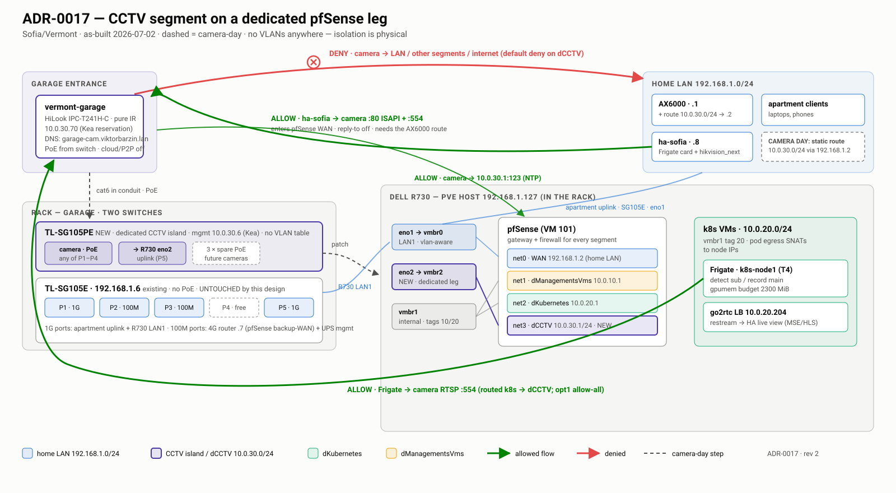
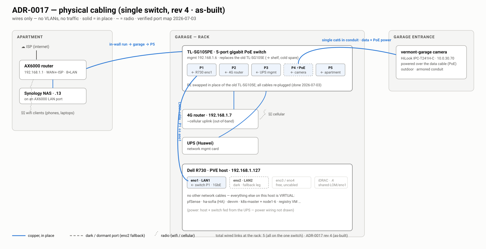
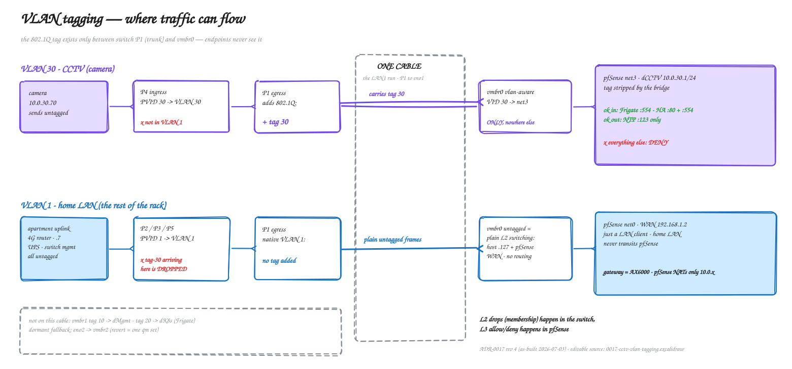

# CCTV segment: dedicated pfSense interface, VLAN-30 trunk on the LAN1 cable

Status: accepted (2026-07-02, rev 3 — single-switch). Current cabling: rev 5
(2026-10-26), see the last section.

*The two diagrams above show the rev 4 cabling (2026-07-03). The current
cabling is in the rev 5 section at the end of this ADR.*

The first owned camera at the Sofia/Vermont site (`vermont-garage`, HiLook
IPC-T241H-C at the garage entrance) needs to be network-isolated: its cable is
physically exposed outside the apartment, so anything plugged into that cable
must land in a segment that can reach nothing. The original design doc
(NAS: `Emo shared/Claude shared/2. spravochnici/garage-camera/`) called for an "802.1Q trunk
to pfSense" — but nothing in this network terminates dot1q on pfSense; the
site idiom is one vlan-aware Proxmox bridge → one tagged VM NIC → one clean
untagged pfSense interface per segment.

**Decision (rev 3):** ONE switch — the new TL-SG105PE **replaces** the old
garage TL-SG105E (Viktor prefers not running two switches; retired unit
becomes a cold spare, its 192.168.1.6 mgmt IP passes to the PE). Five ports,
all used: apartment uplink, 4G router 192.168.1.7, UPS mgmt (all untagged
VLAN 1), the camera (untagged VLAN 30, PoE), and the **trunk to R730 `eno1`
carrying home LAN untagged + CCTV tagged 30** over the existing LAN1 cable.
pfSense `net3` (vtnet3) sits on `vmbr0` with `tag=30` — exactly the site
idiom used for dManagementsVms/dKubernetes (bridge-level tag → clean untagged
vNIC; pfSense still terminates no dot1q itself). The earlier dedicated
`eno2`/`vmbr2` leg is kept **dormant as a fallback** (rev 2 wired it; moving
net3 back to vmbr2 restores pure physical isolation in one `qm set`).
This narrows the earlier 802.1Q objection rather than contradicting it: the
rejection assumed *unmanaged* switches, where any LAN device could inject
tagged frames; with the managed PE as the only device on eno1, VLAN-30
membership is {camera port, trunk port} only, so tag-30 ingress from every
other port — and from the exposed camera cable — is dropped or contained.
Cameras are untrusted: default-deny on dCCTV with a single
NTP-to-gateway exception; Frigate (k8s) pulls RTSP in; ha-sofia (192.168.1.8)
may reach ISAPI/RTSP directly; home-LAN clients route in via an AX6000 static
route (10.0.30.0/24 via 192.168.1.2). 10.0.30.0/24 is deliberately NOT in the
10.0.20.0/22 trusted source-IP allowlist.

## Traffic on the trunk — how one cable carries two networks

The LAN1 cable is shared, but the two networks on it diverge at `vmbr0`
(the vlan-aware bridge on the PVE host), and only ONE of them ever touches
pfSense:

- **Untagged (VLAN 1, home LAN)** is plain L2 bridging: vmbr0 switches it
  between the trunk, the host's own IP (192.168.1.127) and pfSense `net0` —
  where pfSense sits as an ordinary LAN *client* (WAN 192.168.1.2). The home
  LAN's gateway is and remains the AX6000; home-LAN traffic never transits
  pfSense. Consequently a pfSense (or R730 VM-level) outage does not affect
  the home LAN, and the apartment ↔ 4G-router ↔ UPS paths don't even leave
  the switch (the VLAN-1 access ports P2/P3/P5 bridge internally), so
  out-of-band recovery via the 4G router survives the whole rack being down.
- **Tagged 30 (CCTV)** has exactly one possible landing: vmbr0 delivers
  VID 30 only to pfSense `net3` (dCCTV, 10.0.30.1), which is the camera
  segment's gateway, firewall and sole exit. "Camera → AX6000 → internet"
  is impossible by construction, not merely by firewall rule.
- pfSense forwards *upstream* only its own segments (10.0.10/20/30), NATed
  out of its WAN toward the AX6000. Load-wise the trunk gained only the
  camera's ~8 Mbps — it already carried all rack-bound home-LAN traffic.

*(editable source: [`0017-cctv-vlan-tagging.excalidraw`](./0017-cctv-vlan-tagging.excalidraw) — open it in excalidraw to tweak)*

## Considered options

- **802.1Q over the LAN path behind an UNMANAGED switch** (the original plan
  read this way) — rejected: any LAN device could inject tagged frames into
  vmbr0 (`bridge-vids 2-4094`) and tag-passing through a dumb switch is
  undefined. Rev 3 adopts the tagged path ONLY because the managed PE now
  polices VLAN-30 membership at the single entry point to eno1; no bridge
  reconfiguration was needed (vmbr0 was already vlan-aware).
- **Dedicated physical leg (eno2 → vmbr2 → net3), one switch per role**
  (rev 1/2 as-built) — superseded by rev 3: it forced either a second switch
  (6 connections vs 5 ports once the PE also replaced the old switch) or new
  hardware. Strongest isolation of all options; kept dormant as the fallback.
- **AX6000 as the camera gateway** — rejected earlier in the design (consumer
  router, no inter-VLAN firewall).

## Consequences

- The switch is now single-point and load-bearing for everything in the rack
  (apartment uplink, pfSense backup-WAN via 4G, UPS mgmt, CCTV) AND its VLAN
  table + mgmt password are part of the isolation boundary — the Easy Smart
  mgmt UI answers on every port, so the password is the gate between a
  compromised camera and the switch config. All 5 ports are consumed: the
  next camera forces an 8-port PoE upgrade (the wiring plan already fits it).
- `eno2`/`vmbr2` stay cabled-ready but dormant (fallback to rev 2's physical
  leg); eno3/eno4 remain free.
- The old TL-SG105E is retired to cold spare; the PE inherits 192.168.1.6
  (Kea reservation by MAC).
- Revision history: rev 1 (2026-07-02) assumed one shared PE with a
  port-VLAN split (conflated the two devices); rev 2 split into two switches
  after inspecting 192.168.1.6 (old non-PoE SG105E, 4/5 ports used); rev 3
  consolidated back to one switch — the PE replacing the SG105E — per
  Viktor's preference, moving CCTV onto a managed tagged trunk; **rev 4
  (2026-07-03) is the as-built after the physical swap** — see the port map
  below.
- Frigate's ADR-0016 VRAM budget was bumped 2000 → 2300 MiB for the extra
  NVDEC stream.

## As-built port map (rev 4, verified 2026-07-03, superseded by rev 5)

After the physical swap, ports were assigned by a ping-burst counter test on
the live switch (NOT the illustrative left-to-right order the earlier
diagrams guessed — the R730 and apartment-uplink ports came out swapped):

| Port | Speed | Device | VLAN role |
|------|-------|--------|-----------|
| **P1** | 1 GbE | **R730 `eno1`** | **trunk — VLAN 1 untagged (PVID 1) + VLAN 30 tagged** |
| P2 | 100 M | 4G router `192.168.1.7` | VLAN 1 untagged |
| P3 | 100 M | UPS mgmt | VLAN 1 untagged |
| **P4** | 100 M | **camera (PoE)** | **VLAN 30 untagged, PVID 30** |
| P5 | 1 GbE | apartment uplink → AX6000 | VLAN 1 untagged |

Live 802.1Q table: `vids [1,30]`, `tagMbrs [0x0, 0x01]` (VLAN 30 tagged =
P1), `untagMbrs [0x17, 0x08]` (VLAN 1 = P1/P2/P3/P5, VLAN 30 = P4),
`pvids [1,1,1,30,1]`. The camera is live at `10.0.30.70` (Kea reservation),
streaming into Frigate as `vermont-garage`; VLAN 30 never touches the
apartment uplink (clean isolation). Camera config + activation details:
memory #7066 / #7123.

## As-built port map (rev 5, 2026-10-26)

During the 2026-10-23 outage (infra#142) the rack cabling no longer matched
rev 4: R730 `eno1` ran directly to AX6000 port 1 (an AX6000 reboot at
10:29:49 dropped eno1 carrier), and the switch's P1 was the uplink to AX6000
port 2. The same evening the spare LAN2 cable was brought into service for
uplink redundancy. The source of truth for the cabling is emo's Visio
`V4_Internal_IT_Topology_cables` (NAS: `Emo shared/Claude shared/2. spravochnici/schematics/vermont-network-topology/`).

| Device | Port | Connected to | VLAN role |
|--------|------|--------------|-----------|
| AX6000 | 1 | R730 `eno1` (LAN1), bond0 primary | home LAN; carries VLAN 30 tagged frames from port 2 |
| AX6000 | 2 | TL-SG105PE P1 | home LAN; carries VLAN 30 tagged frames |
| TL-SG105PE | P1 | AX6000 port 2 | VLAN 1 untagged + VLAN 30 tagged |
| TL-SG105PE | P2 | MR200 P1 | VLAN 1 untagged |
| TL-SG105PE | P3 | UPS mgmt `192.168.1.5` | VLAN 1 untagged |
| TL-SG105PE | P4 | camera (PoE) `10.0.30.70` | VLAN 30 untagged, PVID 30 |
| TL-SG105PE | P5 | R730 `eno2` (LAN2), bond0 backup | VLAN 1 untagged + VLAN 30 tagged (added 2026-10-23) |
| MR200 `192.168.1.7` | 2 | R730 iDRAC `192.168.1.4` | home LAN (moved from the switch's P5 on 2026-10-23) |

Live 802.1Q table (read 2026-10-26): `vids [1,30]`, `tagMbrs [0x0, 0x11]`
(VLAN 30 tagged = P1 and P5), `untagMbrs [0x17, 0x08]`, `pvids [1,1,1,30,1]`.

On the host, `vmbr0` now sits on `bond0` (active-backup, `eno1` primary, ARP
monitoring against `192.168.1.1` and `192.168.1.13`), and `vmbr2` was removed,
so the dormant physical fallback leg described in rev 2 to rev 4 no longer
exists. With `eno1` active, camera frames travel P4 → P1 → AX6000 port 2 →
AX6000 port 1 → `eno1`; after a failover they travel P4 → P5 → `eno2` and stay
on the switch. A failover test on 2026-10-24 (SRV1 cable pulled for about 8
minutes) kept the camera streaming on the backup path.

Other changes since rev 4:

- The MR200 has no SIM card and no 4G uplink, so there is no backup WAN
  through it. It is a switch with DHCP off; it is on the UPS.
- All five switch ports and MR200 ports 1 and 2 are in use; MR200 ports 3 and
  4 are free.

Open question: rev 3's isolation argument relies on the managed switch being
the only device in front of `eno1`, so that VLAN 30 membership is enforced at a
single entry point. With `eno1` on the AX6000, which passes VLAN 30 tagged
frames from port 2 to port 1, frames tagged 30 from other AX6000 LAN ports are
likely to reach `vmbr0` and pfSense `net3` too (not tested). Whether that is acceptable, or
whether `eno1` should move back behind the managed switch, is for Viktor to
decide.
