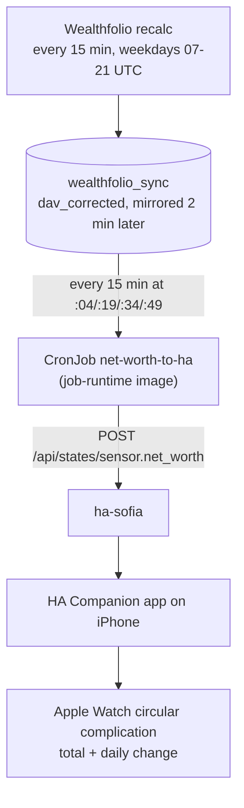

# ADR-0034: Net worth reaches the Apple Watch through a ha-sofia sensor

- Status: accepted
- Date: 2026-10-15
- Amended: 2026-10-28, intraday updates (decision 4)
- Related: `stacks/wealthfolio/net_worth_to_ha.tf`, `stacks/wealthfolio/files/net_worth_to_ha.py` (with tests), `images/job-runtime/Dockerfile`, Grafana dashboard `wealth` ("Net worth (current)" tile)

## Context

Viktor wants a daily look at his net worth on his Apple Watch (Series 12, paired
with an iPhone): the total and the day's change, glanceable on the watch face.

What exists today:

- Wealthfolio holds the accounts. A pg-sync sidecar mirrors its SQLite into the
  `wealthfolio_sync` Postgres database every hour at :07, and the
  `dav_corrected` view publishes one row per account per day in GBP.
- The `wealthfolio-daily-sync` CronJob (16:00 UTC) is what creates each day's
  valuation rows. It runs after the UK close and in the middle of the US
  session, so US holdings carry an intraday price that the next day's run
  revises. Its schedule serves a "Grafana fresh by 6pm BST" target.
  (Superseded by decision 4's amendment.)
- Weekend rows exist and carry Friday forward, moving by a few pounds of FX.
- The Grafana `wealth` dashboard is admin-only.
- Viktor's iPhone runs the Home Assistant Companion app, registered with both
  ha-sofia and ha-london. The Companion app renders watch complications from
  Jinja templates over HA entities and refreshes them roughly every 15 minutes
  while the face is showing.
- The cluster already pushes sensors into ha-sofia through `POST /api/states`
  (`tuya-bridge/saksii-poller`).

Options considered: an HA Companion complication, a daily ntfy push, and a
native watchOS app. A native app signed with a free Apple ID expires every
7 days, and keeping it running needs a paid developer account, which the
zero-cost rule rules out. A push notification does not stay on the face. The
Companion app is already installed and needs no new account.

## Decision

1. **Path.** A CronJob in the wealthfolio stack (`net-worth-to-ha`, every
   15 min at :04/:19/:34/:49, after the mirror) reads `dav_corrected` and POSTs
   `sensor.net_worth` to ha-sofia. ha-sofia was chosen for the existing push
   pattern and its 30-day recorder.
2. **Total.** The sum, over every account in `accounts`, of its last-known
   value on the latest valuation date. This is the Grafana "Net worth
   (current)" figure. Using each account's last-known value means an account
   whose row lands late stays in the sum.
3. **Daily change.** The total on the last weekday minus the total on the
   weekday before it, both from the data. Saturday, Sunday and Monday before
   the recalc show Friday's move. A market-holiday weekday shows roughly £0
   (FX only).
4. **Snapshot timing.** Amended 2026-10-28. The original decision kept the
   16:00 UTC recalc, so on a weekday morning the watch showed only the FX
   move on the US holding (£112 on 2026-10-28, when the market move was
   larger). `wealthfolio-daily-sync` now runs every 15 min, 07:00-21:45 UTC on
   weekdays, the pg-sync sidecar mirrors 2 min after each run, and
   `net-worth-to-ha` pushes 2 min after that. The watch is at most about
   20 min behind Yahoo's price, plus the Companion app's own ~15 min
   complication refresh. Nights and weekends rely on Wealthfolio's internal
   6-hourly recalc.
5. **Watch face.** A circular complication built in the Companion app's
   complication builder (Settings → Companion app → Complications, app
   2026.9.3), source Template, server ha-sofia. Two lines, no gauge and no
   icon: the total in the Value slot, rounded (`£1.48M`), and the change in
   the Title slot under it (`▼£4.2k`, `▲£640` under £1k, `±£0` when flat).
   The text colour comes from
   `change_color` through the builder's Text color template, and it applies
   to both lines. The sensor carries both strings preformatted as
   `total_short` and `change_short`, so the templates only read attributes.
   A corner slot was tried first, but its curved text renders smaller than
   the circular slot's flat text.
6. **Staleness.** When the latest valuation is more than 3 days old the change
   reads `—` and `change_color` turns grey, so an old number is not mistaken
   for today's. No separate alert.
7. **Runtime.** The job runs on `ghcr.io/viktorbarzin/job-runtime`, which
   gains `postgresql-client`, so the pod installs nothing on start. The ha-sofia
   token comes from its canonical Vault entry (`secret/openclaw`,
   `skill_secrets.home_assistant_sofia_token`) through an ExternalSecret.

### Sensor contract

The example values are illustrative.

`sensor.net_worth`, state = total in whole GBP, attributes:

| Attribute | Example | Meaning |
|---|---|---|
| `total_short` | `£1.48M` | Top line of the complication |
| `change` | `-4210.55` | Daily change in GBP, `null` with fewer than two weekdays of data |
| `change_short` | `▼£4.2k` | Bottom line of the complication, shown without `£` |
| `change_color` | `#FF3B30` | Green up, red down, grey flat or stale |
| `as_of` / `compared_to` | `2026-10-15` / `2026-10-14` | The two weekdays compared |
| `latest_valuation` | `2026-10-15` | Newest row in `dav_corrected` |
| `stale` | `false` | Latest valuation older than 3 days |

## Consequences

- The total is visible on the watch face to anyone nearby, at the rounded
  precision chosen for that reason.
- Net worth history now also lives in ha-sofia's recorder (30 days).
- A state set through `/api/states` does not survive an HA restart. The
  15-min run restores it within 15 minutes.
- On weekdays the watch and the Grafana tiles carry intraday prices, and
  today's change is measured against yesterday's close.

## Setup notes

Answers to the open questions this ADR started with, found while setting it
up on the watch:

- Server. A template complication has its own Server picker, which
  pre-selects the first server. With the other server selected, the templates
  rendered `None None`. Choosing ha-sofia fixed it, so the job does not need
  to push to ha-london.
- Colour. Each colour in the builder (gauge, icon, text) has its own template
  row. `change_color` belongs in the Text color row.
- The Title slot holds its own template, separate from the Display name
  template. The phone's preview leaves such a slot blank, but the watch
  renders it
  ([home-assistant/iOS#5844](https://github.com/home-assistant/iOS/issues/5844)).
- The watch keeps its own copy of each complication. After an edit, the
  Reload Complications button in the Complications list sends the new
  version to the watch. Until then the watch renders the old one.
- The CrowdSec AppSec rules in front of ha-sofia return 403 for a template
  containing `replace('£', '')`, so the templates avoid `replace`. The other
  templates here pass.
- Faces that tint their complications show `change_color` as the face's own
  tint. The colour shows on full-colour faces.
- The legacy complications screen does not refresh its complications
  ([home-assistant/iOS#5830](https://github.com/home-assistant/iOS/issues/5830)),
  so this uses the builder.
