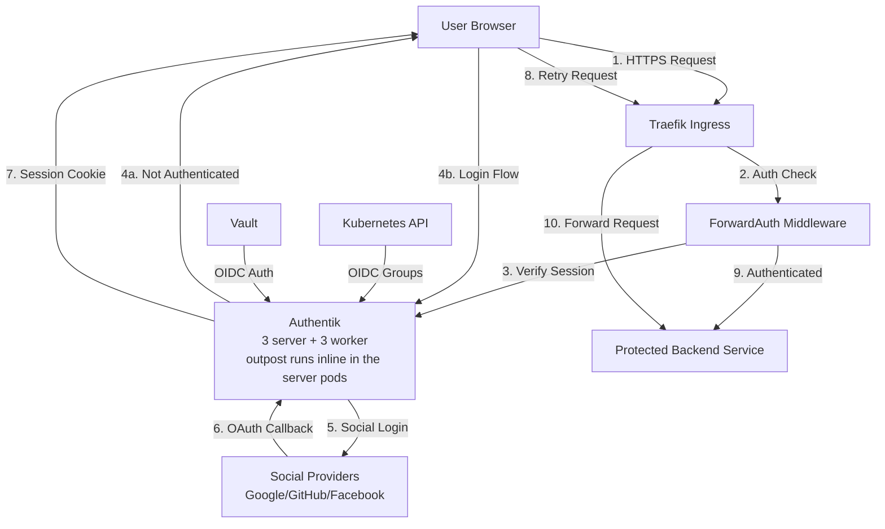
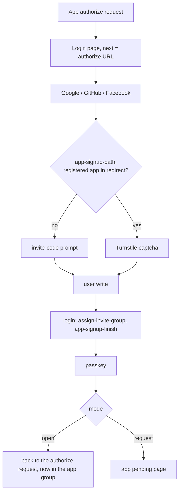

# Authentication & Authorization

## Overview

The homelab uses Authentik as a centralized identity provider (IdP) for all services, providing single sign-on (SSO) via OIDC and forward authentication for ingress protection. Authentik integrates with social login providers (Google, GitHub, Facebook), manages user groups and RBAC policies, and enforces authentication at the Traefik ingress layer. The system supports both human authentication (OIDC SSO) and service-to-service authentication (Kubernetes SA JWT for CI/CD).

## Architecture Diagram



## Components

| Component | Version | Location | Purpose |
|-----------|---------|----------|---------|
| Authentik Server | 2026.8.3 | `stacks/authentik/` | Core IdP application servers (3 replicas) |
| Authentik Worker | 2026.8.3 | `stacks/authentik/` | Background task processors (2 replicas) |
| PgBouncer | v1.25.2-p0 (Renovate proposes bumps) | `stacks/authentik/` | PostgreSQL connection pooler (3 replicas) |
| Embedded Outpost | - | Standalone deployment, managed by Authentik | Forward auth endpoint for Traefik (2 replicas, PG-backed sessions) |
| Public Outpost | - | `stacks/authentik/guest.tf` | Anonymous-binding outpost backing `auth = "public"` (1 replica) |
| LDAP Outpost | - | `stacks/authentik/postgres-ldap.tf` | Prepared for Postgres `ldap` auth. **0 replicas, inert** |
| RAC Outpost | - | `stacks/authentik/rac.tf` | Prepared for SSH/RDP/VNC. **0 replicas, inert** |
| Traefik ForwardAuth | - | `modules/kubernetes/ingress_factory/` | Middleware attached when `auth = "required"` or `"public"` |
| Vault OIDC Method | - | `stacks/vault/` | Human SSO authentication to Vault |
| Vault K8s Auth | - | `stacks/vault/` | Service account JWT authentication |

## How It Works

### Forward Authentication Flow

Services pick an auth tier via the `auth` enum on the `ingress_factory` module (default `"required"`, fail-closed):

| Tier | Effect | When to use |
|------|--------|-------------|
| `"required"` | Authentik forward-auth gates every request | Backend has no own user auth — Authentik is the only gate |
| `"app"` | No Authentik middleware; backend's own login is the gate | Backend handles its own user auth (NextAuth, Django, OAuth, bearer-token API) |
| `"public"` | Authentik anonymous binding via `public` outpost | Audit trail without gating; only works for top-level browser navigation |
| `"none"` | No Authentik middleware at all | Anubis-fronted content, webhooks, OAuth callbacks, native-client APIs (CalDAV, WebDAV, Git) |

When `auth = "required"`, an unauthenticated request flows:

1. Request hits Traefik ingress
2. ForwardAuth middleware calls the `auth-proxy` nginx (basicAuth fallback when Authentik is down), which proxies over a keepalive connection pool to `ak-outpost-authentik-embedded-outpost`. Since 2026-09-19 that Service selects the goauthentik-server pods, because the embedded outpost runs inline inside them rather than as its own Deployment. The Service is Terraform-owned with a pinned ClusterIP: nginx OSS resolves the name once at startup, so an address change would otherwise leave it dialling a dead one until the connect timeout dropped every forward-auth host onto the basicAuth fallback
3. Authentik checks for valid session cookie (domain-level `authentik_proxy_*` cookie on `.viktorbarzin.me`, 4-week validity — one cookie covers all forward-auth apps)
4. If missing/invalid, redirects to Authentik login page (authentik.viktorbarzin.me)
5. User authenticates on a **single screen**: username + password together (the identification stage embeds the password stage), or a social provider button (Google/GitHub/Facebook), then MFA validation
6. Authentik creates session, sets cookie, redirects back to original URL. The outpost rebuilds that URL from the `X-Forwarded-Proto`, `-Host` and `-Uri` headers Traefik sends, and `auth-proxy` passes Traefik's scheme through. Before 2026-10-03 it sent its own `http` instead, so every post-login redirect went to `http://<host>/`. A browser tab follows the 301 to https and the hop goes unnoticed. An installed iOS web app opens out-of-scope pages in a sheet and hands the sheet back to the app when a redirect lands inside the app's scope, which `http://` is not. On 2026-10-03 the health PWA signed in inside the sheet and then stayed there, running the app. Installed PWAs need this redirect to be `https`.
7. Subsequent requests include session cookie, pass auth check, reach backend

An installable app behind forward-auth also needs its icons and web manifest carved out with `auth = "none"`, because OS icon fetchers (iOS Add to Home Screen, macOS Add to Dock, Android install) send no session cookie and otherwise receive the login page. `module.ingress_icons` in `stacks/health` is the reference: it sets `traefik.ingress.kubernetes.io/router.pathmatcher = "Path"` so each listed file is an exact match (Traefik's default for an Ingress path is a string prefix, so `/apple-touch-icon.pngX` would otherwise skip Authentik too), and it attaches `traefik-strip-auth-headers` so a client cannot send its own `X-authentik-*` identity to the app. Each carve-out has an entry in the walling-off probe. An app that runs its own sign-in (`auth = "app"`, as `stacks/tasks` does since its 2026-10-16 cutover to the TypeScript build) serves its icons without a session and needs no carve-out.

Authentik adds authentication headers (user, email, groups) to forwarded requests. These headers are stripped before reaching the backend to prevent confusion.

### First-time signin performance (2026-06-10)

Signin latency is dominated by screen count and round trips, not server time
(DB avg 1.6ms). Standing decisions:

- **Single-screen login**: the identification stage carries `password_stage`,
  so username+password is one round trip. The separate password-stage binding
  was removed from `default-authentication-flow` (required by authentik when
  embedding). Pinned in TF: `authentik_stage_identification.default_identification`.
- **Implicit consent everywhere**: all OIDC providers are first-party, so none
  use the explicit-consent flow (it re-prompted every 4 weeks per app).
- **Live tuning via `server.env`/`worker.env`** (the `authentik.*` Helm values
  are inert due to `existingSecret`): 3 gunicorn workers, 30m flow-plan cache,
  15m policy cache, gunicorn `max_requests=10000`/jitter=1000 (recycle
  hardening — decorrelates the 9 workers' recycles from PG blips). **No
  `CONN_MAX_AGE`** — persistent Django connections pin a PgBouncer server conn
  1:1 and saturate the session-mode pool (reverted 2026-06-10).
- **Static assets cached immutable**: `/static` ingress carve-out adds
  `Cache-Control: public, max-age=31536000, immutable` (assets are
  version-fingerprinted; authentik itself sends no max-age).
- **Rate-limit carve-out** (2026-06-28): `/` and `/static` use a dedicated
  `authentik-rate-limit` (100/1000) instead of the shared 10/50 default — the
  login SPA cold-loads ~70 flow-executor chunks from `/static`; the default
  burst 429'd the tail and a failed ES-module import left a blank login screen.
- **Readiness tolerance** (2026-06-28): server `readinessProbe.failureThreshold:8`
  (~80s, was the chart-default ~30s). The probe (`/-/health/ready/`) queries the
  DB; too-tight tolerance let a sub-60s PG/pgbouncer transient return 503 on all
  3 server pods at once → Traefik had no healthy backend → 502/503/504 (episodic
  blank login + 30s hangs). 80s absorbs a full CNPG failover reconnect. Sessions
  + cache are PostgreSQL-only since Redis was removed in 2026.2 (no external-cache
  option), so request-serving is coupled to PG — this survives a short transient,
  not a total CNPG outage.
- **Rolling-update strategy** (2026-06-28): the chart key is `deploymentStrategy`
  (the repo's old `strategy:` key was silently inert → live ran the chart-default
  25%/25% and dropped a server pod out of rotation on every roll). Now
  `maxSurge:1/maxUnavailable:0` keeps all 3 ready throughout a roll.
- **Old-browser login (SFE)** (2026-06-28): authentik's modern flow SPA is ES2022
  and renders a **blank login** on Safari/WebKit ≤16.3 (every iOS browser shares
  the system WebKit, so it's not browser-choice — e.g. iPadOS ≤15). The overlay
  image patches `flows/views/interface.py::compat_needs_sfe()` to also serve
  authentik's built-in no-JS **Simplified Flow Executor** (SFE, ES5) to old Safari
  **and any iOS browser** (Chrome/Firefox on iOS are WebKit skins) on iOS ≤16.3,
  so those clients get the *real* authentik login (password + MFA + reputation —
  no auth downgrade). The SFE can't render Identification-stage **sources**
  (authentik limitation), so the patch also injects static social-login `<a>`
  links into `flow-sfe.html` (→ `/source/oauth/login/<slug>/`, plain redirects) —
  required for password-less accounts (e.g. Google-only users). A Traefik
  basic-auth fallback was rejected: it would have put a single spoofable-UA
  password in front of `vbarzin→wizard` (passwordless root on the devvm). See
  `stacks/authentik/patch-compat-sfe.py`.
- **SFE + forced-WebAuthn MFA gotcha** (2026-06-28): the `default-authentication-flow`
  MFA stage (`not_configured_action=configure`, `conf_stages=[webauthn]`) force-enrols
  a WebAuthn passkey for any **password**-path user with no MFA device — but the SFE
  **cannot render WebAuthn** (enrol *or* validate), so that user gets
  `unsupported state: ak-stage-authenticator-webauthn`. Two escape hatches, **no MFA
  downgrade**: (1) **social login** — sources run `default-source-authentication`
  (UserLoginStage only, **no MFA stage**), so the SFE's "Continue with <provider>"
  button always completes; (2) **enrol TOTP** — the SFE *can* validate TOTP codes, and
  ≥1 confirmed device flips the stage from force-enrol to validate. User MFA devices are
  runtime data (not Terraform): enrol via `ak shell`
  (`TOTPDevice.objects.create(user=…, confirmed=True)`) and store the secret in the
  user's own Vaultwarden item. (Done for emo — the Google-only iPadOS-15 case: TOTP in
  his `authentik.viktorbarzin.me` Bitwarden item; e2e-verified the BW code is accepted.)
- **Outpost**: 2 replicas, `log_level=info` (was 1 replica at `trace`).
- **auth-proxy nginx**: upstream `keepalive 32` + HTTP/1.1 — no per-request
  TCP setup on the forward-auth subrequest path.

**Anti-exposure guard**: every `auth = "app"` or `auth = "none"` line MUST have a preceding `# auth = "<tier>": <reason>` comment documenting what gates the backend (for `"app"`) or why the endpoint is intentionally public (for `"none"`). The convention is enforced by `scripts/check-ingress-auth-comments.py`, which `scripts/tg` runs on every `plan/apply/destroy/refresh` and blocks the terragrunt invocation if violated. Stack-scoped — each stack documents itself.

### Social Login & Invitation Flow

All new users must use an invitation link to register. The invitation-enrollment flow:

1. **invitation-validation** - Validates invitation token
2. **enrollment-identification** - Social login (Google/GitHub/Facebook) + passkey registration
3. **enrollment-prompt** - Collect name/email
4. **enrollment-user-write** - Create user account
5. **enrollment-login** - Auto-login after creation

Group membership is auto-assigned from the invitation's `fixed_data` field. This prevents open registration while maintaining SSO convenience.

**Google social signup is a special case (2026-07-25, `stacks/authentik/google-social-signup.tf`).** An Authentik invitation lives in the flow *plan*, which is abandoned when the browser leaves for Google's OAuth screen — so a social signup that starts on `invitation-enrollment` returns from `/source/oauth/callback/google/` with no `itoken` and the InvitationStage denies with *"Invalid invite/invite not found."* This is why invite-gated Google signup never worked through the shared flow. Fix: the **Google source's `enrollment_flow` is a dedicated `google-proxy-enrollment`** (write + login, no password prompt). The invite is bridged across the OAuth redirect via the **Postgres cache keyed by the round-trip-stable browser session key**: a `capture-proxy-invite` policy on the invite landing sets `proxy_invite_ok:<session_key>` iff the itoken resolves to a proxy invite, and a `validate-proxy-invite` policy on the enrollment write-stage denies unless that flag is set — otherwise it stamps `attributes.proxy_only=true` + a username (the invitation's `fixed_data` does NOT reach the user on this path, so proxy_only is set by the policy, not the invite) and posts to Slack `#alerts`. A direct hit on the Google source with no invite is denied. GitHub/Facebook still route social enrollment through `invitation-enrollment` and share the original broken-invite limitation.


### Per-app sign-up paths (2026-10-16, ADR-0001)

Since 2026-09-02 all three social sources enrol through one flow, `social-signup`, whose first stage asks for an invite code (`stacks/authentik/invite-flow.tf`). `stacks/authentik/app-signup.tf` adds a second way through that flow for people who arrive from an app that takes sign-ups, generalised from f1-stream ADR-0042. Everyone else keeps the invite path unchanged.

How the flow knows the app: an app sends a new person to Authentik with its own OAuth authorize request. The login page keeps it as `next`, the "Sign up" link and the source buttons carry it, and after the Google (or GitHub, Facebook) round trip the source flow manager puts it in the enrollment plan as `context["redirect"]`. The `app-signup-path` policy parses the `client_id` from that URL, finds the application behind it, and looks for the one group whose `attributes.signup.app` names that application.



| Mode | What sign-up does | How the person gets in |
|---|---|---|
| `open` | Skips the invite prompt, shows the captcha, stamps `attributes.invite_group`, which `assign-invite-group` turns into membership of the app group | The flow resumes the authorize request |
| `request` | Skips the invite prompt, shows the captcha, creates the account with no group, stamps `attributes.signup_request.{app,requested_at,state}` (`state` is the authorize request's OAuth state when it is URL-safe and at most 256 characters); `app-signup-finish` grants the app's approver role `view_user` on that one account and redirects to the app's pending page with `?state=` appended | An admin approves in the app, which calls `POST /api/v3/core/groups/<group>/add_user/` with the approver token |

An app opts in with `modules/authentik/app_signup` (variables `app_slug`, `group_name`, `mode`, `pending_url` for request mode, and `initial_users` to seed the group with people who already use the app; that list is applied when the group is created and ignored afterwards). `stacks/tasks` is the first instance, in request mode, through `modules/kubernetes/tanstack_app` (which every new ADR-0001 app uses), and `stacks/f1-stream/members.tf` (F1 Users, pending page `/join/pending`) the second. f1-stream puts `j.<ref>.<random>` in the state, which ties a new account to the unpaired TV whose QR it scanned (f1-stream ADR-0042). The module creates the `<App> Users` group carrying the registration and, in request mode, an approver service account whose role holds only `add_user_to_group` on that group. Its token comes out as the `approver_token` output, for the app stack to put in a Secret in its own namespace, as `stacks/f1-stream/members.tf` does with its membership token. The token lists only the people who asked for that app; `GET /api/v3/core/users/` answers 403 while nobody has. The app stack still binds its application to the group (`app-access-guard.tf` requires a binding).

Limits, by design:

- A group with `is_superuser`, an RBAC role or a parent group is never used as a sign-up target, and neither is an app that two groups claim. Those paths fall back to the invite prompt.
- Anyone can start an authorize request for any `client_id`, so an app path proves only that the person asked for that app. What it unlocks is that app's group (`open`) or nothing (`request`).
- A failure while evaluating the policy keeps the invite prompt (`failure_result = true` on the negated binding, because Authentik does not negate a failure result).
- The Turnstile widget is the one `stacks/turnstile-gate` creates (`site-gate`, domain `viktorbarzin.me`). Its keys are read from the Cloudflare API at plan time, since they are not in Vault and CI cannot write Vault KV.
- Browsers on the Simplified Flow Executor (iOS 16.3 and older) cannot render the captcha, so they can use the invite path but not an app path.

### Device-code login (2026-10-16)

`stacks/authentik/device-code.tf` creates the `device-code` flow (designation `stage_configuration`, require authenticated, no stages) and sets it as `flow_device_code` on the default brand, which this stack now manages for that one field. Before this, `https://authentik.viktorbarzin.me/device` answered 404. A CLI requests a code at `/application/o/device/`, the person enters it at `/device` after signing in, and the CLI polls `/application/o/token/` with `grant_type=urn:ietf:params:oauth:grant-type:device_code`. Each app's OAuth2 provider must also list that grant in `grant_types`, which the provider pin (2026.8.0 since 2026-10-16; first release with the attribute is 2026.5.0) can set.

### OIDC Applications

Authentik provides OIDC for 10 applications:

| Application | Type | Purpose |
|-------------|------|---------|
| Cloudflare Access | OIDC | Cloudflare Zero Trust tunnels |
| Domain-wide catch-all | Proxy (Forward Auth) | Protect all `*.viktorbarzin.me` services |
| Forgejo | OIDC | Git repository SSO |
| Grafana | OIDC | Monitoring dashboard SSO |
| Headscale | OIDC | Tailscale control plane auth |
| Immich | OIDC | Photo management SSO |
| Kubernetes | OIDC (public client) | K8s API authentication (kubectl / kubelogin CLI) |
| Kubernetes Dashboard | OIDC (confidential) | Built for dashboard SSO — currently **idle** (apiserver OIDC blocked; dashboard uses forward-auth + token-paste) |
| Linkwarden | OIDC | Bookmark manager SSO |
| Wrongmove | OIDC | Real estate app SSO |

### LDAP and RAC providers — prepared, not enabled (2026-09-01)

Step 7 of the service-identity design extends identity to the two protocols
authentik reaches natively rather than through its HTTP-only proxy provider.
Both are declared in Terraform with their outposts at **0 replicas**, so nothing
listens and no existing service changes behaviour.

| Surface | Mechanism | Where | Reachable at |
|---------|-----------|-------|--------------|
| Postgres | LDAP provider + outpost, PostgreSQL `ldap` auth method | `stacks/authentik/postgres-ldap.tf` | `ak-outpost-postgres-ldap.authentik.svc.cluster.local:389` / `:636` when enabled |
| SSH, RDP, VNC | RAC provider + outpost | `stacks/authentik/rac.tf` | `authentik.viktorbarzin.me/application/rac/...` on the existing ingress |

Neither needs an ingress. The LDAP outpost's Kubernetes controller adds no
ingress reconciler (only the proxy controller does), and the RAC controller
declares no ports and removes the Service reconciler entirely, dialling the
authentik server outbound over a websocket instead. So the `auth` tier
conventions have no router to apply to; access control for both is the
application's policy binding, each bound to a group created empty.

The LDAP half uses a dedicated `ldap-bind` flow rather than
`default-authentication-flow`, because that flow carries
`default-authentication-mfa-validation` with `webauthn` in its `device_classes`
and `not_configured_action = configure`. An LDAP bind has no browser, so a
passkey challenge cannot be answered and a device-setup diversion cannot be
completed.

**Neither feature needs an enterprise licence**, read from this instance rather
than the docs: the licence summary reports `unlicensed`, and both live at OSS app
labels (`authentik.providers.rac`, `authentik.providers.ldap`) with plain
`ModelViewSet`s. `EnterpriseRequiredMixin` appears only under
`authentik.enterprise.*`. Impersonation is in the same position: no licence
check, gated instead by the brand `impersonation` flag (on), the
`authentik_core.impersonate` permission, and `impersonation_require_reason` (on).
It is session-based, so it still cannot be started with an API bearer token.

Enabling either half, and the Postgres `pg_hba` and role changes that are
deliberately **not** in the Terraform, are in
`docs/runbooks/authentik-ldap-rac-outposts.md`.

### Kubernetes API authentication (OIDC) — CURRENTLY NON-FUNCTIONAL

> ⚠️ **apiserver OIDC does not work in this cluster** (as of 2026-06-04). The
> kube-apiserver rejects *every* valid Authentik OIDC token — with both the
> legacy `--oidc-*` flags AND a structured `AuthenticationConfiguration`, for
> both the `kubernetes` and `k8s-dashboard` issuers — despite verified
> signature, issuer, audience, `email_verified=true`, synced clock, and a
> reachable + publicly-trusted JWKS. Root cause is still open; see
> `docs/plans/2026-06-04-k8s-dashboard-sso-design.md` §12. A kubeadm v1.34
> upgrade had earlier silently wiped the apiserver `--oidc-*` flags, so OIDC
> CLI/dashboard login has effectively been off. **Do not assume `kubectl`
> OIDC (kubelogin) works until this is resolved.**

The intended model (binds by `email`, see `stacks/rbac/modules/rbac/main.tf`):
`admin` → `cluster-admin`; `power-user` → custom read-mostly ClusterRole;
`namespace-owner` → `admin` RoleBinding in their namespace(s) + cluster read-only.

### Kubernetes Dashboard access (auto-injected SA token)

Because OIDC SSO is blocked, the web dashboard at `k8s.viktorbarzin.me` uses a
**token-injector** instead — users never see the dashboard's token prompt:

1. **Authentik forward-auth** (`auth=required`) gates access AND injects
   `X-authentik-username` (the user's email). `k8s` has its own `forward_single`
   application (ADR-0031) bound to `kubernetes-admins` /
   `kubernetes-power-users` / `kubernetes-namespace-owners` + `Home Server Admins`
   (`stacks/authentik/forward-auth-apps.json`).
2. **Token-injector** (`stacks/k8s-dashboard/dashboard_injector.tf`): an nginx
   that maps `X-authentik-username` → that user's ServiceAccount token and sets
   `Authorization: Bearer` before proxying to kong-proxy, so the dashboard
   auto-authenticates. Namespace-owners → `dashboard-<user>` SA (admin on their
   namespace + read-only on the namespace list & nodes only (dashboard-nav-readonly,
   NOT cross-tenant resource reads); `stacks/rbac/modules/rbac/dashboard-sa.tf`),
   auto-derived from `k8s_users`. Admins → the cluster-admin `kubernetes-dashboard`
   SA token (admin identities listed explicitly in `dashboard_injector.tf`, since
   their Authentik login email ≠ their `k8s_users` email).
   The injected token is the per-namespace security boundary; the map lives in a
   **Secret** (namespace-owners' cluster-read covers configmaps, not secrets).

> Manual token (fallback / break-glass): `kubectl -n <ns> get secret dashboard-<user>-token -o jsonpath='{.data.token}' | base64 -d`, or `kubectl create token kubernetes-dashboard -n kubernetes-dashboard` for admin.

The oauth2-proxy + `k8s-dashboard` Authentik OIDC app (built for the
seamless-SSO design) remain deployed but **idle/unwired** pending the
apiserver-OIDC fix.

### Application access is default-deny (2026-10-16, ADR-0001)

Authentik's `core_default_app_access` system flag is off, set in
`stacks/authentik/system-settings.tf`. An application with no policy bindings
admits nobody, so a new application stays closed until it is bound to the
groups that should reach it. Before 2026-10-16 the flag was on (Authentik's
default) and an unbound application admitted every signed-in account,
including the `guest` identity behind `auth = "public"`.

The flag is read only by an application's policy engine, not by flows or
stages, so sign-in, enrollment and recovery flows are unaffected. The `public`
application is bound to the allow-all policy `public-allow-all`
(`stacks/authentik/guest.tf`) so the anonymous tier keeps working.
`stacks/authentik/app-access-guard.tf` fails the plan for any application
without a group or user binding, and the ci-pipeline-health sweep reports both
an unbound application and the flag reading true.

`system-settings.tf` sets every system setting to its live value, because the
provider sends a full update with its own defaults for anything left out
(`default_token_duration` would drop from `hours=168` to `minutes=30`). Change
system settings there, not in the admin UI.

### Authentik Groups

9 groups manage authorization:

- **Allow Login Users** - Base group, can authenticate to any OIDC app
- **authentik Admins** - Full Authentik admin UI access
- **Headscale Users** - Can access Headscale control plane
- **Home Server Admins** - Admin access to homelab services
- **Wrongmove Users** - Access to Wrongmove real estate app. Adding someone here
  is two steps: the group, plus reserving their row in the app database — see
  `docs/runbooks/wrongmove-user-onboarding.md`. Wrongmove signup is open to
  anyone, and it matches accounts by email whichever issuer vouched for them, so
  an SSO member with no row yet can have their address registered by someone
  else first.
- **kubernetes-admins** - K8s cluster-admin role
- **kubernetes-power-users** - K8s read-mostly access
- **kubernetes-namespace-owners** - K8s namespace-scoped admin
- **Task Submitters** - Can submit tasks to cluster task runner

### Vault Authentication

**For humans:**
- OIDC method using Authentik as provider
- SSO login to Vault UI and CLI
- Group-based policy assignment

**For services (CI/CD):**
- Kubernetes SA JWT authentication
- Woodpecker CI uses service account token
- Vault K8s secrets engine roles:
  - `dashboard-admin` - K8s dashboard admin token
  - `ci-deployer` - Deploy workloads via CI/CD
  - `openclaw` - AI assistant cluster access
  - `local-admin` - Local development access

## Configuration

### Key Config Files

| Path | Purpose |
|------|---------|
| `stacks/authentik/` | Authentik deployment (servers, workers, PgBouncer) |
| `modules/kubernetes/ingress_factory/` | Auth-tier enum + per-ingress middleware composition |
| `stacks/traefik/modules/traefik/middleware.tf` | ForwardAuth middleware definitions (required + public outposts) |
| `scripts/check-ingress-auth-comments.py` | Comment-convention guard wired into `scripts/tg` |
| `stacks/vault/auth.tf` | Vault OIDC and K8s auth methods |

### Vault Paths

- **OIDC config**: `auth/oidc` - Authentik integration settings
- **K8s auth**: `auth/kubernetes` - SA JWT validation
- **K8s secrets engine**: `kubernetes/` - Dynamic kubeconfig/SA token generation

### Terraform Stacks

- `stacks/authentik/` - Authentik infrastructure
- `stacks/platform/` - Traefik ingress with ForwardAuth
- `stacks/vault/` - Vault auth methods

### Ingress Protection Examples

Authentik-gated admin UI (default):
```hcl
module "myapp_ingress" {
  source          = "../../modules/kubernetes/ingress_factory"
  name            = "myapp"
  namespace       = "myapp"
  tls_secret_name = var.tls_secret_name
  # auth = "required" is the default — Authentik forward-auth is the gate.
}
```

Backend with its own user auth (no Authentik in the way):
```hcl
module "myapp_ingress" {
  source          = "../../modules/kubernetes/ingress_factory"
  name            = "myapp"
  namespace       = "myapp"
  tls_secret_name = var.tls_secret_name
  # auth = "app": myapp uses NextAuth + Google OAuth; mobile clients can't follow Authentik 302.
  auth            = "app"
}
```

Intentionally public webhook receiver:
```hcl
module "myapp_ingress" {
  source          = "../../modules/kubernetes/ingress_factory"
  name            = "webhook"
  namespace       = "webhooks"
  tls_secret_name = var.tls_secret_name
  # auth = "none": upstream signs payloads with HMAC; no user identity expected.
  auth            = "none"
}
```

## Decisions & Rationale

### Why Authentik over Keycloak?

- **Lighter weight**: Lower resource footprint (3+3+3 replicas vs Keycloak's heavier Java runtime)
- **Better UX**: Modern UI, simpler admin experience, better mobile support
- **Python-based**: Easier to extend, faster startup times, better developer experience
- **Active development**: More frequent releases, responsive community

### Why Forward Auth over Sidecar?

- **Simpler architecture**: Single auth check at ingress, no sidecar per pod
- **Works with any backend**: Language/framework agnostic, no SDK required
- **Centralized policy**: All auth logic in Authentik, not distributed across sidecars
- **Performance**: Single auth check per session, not per request

### Why OIDC for Kubernetes?

- **SSO integration**: Same login as all other services, no separate credentials
- **No credential management**: No kubeconfig secrets to rotate, tokens are short-lived
- **Group-based RBAC**: Centralized group management in Authentik, automatic K8s role mapping
- **Public client flow**: No client secret needed, works in kubectl plugins and dashboards

### Why Invitation-Only Enrollment?

- **Security**: Prevents open internet access to homelab services
- **Controlled onboarding**: Explicit approval before granting access
- **Social login convenience**: No password management, leverages trusted providers
- **Group auto-assignment**: Invitation encodes initial group membership

## Troubleshooting

### Headers Not Stripped

**Problem**: Backend receives `X-Authentik-Username`, `X-Authentik-Email`, `X-Authentik-Groups` headers and breaks.

**Fix**: Traefik middleware should strip these headers before forwarding. Check `ingress_factory` module for header stripping config.

### OIDC Token Expired

**Problem**: `kubectl` returns 401 Unauthorized.

**Fix**: Re-authenticate to refresh token:
```bash
kubectl oidc-login setup --oidc-issuer-url=https://authentik.viktorbarzin.me/application/o/kubernetes/
```

### Social Login Redirect Loop

**Problem**: After social login, redirects to Authentik login page instead of destination.

**Fix**: Check Authentik application's redirect URIs. Must include `https://authentik.viktorbarzin.me/source/oauth/callback/*` for social providers.

### User Not in Correct Group

**Problem**: User authenticated but lacks permissions.

**Fix**: Check group membership in Authentik admin UI. Verify invitation `fixed_data` specified correct group. Manually add to group if needed.

### Vault OIDC Login Fails

**Problem**: Vault UI redirects to Authentik but returns error.

**Fix**:
1. Verify Vault OIDC client credentials in Authentik
2. Check Vault OIDC issuer URL matches Authentik
3. Ensure Vault redirect URI (`https://vault.viktorbarzin.me/ui/vault/auth/oidc/oidc/callback`) is registered in Authentik

### K8s Auth Group Mapping Not Working

**Problem**: User authenticated but `kubectl` shows limited permissions despite being in `kubernetes-admins`.

**Fix**:
1. Verify group claim is present in token: `kubectl oidc-login get-token | jq -R 'split(".") | .[1] | @base64d | fromjson'`
2. Check ClusterRoleBinding maps group correctly: `kubectl get clusterrolebinding -o yaml | grep kubernetes-admins`
3. Ensure Authentik OIDC app includes `groups` scope

## Related

- [Security & L7 Protection](./security.md) - CrowdSec, anti-AI scraping, rate limiting
- [Networking](./networking.md) - Ingress, DNS, load balancing
- [Vault Runbook](../runbooks/vault.md) - Vault operations and troubleshooting
- [Kubernetes Access Runbook](../runbooks/k8s-access.md) - Setting up kubectl with OIDC
- [Authentik LDAP and RAC Outposts](../runbooks/authentik-ldap-rac-outposts.md) - Enabling the prepared LDAP and RAC halves, and the Postgres-side change
