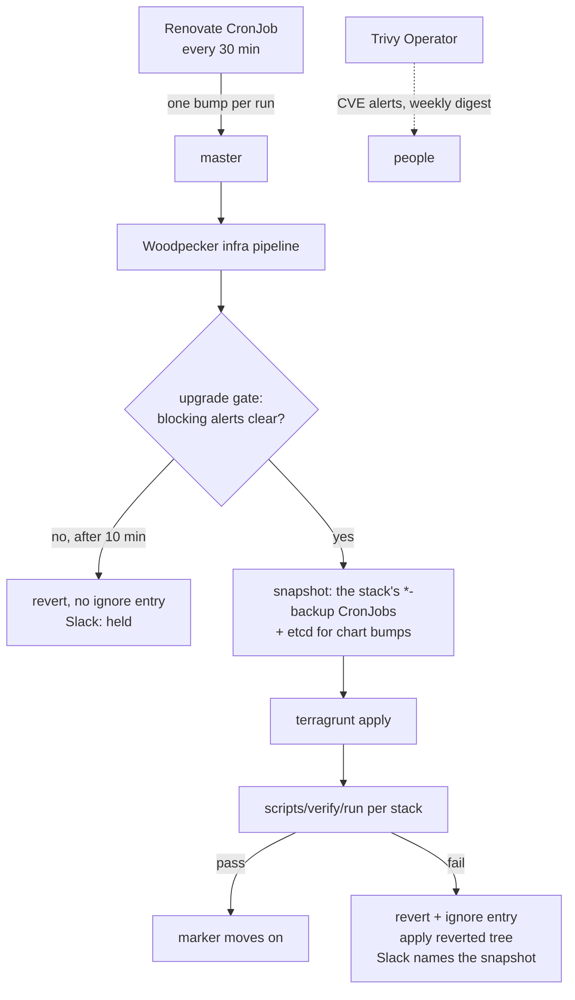

# Automated Upgrades

Four automation paths keep the cluster current. Each owns a distinct set of versions:

| What | Path | Section |
|---|---|---|
| Third-party versions in this repo: image pins in `.tf`, Helm values tags, `helm_release` chart versions | Renovate commits a bump to master; the Woodpecker rails apply it, verify it, and revert it on failure | "Third-party versions: Renovate and the CI rails" |
| First-party images (our own apps) | Each app's CI builds the image and rolls its Deployment (`docs/architecture/ci-cd.md`) | "First-party images without a deploy step" lists the ones that have no deploy step yet |
| OS packages on the K8s nodes | `unattended-upgrades` + `kured` with a sentinel gate and Prometheus halt-on-alert | "K8s Node OS Upgrades", runbook `docs/runbooks/k8s-node-auto-upgrades.md` |
| kubeadm, kubelet, kubectl | Daily detection CronJob, then a chain of phase Jobs | "K8s Version Upgrades", runbook `docs/runbooks/k8s-version-upgrade.md` |

The Trivy Operator supplies the CVE signal ("CVE signal: Trivy"). `/upgrade-state` (`scripts/upgrade_state.sh`) reports the state of the Renovate, OS and K8s paths in one table.

Until 2026-10 two other systems handled app images: Keel rolled live Deployments onto new tags, and DIUN fed an n8n workflow that started an upgrade agent. Both were retired in the software-currency cutover (`docs/plans/2026-10-09-software-currency-design.md`, ADR-0030); their history and the markers they left behind are at the end of this part of the doc.

## Third-party versions: Renovate and the CI rails

Design: `docs/plans/2026-10-09-software-currency-design.md` ("Ownership of versions", "Phase 3"). Decision: ADR-0030. Operations: `docs/runbooks/renovate.md`.

Renovate runs as a CronJob in `stacks/renovate` every 30 minutes. It reads `renovate.json5` at the repo root, picks the highest-priority pending update, and pushes it straight to master as the `renovate-bot` Forgejo account: one commit per run, no pull request. The infra pipeline applies the commit, and for Renovate commits `scripts/renovate-rails` wraps that apply with a gate, a snapshot, a verify and a revert.



Status on 2026-10-11: the CronJob runs every 30 minutes (`variable "suspended"` in `stacks/renovate/main.tf`, default `false` since wave 6 of the build plan). The rails were exercised end to end on one passing and one failing bump in wave 4.

### Who updates which version

| Version | Owner | Notes |
|---|---|---|
| `helm_release` chart versions in `stacks/` | Renovate | Every active release sets an explicit `version` (since 2026-10-10) |
| Third-party image pins in `.tf`, including `variable` defaults with a `# renovate:` comment | Renovate | Pinned to the live string during the Keel cutover |
| Tags inside Helm values files and `.tpl` values | Renovate (`customManagers` regexes in `renovate.json5`) | |
| Pins under `modules/` (for example the `anubis_instance` image tag) | Manual for now | `ignorePaths` excludes `modules/**`, because a change there re-applies every platform stack |
| `.woodpecker/*.yml` CI images | Manual | Excluded so a broken CI image cannot break the rails that would revert it |
| First-party images (`viktorbarzin/*`, `ghcr.io/viktorbarzin/*`, Forgejo registry) | The app's own CI | Renovate skips them (package rule "Our own images") |
| CoreDNS | Nobody yet | Not in Terraform, and kubeadm skips the addon (`scripts/update_k8s.sh`). Keel rolled it before 2026-10 |

Components held for a supervised session are disabled `packageRules` with a `HELD:` description in `renovate.json5`: metallb, the CNPG operator chart, Nextcloud, Calico/tigera-operator, MySQL majors (9.x and 26.x), Woodpecker, Postgres majors, the NVIDIA driver major, the Loki chart repository switch, Kyverno 1.20 (chart 3.10), Forgejo, and Technitium 14 to 15.

### Version patterns

| Pattern | Example | How Renovate reads it |
|---|---|---|
| Variable-based | `variable "immich_version" { default = "v3.3.1" }` | A `# renovate:` comment names the datasource and package |
| Hardcoded | `image = "vaultwarden/server:1.35.4"` | The image-string custom manager |
| Helm chart | `version = "2026.2.2"` in `helm_release` | Renovate's Terraform manager |

Each `helm_release` also sets `atomic = true` and `cleanup_on_fail = true`, with two documented exceptions:

- `prometheus` (`stacks/monitoring/modules/monitoring/prometheus.tf`) sets `cleanup_on_fail` only. It runs with `wait = false`, and Helm turns waiting back on whenever `atomic` is set.
- `vault` (`stacks/vault/main.tf`) keeps `atomic = false`, because HA pods start sealed and fail readiness until they are unsealed.

Any change to a `helm_release`, even a flag such as `cleanup_on_fail`, runs a full `helm upgrade` that re-renders the chart. Where a workload's live image differs from the tag in Terraform (Keel moved several past their Terraform tags before it was parked), that upgrade puts the Terraform tag back and rolls the pods. On 2026-10-10 this rolled `homepage` (same image) and moved `woodpecker` from Keel's v3.14.1 back to v3.14.0. Because CI runs inside Woodpecker, the roll stopped the pipeline that was applying it and left the release in `pending-upgrade`; the fix was to delete the dead revision Secret, set the tag to v3.14.1, and apply `stacks/woodpecker` from a workstation. Apply `stacks/woodpecker` changes that roll its pods from a workstation, then push, so the CI apply finds nothing to change. Before changing a `helm_release`, compare its live images with the Terraform tags.

### Pins Renovate cannot bump yet

These stayed on their previous strings during the cutover, each with its ignore line kept, because a clean pin would restart pods or needs a decision first. Each batch commit names them with the reason:

- Floating tags whose pods run digests that match no version tag (`# FLOATING_TAG_DEFERRED`): crowdsec firewall-bouncer, immich-frame, immich-postgresql, kured-sentinel-gate, lean-proxy, tor-proxy, wireguard and wg-peer-sync, auth-proxy, bot-block-proxy. authfix (`python:3.13-alpine`) and sysctl-inotify (`busybox:1.37`) are Terraform-owned with no ignore and the same multi-digest situation, so Renovate may propose bumps for them through the rails.
- Digest-only pins: anisette, llama-swap, gluetun, and headscale-ui (`# DIGEST_PIN_DEFERRED`).
- changedetection, whose two images run in each other's containers (`# IMAGE_SWAP_DEFERRED`).
- Nextcloud, whose tag comes from a live-tag lookup that Renovate cannot read.

## First-party images without a deploy step

Keel was the only rollout for seven first-party apps. With Keel parked they keep running their current image, and a new build does not reach the cluster until someone rolls the Deployment:

| App | Image | What Keel did | What it needs |
|---|---|---|---|
| excalidraw | `ghcr.io/viktorbarzin/excalidraw-library:latest` | `force`, digest tracking every 5 min | a rollout step in `.github/workflows/build-excalidraw.yml` |
| interview-prep-app | `ghcr.io/viktorbarzin/interview-prep-app:latest` | `force`, digest tracking every 5 min | a rollout step in its build workflow |
| k8s-portal | `ghcr.io/viktorbarzin/k8s-portal:latest` | `force`, digest tracking every 5 min | a rollout step in `.github/workflows/build-k8s-portal.yml` |
| pages-publish | `ghcr.io/viktorbarzin/pages-publish:latest` | `force` + `match-tag`, digest tracking every 5 min | a rollout step in `.github/workflows/build-pages-publish.yml` |
| repowise | `ghcr.io/viktorbarzin/repowise` | `patch` over the daily upstream rebuild | a rollout step in `.github/workflows/build-repowise.yml` |
| learning | `ghcr.io/viktorbarzin/learning` semver tags | `patch` ("pushing a new patch tag is the whole of the rollout") | a `kubectl set image` step in learning's build workflow |
| trading-bot | `ghcr.io/viktorbarzin/trading-bot-service`, `-dashboard` | `patch`, hourly poll | a deploy step in trading-bot's `build.yml` |

Their stacks keep the Keel lines (`KEEL_IGNORE_IMAGE`, the `keel.sh/*` ignores and the `keel.sh/enrolled` namespace label), which are inert now. `stacks/keel` is kept with `local.keel_enabled = false` (0 pods) rather than deleted. Once each app has a deploy step, migrate its stack like the other cutover batches, then delete `stacks/keel` and the `ghcr.io/viktorbarzin/keel` fork image. Until then, roll one of these apps by hand: `kubectl -n <ns> rollout restart deploy/<name>` for a `:latest` image pulled with `imagePullPolicy: Always`, or `kubectl -n <ns> set image` to the new tag.

## CVE signal: Trivy

Since 2026-10-10 the Trivy Operator (`stacks/trivy-operator`, `docs/architecture/trivy.md`) scans every running image, plus secrets in image layers, workload and RBAC configuration, and node configuration. Fixable Critical/High CVEs on internet-reachable workloads and secrets found in images alert in Slack `#alerts`; everything else goes to a weekly section of `alert-digest`. Trivy does not start upgrades: Renovate picks up a fixed release on its next run once it is published. To act on a finding sooner, start a Renovate run by hand (`docs/runbooks/renovate.md`).

## Legacy markers left by Keel and DIUN

The cutover changed no pod template, so two kinds of Keel and DIUN metadata are still on live workloads, and Terraform keeps tolerating them:

- `keel.sh/update-time` on pod templates, ignored as `# LEGACY_TEMPLATE_ANNOTATIONS` (about 160 lines). Removing the ignore strips the stamp, which is a pod-template change and restarts the workload (84 workloads carried it on 2026-10-10).
- `diun.*` pod-template annotations, declared in about 40 Deployments and in the authentik and Technitium configuration. They are inert since DIUN is gone; removing them restarts those pods (traefik, technitium, authentik server, nextcloud and immich among them), so each goes with the next change that rolls its workload anyway.

Chart-rendered workloads and the authentik outposts also keep `keel.sh/policy|trigger|pollSchedule` metadata annotations that the deleted Kyverno policy stamped; Terraform does not declare them and they are inert. Marker reference: `docs/agents/kyverno-drift.md`.

## History: DIUN and the upgrade agent (2026-04 to 2026-10)

From April 2026, DIUN (`stacks/diun`, a 6-hourly image scan) posted new-image events to an n8n webhook; the "DIUN Upgrade Agent" workflow filtered and rate-limited them (5 per 6 hours) and asked `claude-agent-service` to run the service-upgrade agent (`.claude/agents/service-upgrade.md`), which read changelogs, took a database backup, bumped the version in Terraform, waited for CI and reverted on a failed check. Its first bulk run on 2026-04-16 upgraded 12 services in about 30 minutes, including one automatic rollback and forward fix (dawarich).

The n8n filter kept only `status=update` (a new digest on an existing tag) and dropped `status=new` (a new tag), so after April it received digest re-pushes but no version bumps; its last upgrade commit was 2026-04-19. DIUN watched images only, so chart versions had no watcher. ADR-0030 replaced the pipeline with Renovate, and batch B17 (2026-10-11) removed DIUN, its PVC, the n8n workflow, the agent prompt and `upgrade-config.json`; they remain in git history before that commit. The `claude-agent-service` credentials the agent used are documented in `docs/architecture/incident-response.md`.

## History: Keel (2026-05 to 2026-10)

Keel (`stacks/keel/`) polled the registry of each enrolled workload hourly and rolled it when a newer tag or digest matched the workload's `keel.sh/policy`. Enrollment and default annotations came from the Kyverno `inject-keel-annotations` policy (formerly `stacks/kyverno/modules/kyverno/keel-annotations.tf`). Design and history: `docs/plans/2026-05-16-auto-upgrade-apps-design.md`. Keel changed the live cluster outside git, so its updates skipped any snapshot, verify or revert, and Terraform needed `ignore_changes` markers to tolerate it; ADR-0030 retired it for that reason.

Batch B00 (2026-10-10) parked Keel (`local.keel_enabled = false` uninstalls the helm release; chart 1.2.3 hard-codes `replicas: 1`, so a `replicaCount` value has no effect) and deleted the Kyverno policy with its background-controller ClusterRole. Keel stopped first because a running Keel writes back its cached copy of a workload and would have reverted the edits of the later batches.

Each later batch pinned every third-party image in its stacks to the exact string that was running, so the apply changed no pod template; dropped the `KEEL_IGNORE_IMAGE` image ignores and the `keel.sh/policy|trigger|pollSchedule|match-tag` annotation ignores; and removed the `keel.sh/enrolled` namespace label. First-party images that their own CI deploys keep their ignore as `# CI_SETS_IMAGE`, and hand-built first-party `:latest` images as `# FIRST_PARTY_IMAGE`. Stacks that could not move cleanly are listed in the batch commit and stay on their previous lines (batches and classes: the Keel inventory of 2026-10-10).

| Batch | Stacks | Date |
|---|---|---|
| B01 | ac, actualbudget, affine, agentmd, android-emulator, blog, broker-sync, browser-bridge, city-guesser, claude-breakglass, claude-memory, coturn, cyberchef (anisette stays: digest-only pin) | 2026-10-10 |
| B02 | dashy, dawarich, drone-logbook, ebook2audiobook, ebooks, echo, f1-stream, fire-planner, freedify, freshrss, goldmane-edge-aggregator, grampsweb, hackmd (excalidraw stays: Keel was its only deploy path) | 2026-10-10 |
| B03 | health, insta2spotify, instagram-poster, job-hunter, jsoncrack, kms, learn, lesson-harvester, linkwarden, matrix, navidrome (interview-prep-app, k8s-portal and learning stay: Keel was their only deploy path) | 2026-10-10 |
| B04 | netbox, networking-toolbox, nextcloud-todos, novelapp, offline-reader, openclaw, osm_routing, owntracks, paperless-ai, paperless-mcp, payslip-ingest, phpipam, plotting-book (pages-publish stays: Keel was its only deploy path; in openclaw, modelrelay and task-webhook keep their image ignore until the floating-tag batch; plotting-book's image stays with Anca's CI as `# CI_SETS_IMAGE`) | 2026-10-10 |
| B05 | poison-fountain, priority-pass, privatebin, real-estate-crawler, recruiter-responder, resume, rustdesk, rybbit, send, speedtest, stirling-pdf, t3-afk, t3code (repowise stays: Keel was its only deploy path; t3-afk's floating `node:24` and `busybox:1.37` pins wait for the floating-tag batch; rustdesk needed no edit) | 2026-10-10 |
| B06 | tandoor, tasks, terminal, trek, tts, tuya-bridge, url, vaultwarden, vpn-portal, wealthfolio, webhook_handler, whisper (trading-bot stays: Keel was its only deploy path; tasks, tuya-bridge, vpn-portal and webhook_handler keep their image as `# CI_SETS_IMAGE`; the tts image is Terraform-owned through `var.image_tag`) | 2026-10-10 |
| B07 | beads-server, chrome-service, claude-agent-service, homepage, isponsorblocktv, meshcentral, ntfy, paperless-ngx, servarr, stremio, tripit, ytdlp, plus the floating pins left over in openclaw (B04) and t3-afk (B05). This is the floating-tag batch: a floating tag is pinned to the version tag that has the running digest (`v2.23` -> `v2.23.0`, `canary` -> `canary-0.2.47`, `nightly` -> `nightly-2025-03-18`), or to `tag@digest` where the tag was re-pushed and no version tag has the running digest any more (`busybox:1.37@sha256:9532d8...`, `library/nginx:alpine@sha256:62ff20...`). The new string is a pod-template change, so the 12 workloads running these pins restart onto the same image digest; openclaw, task-webhook and t3-afk run 0 replicas. claude-agent-service's image ignores now point at the init containers its CI sets (`init_container[2]` and `[3]`, previously `[0]` and `[1]`, the busybox ones). renovate.json5 gained regex versioning for listenarr (`canary-X.Y.Z`) and youtubedl-material (`nightly-YYYY-MM-DD`) | 2026-10-10 |
| B08 | changedetection, partly. The Deployment runs its two images in the wrong containers (container `sockpuppetbrowser` runs `ghcr.io/dgtlmoon/changedetection.io:0.55.8`, container `changedetection` runs `dgtlmoon/sockpuppetbrowser:0.0.3`, since a Keel update on 2026-08-26), so both image ignores stay, marked `# IMAGE_SWAP_DEFERRED`, and Renovate does not track either image yet. The `keel.sh/policy|trigger|pollSchedule|match-tag` annotation ignores and the `keel.sh/enrolled` namespace label are removed as in the other batches. Putting each image back in its own container restarts the pod and is left for a supervised session | 2026-10-10 |
| B09 | bastion, cloudflared, crowdsec (crowdsec-web only), descheduler, external-secrets, forgejo, frigate, headscale (headscale container), immich, k8s-dashboard, k8s-version-upgrade. Pins moved to the live strings: cloudflared bare -> `2026.7.3`, headscale `0.29.3` -> `v0.29.4`, nginx-unprivileged `1.27-alpine` -> `1.27.5-alpine`, and `var.immich_version` `v3.3.0` -> `v3.3.1` with a `# renovate:` annotation on immich-server (one value drives immich-worker, immich-api, immich-machine-learning `-cuda` and the thumbnail-reconcile CronJob). Forgejo is Terraform-owned now and Renovate holds it. No pin change restarts a pod in this batch, so four images keep their ignore: the crowdsec firewall-bouncer `debian:bookworm-slim`, immich-frame `immich_v3` and immich-postgresql (`# FLOATING_TAG_DEFERRED`: a version or `tag@digest` pin changes the pod template), and headscale-ui (`# DIGEST_PIN_DEFERRED`). crowdsec-web is `# FIRST_PARTY_IMAGE`. calico and cnpg needed no edit; their chart-managed workloads and those of crowdsec, external-secrets and k8s-dashboard stay with their charts | 2026-10-10 |
| B10 | kured, llama-cpp, local-path, mailserver, metallb, metrics-server, nfs-csi, nodelocal-dns, nvidia, proxmox-csi, proxy, pvc-autoresizer. Pins moved to the live strings: local-path-provisioner `v0.0.31` -> `v0.0.37`, docker-mailserver `docker.io/...:15.0.0` -> `mailserver/docker-mailserver:15.0.2`, roundcubemail `1.6.13-apache` -> `1.6.19-apache`, and the three python pins (gpu-vram-watchdog, gpu-pod-exporter, proxy-broker) from `python:3.1x-*` to `library/python:3.12.15-alpine`, `3.11.16-slim` and `3.12.15-slim`. The explicit `keel.sh/policy = "never"` annotation on the proxy-gw-1 egress gateway is removed, as is the shadowed `image` default in the nodelocal-dns module. metallb, metrics-server, nfs-csi, proxmox-csi and pvc-autoresizer only lost the namespace label; their images stay with their charts. kured-sentinel-gate keeps its image ignore as `# FLOATING_TAG_DEFERRED` (`bitnami/kubectl:latest` has no version tag with the running digest, and a `tag@digest` pin restarts its 6 pods). llama-swap and gluetun stay on digest-only pins that Renovate cannot bump. nextcloud stays unchanged for its supervised session (Renovate holds it, and its image comes from a live-tag lookup) | 2026-10-10 |
| B11 | redis, reloader, reverse-proxy, sablier, sealed-secrets, shadowsocks, tor-proxy, uptime-kuma, wireguard, woodpecker, xray. Pins moved to the live strings: xray bare -> `teddysun/xray:26.7.28` and prometheus-wireguard-exporter bare -> `3.6.6`; redis, sablier, shadowsocks, torrserver and uptime-kuma were already pinned to the live string. The explicit `keel.sh/policy = "never"` annotations on redis-v2 and uptime-kuma are removed; both now carry exact version pins, which is what guards against the downgrades that motivated the opt-outs. reloader, sealed-secrets and woodpecker only lost the namespace label; their images stay with their charts (woodpecker values already pin the live `v3.14.1`, and Renovate holds Woodpecker). trivy-operator needed no edit. Three images keep their ignore as `# FLOATING_TAG_DEFERRED`, because a pin restarts pods and this batch allows none: lean-proxy `openresty/openresty:alpine` (its 2 pods run different digests), tor-proxy `dperson/torproxy:latest` and the wireguard and wg-peer-sync containers on `sclevine/wg:latest` (no version tag has the running digest). renovate.json5 gained regex versioning for TorrServer (`MatriX.N[.M]`) | 2026-10-10 |
| B12 | monitoring. Pins moved to the live strings: goflow2 `v2.2.1` -> `v2.2.7`, prometheus-pve-exporter `latest` -> `3.9.0`, snmp-exporter bare -> `v0.30.1` and the sysctl-inotify `pause` container `3.10` -> `3.10.2`; blackbox-exporter was already pinned to the live `v0.25.0`. The `keel.sh/policy: never` deployment annotation on prometheus-server (`server.deploymentAnnotations` in `prometheus_chart_values.tpl`) is removed; a render of chart 29.36.1 with and without it differed only in that Deployment's metadata, so the helm upgrade does not touch the pod template. idrac-redfish-exporter keeps its image ignore as `# FIRST_PARTY_IMAGE`. The sysctl-inotify `busybox:1.37` init container stays as it was (Terraform-owned, never ignored; its pods run different digests under that tag, so a version or `tag@digest` pin restarts the DaemonSet). The chart-managed workloads (alloy, alloy-syslog, grafana, loki, loki-canary, prometheus) stay with their charts. The `KeelUpdateFailing` Loki rule and the image-flipflop detector stay until Keel is removed (B17) | 2026-10-10 |
| B13 | technitium, vault. technitium-primary, -secondary and -tertiary were already pinned to the live `technitium/dns-server:14.3.0`; only their image ignores, the `keel.sh/policy|trigger|pollSchedule` annotation ignores and the `keel.sh/enrolled` namespace label go. Renovate holds the Technitium 14 -> 15 major; 14.x patch and minor releases land through the rails. The primary keeps its `diun.*` pod-template annotations, since removing them restarts the DNS pod. vault only lost the namespace label; its images stay with the chart values (`local.vault_version`, already the live `2.1.2`), and CI applies the vault stack | 2026-10-10 |
| B14 | dbaas. pgadmin moved from the bare `dpage/pgadmin4` to the live `dpage/pgadmin4:9.16`; phpmyadmin (`phpmyadmin/phpmyadmin:5.2.3`), mysql-standalone (`mysql:8.4.8`) and mysqld-exporter (`prom/mysqld-exporter:v0.20.0`) were already pinned to the live string. The image ignores and `keel.sh/policy|trigger|pollSchedule|match-tag` annotation ignores go, as do the explicit `keel.sh/policy = "never"` annotations on mysql-standalone and mysqld-exporter; the MySQL pin itself is what holds the version now, and Renovate holds MySQL majors. pgadmin keeps `keel.sh/update-time` on its pod template as `LEGACY_TEMPLATE_ANNOTATIONS`, since removing it rolls the pod template. The dbaas namespace never carried `keel.sh/enrolled` | 2026-10-11 |
| B15 | authentik. pgbouncer moved from `edoburu/pgbouncer:latest` to the live `edoburu/pgbouncer:v1.25.2-p0`, and its `image_pull_policy` from `Always` to the live `IfNotPresent`; both ignores go. The explicit `keel.sh/policy|trigger|pollSchedule` annotations on the pgbouncer Deployment and the `keel.sh/match-tag` ignore are removed. pgbouncer keeps `keel.sh/update-time` on its pod template as `LEGACY_TEMPLATE_ANNOTATIONS`, since removing it rolls the pods. renovate.json5 gained regex versioning for pgbouncer (`vX.Y.Z-pN`). goauthentik-server and -worker stay with the chart: the `helm_release` version is the authentik version, the values carry no image override, and the `diun.*` pod annotations in `values.yaml` stay, since removing them restarts the server pods. The authentik namespace never carried `keel.sh/enrolled`; the outposts (`ak-outpost-*`) are set by the outpost controller | 2026-10-11 |
| B16 | traefik. error-pages moved from `ghcr.io/tarampampam/error-pages:3` to the live `:3.0.1`; the explicit `keel.sh/policy = "never"` opt-out on authfix, the `keel.sh/*` annotation ignores on auth-proxy, authfix, bot-block-proxy, error-pages and x402-gateway, and the namespace label go. auth-proxy (`nginx:1-alpine`) and bot-block-proxy (`openresty/openresty:alpine`) keep their image ignore as `# FLOATING_TAG_DEFERRED` (each has 2 pods on different digests); authfix stays on `python:3.13-alpine` for the same reason; x402-gateway keeps `# CI_SETS_IMAGE`. The traefik Deployment stays with its chart | 2026-10-11 |
| B17 | Retirement. DIUN (`stacks/diun`, its PVC, the Keel release watch and the n8n webhook notifier), the n8n "DIUN Upgrade Agent" workflow and its backup JSON, `build-diun.yml`, the service-upgrade agent and `upgrade-config.json`, `scripts/audit-keel-image-ownership.py` and the `KeelUpdateFailing` Loki rule are removed; `/upgrade-state` reports Renovate instead of Keel; `keel` leaves the Kyverno security-policy exclude list; n8n drops its Keel ignores and namespace label. `stacks/keel` stays parked at 0 pods (see "First-party images without a deploy step") | 2026-10-11 |

From 2026-10-08 until it was parked, the cluster ran a patched Keel 0.22.4 (`ghcr.io/viktorbarzin/keel`, built from `github.com/ViktorBarzin/keel`, branch `homelab`) that added `keel.sh/pollTagsAfterCurrent`: list only the tags pushed after the running tag, using the registry's `last` cursor. Stock Keel listed all of `ghcr.io/immich-app/immich-machine-learning`'s 150,000+ tags on every poll, and ghcr returned HTTP 429 from 2026-08 to 2026-10, so the ML deployment drifted behind immich-api. Upstream: issue keel-hq/keel#942, PR keel-hq/keel#943 (merged 2026-10-08). Renovate now takes the Immich version from the immich-server tags, a lookup of about 260 tags.

## K8s Node OS Upgrades

Independent of the Renovate path above. Drives apt package updates + reboots on the 5 K8s VMs (master + 4 workers).

### Stack
- **In-guest**: `unattended-upgrades` runs apt upgrades within Allowed-Origins (`-security`, `-updates`, ESM). Package-Blacklist excludes runtime components (`containerd`, `containerd.io`, `runc`, `cri-tools`, `kubernetes-cni`, `calico-*`, `cni-plugins-*`, `docker-ce`). `apt-mark hold` on `kubelet`, `kubeadm`, `kubectl` (and runtime pkgs as belt-and-braces). `Automatic-Reboot=false` — kured handles reboots.
- **Reboot driver**: `kured` (chart `kured-6.1.0`, app `1.23.0`). Window 02:00-06:00 Europe/London every day of the week (Mon-Fri-only restriction dropped 2026-05-16 — see PM), period=1h, concurrency=1, reboot-delay=30s, drainTimeout=30m.
- **Reboot gate (sentinel)**: `kured-sentinel-gate` DaemonSet creates `/var/run/gated-reboot-required` only when (a) host needs reboot, (b) all nodes Ready, (c) all calico-node pods Running, (d) **no node has transitioned Ready in the last 24h** (24h soak window). The gate runs as an immortal `bash` loop that forks `kubectl` each cycle; the pod whose host has a pending reboot runs the full kubectl-heavy path indefinitely and slowly leaks. Mitigated 2026-05-31 (limit 64Mi→256Mi + `MAX_ITER=72` self-exit ≈6h so kubelet restarts it fresh) — see PM `2026-05-31-kured-sentinel-gate-oom.md`.
- **Reboot gate (Prometheus)**: kured `--prometheus-url` polls `prometheus-server.monitoring.svc:80` before each drain. ANY firing alert blocks unless it matches the ignore-regex `^(Watchdog|RebootRequired|KuredNodeWasNotDrained|InfoInhibitor)$`.
- **Health alert library**: 10 alerts in the `Upgrade Gates` group (`prometheus_chart_values.tpl`): `KubeAPIServerDown`, `KubeStateMetricsDown`, `PrometheusRuleEvaluationFailing`, `PVCStuckPending`, `RecentNodeReboot` (the explicit 24h soak signal), `MysqlStandaloneDown`, `ClusterPodReadyRatioDropped`, `NodeMemoryPressure`, `NodeDiskPressure`, `KubeQuotaAlmostFull`. Plus the existing 200+ alerts in the cluster-wide library (anything firing blocks kured).
- **Notifications**: kured `notifyUrl` posts drain-start/drain-finish to Slack via Vault `secret/kured.slack_kured_webhook`. Alertmanager separately routes critical alerts to `#alerts`.

### Source of truth
| Concern | Location |
|---|---|
| Package config (uu, holds, blacklist) | `modules/create-template-vm/cloud_init.yaml` (within `is_k8s_template`) |
| kured Helm release + sentinel-gate DS | `stacks/kured/main.tf` |
| Upgrade Gates alerts | `stacks/monitoring/modules/monitoring/prometheus_chart_values.tpl` |

### Day-2 changes
Cloud-init only runs on first boot. Existing nodes are brought into compliance with a one-shot SSH push — see the runbook section "Restore / re-apply unattended-upgrades config to existing nodes" in `docs/runbooks/k8s-node-auto-upgrades.md`.

### Why this design
The 26h cluster outage on 2026-03-16 was triggered by an unattended-upgrades kernel push that corrupted containerd's overlayfs snapshotter cluster-wide. The remediations:
- 24h soak (sentinel-gate Check 4) gives a full day of observation between consecutive node reboots — broken updates show up as Prometheus alerts before any other node restarts.
- Prometheus halt-on-alert turns ANY firing alert into a hard block — including the 6 Node Runtime Health alerts and the 10 Upgrade Gates alerts that explicitly model "the cluster is in a bad state."

  **Replaced by an opt-in allowlist on 2026-09-19 (bead `code-rl8j`, now closed).** `HALT_IGNORE` is gone. `UPGRADE_GATE_ALERTS` in `upgrade-step.sh` names the 32 alertnames that mean "the cluster is unfit to be upgraded right now", and the gate blocks only on those, intersected with `severity: critical`.

  The mismatch it fixes: `severity: critical` in this cluster means "wake a human", while the gate read it as "the cluster is unfit to upgrade", and those are different sets. `BankSyncConsentExpired`, an expired Amex GoCardless consent only a human at the bank can clear, was the sole firing critical cluster-wide and held 1.35.8 for 2 days 20 hours. A denylist could never win that argument, since it grows by one entry per unrelated application alert forever.

  All 120 critical rules were reviewed (114 in `prometheus_chart_values.tpl`, 6 in `loki.tf`) against one test: an upgrade drains and reboots one node at a time, so it must not start when the cluster cannot absorb losing a node, when pods cannot move, when the grid or network is already degraded, when the monitoring that would catch a bad upgrade is blind, or when a platform incident is already under way. 32 qualified.

  **The fail-open inversion this doc warned about is handled two ways.** The allowlist *is* the hardcoded floor of always-blocking alertnames that the earlier note asked for, so there is no second list to keep in step. And if `UPGRADE_GATE_ALERTS` is ever empty or unset, `halt_on_alert_query` falls back to blocking on every firing critical, so a mistake fails closed rather than draining nodes during an outage.

  Keeping the list in the consumer rather than as an `upgrade_gate: "true"` label on 32 rules is deliberate: one reviewable place, and no risk of an edit in the monitoring stack silently changing upgrade behaviour.

  **The pipeline's own alerts are absent by design.** `K8sUpgradeStalled` and `EtcdPreUpgradeSnapshotMissing` are driven by this pipeline's own Pushgateway gauges, and preflight's gate runs before `in_flight` is refreshed, so counting them would let a stale gauge abort every preflight before it could clear anything (RC3, 2026-07-25). An allowlist expresses that by omission.

  Still true and still unused: `halt_on_alert_query` reads Prometheus `/api/v1/alerts` directly, so Alertmanager **silences do not affect whether the chain blocks**. Silencing a gate alert will not let an upgrade proceed. Honouring silences was considered as a cheaper alternative and rejected, because a silence is a notification preference that can be set for reasons unrelated to whether a reboot is safe.
- Package-Blacklist on runtime components prevents the exact failure mode (containerd/runc auto-bumps).
- `Automatic-Reboot=false` keeps reboot policy in kured (window, ordering, gating), not in apt.

### Operational reference
See `docs/runbooks/k8s-node-auto-upgrades.md` for: verifying health, halting rollout, restoring config to a re-imaged node, rolling back a bad upgrade, and the past-incident timeline.

## K8s Version Upgrades

Independent of the OS-upgrade and Renovate paths. Drives
kubeadm/kubelet/kubectl bumps (patch + minor) on all 5 K8s VMs.

### Architecture

```
k8s-version-check CronJob   (23:00 UTC nightly, k8s-upgrade ns)
  │ probe apt-cache madison kubeadm (master) → latest available patch
  │ probe HEAD https://pkgs.k8s.io/.../v<NEXT_MINOR>/deb/Release → next minor?
  │ push k8s_upgrade_available metric to Pushgateway
  │
  ▼ if a target is detected
envsubst on /template/job-template.yaml | kubectl apply -f -
  │ spawns Job 0 = k8s-upgrade-preflight-<target_version>
  ▼

Job 0 — preflight       (pinned: first worker = node1; +nvidia.com/gpu tol)
Job 1 — master upgrade  (pinned: first worker = node1; +nvidia.com/gpu tol)  drains k8s-master
Job 2..N — worker       (pinned: k8s-master)       drains each worker still off-target
                                                   ← control-plane toleration; one Job
                                                     per worker, enumerated live from
                                                     `kubectl get nodes` (covers node5/6
                                                     + any future node automatically)
Job N+1 — postflight    (no pinning)
```

Each Job runs `scripts/upgrade-step.sh`, which dispatches on `$PHASE` and ends
by spawning the next Job (`envsubst < /template/job-template.yaml | kubectl
apply -f -`). Job names are deterministic (`k8s-upgrade-<phase>-<target_version>[-<node>]`)
so `apply` reconciles to a single Job per run — re-running won't duplicate
downstream Jobs. The detection CronJob and `spawn_next` additionally delete +
re-spawn a terminally-**Failed** Job of the same name (rather than skipping it
on existence), so a transient preflight gate self-heals on the next cycle
instead of wedging the pipeline until the dead Job's 7d TTL expires
(retry-on-failure, added 2026-06-17 after a spurious critical alert stalled
1.34.9 for 5 days).

### Self-preemption history (the reason for the Job-chain rewrite)

The v1 design ran the whole upgrade inside the `claude-agent-service`
Deployment (1 replica, no nodeSelector). On 2026-05-11 the agent's pod was
scheduled to k8s-node4. When the agent ran `kubectl drain k8s-node4` during
Stage 6, it evicted itself — the bash process died after the drain but
before the SSH-pipe to install kubeadm on node4. The cluster ended up
half-upgraded (master at v1.34.7, workers at v1.34.2). The rewrite to a
chain of `nodeSelector`-pinned Jobs eliminates this failure mode because
each Job's pod and its drain target are always different nodes.

### Components

- **Detection CronJob + ConfigMaps + RBAC**: `infra/stacks/k8s-version-upgrade/main.tf`.
  - Image is the claude-agent-service image (kubectl + ssh-client + curl + jq + envsubst).
  - One unified ServiceAccount `k8s-upgrade-job` serves both the detection CronJob and every chain Job.
- **Phase body**: `infra/stacks/k8s-version-upgrade/scripts/upgrade-step.sh`.
  Dispatches on `$PHASE` (preflight | master | worker | postflight). Computes
  `NEXT_PHASE` / `NEXT_TARGET_NODE` / `NEXT_RUN_ON` and spawns the next Job.
  Includes a `predrain_unstick` helper that pre-deletes pods on the target
  node whose PDB has `disruptionsAllowed=0` (otherwise drain loops forever on
  single-replica deployments like Anubis instances).
- **Job template**: `infra/stacks/k8s-version-upgrade/job-template.yaml`.
  envsubst-rendered at runtime. Mounts a `creds` Secret, a `scripts`
  ConfigMap, and a `template` ConfigMap into each Job pod.
- **Per-node script**: `infra/scripts/update_k8s.sh`. Caller passes
  `--role master|worker --release X.Y.Z`. Piped via SSH into each node by
  upgrade-step.sh. The master path runs `kubeadm upgrade apply` with
  `--ignore-preflight-errors=CoreDNSMigration,CoreDNSUnsupportedPlugins
  --skip-phases=addon/coredns` so kubeadm never touches CoreDNS (custom Corefile
  + separately-tracked image; CoreDNS is pinned off Keel via `keel.sh/policy=never`).
  See the runbook's "CoreDNS is NOT upgraded by kubeadm here".
- **Four Upgrade Gates alerts**:
  - `K8sVersionSkew` — `count(count by (kubelet_version)(kube_node_info)) > 1 unless on() (<chain job>.active>0)` for 15m. Catches a half-done rollout **at rest**. Rebuilt 2026-07-25 off `kube_node_info` (the old `kubernetes_build_info{job=~"kubernetes-nodes|kubernetes-apiservers"}` source was never scraped → the alert could never fire, RC5); the `unless active>0` guard suppresses it only during a genuinely-running phase.
  - `EtcdPreUpgradeSnapshotMissing` — `k8s_upgrade_in_flight==1 && k8s_upgrade_snapshot_taken==0` for 10m. Catches preflight failing silently. (Deliberately NOT given the live-Job guard — its snapshot runs while the master Job is Active.)
  - `K8sUpgradeStalled` — `k8s_upgrade_in_flight==1 && time()-started > 14400 && sum(<chain job>.active)>0` for 5m. Catches a chain Job **genuinely running** >4h. Hardened 2026-07-25 with the live-Job guard + 90m→4h — the old latch-only expr fired forever on any leaked `in_flight=1` (also blocking kured); a leaked latch is auto-cleared by the detection reconcile within 12h.
  - `K8sUpgradeChainJobFailed` — `(kube_job_status_failed{namespace="k8s-upgrade",job_name=~"k8s-upgrade-(preflight|master|worker|postflight)-.*",reason=~"BackoffLimitExceeded|DeadlineExceeded"} > 0) unless on() (k8s_upgrade_blocked == 1)` for 15m (warning). Catches a phase Job that terminally failed **before `in_flight` was set** (the preflight gates exit pre-metric) — invisible to the two `in_flight`-based alerts above; this was the blind spot behind the 5-day 1.34.9 preflight wedge. Reason-scoped so a retry-success doesn't false-positive (and so it doesn't needlessly block kured). The `unless k8s_upgrade_blocked == 1` clause (2026-06-21) excludes a deliberate compat-gate refusal (owned by `K8sUpgradeBlocked`) so a block doesn't double-fire as a wedge.
- **Pushgateway metrics**:
  - `k8s_upgrade_in_flight` (set in preflight, cleared in postflight)
  - `k8s_upgrade_snapshot_taken` (set after etcd snapshot Job completes with ≥1 KiB)
  - `k8s_upgrade_started_timestamp` (set in preflight; used by `K8sUpgradeStalled`)
  - `k8s_upgrade_available{kind,running,target}` (pushed by detection CronJob)
  - `k8s_version_check_last_run_timestamp` (staleness watchdog)
- **Leaked-latch reconcile** (2026-07-25): the detection CronJob, at the start of every run, clears a stale `k8s_upgrade_in_flight=1` (no active chain Job AND >12h) by DELETEing the Pushgateway `k8s-version-upgrade` group + stale ns annotations + terminal chain Jobs. Ground-truth via `kubectl`, so it survives a SIGKILL that a shell `trap` cannot. The pipeline's own criticals (`K8sUpgradeStalled`, `EtcdPreUpgradeSnapshotMissing`) are also in the preflight halt-on-alert ignore-list so a still-firing self-emitted critical can't deadlock the very preflight that would clear it (RC3).

### Source of truth

| Concern | Location |
|---|---|
| Stack (CronJob + ConfigMaps + SA/RBAC + ExternalSecret) | `stacks/k8s-version-upgrade/main.tf` |
| Phase orchestration | `stacks/k8s-version-upgrade/scripts/upgrade-step.sh` |
| Job template | `stacks/k8s-version-upgrade/job-template.yaml` |
| Per-node upgrade script | `scripts/update_k8s.sh` |
| Alerts | `stacks/monitoring/modules/monitoring/prometheus_chart_values.tpl` (group "Upgrade Gates") |
| Vault secrets | `secret/k8s-upgrade/{ssh_key, ssh_key_pub, slack_webhook}` |
| Deprecated agent prompt (reference, removed 2026-10-04) | `git show fd0f4a03:.claude/agents/k8s-version-upgrade.deprecated.md` |

### Why this design

The cluster has a single control plane (no HA). A failed `kubeadm upgrade apply` is an outage. Mitigations:

- **Mandatory etcd snapshot before every run** (even patch). Recovery point if master breaks.
- **Halt-on-alert before every drain**. Reuses the same Prometheus ignore-list regex kured uses — any unrelated cluster-health alert blocks. Three gate alerts catch upgrade-specific half-states (version skew, missing snapshot, stalled chain).
- **Job pinning eliminates self-preemption**. Each Job's pod runs on a node that is NOT its drain target: the master-drain Job runs on the first worker; every worker-drain Job runs on k8s-master (already upgraded, control-plane toleration). The worker set is enumerated live from `kubectl get nodes`, so new nodes are covered with no script change; SSH targets are node InternalIPs (no DNS dependency). **The first worker is k8s-node1, which carries `nvidia.com/gpu:NoSchedule` (flipped from PreferNoSchedule 2026-07-19, code-j3tx), so the preflight and master-drain Jobs also carry a matching GPU toleration — without it they hang Pending indefinitely (fixed 2026-07-24 after a ~5-day preflight stall surfaced by a cluster health check).**
- **Sequential workers with 10-min inter-node soak**. Same risk-bounding as the 24h OS-reboot soak, but tightened because kubelet failures surface within minutes — not hours.
- **Master upgrade goes first, workers last**. If master breaks, the cluster is already degraded so further worker upgrades would just delay recovery. By upgrading master first, we either succeed (workers can roll afterward) or fail loud (operator triages before any worker is touched).
- **No auto-rollback**. kubeadm doesn't support clean downgrade; the snapshot + manual apt rollback in the runbook is the recovery path.
- **PDB-blocked pods don't stall the chain**. `predrain_unstick` deletes PDB=0 pods on the target node directly (bypassing the eviction API), so the parent Deployment recreates them elsewhere. This was the workaround applied manually during the 2026-05-11 recovery for Anubis single-replica instances.

### Secrets

| Secret | Vault Path | Purpose |
|--------|-----------|---------|
| SSH private key | `secret/k8s-upgrade.ssh_key` | Jobs SSH `wizard@<node>` |
| SSH public key | `secret/k8s-upgrade.ssh_key_pub` | Deployed to nodes' `~/.ssh/authorized_keys` |
| Slack webhook | `secret/k8s-upgrade.slack_webhook` | Pipeline notifications (separate channel from kured) |

The previous `api_bearer_token` entry is gone — the chain does not POST to `claude-agent-service`.

### Operational reference

See `docs/runbooks/k8s-version-upgrade.md` for: verifying health, manually triggering detection, killing a stuck Job, skipping a phase, rollback paths (master / worker / mid-flight abort), and SSH key rotation.
