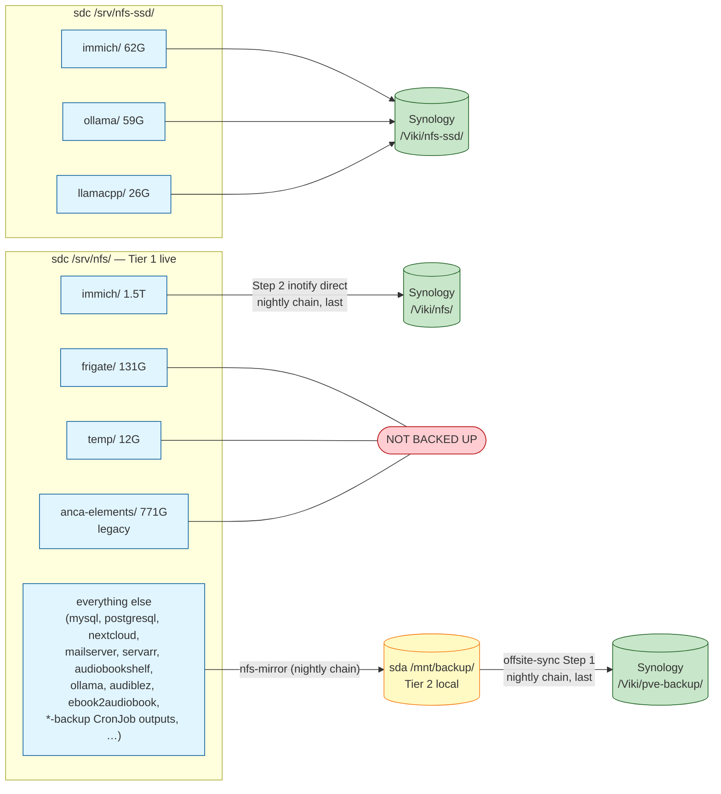
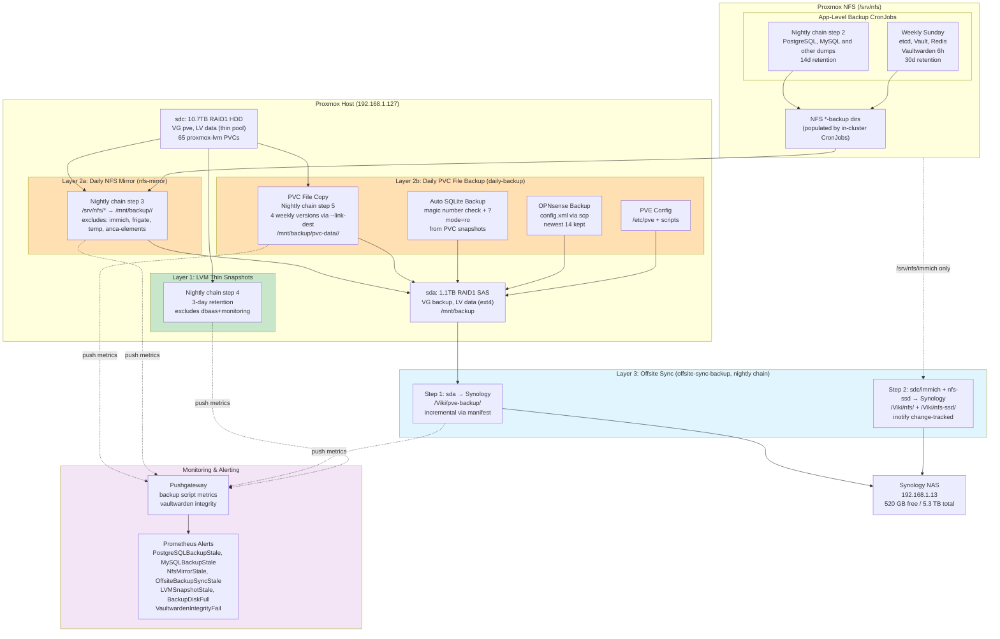
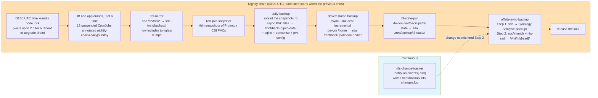
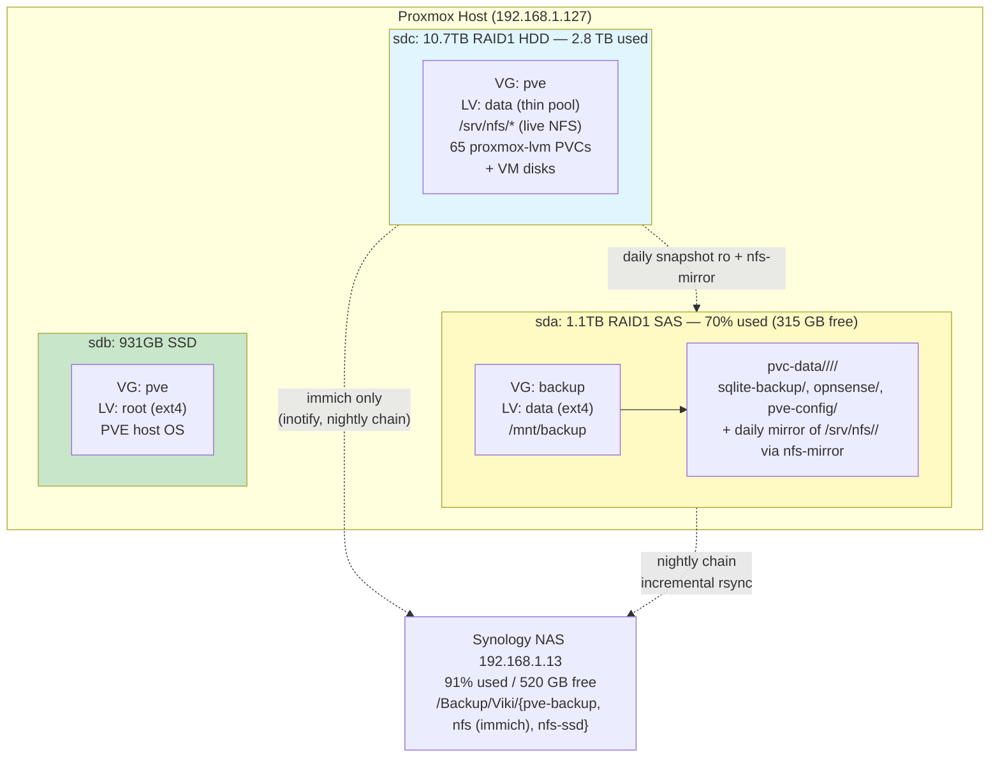
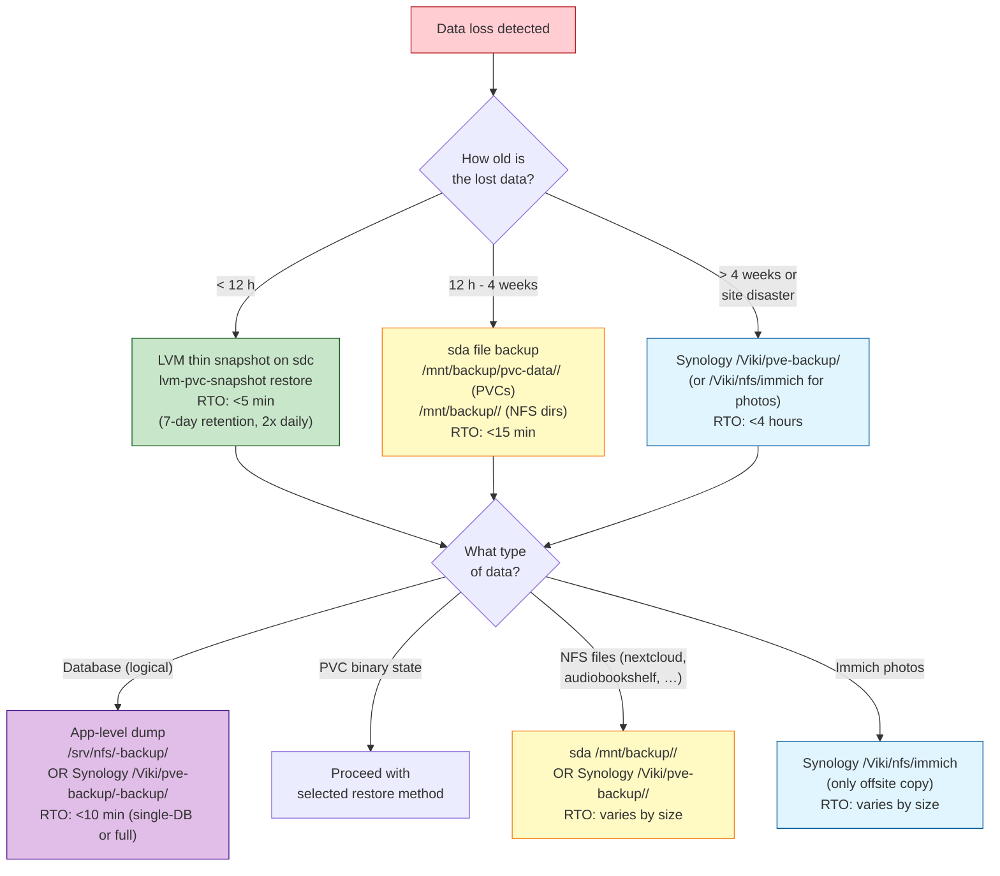
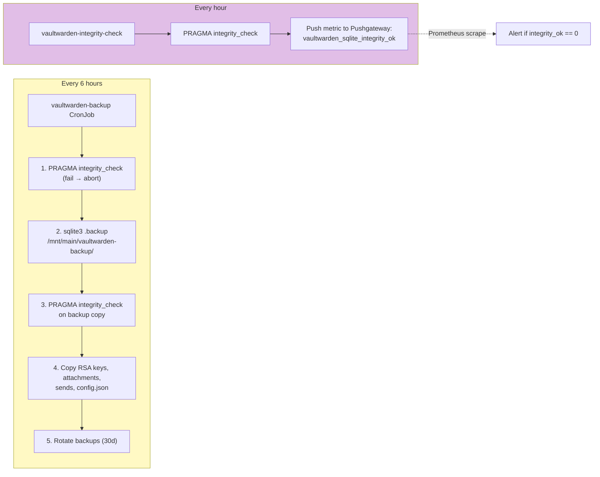

# Backup & Disaster Recovery Architecture

<!-- showcase: Data is snapshotted on the host, mirrored to a second disk and copied offsite to a Synology. Data that can be regenerated stays out of the offsite copy. -->

Last updated: 2026-11-11

> **2026-11-10 — the night runs as one ordered chain.** `nightly-chain` on the
> PVE host (`scripts/nightly-chain.sh`, `nightly-chain.timer` at 00:00 UTC) is
> now the only thing that starts the night's backups, each when the previous
> one ends, instead of at hand-staggered times that collided (2026-11-02:
> upgrade-chain drains during nfs-mirror leaked Proxmox CSI slots):
>
> 1. take kured's node lock (`scripts/kured-lock.sh`, the
>    `weave.works/kured-node-lock` annotation on `kured/kured`), waiting up to
>    2 h, so no kured reboot or k8s-version-upgrade drain overlaps the night;
> 2. the DB and app dumps: every CronJob annotated
>    `backup.viktorbarzin.me/nightly-chain=daily` (or `=sunday`, on Sundays),
>    3 at a time, via `kubectl create job --from=cronjob/...`. The 18 CronJobs
>    are suspended; a Job created from a CronJob still moves its
>    `lastSuccessfulTime`, so the `*BackupStale` alerts are unchanged;
> 3. nfs-mirror, 4. lvm-pvc-snapshot, 5. daily-backup, 6. devvm-home-backup,
>    7. t3-state-pull (since 2026-11-11, see "T3 snapshots"),
>    8. offsite-sync-backup, each its own unit, started with
>    `systemctl start --wait`; a failed step is reported and the rest still run;
> 9. release the lock.
>
> The six step timers are disabled (`DISABLED_TIMERS` in
> `scripts/ci/pve-scripts-sync.sh`). daily-backup, offsite-sync-backup and
> lvm-pvc-snapshot moved to the idle IO class like nfs-mirror and
> devvm-home-backup. If the cluster API is down the dumps are skipped and the
> host steps still run. Alerts: `NightlyChainNotSucceeding` (30 h),
> `NightlyChainStepFailed`, `NightlyChainRanWithoutLock` (info). Test one
> piece by hand with `nightly-chain --only backup-etcd,devvm-home-backup`.
> The times in the older sections below are the pre-chain schedule.

> **2026-06-01 — regenerable services carved back out** (offsite Synology hit
> 97%; the `Backup` share had grown +670 G in a week, traced to the 2026-05-26
> change below that started mirroring large regenerable data offsite):
> - **`nfs-mirror` re-excludes** `ollama` (20 G), `prometheus-backup` (64 G),
>   `audiblez` (24 G), `ebook2audiobook` (11 G). Live copy stays on sdc; no
>   sda/Synology copy. `--delete` reaps them from sda on the next run.
>   `*-backup` DB dumps (sqlite-backup etc.) are KEPT — real DB safety copies.
> - **`offsite-sync` Step 2 nfs-ssd → immich-only**: `ollama` (59 G) +
>   `llamacpp` (26 G) on the SSD no longer ship to Synology (re-pullable
>   models). Was a blanket `/srv/nfs-ssd/` sync; now immich-only like nfs/.
> - **`daily-backup` skips `nextcloud/nextcloud-data-proxmox`** — orphaned
>   pre-encryption PV (Released, Retain) that was still backed up weekly.
> - **Nextcloud backup shrunk**: the dedicated nextcloud-backup CronJob
>   (`stacks/nextcloud`) kept 7 full copies incl. a 10 GB+ `nextcloud.log`
>   (87 G total). Now: `log_rotate_size=10 MB` caps the log at source, backup
>   excludes `nextcloud.log*` + preview cache, retention 7 → 1 (pvc-data holds
>   the version history). Footprint < 5 G.
> - **Nextcloud image pinned to `32.0.9`** in chart_values — the 2026-05-26
>   Keel bump (32.0.3 → 32.0.9, data migrated to 32.0.9.2) was never pinned in
>   TF, so this session's apply rolled a 32.0.3 pod and CrashLooped on the
>   downgrade. Pinning eliminates the drift.
> - **One-off Synology delete** of the existing copies above + emptied the
>   `Backup`/`Emo shared` recycle bins (~31 G). ~340 G total; reclaims as the
>   3-day `Backup`-share snapshots roll off (or via manual snapshot expiry).

> **2026-05-26 — bypass list pruned to a single path** (follow-up to the
> 2026-05-24 changes below):
> - `nfs-mirror` now copies ollama, audiblez, ebook2audiobook, and every
>   `*-backup` CronJob output onto sda. Previously these went sdc → Synology
>   DIRECT via Step 2; now they ride leg 1 like everything else.
> - **Bypass list (leg 2)** is now just `/srv/nfs/immich/` — too big for sda
>   (1.5 T), no other choice.
> - **frigate and temp**: dropped from BOTH legs — intentionally not backed up.
>   frigate is a 14-day camera ring, temp is scratch space. User explicit ask
>   2026-05-26.
> - **prometheus, loki, alertmanager**: live-orphan dirs that no longer
>   exist on `/srv/nfs`. Dropped from the exclude/include lists as no-ops.
> - `/mnt/backup/anca-elements` (423 G) deleted — canonical copy lives in
>   Immich since the 2026-05-24 ingest.
> - **`nfs-mirror.timer`: weekly Mon 04:00 → daily 02:00.** Steady-state
>   delta is 10-20 min of mostly-metadata rsync, so the IO cost is
>   negligible. RPO for non-CronJob app data (nextcloud shared files,
>   audiobookshelf library, mailserver Maildir, real-estate-crawler scraped
>   data, etc.) drops from 7 days to ~24h.
> - Aftermath: sda 87% → 46% used; Synology `/Viki/nfs/` shrinks to
>   immich-only on next monthly `--delete` pass (or manual cleanup —
>   see runbook).
>
> **2026-05-24 session — what changed**:
> - **anca-elements archive direction inverted** — Synology `/Backup/Anca/Elements` (770G) deleted; PVE `/srv/nfs/anca-elements` is now source of truth. `anca-elements-sync.sh` retired.
> - **`anca-elements-mirror.{sh,service,timer}` retired**, subsumed into the new **`nfs-mirror`** weekly job covering all critical NFS subtrees (anca-elements + ~80 services) → sda.
> - **Synology `/Backup/Viki/nfs/<svc>/` orphan cleanup** — 84 dirs renamed in-place (btrfs metadata-only) to `/Backup/Viki/pve-backup/<svc>/` so daily-incremental Step 1 sees them as pre-existing and only ships deltas. No re-transfer.
> - **Synology snapshot retention 7d → 3d**, all 8 backlog snapshots deleted via `sudo synosharesnapshot delete Backup ...`. Reclaimed ~800G btrfs (98% → 83% used). DSM API was blocked by 2FA; `sudo` over the existing `Administrator` SSH key worked with the Vault-stored password.
>   **⚠️ CORRECTION (2026-08-06): the retention half of this never took effect.** It was set via
>   `snap_auto_remove_keep_days` in `sharesnap.conf`, which is inert — the authoritative policy
>   (`synoretention/Share#/Backup/policy`) stayed at `retainDay=7`. The identical near-full
>   incident recurred on 2026-08-06. That day retention was set to 3 for real via
>   `synoretentionconf --set-policy`, then **deliberately restored to 7 by Viktor** — the space
>   problem was the un-collapsed hardlinks (`-H`, commit `f88742ba`) and the absent capacity
>   alerting, not the retention depth. **Live value is 7.** The snapshot deletion half of this
>   entry was real; the credential pointer is also stale (see the snapshot-management section).
> - **Manifest mechanism extended**: `nfs-mirror` now appends its transferred file list to `/mnt/backup/.changed-files` so daily Step 1 incremental picks it up (was previously only fed by `daily-backup`).

## Overview

The homelab runs a 3-2-1 strategy with a **two-leg** path to Synology so every NFS byte takes exactly one route to offsite (no duplication, no gaps):

```
sdc /srv/nfs/<svc>/   ──nfs-mirror (nightly chain)──→  sda /mnt/backup/<svc>/   ──offsite-sync Step 1──→  Synology /Backup/Viki/pve-backup/<svc>/  [leg 1]
sdc /srv/nfs/immich/  ──inotify (nfs-change-tracker)──→  offsite-sync Step 2  ──→  Synology /Backup/Viki/nfs/immich/                          [leg 2]
sdc PVCs (LVM thin)   ──daily-backup~snapshot~rsync──→  sda /mnt/backup/{pvc-data,sqlite-backup,opnsense,pve-config}/  ──Step 1──→  Synology /Backup/Viki/pve-backup/
```

The **bypass list** (leg 2) is just `/srv/nfs/immich/` — too big for sda (1.5 T). **Not backed up at all**: `/srv/nfs/frigate/` (camera ring buffer), `/srv/nfs/temp/` (scratch). Everything else rides leg 1 via `nfs-mirror`.

`/srv/nfs/ha-london-backup/` (since 2026-11-11) holds ha-london's own encrypted Home Assistant backups, which the Pi in London writes through Supervisor network storage over the WireGuard tunnel (`docs/architecture/london-site.md`, "Backups"). It has no exclude in `scripts/nfs-mirror.sh`, so it rides leg 1 like any service directory; `HomeAssistantLondonBackupStale` pages when its newest archive is over 8 days old.

**3-2-1 Breakdown**:
- **Copy 1** (live): all PVC data + VM disks on Proxmox sdc thin pool (10.7TB RAID1 HDD); all NFS data at `/srv/nfs[-ssd]/`
- **Copy 2** (local backup): sda `/mnt/backup` (1.1TB RAID1 SAS) — **46% used** post-2026-05-26 (was 87% before anca-elements cleanup; bypass-list pruning added ~260 G of *-backup + ollama + audiblez + ebook2audiobook)
- **Copy 3** (offsite): Synology NAS at 192.168.1.13
  - `Synology/Backup/Viki/pve-backup/` — sda contents (PVC backups + nfs-mirror output: ~90 service dirs incl. `*-backup` DB dumps. **ollama/audiblez/ebook2audiobook/prometheus-backup excluded 2026-06-01** — regenerable, live-only)
  - `Synology/Backup/Viki/nfs/` — immich only (post-2026-05-26)
  - `Synology/Backup/Viki/nfs-ssd/` — **immich-ML only (2026-06-01)**; ollama/llamacpp dropped (re-pullable models, live-only on the SSD)

**VM image backups (added 2026-06-09, RETIRED 2026-09-15)**: no VM is imaged any more. The timer is disabled on purpose and `scripts/ci/pve-scripts-sync.sh` keeps it disabled (`DISABLED_TIMERS`), because each weekly run read all 228 GiB of devvm's disk and took sdc read latency from 0.23 ms to 107.26 ms. The devvm restore path is now the devvm playbook plus `devvm-home-backup`. The three images already on `/mnt/backup/vzdump/` (newest 2026-09-13) are a floor that no longer advances. The rest of this paragraph describes it as it ran. The hand-managed Linux VMs (those NOT in Terraform — see `compute.md`) were historically **not imaged at all** — only their *contents* reached backup if they happened to host a PVC/NFS path. `vzdump-vms` takes a weekly (Sunday 01:00) live `vzdump --mode snapshot` of each configured VMID → `/mnt/backup/vzdump/` (Copy 2), carried offsite by the monthly offsite-sync full pass (Copy 3). It was nightly until 2026-08-16; day-to-day cover for devvm is now `devvm-home-backup` (daily 03:30), and the image is the bare-metal restore floor. **Currently enabled for VMID 102 (devvm)** — the shared workstation, whose per-user home dirs + local-only git repos are otherwise irreplaceable. Extend via `VZDUMP_VMIDS` in the unit. See "VM Image Backups (vzdump)" under How It Works.

## Architecture Diagram

### Data Routing — where each path goes (post-2026-05-26)



### Overall Backup Flow



### Daily Backup Timeline (EEST)



### Physical Disk Layout



### Restore Decision Tree



### Vaultwarden Enhanced Protection



## Components

| Component | Version/Schedule | Location | Purpose |
|-----------|-----------------|----------|---------|
| LVM Thin Snapshots | Nightly chain step 4, 3d retention | PVE host: `lvm-pvc-snapshot` | CoW snapshots of 62 proxmox-lvm PVCs |
| Daily PVC Backup | Nightly chain step 5, 4 weeks | PVE host: `daily-backup` | File-level PVC copy to sda |
| Auto SQLite Backup | Nightly chain step 5 (daily-backup) | PVE host: magic number check + ?mode=ro | Safe SQLite backup from PVC snapshots |
| NFS Change Tracker | Continuous (inotifywait) | PVE host: `nfs-change-tracker.service` | Logs changed NFS file paths to `/mnt/backup/.nfs-changes.log` |
| OPNsense Backup | Nightly chain step 5 (daily-backup) | PVE host: `scp` over SSH | `/conf/config.xml`, newest 14 copies kept |
| Site-router config | Weekly, Sunday 04:30 | PVE host: `router-config-backup` | `sysupgrade -b` archive per OpenWrt site router (mladost3-openwrt today), 8 kept |
| Offsite Sync | Nightly chain step 8, last | PVE host: `offsite-sync-backup` | Two-step: sda→pve-backup + NFS→nfs/nfs-ssd via inotify |
| VM Image Backup (vzdump) | **Retired 2026-09-15** (timer disabled) | PVE host: `vzdump-vms` | Was a weekly live `vzdump` of devvm → `/mnt/backup/vzdump/`. The last three images (newest 2026-09-13) stay as a floor that no longer advances; daily protection is `devvm-home-backup` |
| devvm /home (incremental) | Nightly chain step 6, keep 14 | PVE host: `devvm-home-backup` | `rsync --link-dest` hardlink generations of devvm `/home` → `/mnt/backup/devvm-home/` |
| T3 snapshots | Nightly chain step 7, keep 3 per user | PVE host: `t3-state-pull` | devvm `/var/backups/t3-state/<user>/` daily snapshots → `/mnt/backup/t3-state/<user>/`, gzipped; restored by `t3-restore-state` on the devvm |
| PostgreSQL Backup (full) | Nightly chain dumps, 14d retention | CronJob in `dbaas` namespace | pg_dumpall for all databases |
| PostgreSQL Backup (per-db) | Nightly chain dumps (same Job as the full dump), 14d retention | CronJob in `dbaas` namespace | pg_dump -Fc per database → `/backup/per-db/<db>/` |
| MySQL Backup (full) | Daily 00:30, 14d retention | CronJob in `dbaas` namespace | mysqldump --all-databases |
| MySQL Backup (per-db) | Daily 00:45, 14d retention | CronJob in `dbaas` namespace | mysqldump per database → `/backup/per-db/<db>/` |
| etcd Backup | Weekly Sunday 01:00, 30d | CronJob in `kube-system` | etcdctl snapshot |
| Vaultwarden Backup | Every 6h, 30d retention | CronJob in `vaultwarden` | sqlite3 .backup + integrity |
| Vault Backup | Weekly Sunday 02:00, 30d | CronJob in `vault` | raft snapshot |
| Redis Backup | Weekly Sunday 03:00, 30d | CronJob in `redis` | BGSAVE + copy |
| Vaultwarden Integrity Check | Hourly | CronJob in `vaultwarden` | PRAGMA integrity_check → metric |
| ~~TrueNAS Cloud Sync~~ | **DECOMMISSIONED 2026-04-13** | Was TrueNAS Cloud Sync Task 1 | Replaced by offsite-sync-backup + inotify change tracking on Proxmox host NFS |

## How It Works

### Layer 1: LVM Thin Snapshots (Fast Local Recovery)

Native LVM thin snapshots provide crash-consistent point-in-time recovery for 62 Proxmox CSI PVCs. These are CoW snapshots — instant creation, minimal overhead, sharing the thin pool's free space.

**Script**: `/usr/local/bin/lvm-pvc-snapshot` on PVE host (source: `infra/scripts/lvm-pvc-snapshot.sh`, unit `infra/scripts/lvm-pvc-snapshot.service`, timer `infra/scripts/lvm-pvc-snapshot.timer`). **Deploy is CI, not a person** — see "Deploying the PVE host scripts" below.
**Schedule**: Daily 03:00 via systemd timer, 7-day retention
**Discovery**: Auto-discovers PVC LVs matching `vm-*-pvc-*` pattern in VG `pve` thin pool `data`

**Coverage**: All 65 proxmox-lvm PVCs **except** `dbaas` and `monitoring` namespaces. These are excluded because:
- MySQL InnoDB, PostgreSQL, and Prometheus are high-churn (50%+ CoW divergence/hour)
- They already have app-level dumps (Layer 2)
- Including them causes ~36% write amplification; excluding them reduces overhead to ~0%

**Monitoring**: Pushes metrics to Pushgateway via NodePort (30091). Alerts: `LVMSnapshotStale` (>30h since last run + 30m `for:`), `LVMSnapshotFailing`, `LVMThinPoolLow` (<15% free).

**Restore**: `lvm-pvc-snapshot restore <pvc-lv> <snapshot-lv>` — auto-discovers K8s workload, scales down, swaps LVs, scales back up. See `docs/runbooks/restore-lvm-snapshot.md`.

### VM Image Backups (vzdump)

> **Retired 2026-09-15 (`d05be720`), alerts removed 2026-09-23.** The timer is disabled and `scripts/ci/pve-scripts-sync.sh` keeps it that way. Each run read all 228 GiB of devvm's disk; measured during the 2026-09-13 run, sdc read latency went from 0.23 ms to 107.26 ms and etcd write latency from 1.36 ms to 22.07 ms, and `--ionice 7` did nothing because sdc runs mq-deadline, which ignores ionice classes. Recovering a devvm now means the devvm playbook plus `devvm-home-backup`. The three images on `/mnt/backup/vzdump/` (newest 2026-09-13) are a frozen floor. Reviving it: enable the timer, drop it from `DISABLED_TIMERS`, and restore the three `Vzdump*` rules from git history. The rest of this section describes the job as it ran.

The hand-managed Linux VMs are **intentionally not in Terraform** (telmate/bpg provider bugs — see `compute.md`) and were historically **not imaged at all**: nothing took a whole-disk backup of the VM itself. For most that is acceptable — k8s nodes are reprovisioned from cloud-init and their data lives in PVCs covered above. But **devvm** (the shared multi-user Claude Code workstation, VMID 102) holds irreplaceable state that lives nowhere else: per-user home dirs (`~/.claude`, `~/.t3`, shell history), manually-installed tooling, and **local-only git repos** — the monorepo root at `/home/wizard/code` has no git remote. A lost devvm disk = unrecoverable.

**Script**: `/usr/local/bin/vzdump-vms` on PVE host (source: `infra/scripts/vzdump-vms.sh`). Deploy: push to master — `.woodpecker/pve-scripts-sync.yml` copies the script and its units to the host (see "Deploying the PVE host scripts" below). It was `scp` by hand until 2026-09-03.
**Schedule**: **Weekly, Sunday 01:00** via systemd timer — ahead of the other backup jobs so a fresh image is on sda before offsite-sync runs. Nightly until 2026-08-16, when a full `.vma` re-reading devvm's whole 228 GiB disk every night turned out to be ~40% of all reads on sdc; `devvm-home-backup` took over the daily job.
**Mode**: `vzdump --mode snapshot` — live, no downtime. devvm has the qemu guest agent enabled (`agent: 1`), so the snapshot is **filesystem-consistent** (fs-freeze) rather than merely crash-consistent. Runs `Nice=10` + `IOSchedulingClass=idle` + `--ionice 7` so it never starves etcd on the contended sdc IO domain.
**Scope**: VMIDs in `VZDUMP_VMIDS` (default `102` = devvm). Add VMIDs there to image other hand-managed VMs.
**Retention**: `KEEP=3` newest dumps per VMID on sda (`/mnt/backup/vzdump/`); each devvm image is ~35-50 GB zstd.
**Critical dependency**: `nfs-mirror` MUST keep `--exclude='/vzdump/'` **and `--exclude='/devvm-home/'`**. Its nightly `rsync -rlt --delete /srv/nfs/ → /mnt/backup/` treats any `/mnt/backup` dir with no `/srv/nfs` counterpart as an orphan and deletes it — this silently reaped the first two vzdump images at 02:00 on 2026-06-10 before the exclude was added (same reason `pvc-data`/`pfsense`/`pve-config`/`sqlite-backup`/`routers` are excluded). Any new top-level folder under `/mnt/backup` needs its exclude in `scripts/nfs-mirror.sh` in the same commit: devvm-home (2026-09) and vzdump (2026-06) were both emptied nightly before theirs was added. `t3-state` (2026-11-11) got its exclude in the commit that created it.

**It happened again.** `devvm-home-backup` landed 2026-08-16 without a matching exclude, so `nfs-mirror` reaped its generations nightly for the next 19 days. Measured 2026-09-04: generations `2026-08-31` through `2026-09-03` held **0 entries under `wizard/`** against 87 in `2026-09-04`, and their mtimes (02:05-02:11) sat just after this job's 02:00 slot. Only the current night's generation ever survived, so retention was **1 day, not 14**. Fixed the same day by adding `/devvm-home/`. **Anything new written under `/mnt/backup/` needs its own exclude line here on the same commit** — that is the whole lesson from both incidents.

A third case on 2026-10-15: the autonomous upgrade run wrote its pre-upgrade dumps to `/mnt/backup/manual-upgrade-20261015/<item>/`, and the mirror run that finished at 23:28 UTC the same night deleted the whole directory. `scripts/nfs-mirror.sh` now excludes `/manual-upgrade-*/`, so any `manual-upgrade-<date>/` directory is left alone. Those directories are not pruned by any job; delete them by hand once the upgrade they guard is settled. The MySQL 8.4.8 dumps were re-taken from the read-only 8.4.8 server on 2026-10-16 after the exclude was deployed.
**Offsite**: deliberately **NOT** appended to the incremental offsite manifest — it never deletes, so daily multi-GB images would accumulate unbounded on Synology. Instead the **monthly offsite-sync full pass (days 1-7)** mirrors all of `/mnt/backup` (including `vzdump/`) to Synology with `--delete`, bounded to local retention. So Copy 2 (sda) refreshes **weekly**; Copy 3 (Synology) refreshes **monthly**.
**Monitoring**: pushes `vzdump_last_run_timestamp` / `vzdump_last_status` / `vzdump_last_success_timestamp` to Pushgateway job `vzdump-backup`. The alerts `VzdumpBackupStale`, `VzdumpBackupNeverRun` and `VzdumpBackupFailing` were **removed on 2026-09-23**: with the job retired they could only report the retirement, and `VzdumpBackupStale` had started firing once the last image passed 8 days old.
**Restore**: on the PVE host, `qmrestore /mnt/backup/vzdump/vzdump-qemu-<vmid>-<ts>.vma.zst <vmid>` — restore to a spare VMID first if the original still exists, then swap disks; or use the PVE UI (add `/mnt/backup` as a dir storage with content=backup → Restore).

### T3 snapshots

Added 2026-11-11 for the disposable-devvm plan (`docs/plans/2026-11-11-disposable-devvm.md`):
T3 threads are one of the kept places, so their copy has to live off the VM.

All of a user's T3 state (threads and messages, `t3 project add` registrations, paired
devices and sessions) is one SQLite file, `~/.t3/userdata/statev2.sqlite`, on the devvm's
own disk. Three pieces carry it:

| Piece | Where | What it does |
|---|---|---|
| `t3-backup-state` | devvm, own timer, ~03:30 UTC + up to 20 min jitter | `VACUUM INTO` copy per user → `/var/backups/t3-state/<user>/state-<YYYYMMDD-HHMMSS>.sqlite`, keep 6. `devvm-cleanup` (04:00 UTC) gzips all but the newest. Unchanged by this work |
| `t3-state-pull` | PVE host, nightly chain step 7 | pulls the newest 3 daily snapshots per user to `/mnt/backup/t3-state/<user>/`, always stored as `.sqlite.gz` |
| `t3-restore-state` | devvm, `/usr/local/bin` | puts the newest snapshot back as the user's live database |
| `devvm-bootstrap` step 4c | a Terraform-built devvm's first boot | copies `/mnt/backup/t3-state` from the host back into `/var/backups/t3-state` before provisioning |

**What the pull takes.** Only daily `state-<ts>.sqlite[.gz]` files. Pre-bump copies
(`state-prebump-*`) are taken minutes after the daily one and serve version rollback on
the box itself; journals and `-wal`/`-shm` files are skipped. When the devvm still has a
snapshot uncompressed (its newest) the host gzips it, so the first copy of wizard's ~1.7 GB
database is ~400 MB on sda; once the devvm's own `.gz` exists, nothing is fetched again.
A file modified in the last 30 minutes is left for the next night, because the chain can
reach this step while `t3-backup-state` or `devvm-cleanup` is still writing. Every file is
checked (SQLite header, or `gzip -t`) before it is kept. New files go into
`/mnt/backup/.changed-files`, so the same night's offsite incremental carries them; the
monthly full pass reaps pruned ones on the Synology. `nfs-mirror` excludes `/t3-state/`.

**Shrink guard.** Pruning holds, and the step fails, when the newest snapshot is under a
quarter of the size of the largest one kept. That is what a rebuilt devvm whose T3 state
was never restored would send: a fresh, nearly empty database that would push every real
generation out within three nights.

**Access.** Pull, like `devvm-home-backup`. The host key `/root/.ssh/id_devvm_t3_state`
is authorised on the devvm's root account pinned to
`command="/usr/bin/rrsync -ro /var/backups/t3-state",restrict`, so it reads that one
directory and nothing else. The authorisation is declared in `playbooks/devvm.yml`
(tag `t3-snapshot`); the public key text is Vault `secret/devvm-authorized-keys`, field
`root-t3-state-pull`, like the admin's keys, because this repo is publicly mirrored.
The snapshots hold live T3 session tokens, so the host keeps them root-only (0700/0600).

**Freshness.** The chain pulls the snapshot the devvm wrote ~23 h earlier, so the newest
copy off the VM is ~23 h old after a pull and ~47 h just before the next. A rebuild loses
at most that much T3 history. Alerts: `T3SnapshotOffVmStale` (newest snapshot of a user
older than 72 h, page; ancamilea is excluded by name because her copy is frozen on
purpose since she left the roster on 2026-08-17; there is no age cut-off, so a missed page
keeps firing) and `T3SnapshotPullNeverReported`
(no metric for 48 h, page). A failed run also shows as `NightlyChainStepFailed`.
Pushgateway job `t3-state-pull`.

**Not covered.** Only the database. `~/.t3/userdata/secrets/` (T3 cloud link keys and the
asset-signing key), `attachments/`, `settings.json` and `keybindings.json` are not in the
snapshot. On a rebuild T3 generates new keys and the user re-links T3 Cloud if they used it.
`devvm-home-backup` still copies all of `~/.t3` while it runs.

**Restore on a rebuilt devvm.** Automatic for a devvm built from `stacks/devvm`:

1. `scripts/devvm-bootstrap` puts up a hold file, `/var/lib/t3-restore/awaiting-snapshots`,
   before the playbook. The playbook enables the hourly provisioning timer, which could
   otherwise start an empty T3 for each user before the snapshots are in.
2. After the playbook (step 4c) it reads Vault `secret/devvm-t3-seed` with its bootstrap
   token and copies `/mnt/backup/t3-state/` from the host into `/var/backups/t3-state/`.
   The fields are `private_key`, `public_key` and `known_hosts` (the host's key, so ssh
   checks it on first contact). On the host the key is pinned in root's
   `authorized_keys` to
   `command="/usr/bin/rrsync -ro /mnt/backup/t3-state",restrict,from="192.168.1.2"`,
   declared in `playbooks/pve-host.yml` (tag `t3-snapshot`). It can read that one
   directory and nothing else, and only from the firewall's inter-VLAN SNAT address.
   The key file lives in a root-only temp directory for the copy and is deleted after.
   `/var/backups/t3-state` is left root 0755. The per-user directories stay root 0700
   until that user's first nightly `t3-backup-state` takes them over.
3. On success it removes the hold. Provisioning (step 5) calls
   `t3-restore-state --if-missing <user>` before `systemctl enable --now t3-serve@<user>`,
   so each user's newest snapshot is their database from the first start.
4. If the copy fails, the build carries on and the status reads
   `ok (T3 held: snapshots not copied from the Proxmox host)`. While the hold is up,
   `--if-missing` exits 3 for a user with no snapshot and no database, and provisioning
   leaves that user's T3 stopped. Nobody gets an empty T3 that a later restore would have
   to move aside.

Copy by hand, after a failed step 4c or onto a box not built by `stacks/devvm`, from a
machine that holds the admin's SSH key. Archive the user directories, not `.`: the host's
`/mnt/backup/t3-state` is root 0700, and extracting `.` as root gives the target that mode,
which stops every nightly and pre-bump snapshot on the new box.

```bash
# 1. host -> new devvm, into the directory t3-restore-state reads
ssh root@192.168.1.127 'cd /mnt/backup/t3-state && tar -cf - --exclude=.incoming */' \
  | ssh wizard@<new-devvm> 'sudo install -d -m 0755 /var/backups/t3-state && sudo tar -C /var/backups/t3-state -xf - --no-same-owner'
# 2. release the hold; the next hourly provisioning run restores and starts each serve
sudo rm -f /var/lib/t3-restore/awaiting-snapshots
sudo systemctl start t3-provision-users.service   # or wait for the timer
# 2b. a user whose serve already made an empty database: restore explicitly; the
#     empty database is kept beside it as statev2.sqlite.before-restore-<ts>
sudo t3-restore-state --dry-run --all
sudo t3-restore-state --all            # or: sudo t3-restore-state <user>
```

`t3-restore-state` picks the newest `state-<ts>.sqlite[.gz]` in `/var/backups/t3-state/<user>/`
(`--snapshot FILE` names another). Root decompresses it in `/var/lib/t3-restore` (root
0700) and checks it with `PRAGMA quick_check` before touching anything. Every step inside
the user's home runs as the user, so a symlink the user planted there reaches only what
they could write anyway. It stops a running `t3-serve@<user>`, moves the live database and
its WAL aside, installs the snapshot as `statev2.sqlite` (mode 0600) and starts the serve
again. `--if-missing` does nothing for a user who has any T3 database. If the box ran a
night before the restore, its own nightly snapshot of the empty database is now the newest
file there: pass `--snapshot` with the pulled one, one user at a time (`--all` takes no
`--snapshot`).

**After a rebuild, on the host.** The new devvm has new SSH host keys, and the host's
`/root/.ssh/known_hosts` still pins the old ones for 10.0.10.10, so the next night's
`t3-state-pull` and `devvm-home-backup` both fail (`NightlyChainStepFailed` pages). Once
the new box answers on 10.0.10.10:

```bash
ssh root@192.168.1.127 'ssh-keygen -R 10.0.10.10 && ssh-keyscan -t ed25519 10.0.10.10 >>/root/.ssh/known_hosts'
```

Compare the fingerprint with `ssh-keygen -lf /etc/ssh/ssh_host_ed25519_key.pub` on the
new devvm before trusting it.

**ancamilea.** Her snapshots are pulled and kept, but she left the roster on 2026-08-17,
so a rebuilt box has no account for her: provisioning and `--all` skip her. Her data is the
pre-0.1.0 `state.sqlite` schema (migration 40); `t3-restore-state` installs every snapshot
as `statev2.sqlite`, and whether T3 0.1.x accepts an old-schema file under that name has not
been tested. If she is added back, restore her with `sudo t3-restore-state ancamilea` and
check her threads; if T3 refuses the file, put it back as `~/.t3/userdata/state.sqlite`
instead so T3 runs its own import.

### Layer 2: Weekly File-Level Backup (sda Backup Disk)

**Backup disk**: sda (1.1TB RAID1 SAS) → VG `backup` → LV `data` → ext4 → mounted at `/mnt/backup` on PVE host. Dedicated backup disk, independent of live storage.

**Script**: `/usr/local/bin/daily-backup` on PVE host (source: `infra/scripts/daily-backup.sh`, unit + timer alongside it). **Deploy is CI** — see "Deploying the PVE host scripts" below.
**Schedule**: Daily 05:00 via systemd timer
**Retention**: 4 weekly versions (weeks 0-3 via `--link-dest` hardlink dedup)

#### What Gets Backed Up

**1. PVC File Copies** (`/mnt/backup/pvc-data/<YYYY-WW>/`):
- Mount each LVM thin LV ro on PVE host → rsync files (not block) → unmount
- 62 PVCs covered (all except dbaas + monitoring)
- Organized as `/mnt/backup/pvc-data/<YYYY-WW>/<namespace>/<pvc-name>/`
- 4 weekly versions with `--link-dest` hardlink dedup (unchanged files share inodes)

**2. Auto SQLite Backup** (`/mnt/backup/sqlite-backup/`):
- Detects SQLite databases in PVC snapshots via magic number check (`SQLite format 3`)
- Opens each database with `?mode=ro` (read-only, safe — no WAL replay)
- Runs `.backup` to create a consistent copy
- Covers all SQLite files across all PVC snapshots automatically

**3. OPNsense Backup** (`/mnt/backup/opnsense/`, ADR-0038):
- `scp root@10.0.20.1:/conf/config.xml` to `config-<date>.xml`; root on the PVE host logs in with `/root/.ssh/id_rsa`, authorized by `playbooks/opnsense.yml --tags users`
- The newest 14 copies are kept
- The configuration source is also in git (`playbooks/files/opnsense/*.yml`), so this copy is for a fast restore of the exact running state
- Replaced the pfSense step, which took config.xml via the API plus a weekly filesystem tar, at the 2026-11-10 cutover. `/mnt/backup/pfsense/` keeps the last pfSense backups, 4.7 GB on 2026-11-10, and nothing adds to or prunes it now

**Site-router config backups** (`router-config-backup`, separate from daily-backup):
- **Script**: `/usr/local/bin/router-config-backup` on the PVE host (source `infra/scripts/router-config-backup.sh`, unit + timer alongside). Deploy is CI, like the others (see "Deploying the PVE host scripts").
- **Schedule**: weekly, Sunday 04:30 EET, on its own timer, `Persistent=true`. It is light (one small archive per router) and not part of the nightly chain; if it lands after that night's offsite-sync, the next night ships it.
- **What**: each router in `ROUTERS` (today `mladost3-openwrt=root@10.3.2.7`, over the site-to-site tunnel) streams `sysupgrade -b -`, the standard OpenWrt config backup, into `/mnt/backup/routers/<name>/backup-<name>-<YYYYMMDD>.tar.gz` (mode 0600: the archives hold WireGuard private keys and root password hashes). An archive is kept only if it is valid gzip and contains `etc/config/network`.
- **Offsite**: each new archive is appended to `/mnt/backup/.changed-files`, so the next daily offsite-sync copies just that file to `Synology:/Backup/Viki/pve-backup/routers/`; the monthly full pass mirrors the folder too.
- **Retention**: 8 per router on sda (about two months), plus the Synology's daily snapshots of the Backup share.
- **Auth**: dedicated key `/root/.ssh/id_router_backup` on the PVE host. On the router it is pinned in `/etc/dropbear/authorized_keys` as `command="sysupgrade -b - 2>/dev/null",no-port-forwarding,no-agent-forwarding,no-X11-forwarding,no-pty`, so it can only produce a backup (verified: asking it to run `id; cat /etc/shadow` returns the backup stream instead). The router's tunnel firewall rule admits the PVE host (`192.168.1.127`) next to 10.0.0.0/8.
- **Adding a router**: authorize the key with the same pinned line, allow 192.168.1.127 to its SSH port, and append `name=root@<tunnel-ip>` to `ROUTERS` in the script.
- **Monitoring**: Pushgateway job `router-config-backup`, one `instance` per router, `backup_last_status` / `backup_last_success_timestamp` / `backup_last_bytes`, pushed on success and failure. Alerts `RouterConfigBackupStale` (>9d) and `RouterConfigBackupFailing`.
- **Restore**: copy the archive to the router and `sysupgrade -r <file>`, then reinstall the packages listed in `docs/architecture/vpn.md` (Mladost 3 section); the archive carries config, not packages.

**4. PVE Config** (`/mnt/backup/pve-config/`):
- `/etc/pve/` (cluster config, VM definitions)
- `/usr/local/bin/` (custom scripts)
- `/etc/systemd/system/` (timers)
- Single copy (no rotation)

**Auto-discovered BACKUP_DIRS**: Uses glob-based discovery instead of a hardcoded list. Any new PVC LV matching `vm-*-pvc-*` is automatically included.

**Snapshot Pruning**: Deletes LVM snapshots older than 7 days (safety net for snapshots that outlive `lvm-pvc-snapshot` timer).

**Monitoring**: Pushes `daily_backup_last_run_timestamp`, `daily_backup_last_status`, and `daily_backup_bytes_synced` to Pushgateway (job `daily-backup`). Alerts: `WeeklyBackupStale` (>9d on `daily_backup_last_run_timestamp`), `WeeklyBackupFailing` (`daily_backup_last_status != 0`). The metric is pushed both on clean exit AND from a `trap TERM INT` handler — a 2026-04-30 → 2026-05-09 silent-failure incident traced to systemd SIGTERMing the script before it reached its final push, leaving the alert blind.

### Layer 2b: Application-Level Backups

K8s CronJobs run inside the cluster, dumping database/state to NFS-exported backup directories. Each service writes to `/srv/nfs/<service>-backup/` (some legacy paths still use `/mnt/main/<service>-backup/`).

**Why needed**: LVM snapshots capture block-level state, but:
- Cannot restore individual databases from a PostgreSQL snapshot
- Proxmox CSI LVs are opaque raw block devices
- Need point-in-time recovery for specific apps without full LVM rollback

**Daily backups (00:00-00:30)**:
- **PostgreSQL** (`postgresql-backup`, 00:00): `pg_dumpall --globals-only` to `globals_*.sql.gz`, then `pg_dump -Fc` of each database to `/mnt/main/postgresql-backup/per-db/<dbname>/dump_*.dump`. Single-database restore via `pg_restore -d <db> --clean --if-exists`; whole-cluster restore is globals then each database. 14-day rotation. Until 2026-11-03 a full `pg_dumpall` and a separate per-db job (00:15) each read every database.
- The PostgreSQL job above and Immich's `postgresql-backup` (00:00, `pg_dumpall` of `immich-postgresql`) run on `docker.io/library/postgres:16.15-trixie`, so the client stays on PostgreSQL 16 like `pg-cluster`. Each job pushes `backup_last_success_timestamp` to the Pushgateway (jobs `postgresql-backup`, `postgresql-backup-per-db`, `immich-postgresql-backup`) with Perl's core `HTTP::Tiny`, because the image has no curl or wget. Until 2026-10-10 the jobs ran `postgres:16.4-bullseye` and installed curl at run time; that step failed once `bullseye-pgdg` left `apt.postgresql.org`, so the dumps kept succeeding while the timestamp stopped updating around 2026-09-06. The push result is logged as `pushgateway: <status>`.
- **MySQL** (`mysql-backup`, 00:30): users and grants to `grants_*.sql.gz`, then `mysqldump --single-transaction --routines --events` of each database to `/mnt/main/mysql-backup/per-db/<dbname>/dump_*.sql.gz`. 14-day rotation. Until 2026-11-03 a full `--all-databases` dump and a separate per-db job (00:45) each read every database.
- **ClickHouse** (rybbit, 01:10): CronJob `clickhouse-backup` writes schema plus Native-format rows per table to `/srv/nfs/clickhouse-backup/<yyyymmdd-hhmm>/`, after restoring the dump into `clickhouse-local` to check it. 14-day rotation. Runbook: `docs/runbooks/restore-clickhouse.md`.
- **ClickHouse** (claude-sessions, 01:40): CronJob `clickhouse-backup` runs native `BACKUP DATABASE claude` plus the `netsec` `*_hourly` rollup tables (not the raw `netsec` tables) to `/srv/nfs/claude-sessions-backup/`: a full on Sunday, an incremental against the newest full on other days. Incrementals kept 28 days, fulls 35. Runbook: `docs/runbooks/restore-claude-sessions.md`.
- **Dolt** (beads-server, 01:25): CronJob `dolt-backup` writes a mysqldump per database to `/srv/nfs/dolt-backup/<yyyymmdd-hhmm>/`, after restoring it into a scratch Dolt directory to check it. Current rows only, no commit history. 14-day rotation. Runbook: `docs/runbooks/restore-dolt.md`.
- **Dolt history** (beads-server, 01:45): CronJob `dolt-history-backup` copies each database's store from the `dolt-data` PVC (mounted read-only by a co-located pod; manifest first, chunk journal last), checks the copy with `dolt fsck`, runs `dolt backup sync-url` from the copy, and writes `<db>.tar` to `/srv/nfs/dolt-backup/history/<yyyymmdd-hhmm>/` after restoring it with `dolt backup restore` and comparing commit and branch counts. Keeps commit history, branches, tags and working sets; the live server only answers two count queries. Keeps the newest 14 runs. The Renovate rails run it before a Dolt bump. Runbook: `docs/runbooks/restore-dolt.md`.

**Daily backups (Sunday 01:00-04:00)**:
- **etcd**: `etcdctl snapshot save /mnt/main/etcd-backup/snapshot-$(date +%Y%m%d).db`. 30-day retention. Critical for cluster recovery.
- **Vaultwarden**: See "Vaultwarden Enhanced Protection" below. 30-day retention.
- **Vault**: `vault-raft-backup` CronJob, `vault operator raft snapshot save /backup/vault-raft-$(date +%Y%m%d-%H%M%S).db` onto the NFS share `192.168.1.127:/srv/nfs/vault-backup` (PVC `vault-backup-host`). 30-day retention.
- **Redis**: `redis-cli BGSAVE` then copy RDB file. 30-day retention.

### Vaultwarden Enhanced Protection

Vaultwarden stores sensitive password vault data in SQLite on a proxmox-lvm volume. Extra safeguards prevent corruption:

**Every 6 hours** (vaultwarden-backup CronJob):
1. Run `PRAGMA integrity_check` on live database
2. If check fails → abort (alert fires)
3. If check passes → `sqlite3 .backup /mnt/main/vaultwarden-backup/db-$(date +%Y%m%d%H%M).sqlite`
4. Run `PRAGMA integrity_check` on backup copy
5. Copy RSA keys, attachments, sends folder, config.json
6. Rotate backups older than 30 days

**Every hour** (vaultwarden-integrity-check CronJob):
1. Run `PRAGMA integrity_check` on live database
2. Push metric to Pushgateway: `vaultwarden_sqlite_integrity_ok{status="ok"}=1` or `=0`
3. Prometheus scrapes Pushgateway and alerts on `integrity_ok == 0`

This provides both frequent backups (every 6h) AND continuous integrity monitoring (hourly).

### Layer 3: Offsite Sync to Synology NAS

**Script**: `/usr/local/bin/offsite-sync-backup` on PVE host (source: `infra/scripts/offsite-sync-backup.sh`, unit + timer alongside it). **Deploy is CI** — see "Deploying the PVE host scripts" below.
**Schedule**: last step of the nightly chain (see the 2026-11-10 note at the top); its own timer is disabled

Two-step offsite sync:

#### Step 1: sda to Synology pve-backup/

**Method**: `rsync` from `/mnt/backup/` to `synology.viktorbarzin.lan:/Backup/Viki/pve-backup/`
**Content**: PVC snapshots (`pvc-data/`), OPNsense backups, PVE config, SQLite backups, **plus the nfs-mirror output** (anca-elements + ~30 critical NFS subtrees) — see Layer 3a. After consolidation, sda is the single source for the bulk of Synology's payload.

**Destination**: `Synology/Backup/Viki/pve-backup/`:
- `pvc-data/<YYYY-WW>/` — 4 weekly PVC file backups
- `sqlite-backup/` — auto SQLite backups
- `opnsense/`: the newest 14 OPNsense `config.xml` copies; `pfsense/` holds the last pfSense backups
- `pve-config/` — latest PVE config
- `anca-elements/`, `mysql/`, `postgresql/`, `nextcloud/`, `health/`, `<other critical NFS dirs>/` — from nfs-mirror (Layer 3a)

#### Step 2: sda-bypass NFS to Synology nfs/ + nfs-ssd/ (inotify change-tracked, FILTERED)

**Role**: Carries the single path that bypasses sda — `/srv/nfs/immich/` (1.5 T, doesn't fit on sda). Plus the full `/srv/nfs-ssd/` (immich-ML + ollama + llamacpp; the SSD has no sda-mirror leg). Everything else under `/srv/nfs/` rides leg 1.

**Method**: `rsync --files-from /mnt/backup/.nfs-changes.log` with regex filter `^/srv/nfs/immich/`. The monthly full sync uses `--include='/immich/***' --exclude='*'` for the HDD leg, and a plain `--delete` for the SSD leg.

**Change tracking**: `nfs-change-tracker.service` (systemd, inotifywait) on PVE host watches `/srv/nfs` and `/srv/nfs-ssd` continuously. Changed file paths are logged to `/mnt/backup/.nfs-changes.log`. Step 2 reads this log and transfers only changed files matching the bypass regex. Incremental syncs complete in seconds.

**Monthly full sync**: On 1st Sunday of month, runs `rsync --delete` with the immich-only include list. The `--delete` pass also reaps any stale Synology `/Viki/nfs/<dir>/` from the broader pre-2026-05-26 bypass list (ollama, audiblez, ebook2audiobook, *-backup, frigate, prometheus, loki, temp, alertmanager).

**`/srv/nfs/anca-elements/` history**: had its own dedicated Synology exclusion line earlier in 2026-05-24 because the original Synology source (`/volume1/Backup/Anca/Elements`) was being preserved while we moved canonical to PVE. After the original was deleted (same day), anca-elements joined the broader "NOT bypassing sda" category and is covered by Step 1 via `nfs-mirror`.

**Layer 3a: NFS local mirror on sda (3-2-1 second copy)**: `/usr/local/bin/nfs-mirror` rsyncs `/srv/nfs/` → `/mnt/backup/<service>/` daily at 02:00 (switched from weekly Mon 04:00 on 2026-05-26 — steady-state delta is 10-20 min of mostly-metadata rsync, cuts non-CronJob app-data RPO from 7d to ~24h). Single rsync invocation, single destination. As of 2026-05-26 the skip-list (in `nfs-mirror.sh` `EXCLUDES`) is intentionally minimal:

- **immich** (1.5 T) — too big for sda; ships sdc → Synology direct (leg 2)
- **frigate** (camera ring buffer) — intentionally NOT backed up
- **temp** (scratch) — intentionally NOT backed up
- **anca-elements** (legacy) — now in Immich; `/mnt/backup/anca-elements` deleted 2026-05-26
- **/srv/nfs-ssd** entirely — its three dirs (immich-ML, ollama, llamacpp) all ship direct to Synology nfs-ssd/

Everything else under `/srv/nfs/` — mysql, postgresql, nextcloud, health, real-estate-crawler, audiobookshelf, servarr, technitium, openclaw, ollama (HDD), audiblez, ebook2audiobook, every `*-backup` CronJob output, … — lands at `/mnt/backup/<svc>/`. Mirror size ≈ 400 GB post-2026-05-26 (was ~900 GB with anca-elements).

Pushes `nfs_mirror_last_run_timestamp` + `nfs_mirror_last_status` + `nfs_mirror_bytes` to Pushgateway. Alerts: `NfsMirrorStale` (>16d), `NfsMirrorFailing` (status != 0). `rsync -rlt --delete -H --no-perms --no-owner --no-group`; idempotent. Nice=10, IOSchedulingClass=idle (won't compete with foreground IO).

> History: `anca-elements-mirror.{sh,service,timer}` was a precursor (2026-05-24 morning) dedicated to /srv/nfs/anca-elements only. Subsumed by `nfs-mirror` later the same day to consolidate ad-hoc copy scripts into one.

**Destination**:
- `Synology/Backup/Viki/nfs/` — immich only (post-2026-05-26)
- `Synology/Backup/Viki/nfs-ssd/` — mirrors `/srv/nfs-ssd` (immich-ML, ollama, llamacpp)

**Monitoring**: Pushes `offsite_backup_sync_last_success_timestamp` to Pushgateway. Alerts: `OffsiteBackupSyncStale` (>8d), `OffsiteBackupSyncFailing`.

#### ~~TrueNAS Cloud Sync~~ — DECOMMISSIONED 2026-04-13

> TrueNAS Cloud Sync was decommissioned along with TrueNAS (2026-04-13). The current offsite path is inotify-change-tracked rsync from the Proxmox host NFS (`/srv/nfs`, `/srv/nfs-ssd`) to Synology.

### Synology snapshot management

Synology DSM keeps daily btrfs snapshots of every shared folder (the `Backup` share most importantly). Retention is configured per-share in DSM's Snapshot Replication app.

> ### ⚠️ Two config files. Only one of them does anything.
>
> **AUTHORITATIVE** — `/usr/syno/etc/synoretention/Share#/<share>/policy`, managed by
> `/usr/syno/bin/synoretentionconf`. This is what `synoretainer` actually enforces:
>
> ```bash
> synoretentionconf --get "Share#" Backup                  # read
> synoretentionconf --set-policy "Share#" Backup retain_by_day 7   # write
> ```
>
> **INERT** — `snap_auto_remove_keep_days` / `snap_auto_remove_enable` in
> `/usr/syno/etc/sharesnap/sharesnap.conf`. These read like the retention knob and are
> *not*. Setting them changes nothing.
>
> **This cost us a repeat incident.** On 2026-05-24 retention was "tightened 7d → 3d" by
> setting `snap_auto_remove_keep_days=3` — and documented here as done. The real policy
> stayed at `retainDay=7`, so the volume kept 7 days of snapshots and hit 99% again on
> 2026-08-06 (103 GiB free, ~1 day from stopping the offsite leg). Both the 2026-05-24 note
> above and this section asserted 3 days for ~10 weeks while the system did 7.
>
> Whenever you touch retention, verify with `synoretentionconf --get` — never trust
> `sharesnap.conf`, and never trust the docs alone.

**Current settings** (`Backup` share, verified 2026-08-06 via `synoretentionconf --get`):
daily snapshot, `Policy type: 64 (Retain by day)`, **`RetainDay=7`**. Contrast: `homes` and
`Emo shared` are `retainDay=28`, `music` is 7.

> **7 days is a deliberate choice, not the old bug.** During the 2026-08-06 incident retention
> was briefly set to 3, then **restored to 7 by Viktor the same day** — 7 days of rollback depth
> on the offsite copy is worth the space. The earlier 7 was an *accident* (the 3 never applied);
> this 7 is a decision. Don't "fix" it back to 3.
>
> What makes 7 affordable now, where it wasn't before:
> 1. **`-H` on the offsite rsync** (commit `f88742ba`) — the weekly `pvc-data` generations were
>    landing as independent full copies (124G real vs 300G apparent). That ~176 GiB of pure
>    duplication was the bulk of what 7 days of snapshots had to pin.
> 2. **Real capacity alerts** (below) — the volume is no longer unmonitored, so a refill is
>    caught days out instead of surfacing at 99%.
>
> If it fills again *with* those in place, the honest next lever is capacity (the DS218 is a
> 2-bay at 5.3 TB and the Immich mirror grows), not shaving retention.

**Snapshot count runs at retention+1** — the daily snapshot is created at the same 00:00 tick
that `synoretainer` prunes, so `RetainDay=7` steady-state shows 8. Don't read that as drift.

Snapshots are CoW — deleting a file from the live filesystem does NOT free its blocks while any retained snapshot references them. Reclaim only happens after ALL referencing snapshots roll off.

**DSM Web API is gated by 2FA (FIDO/OTP)** — programmatic snapshot management has to go via SSH + sudo instead:

**The password is in VAULTWARDEN, not HashiCorp Vault** (corrected 2026-08-06 — the old
`vault kv get -field=synology_admin_password secret/viktor` documented here returns EMPTY and
no such key exists under `secret/`; that dead pointer cost a handoff mid-incident). Note there
are TWO Vaultwarden items named `nas.viktorbarzin.me` — disambiguate on `username=Administrator`
(the other is Anca's).

```bash
PW=$(homelab vault get e993c4e1-6e22-4fe8-a52d-2a5214d9d0c0 --field password)

# Pass the secret on ssh STDIN, never inside the remote command string:
# `ssh host "echo '$PW' | sudo -S ..."` FAILS ("no password was provided") and would
# also leak the password into the remote process args.
printf '%s\n' "$PW" | ssh Administrator@192.168.1.13 \
  'sudo -S -p "" /usr/syno/sbin/synosharesnapshot list Backup'

# Delete specific snapshots (space-separated; keep the newest few)
printf '%s\n' "$PW" | ssh Administrator@192.168.1.13 \
  'sudo -S -p "" /usr/syno/sbin/synosharesnapshot delete Backup GMT-2026.08.01-21.00.02 ...'

# Read / change retention (AUTHORITATIVE — not sharesnap.conf)
printf '%s\n' "$PW" | ssh Administrator@192.168.1.13 \
  'sudo -S -p "" /usr/syno/bin/synoretentionconf --get "Share#" Backup'
printf '%s\n' "$PW" | ssh Administrator@192.168.1.13 \
  'sudo -S -p "" /usr/syno/bin/synoretentionconf --set-policy "Share#" Backup retain_by_day 7'
```

For a multi-line remote script, feed the password as line 1 and the script after it —
`sudo` consumes the first line, `bash -s` reads the rest:

```bash
{ printf '%s\n' "$PW"; printf '%s' "$SCRIPT"; } | ssh Administrator@192.168.1.13 'sudo -S -p "" bash -s'
```

**Reclaim is ASYNCHRONOUS.** `synosharesnapshot delete` prints `Success!` instantly, but the
btrfs cleaner frees extents in the background — `df` lags by minutes (2026-08-06: deleting 5
snapshots took the volume 99% → 90% in ~3 min and settled at 83%/957 GiB free over the next
hour; 2026-05-24 saw ~300 MB/s sustained with 800 GB bursts). Don't treat a flat `df` as failure.

**Sizing tip**: use `df` or `btrfs qgroup show` — a `du` over `/volume1` does NOT finish on the
DS218 (runs killed at 900 s and 2400 s on 2026-08-06). Measure hardlink-aware sizes from the
PVE side instead (`du -sh` vs `du -slh` on `/mnt/backup/pvc-data`).

> Memory: id=2673-2676 (Synology snapshot retention gotcha — deletion vs reclaim timing).

### Deploying the PVE host scripts

`lvm-pvc-snapshot`, `daily-backup`, `offsite-sync-backup`, `devvm-home-backup`,
`vzdump-vms`, `nfs-mirror`, `router-config-backup`, `nightly-chain` and `t3-state-pull`
deploy from git through Woodpecker, not by hand. Push a change to any of their files under
`infra/scripts/` (`<name>.sh`, `<name>.service`, `<name>.timer`) and
`.woodpecker/pve-scripts-sync.yml` copies the script to `/usr/local/bin/<name>`, the units
to `/etc/systemd/system/`, runs `bash -n` on each script, then `systemctl daemon-reload`
and prints the timer list. Failures post to Slack.

The pipeline follows `pve-nfs-exports-sync.yml` and uses the same `pve_ssh_key` repo
secret (private key mirrored in Vault `secret/woodpecker/pve_ssh_key`).

Why it exists: these scripts carried an `scp` invocation in this document and depended on
someone remembering to run it, so a committed change could sit undeployed. Added
2026-09-03 (code-kpk0) for the first three, after `lvm-pvc-snapshot.service` turned out to
exist on the host and in no repository at all (code-3ni). All nine files were
byte-identical between repo and host when the pipeline landed, so its first run changed
nothing.

`devvm-home-backup` and `vzdump-vms` joined the same day. `devvm-home-backup` had no
deploy path at all — neither CI nor Ansible carried it — so its repo copy was the one
nobody kept in step with the host. `vzdump-vms` was byte-identical to the host copy
(md5 `e1b06d5b3862fa62edf826e274e4b1fc`), so adding it closed a drift window rather than
changing anything.

`nfs-mirror` joined 2026-09-04, the last one still deployed by hand. All three of its
files were byte-identical between repo and host when it joined.

`t3-state-pull` joined 2026-11-11 with its timer in `DISABLED_TIMERS` from the start.

Nothing in this set is deployed by hand any more.

## Configuration

### Key Files

| Path | Purpose |
|------|---------|
| `/usr/local/bin/lvm-pvc-snapshot` | PVE host: LVM snapshot creation + restore |
| `/usr/local/bin/daily-backup` | PVE host: PVC file copy + auto SQLite backup + OPNsense config |
| `/usr/local/bin/offsite-sync-backup` | PVE host: two-step rsync to Synology (sda + NFS via inotify) |
| `/usr/local/bin/vzdump-vms` | PVE host: live `vzdump` image of devvm → `/mnt/backup/vzdump/`. **Retired 2026-09-15**, still deployed so reviving it is one `systemctl enable` |
| `/usr/local/bin/devvm-home-backup` | PVE host: daily incremental `rsync --link-dest` of devvm `/home` → `/mnt/backup/devvm-home/`. ~29 GB per generation after the 2026-09-03 exclude fix (was 37 GB — virtualenvs and four SDK caches were slipping through) |
| `/mnt/backup/` | PVE host: sda mount point (1.1TB backup disk) |
| `/mnt/backup/vzdump/` | PVE host: vzdump VM images (keep 3 per VMID), mirrored offsite monthly |
| `/mnt/backup/devvm-home/` | PVE host: devvm `/home` hardlink generations (keep 14), mirrored offsite monthly (`-H` preserves the link farm) |
| `/mnt/backup/.nfs-changes.log` | NFS change log from inotifywait, consumed by offsite-sync |
| `/etc/systemd/system/nfs-change-tracker.service` | inotifywait watcher for `/srv/nfs` + `/srv/nfs-ssd` |
| `/usr/local/bin/nightly-chain` | PVE host: runs the night's dumps and the six host steps in order, holding kured's node lock (source `infra/scripts/nightly-chain.{sh,service,timer}`, helper `kured-lock.sh`) |
| `/etc/systemd/system/nightly-chain.timer` | 00:00 UTC daily, the only nightly backup timer |
| `/etc/systemd/system/lvm-pvc-snapshot.timer` | **Disabled since 2026-11-10**: nightly-chain step 4 |
| `/etc/systemd/system/daily-backup.timer` | **Disabled since 2026-11-10**: nightly-chain step 5 |
| `/etc/systemd/system/offsite-sync-backup.timer` | **Disabled since 2026-11-10**: nightly-chain step 8 |
| `/etc/systemd/system/devvm-home-backup.timer` | **Disabled since 2026-11-10**: nightly-chain step 6 |
| `/usr/local/bin/t3-state-pull` | PVE host: nightly-chain step 7, the devvm's daily T3 snapshots → `/mnt/backup/t3-state/<user>/` (source `infra/scripts/t3-state-pull.{sh,service,timer}`; timer disabled, the chain starts it) |
| `/mnt/backup/t3-state/` | PVE host: newest 3 T3 snapshots per user as `state-<ts>.sqlite.gz`, mode 0700/0600, carried offsite nightly through the manifest |
| `/usr/local/bin/t3-restore-state` | devvm: puts a user's newest snapshot back as `~/.t3/userdata/statev2.sqlite` (source `infra/scripts/t3-restore-state.sh`, installed by `playbooks/devvm.yml`) |
| `/etc/systemd/system/vzdump-vms.timer` | **Disabled since 2026-09-15** on purpose (`DISABLED_TIMERS` in `scripts/ci/pve-scripts-sync.sh`) |
| `/etc/systemd/system/vzdump-vms.service` | oneshot: `vzdump-vms` (source `infra/scripts/vzdump-vms.{sh,service,timer}`) |
| `/usr/local/bin/nfs-mirror` | PVE host: nightly-chain step 3, mirror of /srv/nfs/* → sda /mnt/backup/<svc>/ (Layer 3a) |
| `/etc/systemd/system/nfs-mirror.timer` | **Disabled since 2026-11-10**: nightly-chain step 3 |
| `stacks/dbaas/` | Terraform: PostgreSQL/MySQL backup CronJobs |
| `stacks/vault/` | Terraform: Vault backup CronJob |
| `stacks/vaultwarden/` | Terraform: Vaultwarden backup + integrity CronJobs |
| `stacks/monitoring/` | Terraform: Prometheus alerts |
| `synology:Administrator@192.168.1.13` | Synology SSH; sudo password = Vault `secret/viktor` `synology_admin_password`; DSM API itself gated by 2FA |
| `/usr/syno/sbin/synosharesnapshot` | Synology: btrfs snapshot CLI — must run as root via sudo |

### Vault Paths

| Path | Contents |
|------|----------|
| `secret/viktor/synology_ssh_key` | SSH key for Synology NAS SFTP access |
| `secret/viktor/pfsense_api_key` | pfSense API key + secret, used by the pfSense backup step until the 2026-11-10 cutover; the OPNsense step uses SSH |

### Terraform Stacks

Each backup CronJob is defined in the application's stack:
- PostgreSQL/MySQL: `stacks/dbaas/backup.tf`
- Vault: `stacks/vault/backup.tf`
- Vaultwarden: `stacks/vaultwarden/backup.tf`
- etcd: `stacks/platform/etcd-backup.tf`

## Decisions & Rationale

### Why 3-2-1 Strategy?

**3 copies**:
- Live PVCs (zero RTO for recent data)
- sda local backup (fast recovery without network)
- Synology offsite (site-level disaster protection)

**2 media types**:
- sdc SSD (live, low latency)
- sda HDD (backup, cost-effective bulk storage)

**1 offsite**:
- Protection against fire, theft, catastrophic hardware failure
- Weekly RPO acceptable for offsite (daily/weekly app backups reduce exposure)

### Why File-Level + Block-Level Snapshots?

**LVM snapshots** (Layer 1):
- Near-instant (<1s), zero overhead
- Point-in-time recovery for entire PVCs
- BUT: Cannot restore individual files, no offsite protection, 7-day retention

**File-level backup** (Layer 2):
- Can restore single files or directories
- Offsite-compatible (rsync)
- Longer retention (4 weeks local, unlimited offsite)
- BUT: Slower RTO (rsync), higher storage overhead

Both together provide flexibility: fast local rollback for recent changes, granular recovery for older data.

### Why Dedicated Backup Disk (sda)?

**Isolation**: If sdc fails (thin pool corruption, controller failure), sda is independent (different disk, different VG).

**Performance**: Backup I/O doesn't compete with live PVC I/O.

**Simplicity**: Single mount point (`/mnt/backup/`) for all backup data, easy to monitor disk usage.

### Why Not Velero/Longhorn Backup?

Evaluated K8s-native backup solutions (Velero, Longhorn):
- **Velero**: Requires object storage backend, complex restore, doesn't handle databases well
- **Longhorn**: High overhead (replicas, snapshots in-cluster), no offsite by default

**Current approach wins** because:
- Leverages existing Proxmox LVM infrastructure (already running)
- Database-native backups (pg_dump/mysqldump) are battle-tested
- Simple restore procedures (documented runbooks)
- Lower resource overhead (no in-cluster replicas)

### Why Hybrid Incremental + Full Sync?

**Incremental alone** (rsync --files-from via inotify change log) is risky:
- Deleted files on source never deleted on destination
- Renamed paths create duplicates
- No cleanup of orphaned files

**Full sync alone** (rsync --delete) is slow:
- 30-60 min per run (all files scanned)
- 7d RPO → 14d if a sync fails

**Hybrid approach**:
- Fast incremental weekly via inotify change tracking (completes in seconds)
- Monthly full `rsync --delete` for cleanup (tolerates longer runtime)

### Why 6h Vaultwarden Backup vs Daily for Others?

Vaultwarden stores **password vault data** — highest-value target:
- User creates 10 new passwords → disaster 5h later → daily backup loses all 10
- 6h RPO acceptable for password vaults (industry standard is 1-24h)
- Hourly integrity checks detect corruption before it spreads to backups

Other services (MySQL, PostgreSQL):
- Mostly application data (not authentication secrets)
- Daily RPO acceptable per user tolerance
- Lower change velocity

## Troubleshooting

### LVM Snapshot Restore Issues

See `docs/runbooks/restore-lvm-snapshot.md`.

### Weekly Backup Failing

**Symptom**: `WeeklyBackupStale` or `WeeklyBackupFailing` alert

**Diagnosis**:
```bash
ssh root@192.168.1.127
systemctl status daily-backup.service
journalctl -u daily-backup.service --since "7 days ago"
df -h /mnt/backup
```

**Common causes**:
- Backup disk full (check `df -h /mnt/backup`, alert: `BackupDiskFull`)
- LV mount failed (check `lvs pve`, `dmesg | grep backup`)
- NFS mount failed (check `showmount -e 192.168.1.127`)

**Fix**:
1. If disk full: Clean up old weekly versions manually, adjust retention
2. If LV mount failed: `lvchange -ay backup/data && mount /mnt/backup`
3. If NFS failed: Check Proxmox NFS availability (`showmount -e 192.168.1.127`), verify exports
4. Manually trigger: `systemctl start daily-backup.service`

### Offsite Sync Failing

**Symptom**: `OffsiteBackupSyncStale` or `OffsiteBackupSyncFailing` alert

**Diagnosis**:
```bash
ssh root@192.168.1.127
systemctl status offsite-sync-backup.service
journalctl -u offsite-sync-backup.service --since "7 days ago"
wc -l /mnt/backup/.nfs-changes.log  # verify change log exists
systemctl status nfs-change-tracker.service  # verify inotify watcher
```

**Common causes**:
- Synology NAS unreachable (network, SFTP down)
- SSH key auth failed (permissions, expired key)
- nfs-change-tracker.service stopped (no change log)

**Fix**:
1. Verify Synology: `ping 192.168.1.13`, `ssh root@192.168.1.13`
2. Verify SSH key: `ssh -i /root/.ssh/synology_backup root@192.168.1.13`
3. Verify change tracker running: `systemctl status nfs-change-tracker.service`
4. Manually trigger: `systemctl start offsite-sync-backup.service`

### PostgreSQL Backup Stale Alert

**Symptom**: `PostgreSQLBackupStale` firing in Prometheus

**Diagnosis**:
```bash
kubectl get cronjob -n dbaas
kubectl logs -n dbaas job/postgresql-backup-<timestamp>
```

**Common causes**:
- Pod OOMKilled (increase memory limit)
- NFS mount unavailable (check Proxmox NFS)
- pg_dumpall command failed (check PostgreSQL connectivity)

**Fix**:
1. If OOM: Increase `resources.limits.memory` in `stacks/dbaas/backup.tf`
2. If NFS: Verify mount on worker node, restart NFS server on Proxmox host if needed (`systemctl restart nfs-server`)
3. Manually trigger: `kubectl create job --from=cronjob/postgresql-backup manual-backup -n dbaas`

### Vaultwarden Integrity Check Failing

**Symptom**: `VaultwardenIntegrityFail` alert, `vaultwarden_sqlite_integrity_ok=0`

**Diagnosis**:
```bash
kubectl exec -n vaultwarden deployment/vaultwarden -- sqlite3 /data/db.sqlite3 "PRAGMA integrity_check;"
```

**Critical**: If integrity check fails, database is corrupt.

**Recovery**:
1. Stop writes: `kubectl scale deployment/vaultwarden --replicas=0 -n vaultwarden`
2. Restore from latest backup (see `restore-vaultwarden.md`)
3. Verify integrity on restored DB
4. Scale back up: `kubectl scale deployment/vaultwarden --replicas=1 -n vaultwarden`

### OPNsense Backup Failing

**Symptom**: `OpnsenseBackupStale` alert: no successful copy for 9 days, job `opnsense-backup`

**Diagnosis**:
```bash
ssh root@192.168.1.127
journalctl -u daily-backup.service --since -2d | grep -i opnsense
```

**Common causes**:
- SSH key rejected: the PVE host's `/root/.ssh/id_rsa` is not in OPNsense root's authorized keys
- Host key mismatch: the host's `known_hosts` entry for 10.0.20.1 must hold OPNsense's key, which replaced pfSense's at the cutover
- OPNsense unreachable

**Fix**:
1. From the PVE host: `ssh -o BatchMode=yes root@10.0.20.1 true`
2. Re-apply the authorized keys: `playbooks/opnsense.yml --tags users`; the keys are in `playbooks/files/opnsense/authorized_keys.yml`
3. Access and everyday commands: `docs/runbooks/opnsense.md`

### Backup Disk Full

**Symptom**: `BackupDiskFull` alert, `df -h /mnt/backup` >85%

**Fix**:
```bash
ssh root@192.168.1.127

# Check space usage by component
du -sh /mnt/backup/pvc-data/*
du -sh /mnt/backup/opnsense /mnt/backup/pfsense
du -sh /mnt/backup/sqlite-backup

# Clean up old weekly versions (keep latest 2)
find /mnt/backup/pvc-data -maxdepth 1 -type d -name "????-??" | sort | head -n -2 | xargs rm -rf
```

Nothing prunes `/mnt/backup/pfsense/` any more: it holds the last pfSense backups, about 4.7 GB on 2026-11-10.

### Missing Backup for New Service

**Symptom**: Added new service using proxmox-lvm storage, no backup exists

**Fix**: The service is automatically covered by:
1. **LVM snapshots** (if not in dbaas/monitoring namespace) — automatic, no config needed
2. **Weekly file backup** — automatic, no config needed

**If the service has a database that needs app-level dumps**:
Add backup CronJob in service's Terraform stack (see template below).

**Template**:
```hcl
resource "kubernetes_cron_job_v1" "backup" {
  metadata {
    name      = "${var.service_name}-backup"
    namespace = kubernetes_namespace.service.metadata[0].name
  }
  spec {
    schedule = "0 3 * * 0"  # Weekly Sunday 03:00
    job_template {
      spec {
        template {
          spec {
            container {
              name  = "backup"
              image = "appropriate/image:tag"
              command = ["/bin/sh", "-c"]
              args = [
                <<-EOT
                TIMESTAMP=$(date +%Y%m%d)
                # Dump command here (sqlite3 .backup, pg_dump, etc.)
                find /backup -mtime +30 -delete
                EOT
              ]
              volume_mount {
                name       = "data"
                mount_path = "/data"
              }
              volume_mount {
                name       = "backup"
                mount_path = "/backup"
              }
            }
            volume {
              name = "data"
              persistent_volume_claim {
                claim_name = kubernetes_persistent_volume_claim.data.metadata[0].name
              }
            }
            volume {
              name = "backup"
              persistent_volume_claim {
                claim_name = module.nfs_backup.pvc_name
              }
            }
          }
        }
      }
    }
  }
}

module "nfs_backup" {
  source     = "../../modules/kubernetes/nfs_volume"
  name       = "${var.service_name}-backup"
  namespace  = kubernetes_namespace.service.metadata[0].name
  nfs_server = var.nfs_server
  nfs_path   = "/srv/nfs/${var.service_name}-backup"
}
```

## Monitoring & Alerting

```
┌────────────────────────────────────────────────────────────────┐
│                     Prometheus Alerts                           │
│                                                                 │
│  PostgreSQLBackupStale      > 36h since last success            │
│  MySQLBackupStale           > 36h since last success            │
│  EtcdBackupStale            > 8d  since last success            │
│  VaultBackupStale           > 8d  since last success            │
│  VaultwardenBackupStale     > 8d  since last success            │
│  RedisBackupStale           > 8d  since last success            │
│  ~~CloudSyncStale~~         REMOVED (TrueNAS decommissioned)    │
│  ~~CloudSyncNeverRun~~      REMOVED (TrueNAS decommissioned)    │
│  ~~CloudSyncFailing~~       REMOVED (TrueNAS decommissioned)    │
│  VaultwardenIntegrityFail   integrity_ok == 0                   │
│  LVMSnapshotStale           > 30h since last snapshot           │
│  LVMSnapshotFailing         snapshot creation failed            │
│  LVMThinPoolLow             < 15% free space in thin pool       │
│  WeeklyBackupStale          > 8d  since last success            │
│  WeeklyBackupFailing        backup script exited non-zero       │
│  OpnsenseBackupStale        > 9d  since last success            │
│  OffsiteBackupSyncStale     > 8d  since last success            │
│  BackupDiskFull             > 85% usage on /mnt/backup          │
│  T3SnapshotOffVmStale       > 72h newest T3 snapshot on sda     │
│  T3SnapshotPullNeverReported no t3-state-pull metric for 48h    │
└────────────────────────────────────────────────────────────────┘
```

**Metrics sources**:
- Backup CronJobs: Push `backup_last_success_timestamp` to Pushgateway on completion
- LVM snapshot script: Pushes `lvm_snapshot_last_run_timestamp`, `lvm_snapshot_last_status`, `lvm_snapshot_created_total`, `lvm_snapshot_failed_total`, `lvm_snapshot_pruned_total`, `lvm_snapshot_thinpool_free_pct` (job `lvm-pvc-snapshot`)
- Daily backup script: Pushes `daily_backup_last_run_timestamp`, `daily_backup_last_status`, `daily_backup_bytes_synced` (job `daily-backup`). Disk-fullness alert (`BackupDiskFull`) does NOT use a script-pushed metric; it derives from node-exporter `node_filesystem_avail_bytes{job="proxmox-host", mountpoint="/mnt/backup"}`.
- OPNsense backup (step 3 of `daily-backup`): Pushes `backup_last_run_timestamp`, `backup_last_status`, and `backup_last_success_timestamp` (only on success) under job `opnsense-backup`. Pushed in BOTH success and failure paths so `OpnsenseBackupStale` doesn't go silent when SSH to OPNsense breaks. The pfSense step and its `pfsense-backup` job were removed at the cutover.
- Offsite sync script: Pushes `backup_last_success_timestamp`, `offsite_sync_last_status` (job `offsite-backup-sync`)
- Prometheus backup (sidecar in prometheus-server pod, monthly 1st-Sunday 04:00 UTC): Pushes `prometheus_backup_last_success_timestamp` (job `prometheus-backup`)
- ~~CloudSync monitor~~: Removed (TrueNAS decommissioned)
- Vaultwarden integrity: Pushes `vaultwarden_sqlite_integrity_ok` hourly

**Pushgateway persistence**: The Pushgateway is configured with
`--persistence.file=/data/pushgateway.bin --persistence.interval=1m`
on a 2Gi `proxmox-lvm-encrypted` PVC (helm values:
`prometheus-pushgateway.persistentVolume`). Without this, every pod
restart drops in-memory metrics. Once-per-day pushers (offsite-sync,
weekly backup) are otherwise invisible for up to 24h if the
Pushgateway restarts between pushes — which is exactly what triggered
the 2026-04-22 backup_offsite_sync FAIL (node3 kubelet hiccup at
11:42 UTC terminated the Pushgateway 8h after the 03:12 UTC push).

**Alert routing**:
- All backup alerts → Slack `#infra-alerts`
- Vaultwarden integrity fail → Slack `#infra-critical` (immediate action required)

## Service Protection Matrix

| Service | LVM Snapshots (7d) | File Backup (4w) | App Backup | Offsite | Storage |
|---------|:------------------:|:----------------:|:----------:|:-------:|---------|
| **Databases** |
| PostgreSQL (all DBs) | — | — | ✓ daily | ✓ | proxmox-lvm |
| MySQL (all DBs) | — | — | ✓ daily | ✓ | proxmox-lvm |
| **Critical State** |
| Vault | ✓ | ✓ | ✓ weekly | ✓ | proxmox-lvm |
| etcd | ✓ | ✓ | ✓ weekly | ✓ | proxmox-lvm |
| Vaultwarden | ✓ | ✓ | ✓ 6h + integrity | ✓ | proxmox-lvm |
| Redis | ✓ | ✓ | ✓ weekly | ✓ | proxmox-lvm |
| **Applications (65 proxmox-lvm PVCs)** |
| Prometheus | — | — | — | excluded | proxmox-lvm |
| Nextcloud | ✓ | ✓ | — | ✓ | proxmox-lvm |
| Calibre-Web | ✓ | ✓ | — | ✓ | proxmox-lvm |
| Forgejo | ✓ | ✓ | — | ✓ | proxmox-lvm |
| FreshRSS | ✓ | ✓ | — | ✓ | proxmox-lvm |
| ActualBudget | ✓ | ✓ | — | ✓ | proxmox-lvm |
| NovelApp | ✓ | ✓ | — | ✓ | proxmox-lvm |
| Headscale | ✓ | ✓ | — | ✓ | proxmox-lvm |
| Uptime Kuma | ✓ | ✓ | — | ✓ | proxmox-lvm |
| **Other apps not enumerated above** | ✓¹ | ✓¹ | varies | ✓ | proxmox-lvm / proxmox-lvm-encrypted |
| **Hand-managed VMs (not in Terraform)** |
| devvm (workstation, VMID 102) | — | — | ✓ daily `/home` rsync + daily T3 snapshots (`t3-state-pull`); the weekly vzdump image is retired | ✓ `/home` monthly, T3 snapshots nightly | local-lvm (sdc) |
| Other hand-managed VMs (HA 103, registry 220, k8s nodes) | — | — | — gap² | — | local-lvm — see note² |
| **Media (NFS)** |
| Immich (~800GB) | — | — | — | ✓ | NFS |
| Audiobookshelf | — | — | — | ✓ | NFS |
| Servarr | — | — | — | ✓ | NFS |
| Navidrome | — | — | — | ✓ | NFS |

**Legend**:
- ✓ = Protected at this layer
- — = Not needed (other layers cover it, or data is regenerable/disposable)
- excluded = Too large/regenerable, not worth offsite bandwidth

**Note**: All proxmox-lvm and proxmox-lvm-encrypted PVCs get LVM snapshots (except `dbaas` and `monitoring` namespaces, excluded for write-amplification reasons) + file-level backup. NFS-backed media syncs directly to Synology `nfs/` and `nfs-ssd/` via inotify change tracking.

² **Hand-managed VMs** — **no VM is imaged since 2026-09-15**, when `vzdump-vms` was retired; devvm (102) was the only one, and its protection is now the devvm playbook plus `devvm-home-backup`. The k8s nodes are deliberately uncovered (reprovisioned from cloud-init; their data lives in the PVCs already backed up above). **home-assistant (103) and docker-registry (220) are a documented gap** — add their VMIDs to `VZDUMP_VMIDS` to image them (registry content is also re-pullable from upstreams; HA has its own add-on backups). OPNsense (100) is covered separately by `daily-backup` (config.xml), and its configuration source is in git; pfSense (101) is stopped and kept as the rollback.

¹ **"Other apps not enumerated above"** — the table only enumerates services worth calling out. The default backup posture for any service using `proxmox-lvm` or `proxmox-lvm-encrypted` (outside `dbaas`/`monitoring`) is **automatic** Layer 1 (LVM thin snapshots, 7d retention) + Layer 2 (file backup, 4 weekly versions on sda) + Layer 3 (offsite to Synology). Auto-discovery is by LV name pattern (`vm-*-pvc-*`), so adding a new service to the cluster gets it covered without any explicit registration. Run `ssh root@192.168.1.127 lvs --noheadings -o lv_name pve | grep '^vm-.*-pvc-' | grep -v _snap_ | wc -l` to see the live count.

**Known gaps** — services with PVCs not on the proxmox-lvm path lose Layer 1+2:
- **Prometheus, Alertmanager, Pushgateway** — `monitoring` namespace excluded by policy; loss is acceptable (metrics regenerable, silences ephemeral, Pushgateway has on-disk persistence for 24h gap tolerance).

## Recovery Procedures

Detailed runbooks in `docs/runbooks/`:

- **`restore-lvm-snapshot.md`** — Instant rollback of a PVC using LVM snapshot (RTO <5 min)
- **`restore-pvc-from-backup.md`** — Restore a PVC from sda file backup (when snapshots expired)
- **`restore-postgresql.md`** — Restore individual database (from per-db `pg_dump -Fc`) or full cluster (from `pg_dumpall`)
- **`restore-mysql.md`** — Restore individual database (from per-db `mysqldump`) or full cluster (from `mysqldump --all-databases`)
- **`restore-vault.md`** — Restore Vault from raft snapshot
- **`restore-vaultwarden.md`** — Restore password vault from sqlite3 backup
- **`restore-etcd.md`** — Restore etcd cluster from snapshot
- **`restore-full-cluster.md`** — Disaster recovery: rebuild cluster from offsite backups

**RTO estimates**:
- LVM snapshot rollback: <5 min (instant swap)
- File-level restore from sda: <15 min (depends on PVC size)
- Single PostgreSQL database: <5 min
- Full MySQL cluster: <15 min
- Vault: <10 min
- Vaultwarden: <5 min
- etcd: <20 min (requires cluster rebuild)
- Full cluster from offsite: <4 hours (NFS restore + K8s bootstrap + app deploys)

## Related

- **Architecture**: `docs/architecture/storage.md` (NFS/Proxmox storage layer)
- **Reference**: `.claude/reference/service-catalog.md` (which services need backups)
- **Runbooks**: `docs/runbooks/restore-*.md` (step-by-step recovery procedures)
- **Monitoring**: `stacks/monitoring/alerts/backup-alerts.yaml` (Prometheus alert definitions)
