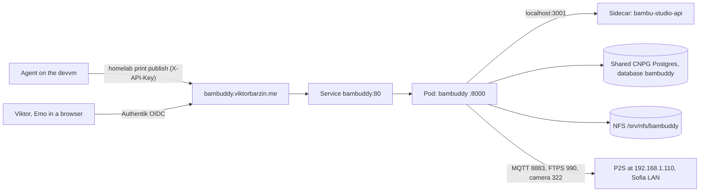

# Bambuddy

Bambuddy is the 3D-print workshop for the Bambu Lab P2S in Emo's Sofia flat. It keeps every print project in one place: the model files, the design source, notes, photos, sliced plates and print history. People preview a model, slice it and print it from the web app at `https://bambuddy.viktorbarzin.me`. Agents publish the parts they design into it with `homelab print`. Stack: `stacks/bambuddy`. Upstream: [maziggy/bambuddy](https://github.com/maziggy/bambuddy), AGPL-3.0.

## Shape

| Piece | Value |
|---|---|
| Images | `ghcr.io/maziggy/bambuddy:1.3.2` and `ghcr.io/maziggy/bambu-studio-api:bambuddy-1.3.2`. Upstream releases both together, so keep the two tags equal |
| Workload | Deployment `bambuddy`, 1 replica, `Recreate`, because Bambuddy holds one MQTT session per printer and runs its queue scheduler in the process |
| Slicer | The `bambu-studio-api` container runs the Bambu Studio CLI behind an HTTP API on port 3001. The Slice button in the library sends the model and the profiles to it and gets a `.gcode.3mf` back |
| Database | `bambuddy` on the shared CNPG cluster (`stacks/dbaas` `app_databases`). Password from the Vault static role `pg-bambuddy`, rotated Tuesdays at 10:25 UTC. Pool of 3 plus 4 overflow connections |
| Files | NFS `/srv/nfs/bambuddy` at `/app/data`: library files, the print archive, plate-detection references. The nightly NFS mirror and offsite sync carry it |
| Secrets | Vault `secret/bambuddy`: `jwt_secret_key`, `mfa_encryption_key`, `oidc_client_secret`, and `admin_password` for the local `admin` account. Vault `secret/bambuddy-agent`: `api_key` of the local `agent` account |
| Ingress | `auth = "app"`, proxied. Bambuddy's own login gates the UI and the API. Its own per-client rate limit (50 average, 300 burst, after real-ip): the default 10/50 limiter answered 429 to the login page's first load |

## Sign-in and access

People sign in with Authentik. The Authentik application `bambuddy` (`stacks/bambuddy/authentik.tf`) admits the Home Server Admins group, which is Viktor and Emo. Bambuddy creates the account on the first login and maps the group to its own Administrators group (`BAMBUDDY_OIDC_GROUP_MAPPING`).

Two local accounts exist:

| Account | Use |
|---|---|
| `admin` | Break-glass login and settings. Password in Vault `secret/bambuddy` `admin_password` |
| `agent` | In the Operators group. Owns the API key that `homelab print` uses. The key has the library and projects scopes only. It cannot queue, start or stop a print. Its password is in Vault `secret/bambuddy-agent` `password` |

## State outside Terraform

Bambuddy keeps its users, settings and printers in its database. These were set through its API on 2026-11-22, and a rebuild from an empty database repeats them:

1. `POST /api/v1/auth/setup` with `auth_enabled: true`, user `admin` and the Vault password. Until this runs, the app is open, so run it through `kubectl port-forward` before the hostname resolves. The password needs a special character.
2. Create the user `agent` in Operators. Operators lack `api_keys:create`, so move `agent` to Administrators, sign in as `agent`, create the key (`can_queue` and `can_control_printer` false, `can_manage_library` and `can_manage_projects` true), move it back to Operators, and write the key to `secret/bambuddy-agent` `api_key`.
3. Settings (`PATCH /api/v1/settings/`): `use_slicer_api` true, `bambu_studio_api_url` `http://localhost:3001`, `preferred_slicer` and `open_in_slicer` `bambu_studio`, `external_url`, currency EUR. Without `use_slicer_api` the Slice button stays off.
4. Add the printer (`POST /api/v1/printers/`: name `P2S`, serial and access code from `secret/emo/bambu-p2s`, IP 192.168.1.110, model `P2S`). Bambuddy tests the connection first and refuses the printer while it is off. Done on 2026-11-22 with the plug switched on for it: printer id 1, status and camera snapshot checked.

5. Filament inventory: the white PETG Basic came in from the AMS RFID; the other spools of Emo's first order (PETG Basic black and orange, PLA Basic black and Jade White) were added by hand with the order's prices, 10.15 and 10.68 EUR per kg. A hand-added spool links to an RFID roll by material and colour when the roll is first loaded; a colour that does not match (orange is a guess, `F75403`) gives a second spool to archive.
6. The Shelly plug as a REST smart plug `P2S plug` on printer 1, through the Shelly RPC API at 192.168.1.111 (no Home Assistant token in Bambuddy). Power, lifetime energy and state are read from `Switch.GetStatus`. Automatic power-on is off. Automatic power-off after a print is off by default; it is a one-shot switch on the printer card, and when set it waits until the nozzle is below 50 °C.

The files are on NFS and the database in the nightly per-database dump, so a restore of both brings all of this back.

## Agents

`homelab print publish --project "<name>" <file|dir>...` finds or creates the project and a top-level library folder of the same name linked to it, then uploads the files. A file with the same name as one already in the folder replaces it, which is how a new revision goes in. A `README.md` among the files also becomes the project notes on the project page, rendered to HTML. `--description`, `--url` and `--cover <image>` fill in a new project. `homelab print projects` lists the projects with their page URLs. The key comes from `BAMBUDDY_API_KEY` or Vault `secret/bambuddy-agent`, which admins and emo (policy `projects-emo`) can read.

A project folder holds the model files (`.stl`, `.3mf`), the design source (`.py`, `.scad`), a `README.md` that Bambuddy shows with the folder, renders and test-fit photos.

## The printer

Bambuddy reaches the printer directly on the Sofia LAN with its serial number and LAN access code (Vault `secret/emo/bambu-p2s`). The printer stays in cloud mode with Bambu Handy working. In that mode Bambu's authorization firmware lets other software read the status and the camera, but not start a print. Starting a print from Bambuddy needs Developer Mode on the printer, which turns off Bambu Cloud and the Handy app. That switch is Emo's decision; until then Emo prints from Bambu Studio or Handy.

The printer is powered through the Shelly plug "P2S принтер" (192.168.1.111). When the plug is off, Bambuddy shows the printer offline.

The camera allows one stream at a time. Home Assistant (ha-sofia, `ha-bambulab`) and Bambuddy share it, and the one that opens the stream first holds it.

## Upgrades

Change both image tags in `stacks/bambuddy/main.tf` to the same release. Bambuddy migrates its own schema on start. Read the release notes for changes to the `BAMBUDDY_OIDC_*` variables.
