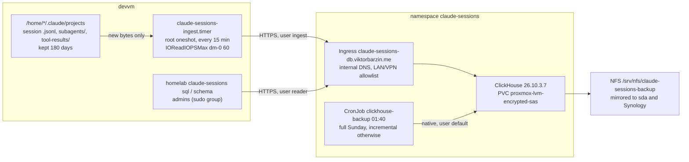

# Claude session store

Every Claude Code session on the devvm, for every user, kept in ClickHouse so it can be queried in bulk. Decision record: [ADR-0039](../adr/0039-claude-sessions-are-kept-in-clickhouse.md). Research: [2026-11-07-session-transcript-store.md](../research/2026-11-07-session-transcript-store.md).

## Data

| Table | One row per | Notes |
|---|---|---|
| `claude.lines` | transcript line | `raw` is the original JSON line. All other columns are `DEFAULT` expressions over `raw`, computed at insert. Identity columns (`os_user`, `project`, `session_id`, `agent_id`, `file`, `byte_offset`) come from the ingester. |
| `claude.blocks` | message content block | Filled by materialized view `blocks_mv` from `lines`: prompts, replies, thinking, `tool_use` (with `tool_name` and input) and `tool_result` (with `is_error` and output). Text index on `text`. |
| `claude.files` | side file | `tool-results/*.txt` and `subagents/*.meta.json`. `ReplacingMergeTree(mtime)`, so query with `FINAL`. Text index on `content`. |
| `claude.requests` | API request (view) | model and token counts, deduplicated by `requestId`. Sum tokens here: `lines` repeats a message's usage on each of its content-block lines, so summing `lines` inflates tokens about 2.5x. |
| `claude.sessions` | session (view) | cost, prompts, human prompts, subagents, compactions, API requests, tokens (from `requests`), models, start and end. |
| `claude.model_costs` | session and model (view) | cost and tokens per model, from `cost-state`'s per-model `modelUsage`. Use it for spend per model; `arrayJoin(sessions.models)` credits a session's whole cost to every model it touched. |
| `claude.turns` | finished turn (view) | `duration_ms` from Claude Code's `turn_duration` records. |

Details worth knowing before writing queries (`homelab claude-sessions schema` prints them with ten example queries):

- `ts` is the record's own timestamp. Records without one (`mode`, `last-prompt`) take the previous timestamp in the same file (`ts_hint`); `has_own_ts` tells them apart. `cost-state` records use the process start time.
- `sessions.cost_usd` sums the last `cost-state` of each Claude Code process in the session. Resuming a session starts a new process with its own counter, so taking only the maximum would undercount. Claude Code writes `cost-state` occasionally, not after each request, so the figure is final once a session has exited and can lag for a running one. Checked on 2026-11-08: five finished sessions matched Loki's `api_request` cost to the cent.
- A column named `file` can parse as the `file()` table function inside some expressions, which the reader is not allowed to use. Write `lines.file` or a backticked name.
- Full-text search: `hasAnyTokens(text, 'word')` and `hasAllTokens(text, ['a','b'])` use the index and ignore case.

## Ingest

`homelab claude-sessions ingest` (`cli/claude_sessions_ingest.go`), run by `claude-sessions-ingest.timer` from `playbooks/devvm.yml` section 8d:

- Walks `/home/*/.claude/projects/<slug>/`, plus `<session>/subagents/` and `<session>/tool-results/`. It reads directories and stats files; it opens only files whose (inode, size, mtime) changed since the state file (`/var/lib/claude-sessions-ingest/state.json`).
- Reads from the stored byte offset to the end of the last complete line. A partial last line waits for the next run. A smaller file or a new inode restarts the file from 0.
- Sends gzip-compressed JSONEachRow batches of about 8 MB. Each batch carries `insert_deduplication_token = <file>:<first offset>`, so a retried batch is dropped by ClickHouse. The state is saved after every accepted batch.
- Security: runs as root with `ProtectHome=read-only`. Opens files with `O_NOFOLLOW`, ignores symlinks, and skips files not owned by the home directory's owner.
- IO: the unit sets `IOReadIOPSMax=/dev/dm-0 60`, because the devvm IO guard only throttles user slices (`docs/architecture/devvm-io-guard.md`).
- Logs one `claude-sessions-ingest status=... lines=...` line per run to the journal and writes `claude_sessions_ingest_*` to the node_exporter textfile collector.

Credentials come from Vault `secret/claude-sessions` (`clickhouse_password`, `ingest_password`, `reader_password`). The playbook writes `/etc/claude-sessions/ingest.env` (root, 0600) and `reader.env` (root:sudo, 0640). The stack's ExternalSecret reads the same keys.

## Access

| ClickHouse user | Used by | Rights |
|---|---|---|
| `default` | backup CronJob, schema changes | admin |
| `ingest` | devvm timer | `INSERT` on `claude.lines` and `claude.files` |
| `reader` | `homelab claude-sessions sql/schema` | `SELECT` on `claude.*`, `readonly=2`, 120 s, 2 GB memory, 100,000 rows |
| `netsec_writer` | `stacks/netsec` Vector | `INSERT` on `netsec.*`, hourly quota |
| `netsec_reader` | `homelab netsec sql/schema` (Viktor only) | `SELECT` on `netsec.*`, same limits as `reader` |

The server also hosts the `netsec` database of the network IDS since 2026-11-10 ([network-security-monitoring.md](network-security-monitoring.md)). It is not in the backup.

`blocks_mv` runs with `SQL SECURITY DEFINER` as `default`. Without it, an insert by `ingest` reaches `lines` and then fails in the view.

## Backups and alerts

The `clickhouse-backup` CronJob (`files/backup.sh`) runs `BACKUP DATABASE claude TO Disk('backups', ...)` at 01:40 UTC: a full backup on Sunday, an incremental against the newest full on other days. Incrementals are kept 28 days and fulls 35 days. It pushes `backup_last_success_timestamp{job="claude-sessions-backup"}`. Restore: [restore-claude-sessions.md](../runbooks/restore-claude-sessions.md).

Alerts: `ClaudeSessionsDBDown`, `ClaudeSessionsIngestStale` (no successful ingest for 1 h), `ClaudeSessionsBackupStale` (36 h), `ClaudeSessionsBackupNeverRun`.

## Changing the schema

The image runs `files/schema.sql` from `/docker-entrypoint-initdb.d` only when the data volume is empty. To change a live schema, run the DDL as `default` (for example `kubectl exec` into the pod with `clickhouse-client`), then make the same change in `schema.sql` in the same commit, so a rebuilt volume matches.
