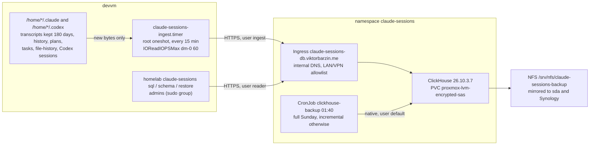

# Claude session store

Every Claude Code session on the devvm, for every user, kept in ClickHouse so it can be queried in bulk. Since 2026-11-11 it also keeps the rest of each user's `~/.claude` and `~/.codex` except credentials and caches, so `homelab claude-sessions restore` can write them back after a rebuild ([disposable devvm plan](../plans/2026-11-11-disposable-devvm.md)). Decision record: [ADR-0039](../adr/0039-claude-sessions-are-kept-in-clickhouse.md). Research: [2026-11-07-session-transcript-store.md](../research/2026-11-07-session-transcript-store.md).

## Data

| Table | One row per | Notes |
|---|---|---|
| `claude.lines` | transcript line | `raw` is the original JSON line. All other columns are `DEFAULT` expressions over `raw`, computed at insert. Identity columns (`os_user`, `project`, `session_id`, `agent_id`, `file`, `byte_offset`) come from the ingester. |
| `claude.blocks` | message content block | Filled by materialized view `blocks_mv` from `lines`: prompts, replies, thinking, `tool_use` (with `tool_name` and input) and `tool_result` (with `is_error` and output). Text index on `text`. |
| `claude.files` | side file | `tool-results/*.txt` and `subagents/*.meta.json`. `ReplacingMergeTree(mtime)`, so query with `FINAL`. Text index on `content`. |
| `claude.home_files` | file under `~/.claude` or `~/.codex` | Everything that is not a transcript, a credential or a cache, sent whole when it changes: plans, tasks, teams, todos, file-history, settings, workflows, remote/ logs, Codex config and databases. `path` is relative to the home. `encoding` is `text`, `base64` (not UTF-8) or `omitted` (over 32 MiB, no content). `redacted` marks a settings file sent with its secret values replaced. `ReplacingMergeTree(ingested_at)`, so query with `FINAL`. |
| `claude.home_lines` | line of a `.jsonl` home file | `history.jsonl`, Codex rollouts (`.codex/sessions/`) and `session_index.jsonl`, appended like `lines`. `generation` changes when a file is read again from the start; restore uses the newest. |
| `claude.requests` | API request (view) | model and token counts, deduplicated by `requestId`. Sum tokens here: `lines` repeats a message's usage on each of its content-block lines, so summing `lines` inflates tokens about 2.5x. |
| `claude.sessions` | session (view) | cost, prompts, human prompts, subagents, compactions, API requests, tokens (from `requests`), models, start and end. |
| `claude.model_costs` | session and model (view) | cost and tokens per model, from `cost-state`'s per-model `modelUsage`. Use it for spend per model; `arrayJoin(sessions.models)` credits a session's whole cost to every model it touched. |
| `claude.turns` | finished turn (view) | `duration_ms` from Claude Code's `turn_duration` records. |

Details worth knowing before writing queries (`homelab claude-sessions schema` prints them with ten example queries):

- `ts` is the record's own timestamp. Records without one (`mode`, `last-prompt`) take the previous timestamp in the same file (`ts_hint`); `has_own_ts` tells them apart. `cost-state` records use the process start time.
- `sessions.cost_usd` sums the last `cost-state` of each Claude Code process in the session. Resuming a session starts a new process with its own counter, so taking only the maximum would undercount. Claude Code writes `cost-state` occasionally, not after each request, so the figure is final once a session has exited and can lag for a running one. Checked on 2026-11-08: five finished sessions matched Loki's `api_request` cost to the cent.
- A column named `file` can parse as the `file()` table function inside some expressions, which the reader is not allowed to use. Write `lines.file` or a backticked name.
- Full-text search: `hasAnyTokens(text, 'word')` and `hasAllTokens(text, ['a','b'])` use the index and ignore case.

## Ingest

`homelab claude-sessions ingest` (`cli/claude_sessions_ingest.go`), run by `claude-sessions-ingest.timer` from `playbooks/devvm.yml` section 8d:

- Walks `/home/*/.claude` and `/home/*/.codex`. Transcripts (`projects/<slug>/<session>.jsonl`, `<session>/subagents/*.jsonl`, and since 2026-11-11 workflow subagents in `<session>/subagents/workflows/<run>/`) go to `lines`; `tool-results/*.txt` and `*.meta.json` go to `files`; other `.jsonl` files go to `home_lines`; everything else goes whole to `home_files`. It reads directories and stats files; it opens only files whose (inode, size, mtime) changed since the state file (`/var/lib/claude-sessions-ingest/state.json`).
- Never sent (`cli/claude_sessions_home.go`): credentials (`.credentials.json*`, `auth.json`, `*.key`, `*.pem`, any name containing token, secret, credential or oauth), caches and runtime state (`cache/`, `paste-cache/`, `shell-snapshots/`, `session-env/`, `sessions/`, `daemon/`, `backups/` with its copies of `~/.claude.json`, `debug/`, `telemetry/`, `tmp/`, `plugins/cache` and `plugins/marketplaces`, Codex `logs_*.sqlite`, `packages/`, `*-shm`, locks), and downloadable binaries (`remote/ccd-cli/`, `remote/srv/`, `remote/server`). Symlinks are not kept: the `CLAUDE.md` and `AGENTS.md` links, the `~/.claude/skills/<name>` links into `~/.agents/skills`, and Codex's shared `auth.json` link are made again by t3-provision-users and `claude-skills-update`. Outside the two directories, two files are kept: `~/.agents/.skill-lock.json`, from which `claude-skills-update` reinstalls a user's skills, and a reduced copy of `~/.claude.json` (below).
- `~/.claude.json` (since 2026-11-11, `cli/claude_sessions_claudejson.go`) is about 1 MB on wizard's account and rewritten on every start, mostly caches, tips, the signed-in account and per-project stats. The store gets a reduced copy: the onboarding flags (`hasCompletedOnboarding`, `lastOnboardingVersion`, `hasSeen*`, `*MigrationComplete`, `installMethod`, `autoUpdates`), the user-scope `mcpServers`, and per project only the keys with a value: folder trust (`hasTrustDialogAccepted`), approved CLAUDE.md includes, `allowedTools`, project `mcpServers` and their approvals. A project with none of them is left out (wizard: 72 of 454 entries kept, 6.5 KB). The copy is redacted like a settings file and always stored with `redacted` true, so restore treats it as one. The state records the copy's SHA-256 (`stored`), and a rewrite that changed only what the copy leaves out sends nothing. A file caught mid-write (does not parse) is skipped and read on the next run.
- Settings files (`settings*.json*`, `*.toml`, `hooks.json`, `*mcp.json`) are sent with secret values replaced by `<redacted>`: values of keys that name a token, key, password or auth, every value under `headers`, `KEY=value` pairs inside strings, bearer tokens, URL passwords, and long runs mixing upper case, lower case and digits. Under `env` each variable is judged by itself: a name containing key, pass, pwd, token, secret, auth, cred, cookie or private, or a value with a long run of letters and digits, is redacted, and the rest (flags such as `DISABLE_AUTOUPDATER=1`, URLs) is kept, so restore can give them back. Checked on 2026-11-11 against all 17 settings files on the box: no token-like string survived. The state records the rule each settings file went under (`rv`); when the rule keeps more than before, every settings file is sent once more.
- Whole home files from many files share one INSERT of up to 8 MB, so a first run makes a few parts, not thousands.
- Reads from the stored byte offset to the end of the last complete line. A partial last line waits for the next run. A smaller file restarts the file from 0. For a new inode (Claude Code rewrote the transcript), the state keeps a running SHA-256 over the bytes already sent (`sum`): if the new copy starts with those same bytes, the ingest goes on from the old offset, so no line is stored twice in `lines` and `blocks` (plain MergeTree tables) and session cost and turn counts stay right. Otherwise the file restarts from 0. A state entry without `sum` (written before 2026-11-11, or by a run that died mid-file) gets it on the file's next change by reading the prefix once.
- Sends gzip-compressed JSONEachRow batches of about 8 MB. Each batch carries `insert_deduplication_token = <file>@<inode>:<first offset>` (`<file>#<generation>:<offset>` for `home_lines`), so a retried batch is dropped by ClickHouse. The state is saved after every accepted batch. Until 2026-11-11 the token had no inode: when Claude Code rewrote a transcript (a new inode), the re-read's first batch carried the old file's first token and ClickHouse dropped it, new lines included. That lost 357 lines (1.1 MB) of one wizard transcript on 2026-11-08, the only gap in the store (checked over every file with a window query in the pod); they were sent again from the live file on 2026-11-11.
- Only the devvm at 10.0.10.10 ingests: the playbook writes `ingest.env` and starts the timer there and nowhere else, because rows carry no box name and a drill VM's files would replace the live box's. The unit also has an `ExecCondition` on that address, so a box whose timer is on anyway skips every run. Both exist because it happened: on 2026-11-11 a drill built before the playbook gate sent 29 `home_files` rows for wizard and emo (drill copies of `settings.json` and others) that `FINAL` returned over the live ones; they were deleted by their `ingested_at`, and the live rows, still unmerged, took over again.
- Waits per user for a rebuild restore: a user is ingested only once `/var/lib/claude-sessions-ingest/restored/<user>` exists or the state already lists their files (the live box, where the ingest writes the marker itself). On a rebuilt box `restore --rebuild` writes the marker after it has restored the user, and step 5 of t3-provision-users starts the user's T3 serve only after that, so a session run on the new box before the restore cannot replace the stored copy. `users_waiting_for_restore` in the run's log line and in the textfile counts the users it left alone; `ClaudeSessionsUserWaitingForRestore` fires when it stays above 0 for 2 hours. The ingest and `restore --rebuild` share the lock `state.lock` beside the state file.
- Security: runs as root with `ProtectHome=read-only`. Opens files with `O_NOFOLLOW`, ignores symlinks, and skips files not owned by the home directory's owner.
- IO: the unit sets `IOReadIOPSMax=/dev/dm-0 60`, because the devvm IO guard only throttles user slices (`docs/architecture/devvm-io-guard.md`).
- Logs one `claude-sessions-ingest status=... lines=...` line per run to the journal and writes `claude_sessions_ingest_*` to the node_exporter textfile collector.

Credentials come from Vault `secret/claude-sessions` (`clickhouse_password`, `ingest_password`, `reader_password`). The playbook writes `/etc/claude-sessions/ingest.env` (root, 0600) and `reader.env` (root:sudo, 0640). The stack's ExternalSecret reads the same keys.

Size, measured on 2026-11-11 (`system.parts`, bytes on disk): the `claude` database went from 1.60 GB to 2.61 GB with the first run. `home_files` is 75 MB (1,994 files, 213 MB uncompressed) and `home_lines` 12 MB (44,581 lines). The rest, about 0.92 GB in `lines` and `blocks`, is the one-time backlog of 1,211 workflow subagent transcripts that the ingester had been missing. That first run took 22 minutes and sat at the unit's 512 MB `MemoryMax`, mostly page cache; later runs take about 17 seconds. Files that change often (the hooks provisioning rewrites hourly, Codex WALs) are sent again each time they change and merge away; the two 74 MB Codex WALs of one user are over the 32 MiB cap and stored as `omitted`.

## Restore

`homelab claude-sessions restore --user <name> (--to <home> | --tar -) [--session <id>] [--force]` (`cli/claude_sessions_restore.go`) writes the store back into a home directory: `home_files`, `home_lines` (newest generation), `files`, and `lines` reassembled in byte-offset order, with modes and mtimes. Existing files are kept unless `--force`. A redacted settings file is written under its real name without the redacted keys, and provisioning fills the secrets back in from Vault: the agent-tool keys in `settings.json` (`install_agent_api_keys`) and the MCP server secrets of `~/.claude.json` and `~/.codex/config.toml` (`mcp-secrets fill`, below). `--path <rel>` (repeatable) restores only those stored home files, such as `.claude.json`, with no transcripts. If the real file is already there, `--to` writes the stored copy beside it as `<name>.from-store` unless the two are equal. As root it refuses to write into a directory another user owns; that case uses `--tar - | runuser -u <user> -- tar -x --skip-old-files`. It reads as `reader` with keyset pages of 500 rows and stops at an empty page, so the reader's silent row and byte caps cannot cut a file short. A line file whose stored offsets jump (lines missing in the store) is written without them and named in a `WARN` line.

`restore --user <name> --rebuild` (`cli/claude_sessions_rebuild.go`) is the rebuild's form, run as root by `t3-provision-users.sh` step 4a for every account with a home under `/home` (roster users and accounts such as breakglass) on every pass, before step 5 starts T3. Once per user and box it extracts the restore as the user (`runuser -u <user> -- tar -x --skip-old-files`), records every file it wrote in the ingest state as already sent (inode, size, mtime, offset at the end, and the stored generation for `home_lines` files), then writes the marker the ingest waits for. Without the seeded state the first ingest would read every restored file again from 0, and transcripts longer than one batch would be inserted a second time. A user the state already lists (the live box) gets the marker and nothing else; later passes stop at the marker without touching the database. A failed restore leaves no marker and removes the files that attempt wrote, so a file cut off mid-stream is not kept by the retry; the next hourly pass tries again. A `.jsonl` file that was there before the restore is kept and named in a `WARN` line. A redacted JSON settings file that was there first (the skeleton `install_memory` makes on a pass whose restore failed) gets the stored keys merged in where absent, arrays element by element, keeping every value it has; it is not recorded as sent, so the ingest stores the merged file. For `~/.claude.json` (provisioning's `claude mcp add playwright`, or the native installer, can write one first) the merge also lets a stored `true` replace a `false` the new file holds, since Claude writes `hasTrustDialogAccepted: false` for a folder it has only opened. A TOML file that was there first gets the stored copy beside it as `<name>.from-store`.

MCP server secrets have their kept place in Vault, `secret/workstation/<user>/mcp` (`cli/claude_sessions_mcp.go`): field `claude_json` holds each `~/.claude.json` MCP server entry (user scope and per project) that the redaction changes, as it is live; field `codex_config_toml` holds each `~/.codex/config.toml` table that holds a secret, header to the next header. `homelab claude-sessions mcp-secrets capture --user <name>` (admin token, root for another user's files) reads the live files and merges into that secret; it refuses a file that still holds `<redacted>`, so a rebuilt box whose fill has not run cannot blank Vault. `mcp-secrets fill` puts the secrets back: an entry is replaced by its Vault copy only when it is exactly what the store's redaction makes of that copy, so a live file whose entries hold their own secrets is never touched, and a restored entry whose other values changed since the capture is named in a `WARN` line instead. Run as root it writes as the user through `runuser` with an emptied environment. `t3-provision-users.sh` step 4a2 runs it for every roster user once their restore marker exists, on passes that hold an admin Vault token. `mcp-secrets list` names the kept entries, never values. Procedure: [restore-claude-sessions.md](../runbooks/restore-claude-sessions.md).

## Access

| ClickHouse user | Used by | Rights |
|---|---|---|
| `default` | backup CronJob, schema changes | admin |
| `ingest` | devvm timer | `INSERT` on `claude.lines`, `claude.files`, `claude.home_files` and `claude.home_lines` |
| `reader` | `homelab claude-sessions sql/schema/restore` | `SELECT` on `claude.*`, `readonly=2`, 120 s, 2 GB memory, 100,000 rows |
| `netsec_writer` | `stacks/netsec` Vector | `INSERT` on `netsec.*`, hourly quota |
| `netsec_reader` | `homelab netsec sql/schema` (Viktor only) | `SELECT` on `netsec.*`, same limits as `reader` |

The server also hosts the `netsec` database of the network IDS since 2026-11-10 ([network-security-monitoring.md](network-security-monitoring.md)). It is not in the backup.

`blocks_mv` runs with `SQL SECURITY DEFINER` as `default`. Without it, an insert by `ingest` reaches `lines` and then fails in the view.

## Backups and alerts

The `clickhouse-backup` CronJob (`files/backup.sh`) runs `BACKUP DATABASE claude TO Disk('backups', ...)` at 01:40 UTC: a full backup on Sunday, an incremental against the newest full on other days. Incrementals are kept 28 days and fulls 35 days. It pushes `backup_last_success_timestamp{job="claude-sessions-backup"}`. Restore: [restore-claude-sessions.md](../runbooks/restore-claude-sessions.md).

Alerts: `ClaudeSessionsDBDown`, `ClaudeSessionsIngestStale` (no successful ingest for 1 h), `ClaudeSessionsUserWaitingForRestore` (a user skipped for a missing restore for 2 h), `ClaudeSessionsBackupStale` (36 h), `ClaudeSessionsBackupNeverRun`.

## Changing the schema

The image runs `files/schema.sql` from `/docker-entrypoint-initdb.d` only when the data volume is empty. To change a live schema, run the DDL as `default` (for example `kubectl exec` into the pod with `clickhouse-client`), then make the same change in `schema.sql` in the same commit, so a rebuilt volume matches.
