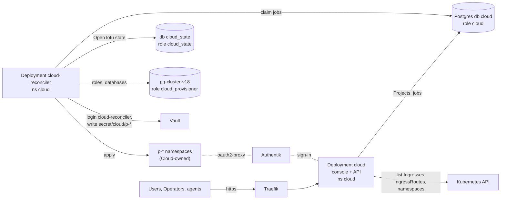

# Cloud

Cloud is the homelab's self-hosted cloud for invited Users: they connect App
and Postgres Services in Projects, and agents do the same through an API. The
code is Forgejo `viktor/cloud` (plan `docs/plans/2026-11-12-cloud-v1-and-operator.md`,
vocabulary `GLOSSARY.md` there). This page covers what this repo runs for it.
Operations are in [docs/runbooks/cloud.md](../runbooks/cloud.md).

Scope: Project namespaces (`p-*`), Project Postgres roles and databases, and
`secret/cloud/<namespace>/*` belong to Cloud's database, not this repo
(AGENTS.md, "Cloud-owned objects"; [docs/agents/terraform.md](../agents/terraform.md)).

## What runs where

| Piece | Where | Defined in |
|---|---|---|
| Console and API | Deployment `cloud` (init container `migrate`), Service `cloud`, ingress `cloud.viktorbarzin.me` (`auth = "app"`), namespace `cloud` | `stacks/cloud/console.tf`, one `modules/kubernetes/tanstack_app` call |
| Reconciler | Deployment `cloud-reconciler` (1 replica, Recreate), Service `cloud-reconciler` (metrics only) | `stacks/cloud/reconciler.tf` |
| Env and credential files of both | locals | `stacks/cloud/deploy_rules.tf` |
| Reconciler identity and limits | service account `cloud-reconciler`, ClusterRoles, admission policies, Calico tier `cloud` | `stacks/cloud/main.tf`, `access_rules.tf` (M2) |
| Console identity | service account `cloud-console` with a token, ClusterRole `cloud-console` (get, list on namespaces, Ingresses, IngressRoutes) | `stacks/cloud/console.tf`, `deploy_rules.tf` |
| Sign-in | Authentik application `cloud` (console, confidential, authorization code and device code), `cloud-cli` (public, device code and refresh token), groups `Cloud Users` and `Cloud Operators` | the module's `authentik.tf`, `stacks/cloud/cli_sign_in.tf` |
| Private Apps' sign-in | Authentik application `cloud-apps`, shared by every private App's oauth2-proxy | `stacks/authentik/cloud-apps.tf` (M2) |
| Postgres roles | `cloud` (console), `cloud_state`, `cloud_provisioner`, `cloud_projects` | `stacks/dbaas` |
| Vault | static roles `pg-cloud`, `pg-cloud-state`, `pg-cloud-provisioner`; Kubernetes auth roles `cloud-reconciler`, `cloud-project` | `stacks/vault` |
| Images | `ghcr.io/viktorbarzin/cloud` and `ghcr.io/viktorbarzin/cloud-reconciler`, private; Kyverno copies `ghcr-credentials` into `cloud` | `stacks/kyverno` `ghcr-credentials.tf` |
| Alerts | group `Cloud` | `stacks/monitoring` `prometheus_chart_values.tpl` |

The console's ingress is proxied, so `external-monitor-sync` adds the Uptime
Kuma monitor `[External] cloud` by itself.

## Credentials

| Credential | Source | Reaches | How |
|---|---|---|---|
| `BETTER_AUTH_SECRET`, `OIDC_CLIENT_ID`, `OIDC_CLIENT_SECRET` | Vault KV `secret/cloud-console`, seeded by hand | console | ExternalSecret `cloud-auth` (env) |
| Console database password (role `cloud`) | Vault static role `pg-cloud` | console, migrate, reconciler | ExternalSecret `cloud-db-creds`, file `/secrets/db/password` |
| Authentik reader and approver tokens | Terraform (`authentik_token`) | console | Secrets `cloud-authentik-reader`, `cloud-authentik-approver` (env) |
| Kubernetes API token | service account `cloud-console` | console | projected token |
| `CLOUD_STATE_URL` (role `cloud_state`) | Vault static role `pg-cloud-state` | reconciler | ExternalSecret `cloud-reconciler-postgres`, file `/secrets/postgres/state-url` |
| `POSTGRES_PROVISIONER_PASSWORD` | Vault static role `pg-cloud-provisioner` | reconciler | same ExternalSecret, file `/secrets/postgres/provisioner-password` |
| `REGISTRY_TOKEN` (read:packages ghcr token) | Vault KV `secret/cloud/system` `ghcr_pull_token` | reconciler, copied into each Project | ExternalSecret `cloud-reconciler-registry`, file `/secrets/registry/token` |
| Vault token | Kubernetes auth login, role `cloud-reconciler`, 1 h TTL | reconciler | logs in with its service account token before each job |
| Kubernetes API token | service account `cloud-reconciler` | reconciler, OpenTofu | projected token |
| `cloud_apps_client_id`, `cloud_apps_client_secret` | Vault KV `secret/cloud/system` | read by the reconciler's OpenTofu through Vault | Vault policy `cloud-reconciler` |

The reconciler holds no Authentik credential. The three Postgres passwords
rotate on Tuesdays (10:17 for `pg-cloud`, `pg-cloud-state` and
`pg-cloud-provisioner`). The reconciler reads its files again on every job, and
Reloader restarts it when `cloud-reconciler-postgres` or
`cloud-reconciler-registry` changes; the pod finishes its running job first
(grace period 3780 s, the longest a job can run). `cloud-db-creds` restarts
nothing: both processes read the password file on each new connection.

## Data flow of a change

1. A User or an agent saves a Project change in the console or through
   `/api/v1`. The console checks it (Plan): names, Budget, the 20-connection
   Postgres ceiling and taken hosts, which it reads from the cluster with its
   ClusterRole. It writes a new desired version and queues a reconcile job in
   the `cloud` database.
2. The reconciler claims the job (`FOR UPDATE SKIP LOCKED`), reads the
   cluster's taken hosts again, renders the Project as OpenTofu JSON into
   `/tmp`, logs in to Vault, and runs `init`, `plan` and `apply` with state in
   `cloud_state`, schema `p_<project>`.
3. OpenTofu writes the `p-<project>` namespace and its objects through the
   reconciler's RBAC and the admission policies, the Project's Postgres role
   and database as `cloud_provisioner`, and the Project's Vault entries under
   `secret/cloud/p-<project>/`.
4. The reconciler waits for the Project's pods (180 s), records the result,
   duration and a redacted log excerpt on the job, and sets the Project's
   applied version. A failed job is retried up to 3 times with backoff.

## Agent sign-in

Two Authentik clients sign agents in:

| | `cloud` | `cloud-cli` |
|---|---|---|
| Client type | confidential | public |
| Grants | authorization code, device code | device code, refresh token |
| Access token | 15 minutes | 1 hour |
| Refresh token | none (no `offline_access`) | 30 days |
| Issuer | `https://authentik.viktorbarzin.me/application/o/cloud/` | `https://authentik.viktorbarzin.me/application/o/cloud-cli/` |
| Who may sign in | Cloud Users, Cloud Operators, Home Server Admins | the same |

A device-code token from the confidential client cannot be refreshed without
its secret, so a CLI on it would ask for `cloud login` every 15 minutes. Both
clients use `sub_mode = hashed_user_id`, so a person has the same `sub` on both
and is one User.

The console's env carries `API_TOKEN_AUDIENCES=cloud,cloud-cli`,
`AGENT_OIDC_CLIENT_ID=cloud-cli` and `AGENT_OIDC_DISCOVERY_URL` (the
`cloud-cli` discovery document). As of 2026-11-13 the cloud code reads only the
first: it verifies tokens against the console's own issuer, so a `cloud-cli`
token passes the audience check and fails the issuer check. The code change
for the API to accept `cloud-cli` tokens: verify bearer tokens against both
discovery URLs (`OIDC_DISCOVERY_URL` with audience `cloud`,
`AGENT_OIDC_DISCOVERY_URL` with audience `cloud-cli`), point the CLI's
`cloud login` and the MCP Protected Resource Metadata at `AGENT_OIDC_*` in
`agentSettings()`, and add `offline_access` to the CLI's scopes.
`tests/cloud-deploy.test.sh` fails once the code reads the two `AGENT_OIDC_*`
names, as a reminder to drop them from its pending list.

## Metrics

The reconciler serves `/metrics` on 9090; Service `cloud-reconciler` carries
the `prometheus.io` annotations and `cloud_.+` is on the
`kubernetes-service-endpoints` keep list. The job sets `honor_labels: true`,
so the Postgres series keep their own `service` label, the Cloud Service name.

| Metric | Exported by | Read by |
|---|---|---|
| `cloud_reconcile_total{result}`, `cloud_reconcile_duration_seconds{kind}`, `cloud_reconcile_queue_depth` | reconciler | `CloudReconcileQueueStuck`, `CloudReconcileFailing` |
| `cloud_postgres_database_bytes`, `cloud_postgres_database_limit_bytes`, `cloud_postgres_database_unmeasured` `{project,service}` | reconciler | `CloudPostgresDatabaseNearSize`, `CloudPostgresDatabaseUnmeasured` |
| `cloud_project_converging_seconds{project}` | not yet exported (code follow-up) | `CloudProjectStuckConverging` |
| `cloud_build_minutes_used`, `cloud_build_minutes_allowance` | not yet exported (M5, builds) | `CloudBuildMinutesHigh` |
| `up{namespace="cloud",service="cloud-reconciler"}` | Prometheus | `CloudReconcilerDown` |

Only `CloudReconcilerDown` and `CloudReconcileQueueStuck` page: then no Project
change applies until an Operator acts. The other alerts are warnings about one
Project or one database. `CloudProvisionerForeignRole`,
`CloudProjectRoleUnlimited` and `CloudProjectConnectionsOverCeiling` (M2, the
PostgreSQL group) cover the provisioner audit. `tests/cloud-deploy.test.sh`
runs promtool unit tests on the group.

## Connections on the shared primary

| Holder | Connections |
|---|---|
| console pool, role `cloud` (`APP_POOL_MAX` 4, plus 1 LISTEN) | 5 |
| reconciler pool, role `cloud` | 4 |
| `migrate` init container while it runs | 1 |
| **role `cloud` at most** | **10**, the figure in [docs/agents/databases.md](../agents/databases.md) |
| `cloud_provisioner` | 5 (CONNECTION LIMIT) |
| `cloud_state` | 10 (CONNECTION LIMIT) |

A second replica of either Deployment needs this budget raised first.

## CI

The cloud repo builds both images on GitHub Actions from its private mirror:
one job on pushes to master, `bun run check` and `typecheck`, then the console
image (the Dockerfile's last stage) and the reconciler image (target
`reconciler`), with a newer push cancelling a running build. The unit, HTTP
and e2e suites run locally before a change lands, because private Actions
minutes are nearly used up. Woodpecker's deploy pipeline sets both images:
`cloud` (containers `migrate` and `cloud`) and `cloud-reconciler` (container
`reconciler`). Both Deployments ignore their images in Terraform
(`CI_SETS_IMAGE`). Registration: [docs/runbooks/cloud.md](../runbooks/cloud.md),
"Register the repo with CI".

## How to debug a stuck Project

A Project is stuck when its desired version stays ahead of its applied
version. Work down this list:

1. **Is the reconciler running?** `kubectl -n cloud get pods -l app=cloud-reconciler`.
   Down: runbook "Restart".
2. **Is the Project's job queued, running or failed?** In the `cloud` database:
   `SELECT id, kind, state, attempts, last_error, updated_at FROM reconcile_jobs WHERE project_id = (SELECT id FROM projects WHERE slug = '<project>') ORDER BY id DESC LIMIT 5;`
   A `running` job older than 10 minutes (`RECONCILE_STALE_SECONDS`) is
   requeued by the reconciler itself.
3. **What did OpenTofu say?** The job's `log_excerpt`, then the logs:
   `homelab logs query '{namespace="cloud", container="reconciler"} |= "<project>"'`.
4. **Admission refused an object?** The error names the policy
   (`cloud-reconciler-scope`, `cloud-managed-*`, `cloud-ingress-live-hosts`).
   A host the homelab took after the last `cloud` apply is refused by the live
   host guard; the Project must pick another name.
5. **Credentials?** `Vault login as role cloud-reconciler answered 403`,
   `password authentication failed for user "cloud_state"` or
   `"cloud_provisioner"`: check the ExternalSecrets
   (`kubectl -n cloud get externalsecret`) and runbook "Recover from a failed
   apply".
6. **State lock?** `Error acquiring the state lock` names the lock holder in
   `cloud_state`, schema `p_<project>`. Runbook "Recover from a failed apply".
