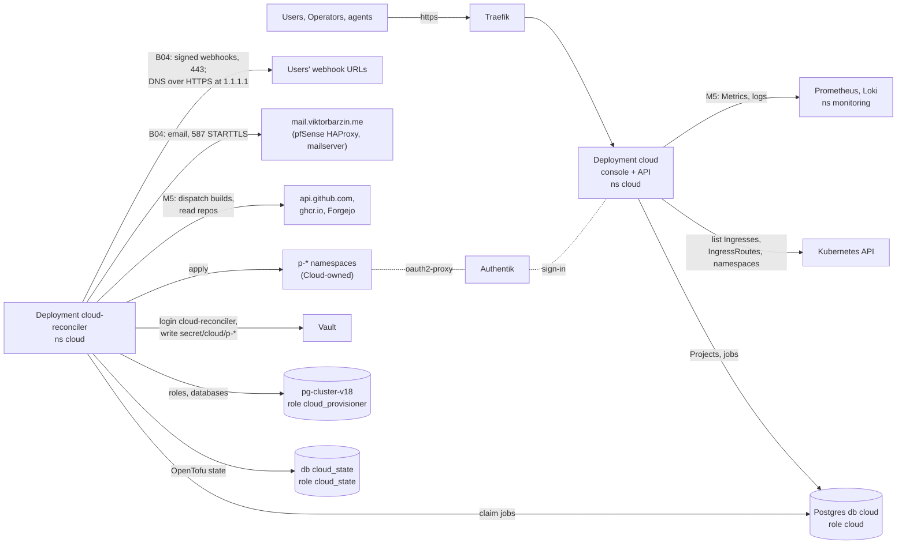
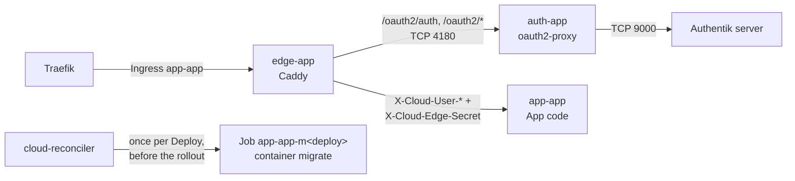

# Cloud

Cloud is the homelab's self-hosted cloud for invited Users: they connect App
and Postgres Services in Projects, and agents do the same through an API. The
code is Forgejo `viktor/cloud` (plan `docs/plans/2026-11-12-cloud-v1-and-operator.md`,
vocabulary `GLOSSARY.md` there). This page covers what this repo runs for it.
Operations are in [docs/runbooks/cloud.md](../runbooks/cloud.md).

Scope: Project namespaces (`p-*`), Project Postgres roles and databases, and
`secret/cloud/<namespace>/*` belong to Cloud's database, not this repo
(AGENTS.md, "Cloud-owned objects"; [docs/agents/terraform.md](../agents/terraform.md)).

## What runs where

| Piece | Where | Defined in |
|---|---|---|
| Console and API | Deployment `cloud` (2 replicas preferring different nodes, RollingUpdate maxSurge 1 maxUnavailable 0, 10 s preStop sleep, init container `migrate`), PodDisruptionBudget `cloud` (minAvailable 1), Kubernetes Service `cloud`, ingress `cloud.viktorbarzin.me` (`auth = "app"`), namespace `cloud` | `stacks/cloud/console.tf`, one `modules/kubernetes/tanstack_app` call |
| Reconciler | Deployment `cloud-reconciler` (1 replica, Recreate, `RECONCILER_WORKERS` workers inside, each on another Project: 1 until B15's `cloud_provisioner` limit of 10 is applied, then 2), Kubernetes Service `cloud-reconciler` (metrics only) | `stacks/cloud/reconciler.tf` |
| Env and credential files of both | locals | `stacks/cloud/deploy_rules.tf` |
| Reconciler identity and limits | service account `cloud-reconciler`, ClusterRoles, admission policies, Calico tier `cloud` | `stacks/cloud/main.tf`, `access_rules.tf` (M2) |
| Console identity | service account `cloud-console` with a token, ClusterRole `cloud-console` (get, list on namespaces, Ingresses, IngressRoutes) | `stacks/cloud/console.tf`, `deploy_rules.tf` |
| Sign-in | Authentik application `cloud` (console, confidential, authorization code and device code), `cloud-cli` (public, device code and refresh token, flow `cloud-cli-authorization` with an always-asked consent stage), groups `Cloud Users` and `Cloud Operators`; both providers send scope mapping `cloud: email (verified when vouched for)` instead of the managed `scope-email` | the module's `authentik.tf`, `stacks/cloud/cli_sign_in.tf`, `stacks/cloud/email_claim.tf` |
| Apps' sign-in | Authentik application `cloud-apps`, shared by every App's oauth2-proxy, public or private (app-kit K1) | `stacks/authentik/cloud-apps.tf` (M2) |
| Guest invites and onboarding | Authentik service account `cloud-inviter` (role: `add_invitation`; for `cloud users add`, global `view_user` and `add_user_to_group` plus `view_group` on `Cloud Users` and `Cloud Email Vouched` only), group `Cloud App Guests`, group `Cloud Email Vouched` (an Operator's email vouch, in `stacks/authentik/cloud-apps.tf`), the guard in `validate-invite-code` and a deny stage on `invitation-enrollment`; token in `secret/cloud/inviter`, read by the console as `CLOUD_INVITER_TOKEN` through ExternalSecret `cloud-console-inviter` (app-kit K5) | `stacks/authentik/cloud-inviter.tf`, `invite-flow.tf`, `stacks/cloud/console.tf` |
| The `cloud` CLI on the devvm | `@viktorbarzin/cloud` for every user, pinned (app-kit K4) | `playbooks/devvm.yml`, tag `cloud-cli` |
| Postgres roles | `cloud` (console), `cloud_state`, `cloud_provisioner`, `cloud_projects` | `stacks/dbaas` |
| Vault | static roles `pg-cloud`, `pg-cloud-state`, `pg-cloud-provisioner`; Kubernetes auth roles `cloud-reconciler`, `cloud-project` | `stacks/vault` |
| Images | `ghcr.io/viktorbarzin/cloud` and `ghcr.io/viktorbarzin/cloud-reconciler`, private; Kyverno copies `ghcr-credentials` into `cloud` | `stacks/kyverno` `ghcr-credentials.tf` |
| Notifications (cloud B04) | The reconciler emails as `cloud@viktorbarzin.me` (an account in Vault `secret/platform` `mailserver_accounts`; password also in `secret/cloud/system` `smtp_password`, carried by `stacks/authentik`, reaching the reconciler as `SMTP_PASSWORD_FILE`) through `mail.viktorbarzin.me:587`, and POSTs signed webhooks on 443. Webhook hosts are resolved through DNS over HTTPS at 1.1.1.1, since the cluster's DNS answers internal addresses for `*.viktorbarzin.me`, and private answers are refused. The `cloud` namespace has no egress policy, so no Calico rule is needed; the paths a future lockdown must keep are in cloud `docs/build/b04-infra.md` | `stacks/cloud/deploy_rules.tf`, `stacks/authentik/cloud-apps.tf` |
| Alerts | group `Cloud` | `stacks/monitoring` `prometheus_chart_values.tpl` |
| App hosts in internal DNS | Helm release `external-dns-cloud` (namespace `technitium`) writes `CNAME <host> -> viktorbarzin.me` plus an owner TXT record in Technitium within seconds of an App Ingress appearing, and deletes both with the Ingress. It reads only Ingresses labelled `cloud.viktorbarzin.me/managed=true`, which Cloud's `modules/app` sets. Publicly the hosts ride the Cloudflare wildcard. See `docs/architecture/dns.md`, "Cloud App hosts" | `stacks/technitium` `external_dns.tf` |

The console's ingress is proxied, so `external-monitor-sync` adds the Uptime
Kuma monitor `[External] cloud` by itself.

## Credentials

| Credential | Source | Reaches | How |
|---|---|---|---|
| `BETTER_AUTH_SECRET`, `OIDC_CLIENT_ID`, `OIDC_CLIENT_SECRET` | Vault KV `secret/cloud-console`, seeded by hand | console | ExternalSecret `cloud-auth` (env) |
| Console database password (role `cloud`) | Vault static role `pg-cloud` | console, migrate, reconciler | ExternalSecret `cloud-db-creds`, file `/secrets/db/password` |
| Authentik reader and approver tokens | Terraform (`authentik_token`) | console | Secrets `cloud-authentik-reader`, `cloud-authentik-approver` (env) |
| Kubernetes API token | service account `cloud-console` | console | projected token |
| `CLOUD_STATE_URL` (role `cloud_state`) | Vault static role `pg-cloud-state` | reconciler | ExternalSecret `cloud-reconciler-postgres`, file `/secrets/postgres/state-url` |
| `POSTGRES_PROVISIONER_PASSWORD` | Vault static role `pg-cloud-provisioner` | reconciler | same ExternalSecret, file `/secrets/postgres/provisioner-password` |
| `REGISTRY_TOKEN` (the ghcr pull token; since 2026-11-17 the narrow `read:packages` token from `secret/cloud/github-narrow`, see the runbook's "Turning builds on") | Vault KV `secret/cloud/system` `ghcr_pull_token` | reconciler, copied into each Project | ExternalSecret `cloud-reconciler-registry`, file `/secrets/registry/token` |
| Vault token | Kubernetes auth login, role `cloud-reconciler`, 1 h TTL | reconciler | logs in with its service account token before each job |
| B09: the OpenTofu state encryption passphrase | Vault KV `secret/cloud/state-key` `passphrase`, written once by hand (runbook, "State encryption key"); backed up by `vault-raft-backup`; the broad `secret/data/*` policies deny it (`tests/cloud-state-key.test.sh`) | reconciler only, as `TF_ENCRYPTION` for OpenTofu | the reconciler reads it with its Vault token on every job (policy `cloud-reconciler`); no ExternalSecret, no file |
| Kubernetes API token | service account `cloud-reconciler` | reconciler, OpenTofu | projected token |
| `cloud_apps_client_id`, `cloud_apps_client_secret` | Vault KV `secret/cloud/system` | read by the reconciler's OpenTofu through Vault | Vault policy `cloud-reconciler` |
| M5: `GITHUB_DISPATCH_TOKEN`, `GITHUB_OWNER_READ_TOKEN`, `FORGEJO_READ_TOKEN`, `FORGEJO_ADMIN_TOKEN`, `SECRETS_PRIVATE_KEY` | Vault KV `secret/cloud/system` keys `github_dispatch_token`, `github_owner_read_token`, `forgejo_read_token`, `forgejo_admin_token`, `secrets_private_key`, written by hand | reconciler | ExternalSecret `cloud-reconciler-system`, files `/secrets/system/<key with dashes>`; the reconciler also reads the same keys from Vault itself |
| B05: `BUILD_LOG_KEY` (Cloud's age identity; opens the build logs the public builder seals) | Vault KV `secret/cloud/system` key `build_log_key`, written by hand (runbook, "Builder v2 keys") | reconciler only | ExternalSecret `cloud-reconciler-system`, file `/secrets/system/build-log-key`; carried by `stacks/authentik` (`cloud_system_carried_keys`) |
| B05: the builder's job key | GitHub secret `CLOUD_JOB_KEY` of `ViktorBarzin/cloud-builder`, with a copy in Vault KV `secret/cloud/builder` `job_key` that no workload reads; its public recipient is `var.builder_job_recipient` in `stacks/cloud`, env `BUILD_JOB_RECIPIENT` | the builder workflow only | `scripts/publish-builder.sh --job-key` in the cloud repo |
| M5: `SECRETS_PUBLIC_KEY`, `GITHUB_API_TOKEN` (optional) | Vault KV `secret/cloud/system` keys `secrets_public_key`, `github_api_token`, written by hand | console | ExternalSecret `cloud-console-system` (env, optional) |
| `TELEMETRY_WRITE_KEY`, `SENTRY_DSN`, `SENTRY_BROWSER_DSN` | Vault KV `secret/rybbit` `write_keys` (key `cloud`) and `secret/glitchtip` `dsn_cloud` | console | Secret `cloud-telemetry` written by Terraform (`telemetry.tf`, env); product events and errors, cloud ADR-0007 |

The two M5 ExternalSecrets read all of `secret/cloud/system` (`dataFrom`
`extract`) and write only their own keys, through a template that uses
`{{ index . "key" }}`. ESO renders templates with `missingkey=error`, so
`{{ .key }}` or a `data` entry would fail the whole sync while one token is
not in Vault yet. A missing key becomes an empty file or an empty variable,
which the cloud code treats as unset; the reconciler then falls back to
reading Vault itself. The console holds no Vault token and gets only the
public key and the GitHub API token, never `secrets_private_key`. The
reconciler's Vault policy has `patch` on `secret/data/cloud/p-*`, because
App secrets are written as KV v2 merge patches; `secret/cloud/system` stays
read-only for it. For a generated secret (`{generate: true}` in a Project
File) it first reads the App's entry with the `read` it already has, and
patches with check-and-set, so it writes a random value only for a key the
entry lacks.

`secret/cloud/system` is written by stacks/authentik (`cloud-apps.tf`), and a
write replaces the whole secret. That stack reads the hand-written M5 keys
back and writes them again (`local.cloud_system_carried_keys`), so changing
`ghcr_pull_token` or rotating the client secret keeps them. A new
hand-written key must be added to that list.

The reconciler holds no Authentik credential. The console holds the
`cloud-inviter` token, from its own path `secret/cloud/inviter`, so no
Project's OpenTofu state and no reconciler token can read it
(`docs/runbooks/cloud.md`, "Guest invites"). The three Postgres passwords
rotate on Tuesdays (10:17 for `pg-cloud`, `pg-cloud-state` and
`pg-cloud-provisioner`). The reconciler reads its files again on every job, and
Reloader restarts it when `cloud-reconciler-postgres`,
`cloud-reconciler-registry` or `cloud-reconciler-system` changes. The M5
files are read once at start, so that restart is what brings in a rotated
token. On such a restart, a pod delete or a CI
rollout the pod finishes its running job first (grace period 3780 s, the
longest a job can run). A node drain or eviction with a shorter grace period
cuts the job (the automated node upgrade drains with `--grace-period=300`);
the job stays `running` until `RECONCILE_STALE_SECONDS` pass, is requeued and
resumes from the OpenTofu state. `cloud-db-creds` restarts
nothing: both processes read the password file on each new connection.

## Data flow of a change

1. A User or an agent saves a Project change in the console or through
   `/api/v1`. The console checks it (Plan): names, Budget, the 80-connection
   Postgres ceiling, each Postgres's Size against the processes that connect
   to it, and taken hosts, which it reads from the cluster with its
   ClusterRole. It writes a new desired version and queues a reconcile job in
   the `cloud` database.
2. The reconciler claims the job (`FOR UPDATE SKIP LOCKED`), reads the
   cluster's taken hosts again, renders the Project as OpenTofu JSON into
   `/tmp`, logs in to Vault, and runs `init`, `plan` and `apply` with state in
   `cloud_state`, schema `p_<project>`. State and saved plans are encrypted
   with the passphrase in `secret/cloud/state-key` (B09).
3. OpenTofu writes the `p-<project>` namespace and its objects through the
   reconciler's RBAC and the admission policies, the Project's Postgres role
   and database as `cloud_provisioner`, and the Project's Vault entries under
   `secret/cloud/p-<project>/`.
4. The reconciler waits for the Project's pods (180 s), records the result,
   duration and a redacted log excerpt on the job, and sets the Project's
   applied version. A failed job is retried up to 3 times with backoff.
5. After that, the reconciler's health watch reads every live App's pods
   every 30 s (every 10 s for an App that is not healthy), with the same
   get and list on pods and events in `p-*` namespaces, and records an
   Event in the `cloud` database (`service_events`, kept 30 days) when an
   App starts crashing, turns unhealthy or recovers. It skips a Project
   with a reconcile job in flight and judges only pods of the App's live
   Deploy. It needs no RBAC beyond the project role. An App with
   `healthCheckPath` in its Project File has `httpGet` readiness, liveness
   and startup probes on that path with no host, which
   `cloud-managed-pod` admits (probes may not name a host).

## Agent sign-in

Two Authentik clients sign agents in:

| | `cloud` | `cloud-cli` |
|---|---|---|
| Client type | confidential | public |
| Grants | authorization code, device code | device code, refresh token |
| Access token | 15 minutes | 1 hour |
| Refresh token | none (no `offline_access`) | 30 days |
| Issuer | `https://authentik.viktorbarzin.me/application/o/cloud/` | `https://authentik.viktorbarzin.me/application/o/cloud-cli/` |
| Who may sign in | Cloud Users, Cloud Operators, Home Server Admins | the same |

Authentik 2026.8 requires the client secret at the token endpoint for the
device code grant on a confidential client (`authentik/providers/oauth2/token/base.py`),
so only a holder of the console's secret can complete a device sign-in on
`cloud`, and it could not refresh either. A CLI cannot hold that secret, so
agents sign in on `cloud-cli`. Both
clients use `sub_mode = hashed_user_id`, so a person has the same `sub` on both
and is one User.

The console's env carries `API_TOKEN_AUDIENCES=cloud,cloud-cli`,
`AGENT_OIDC_CLIENT_ID=cloud-cli` and `AGENT_OIDC_DISCOVERY_URL` (the
`cloud-cli` discovery document). The API verifies a bearer JWT against two
providers: the console's (`OIDC_DISCOVERY_URL`, audiences from
`API_TOKEN_AUDIENCES`) and the agent's (`AGENT_OIDC_DISCOVERY_URL`, audience
`AGENT_OIDC_CLIENT_ID`). Both map to one User by `sub`. `cloud login` and the
MCP Protected Resource Metadata use the agent client; the CLI asks for
`offline_access` and renews its sign-in with the refresh token.
`tests/cloud-deploy.test.sh` fails if the stack sets an env name the cloud
code does not read.

**Email claim.** Authentik's managed `scope-email` mapping sends
`email_verified: false` for every account. Cloud's owner check (M5) finds a
Project owner's Forgejo account by an email both sides verified, so the
console's provider (module input `email_scope_mapping_id`) and `cloud-cli`
send `cloud: email (verified when vouched for)` instead
(`stacks/cloud/email_claim.tf`). It sends `email_verified: true` only for an
account the `cloud-apps-active-users` policy in `stacks/authentik/cloud-apps.tf`
admits: active, not `guest`, not a service account, not proxy-only, and
enrolled by a social source, on path `users/email-verified`, a direct
member of `Cloud Email Vouched` (an Operator's vouch through `cloud users
add`), or carrying `attributes.cloud_apps_email_vouched: true`. The two expressions are copies;
`tests/cloud-deploy.test.sh` runs both on the same accounts and fails when
they disagree.

**Follow-up: private App sign-in.** `cloud-apps` still uses the managed
`scope-email`, so every App's oauth2-proxy, public or private, runs with
`--insecure-oidc-allow-unverified-email=true` (`stacks/cloud/access_rules.tf`
and the cloud repo's `modules/app/auth.tf`). The gate holds because
`cloud-apps-active-users` admits only vouched-for accounts and users cannot
change their email. The deferred change, in order: give `cloud_apps` the
vouching `email` mapping (a third copy, covered by the same test), check that
a vouched-for account's ID token carries `email_verified: true`, then drop
the flag from both files in one change window. Dropping the flag first locks
every App's sign-in. Steps: the cloud repo's `docs/build/m7-infra.md`,
"Private App sign-in".

**Device-code phishing.** Anyone can start a device authorization on the
public `cloud-cli` client, and Authentik returns a link
(`/device?code=XXXX`) that grants the code to the starter when a signed-in
person opens it. A hostile User could send that link to an Operator. So
`cloud-cli` uses its own authorization flow, `cloud-cli-authorization`, whose
consent stage asks every time (`always_require`) and names "Cloud CLI": the
person must confirm before any token is issued. The stock explicit-consent
flow remembers consent for weeks, so it would not stop a second link.

The consent screen in authentik 2026.8 shows "You're about to sign into Cloud
CLI." and the scopes, but not the user code or who started the sign-in. The
flow title is the heading of that screen, so it carries the warning:
"Continue only if you ran cloud login yourself in the last few minutes.
Whoever started this sign-in gets your Cloud access." The remaining risk is a
person who clicks Allow on a link they did not start: the link fills in the
code, so one click still grants that person's 30-day refresh token to the
sender. To make the code typed by hand, a Traefik middleware could strip the
`code` query parameter from authentik's `/device`; that is not in place.

## Metrics

The reconciler serves `/metrics` on 9090; Kubernetes Service `cloud-reconciler` carries
the `prometheus.io` annotations and `cloud_.+` is on the
`kubernetes-service-endpoints` keep list. The job sets `honor_labels: true`,
so the Postgres series keep their own `service` label, the Cloud Service name.

| Metric | Exported by | Read by |
|---|---|---|
| `cloud_reconcile_total{result}`, `cloud_reconcile_duration_seconds{kind}`, `cloud_reconcile_queue_depth` | reconciler | `CloudReconcileQueueStuck`, `CloudReconcileFailing` |
| `cloud_postgres_database_bytes`, `cloud_postgres_database_limit_bytes`, `cloud_postgres_database_unmeasured` `{project,service}` | reconciler | `CloudPostgresDatabaseNearSize`, `CloudPostgresDatabaseUnmeasured` |
| `cloud_postgres_database_read_only{project,service}` | reconciler: 1 when the role is read-only because the database reached its Size's disk | `CloudPostgresReadOnly` |
| `cloud_postgres_disk_enforcement_failed{project,service}` | reconciler: 1 while the last size pass did not enforce the disk limit | `CloudPostgresDiskEnforcementFailed` |
| `cloud_project_converging_seconds{project}` | reconciler | `CloudProjectStuckConverging` |
| `cloud_build_minutes_used`, `cloud_build_minutes_allowance` | reconciler: set when a build checks the account's minutes, which it does only while the builder repo is private; with the public builder both read 0 | `CloudBuildMinutesHigh` |
| `up{namespace="cloud",service="cloud-reconciler"}` | Prometheus | `CloudReconcilerDown` |

`cloud_project_converging_seconds` is the seconds since the oldest `queued`
or `running` `reconcile_jobs` row whose `desired_version` is above its
Project's `applied_version`. If a converging Project has no such job, the
count starts at its oldest job above the applied version, else at the
Project's creation. A Project that is not converging has no series.

`cloud_postgres_disk_enforcement_failed` is 1 when the last size pass could
not switch a role to read-only, change its CONNECT or end its sessions.
Postgres refused or timed out, often because a Project's own session holds a
lock on its role row and the 5 s `lock_timeout` expires. If the roles could
not be listed at all, it is 1 for every database over its disk or already
read-only or blocked. The pass runs every 10 minutes, so the alert's
`for: 30m` is three failed passes.

`CloudReconcileFailing` has no `for`: a failed job is not retried, so one
failure fires the warning, which stays up while the failure is inside the
15-minute window. prom-client creates the `result="failed"` series at its
first increment, which `increase()` cannot see. The rule's
`last_over_time(...[1h] offset 15m)` clause counts a series with no sample in
the hour before the window as new, so the first failure after a restart fires
too: a restarted pod has a new `instance` label. A scrape gap shorter than an
hour, such as a Prometheus restart, does not make an old failure look new; a
longer gap can fire one false warning. `CloudReconcileQueueStuck` uses the
same clause for finished jobs. Zero-initialised result labels in
`src/reconciler/metrics.ts` would let both rules drop the clause.

Only `CloudReconcilerDown` and `CloudReconcileQueueStuck` page: then no Project
change applies until an Operator acts. The other alerts are about one Project
or one database: warnings, and `CloudPostgresReadOnly` is info. `CloudProvisionerForeignRole`,
`CloudProjectRoleUnlimited` and `CloudProjectConnectionsOverCeiling` (M2, the
PostgreSQL group) cover the provisioner audit. `tests/cloud-deploy.test.sh`
runs promtool unit tests on the group.

## Builds and network (M5)

Builds and Deploys run in the reconciler; one switch turns them on:
`variable "builds_enabled"` in `stacks/cloud/deploy_rules.tf`, passed as
`BUILDS_ENABLED` to the reconciler and the console. The console answers
`GET /api/v1/builds` from it, so the Deploys tab and the Add Service wizard
say that pushes do not deploy while it is `false`. It is `false` until the GitHub tokens exist (runbook,
"Turn on builds"); `false` is also the M5 rollback. The reconciler also gets
`FORGEJO_URL=http://forgejo.forgejo.svc.cluster.local` and
`FORGEJO_AUTH_SOURCE_ID=1`. `forgejo admin auth list` shows source 1
"Authentik" as disabled (checked 2026-11-13): it makes no new accounts, and
the accounts it made still carry it, which is what the owner check matches
on. The console gets `PROMETHEUS_URL=http://prometheus-server.monitoring.svc.cluster.local`
(Metrics tab) and `LOKI_URL=http://loki.monitoring.svc.cluster.local:3100`
(logs tab). Alloy gives log lines from `p-*` namespaces an `image` label
(`stacks/monitoring/modules/monitoring/alloy.yaml`); the Logs tab uses it to
leave out the "Not deployed yet" placeholder and to tag each line with its
Deploy. It adds no streams, because each container is one stream already.

Push webhooks and Deploy Hooks (cloud B07): Forgejo posts push events to
`https://cloud.viktorbarzin.me/hooks/forgejo`, and a User's Deploy Hook is a
POST to `https://cloud.viktorbarzin.me/hooks/deploy/<token>`. Both enter
through Traefik like any browser request, so the console's ingress policy
(Traefik only) needs no change. Forgejo's `ALLOWED_HOST_LIST`
(`stacks/forgejo/main.tf`) already admits `*.viktorbarzin.me`, and inside
the cluster that name resolves to the internal Traefik. The routes take no
session: an HMAC signature or the token is the credential, and every
refusal is 404. The console derives each App's webhook secret from
`WEBHOOK_KEY`, Vault `secret/cloud-console` `webhook_key` through the
`cloud-secrets` ExternalSecret (`app_secret_env` in `stacks/cloud/console.tf`),
and a per-App nonce; without the key it falls back to `BETTER_AUTH_SECRET`. The reconciler's branch poll stays the fallback. Traefik's access
log records request paths, and a Deploy Hook's path holds its token: anyone
who reads those logs can start that App's Deploy until the User regenerates
the hook.

Network: neither Deployment has an egress NetworkPolicy, and namespace
`cloud` carries `tier=4-aux`, so Calico's `wave1-egress-observe-tier34`
(order 2000, Allow) passes all its egress. Namespaces `forgejo` and
`monitoring` have no ingress policy. Checked on 2026-11-13 from the running
pods: the reconciler reached Forgejo, Prometheus, Loki, `api.github.com`,
`github.com` and `ghcr.io`; the console reached Prometheus and Loki. If
tier 4-aux egress is ever restricted, namespace `cloud` needs these allowed
first. The Calico tier `cloud` applies to `p-*` namespaces only.

Project egress (B38, 2026-11-16): the floor `cloud.project-egress-floor`
denies TCP 25, 465, 587 and 2525 to every address before any Pass, so Apps
cannot send email directly (Viktor's decision V8); Cloud's Project policy
denies the same ports. Project pods leave through the home WAN, SNATed to
`config.tfvars` `public_ip`, and pod IPv6 is ULA with no NAT66, so Apps
egress over IPv4 only. The console gets that address as
`CLOUD_OUTBOUND_IPV4` (`deploy_rules.tf`) and shows it in `/help/apps`, the
Connect dialog and `cloud help apps`. A new WAN address reaches Cloud with
the next apply of `stacks/cloud`. CrowdSec still whitelists the home
address (`docs/agents/security.md`, "Open risk").

## A request to a Project App, and what admission allows

Since app-kit K1 (the cloud repo's `docs/plans/2026-11-14-cloud-app-kit.md`)
every App, public or private, runs three pods: the App, its edge (pinned
Caddy) and its oauth2-proxy (pinned, on `cloud-apps`). Traefik routes the
App's host to the edge only. The edge deletes forged identity headers
(`X-Cloud-User-*`, `X-Cloud-Edge-Secret`, `X-Auth-Request-*`,
`X-Authentik-*`, both spellings), sends `/oauth2/*` to the oauth2-proxy,
asks it at `/oauth2/auth` who is signed in, and passes that to the App as
`X-Cloud-User-Id`, `-Email` and `-Username` with the App's edge secret
(Secret `edge-<app>` in the Project namespace, made by Cloud's OpenTofu
module). A public App's oauth2-proxy has `--email-domain=*` and no emails
file; a private App's has the email allowlist. Not signed in, a public App
gets the request anonymously and a private App redirects a page load to
sign-in and answers other requests 401. The session cookie is the
host-only `__Host-oauth2_proxy` (no `--cookie-domain`), so script on a
sibling host cannot plant a session for another App. Services `edge-<app>`
and `auth-<app>` select only pods running the current Caddyfile and args
(pod labels `cloud.viktorbarzin.me/edge-config` and `auth-config`), so an
access change answers 503 or 502 until the new pods are ready instead of
serving with the old rules. The Project quota holds a surge pod for every
edge and oauth2-proxy beside the App's own, so the new pods start while
the App's new pod is still getting ready. Cloud's Project policy lets
Traefik reach only edge pods with the `edge-config` label. Every Service
`edge-<app>` names the ServersTransport `cloud/app-edge`
(`stacks/cloud/main.tf`), so Traefik waits 125 s for an App's response
headers, the request timeout `cloud help limits` states, instead of its
global 30 s. `cloud-managed-service` admits no other `traefik.*` Service
annotation.

`stacks/cloud/access_rules.tf` pins this. `cloud-managed-edge-config`
accepts the public and the private Caddyfile, and the fixed page of a
suspended App or an App in maintenance (`cloud_edge_pages`: every request
answers 503 with that page and nothing is proxied). A suspended App's
Deployment `app-<app>` runs 0 replicas; `cloud-managed-deployment` admits
0 on App and worker Deployments only, so the edge and the oauth2-proxy always run and
the App's address always answers. The rule reads Deployment writes, not
the `deployments/scale` subresource (a Scale object has no pod template to
tell an App from an edge). The reconciler's project role has no
`deployments/scale`, so only an admin can scale that way. No Deployment
runs more than 3 replicas (an App's `instances`, the cloud repo's B21).
An App with 2 or more instances has a PodDisruptionBudget `app-<app>`;
`cloud-managed-pdb` admits only that name, `minAvailable: 1`, no
`maxUnavailable`, `unhealthyPodEvictionPolicy: AlwaysAllow` and a
`matchLabels` selector on one App's `component=app` pods, so no PDB holds
an edge or oauth2-proxy pod and an unready App pod never holds a drain. A
drain does wait on an App's last ready pod while its other instances are
not ready; the drain script's rollout restart (B10) starts a replacement on
another node first, and the wait ends once that pod is ready. App pods
spread over nodes when they can: `cloud-managed-pod` admits exactly one
`topologySpreadConstraints` entry on App pods, `maxSkew` 1 on
`kubernetes.io/hostname`, `ScheduleAnyway`, over the App's own pods. The running
Caddyfile's App leg has three retry lines (`lb_try_duration 5s`,
`lb_try_interval 250ms`, `lb_retry_match expression false`): a refused
connection to a crashed instance is dialled again, and a request that
reached the App is never sent twice. `cloud-managed-edge-config` admits
the file with and without them (`cloud_caddyfile_retry`) until a later
change requires them. `cloud-managed-pod` and
`cloud-managed-deployment` accept the edge with its one `secretKeyRef`
env value (Secret `edge-<app>`, key `secret`) and the oauth2-proxy with
exactly one of the emails file and `--email-domain=*`, and the ingress
floor passes edge pods to oauth2-proxy pods on TCP 4180. App pods may have
one init container, `migrate` (app-kit K3), with the App container's image
and no `restartPolicy`; edge and oauth2-proxy pods may have none, and every
container rule (extended resources, ephemeral limits, probe and hook
hosts) covers init containers too.

A Deploy's migrations (cloud backlog B16) run once per Deploy, before its
rollout, as a Job the reconciler starts through the Kubernetes API (the
cloud repo's `src/reconciler/migrate-job.ts`; the App pod's init container
stays only behind `RECONCILE_MIGRATE_AS=init` for one release). The
project role grants `create`, `get`, `list` and `delete` on `jobs` and
`get` on `pods/log`, and no `create` on pods. `cloud-managed-job` admits a
Job whose pod template passes every pod rule and which runs one pod once
(`backoffLimit` 0, `restartPolicy: Never`, a deadline up to 12 h, a TTL up
to a day). It is a Deploy's migrations, component `migrate`, named
`app-<app>-m<9 hex>`, with no owner; never component `app`, which the App's
Kubernetes Service would select. A Job whose pod is component `cron` (B19's
cron run) is left to its own policy. A `migrate` pod has one container `migrate`
running an image by digest with no command and 1 to 8 args, no port, probe
or hook. Only its Job makes it: `cloud-managed-pod` wants a controlling Job
owner, and `cloud-managed-deployment` refuses the component. The App's
Kubernetes Service selects component `app`, so it never sends the Job a
request. The ingress floor has no rule for `migrate` pods; egress is the
Project's, as for the App.

Worker and cron Services (the cloud repo's B18 and B19) run App code with
no edge, no oauth2-proxy and no Ingress. Their pods carry the label of the
App they run from (`cloud.viktorbarzin.me/app=<app>`), component `worker`
or `cron`, and run one container `app` with the App's image and a command.

| Service | Object in `p-<project>` | What admits it |
|---|---|---|
| Worker | Deployment `worker-<name>`, component `worker`, 0 or 1 replicas, RollingUpdate with `maxSurge: 0` and `maxUnavailable: 1`, no ports, probes or init container | `cloud-managed-deployment`: the pod rules, no init container (App pods only), 0 replicas allowed |
| Cron | CronJob `cron-<name>`, component `cron`, time zone `Etc/UTC`, `concurrencyPolicy: Forbid`, `startingDeadlineSeconds: 60`, Job `backoffLimit: 0`, `activeDeadlineSeconds: 43200`, `ttlSecondsAfterFinished: 86400` | `cloud-managed-cronjob`: every pod rule on the Job template's pod, plus component `cron`, no init container, `restartPolicy` Never or OnFailure, and `activeDeadlineSeconds` set and at most 43200 |
| Scheduled run | Job `cron-<name>-<digits>`, made by the CronJob controller, owned by the CronJob as its controller | `cloud-managed-cron-job`: the same pod and deadline rules, one owner, CronJob `cron-<service>`, and that name |
| Manual run | Job `cron-<name>-m<run id>`, created by the reconciler from the CronJob's `jobTemplate`, label `cloud.viktorbarzin.me/run=<id>`, owned by the CronJob, not as its controller | `cloud-managed-cron-job`, as above; the reconciler's `jobs` create right |

`cloud-managed-cron-job` matches only Jobs whose pod is component `cron`;
`cloud-managed-job` (the cloud repo's B16, migrations) checks every other
Job but a one-off job's (below). The pods of both kinds of run meet `cloud-managed-pod`.

For crons the project role grants `cronjobs` with the full write verbs;
a manual run uses the `jobs` create right that B16 added. A finished Job is removed by its
`ttlSecondsAfterFinished`, and with its CronJob by the owner reference, so
the reconciler never updates or deletes a cron run. `concurrencyPolicy: Forbid`
keeps two scheduled runs apart, and a manual run asked for while a run is
active is skipped. A scheduled start during a manual run still starts,
because the CronJob controller counts only the Jobs it controls, so those
two can overlap.

Network: the egress floor selects every pod in a managed namespace, so
worker and cron pods reach DNS, the Project's Postgres and the internet
like App pods, within Cloud's own Project policy. The ingress floor passes
connections only to edge, oauth2-proxy and App pods, so nothing connects
to a worker or cron pod. The floor passes App-to-App traffic into an internal App only from
component `app` pods, so a worker or cron pod cannot call an internal App.

A one-off job (cloud backlog B20, `cloud run <project> <app> -- <command>`)
is a Job the reconciler starts when a User asks, with the App's live image,
env, secrets and Size and the User's command as the container's command,
never through a shell (the cloud repo's `src/reconciler/job-runs.ts`). The
B16 Job rights cover it. `cloud-managed-job` skips a Job whose pod is
component `job`, and `cloud-managed-one-off-job` admits it: every pod rule,
one pod once (`backoffLimit` 0, `restartPolicy: Never`), a deadline up to
4,260 s (10 min to start, 1 h to run and a minute), a TTL up to a day,
named `job-<app>-<9 hex>`, labelled like its pod, no owner. A `job` pod has
one container `job` running an image by digest with a command of 1 to 64
items of at most 4,096 characters, no args, port, probe, hook or init
container. Only its Job makes it, and no Deployment runs one. No
Kubernetes Service selects component `job`, and the ingress floor has no
rule for it; egress is the Project's. Like a worker or cron pod, a job
pod cannot call an internal App.

The shapes from before K1 are refused: `cloud-managed-ingress` admits
only `edge-<app>` port `edge` as a backend, never `auth-<app>`; the edge
must carry its edge secret; the oauth2-proxy must use
`--upstream=static://202`, never its edge; and the Caddyfile must hold the
sign-in check, never `respond /oauth2/* 404` alone. The ingress floor
passes nothing from Traefik to oauth2-proxy pods or from oauth2-proxy pods
to edge pods, so a Project policy cannot open the old path either.

Internal Apps (B17, 2026-11-16): an App with `access: internal` runs only
its App Deployment and Kubernetes Service `app-<app>`, with no edge,
oauth2-proxy or Ingress. Its https address answers 404 from the internet
like any unknown host, and external-dns-cloud writes no LAN record, since
there is no Ingress. Cloud keeps its name held. The Apps of its Project that list it
in `connects` call `http://app-<app>.p-<project>.svc.cluster.local` from
their `CLOUD_URL_<NAME>`. The ingress floor passes App pods to internal App
pods (label `cloud.viktorbarzin.me/access=internal`) on TCP 3000
(`cloud_app_port`, Cloud's App port) inside managed namespaces only, and
Cloud's Project policy admits only its own namespace's callers. The floor
cannot say "the same namespace"; Cloud starts App pods only after the
Project policy exists.
Admission needs no new rule: an App Deployment never needed an edge
sibling, and `tests/cloud-access.test.sh` applies one through every policy.

## Connections on the shared primary

| Holder | Connections |
|---|---|
| console pool, role `cloud` (`APP_POOL_MAX` 4, plus 1 LISTEN) | 5 |
| reconciler pool, role `cloud` | 4 |
| `migrate` init container while it runs | 1 |
| **role `cloud` at most** | **10**, the figure in [docs/agents/databases.md](../agents/databases.md) |
| `cloud_provisioner` | 10 (CONNECTION LIMIT, B15): 2 workers x 4 + the size loop 1 = 9 |
| `cloud_state` | 10 (CONNECTION LIMIT) |

A second replica of either Deployment needs this budget raised first.

## CI

The workflow files are kept here, reviewed with the stack:
[cloud-ci/build.yml](cloud-ci/build.yml) and [cloud-ci/deploy.yml](cloud-ci/deploy.yml).
On 2026-11-13 the cloud repo's master still has its first build.yml (the full
test suite against a Postgres service, the console image only) and a
deploy.yml that sets only `cloud`; the runbook's "Register the repo with CI"
copies these two in. Once they are in place, the cloud repo builds both images
on GitHub Actions from its private mirror: one job on pushes to master,
`bun run check` and `typecheck`, then the console image (the Dockerfile's last
stage) and the reconciler image (target `reconciler`), each with its own build
cache and ghcr retention, with a newer push cancelling a running build. The unit, HTTP
and e2e suites run locally before a change lands, because private Actions
minutes are nearly used up. Woodpecker's deploy pipeline sets both images:
`cloud` (containers `migrate` and `cloud`) first, waiting for its rollout so
the migrations have run, then `cloud-reconciler` (container `reconciler`). It
reports the reconciler's rollout without failing on it, since the old pod may
first finish a job of up to 3780 s. Both Deployments ignore their images in Terraform
(`CI_SETS_IMAGE`). Registration: [docs/runbooks/cloud.md](../runbooks/cloud.md),
"Register the repo with CI".

## How to debug a stuck Project

A Project is stuck when its desired version stays ahead of its applied
version. Work down this list:

1. **Is the reconciler running?** `kubectl -n cloud get pods -l app=cloud-reconciler`.
   Down: runbook "Restart".
2. **Is the Project's job queued, running or failed?** In the `cloud` database:
   `SELECT id, kind, state, attempts, last_error, updated_at FROM reconcile_jobs WHERE project_id = (SELECT id FROM projects WHERE slug = '<project>') ORDER BY id DESC LIMIT 5;`
   A `running` job older than 10 minutes (`RECONCILE_STALE_SECONDS`) is
   requeued by the reconciler itself.
3. **What did OpenTofu say?** The job's `log_excerpt`, then the logs:
   `homelab logs query '{namespace="cloud", container="reconciler"} |= "<project>"'`.
4. **Admission refused an object?** The error names the policy
   (`cloud-reconciler-scope`, `cloud-managed-*`, `cloud-ingress-live-hosts`).
   A host the homelab took after the last `cloud` apply is refused by the live
   host guard; the Project must pick another name.
5. **Credentials?** `Vault login as role cloud-reconciler answered 403`,
   `password authentication failed for user "cloud_state"` or
   `"cloud_provisioner"`: check the ExternalSecrets
   (`kubectl -n cloud get externalsecret`) and runbook "Recover from a failed
   apply".
6. **State lock?** `Error acquiring the state lock` names the lock holder in
   `cloud_state`, schema `p_<project>`. Runbook "Recover from a failed apply".
