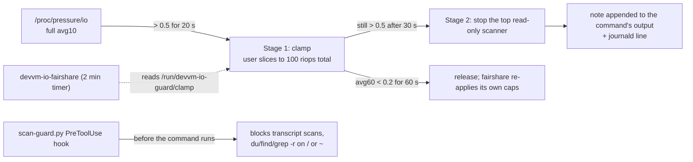

# Devvm disk guard

The devvm's disk is a slice of the Proxmox host's one spinning drive, `sdc`, which also holds etcd for the Kubernetes cluster. Read load from the devvm reaches etcd's write-ahead log directly. Two pieces keep agent disk scans from stalling it:

- `devvm-io-guard`, a root daemon that watches IO pressure and throttles, then stops, read-only scans while the disk is saturated.
- `scan-guard.py`, a Claude Code PreToolUse hook that blocks the known whole-disk and whole-transcript scan shapes before they run.

Both were added on 2026-10-11. The guard ships in log-only mode; enforcement is planned for 2026-10-14 once three days of its decisions have been reviewed.

## Background

On 2026-10-11 etcd WAL fsync p99 reached 8.2 s twice, at 07:12–07:32 and 14:25–17:45 UTC. Both times the devvm read 200–500 IOPS from `sdc`. In the morning a subagent ran `xargs grep` six times over all 7.6 GB of `~/.claude/projects` transcripts. In the afternoon about 80 parallel sessions were running docker builds, `npm ci`, test suites, `tg plan`, `find /` and `du`. kube-state-metrics restarted 56 times, and each restart fired about 9 false critical alerts.

The existing limits did not engage for this load:

| Limit | Why it did not engage |
|---|---|
| QEMU read cap on VM 102, 400 IOPS | The spindle sustains about 227 read IOPS, so the cap is above what the disk can deliver |
| `devvm-io-fairshare`, `io.max` per user slice | Caps only when two or more users are active, at 200 riops each. A lone user is uncapped |
| `io.latency` | Not compiled into the guest or the Proxmox kernel |



## devvm-io-guard

Source: `playbooks/files/devvm/devvm-io-guard` (its docstring is the full contract). Unit: `devvm-io-guard.service`, `Type=simple`, as root with the same sandboxing as `playwright-reaper`. Settings: `/etc/default/devvm-io-guard`, rendered from the `devvm_io_guard_*` vars in `playbooks/devvm.yml`.

### What triggers it

Every 2 s it reads the `full` line of `/proc/pressure/io`: the share of time every runnable task on the devvm was stalled on IO. Over 14 h on 2026-10-11, `full` above 0.5 (50%) matched 25 of 29 etcd fsync stalls over 1 s, with 4 false alarms and 4 misses. The misses lined up with load from other VMs on the same host, which a guard inside the devvm cannot address.

| Stage | Condition | Action |
|---|---|---|
| Clamp | `full avg10` > 0.5 for 20 s | Every user slice gets `io.max riops` = 100 divided by the number of slices that read in the last 10 s. A lone user is clamped too. The per-slice value goes in `/run/devvm-io-guard/clamp` |
| Kill | Clamped for 30 s and `full avg10` still > 0.5 | Stop the eligible process with the highest score. At most one decision every 20 s |
| Release | `full avg60` < 0.2 for 60 s | Remove the clamp file and run `devvm-io-fairshare.service` once to restore its own caps |

`devvm-io-fairshare.sh` reads the clamp file on every run and uses the lower of its own share and the clamp, including for a lone user. Without that, its 2-minute timer would lift the clamp.

### What it stops, and what it never stops

Only read-only scanners are eligible: a process in `user.slice` whose argv0 is `ugrep`, `grep`, `egrep`, `fgrep`, `rg`, `bfs`, `find`, `du`, `tree`, `locate`, or `ls` with `-R`. An agent's `grep`, `find` and `rg` in the Bash tool are shell-snapshot functions that run the claude binary with argv0 `ugrep`, `bfs` or `rg`, and its comm is a version string, so the match is on argv0.

Builds, test runs, Python, git, docker and the claude process itself are never stopped. They get the clamp. A scan can be repeated or narrowed at no cost; an interrupted build loses work, and 17% of Bash calls run longer than 10 s as normal work.

How much is stopped depends on where the scanner runs:

| Where | What is stopped |
|---|---|
| A Bash tool scope (`app.slice/run-u<N>.scope`) holding only shells, scanners and text tools | The whole scope, so an `xargs` cannot start its next batch |
| A Bash tool scope that also holds something else (make, npm, python) | The scanner, plus its `xargs` parent if it has one |
| Anywhere else, such as the built-in Grep tool's `ugrep` in the pane scope | The scanner alone; the pane scope also holds claude and tmux |

SIGTERM first, then SIGKILL 2 s later: through `cgroup.kill` for a whole scope, or per pid after checking the pid has not been reused.

### How it ranks

Score = seconds of block-IO wait over the last 10 s, plus MB read over the last 10 s divided by 4. Bytes alone would miss the `du`/`find` shape: `du -s ~/code/infra` on a cold cache read 7 MB but made about 6,100 IOs over 38 s. The wait figure is field 42 of `/proc/<pid>/stat`, which needs `kernel.task_delayacct = 1` (`/etc/sysctl.d/60-devvm-delayacct.conf`). A score under 1.0 is not a victim, and the guard logs `no-victim` with the heaviest reader of any kind, which shows when the load is builds rather than scans.

### What the agent sees

Before the signal, the guard appends a note to the command's output: for a Bash tool scope, the output of the scope's top-level shell (the stream Claude reads, even when the scanner's own stderr went to `/dev/null`); otherwise the scanner's own stderr. Terminals and `/dev/null` are skipped. The note says what was read, for how long, and what to use instead: a narrower path, `git grep`, `homelab claude-usage --session`, or `homelab logs query`.

### Reading its log

Every decision is one journald line from `devvm-io-guard.service`, as `key=value` pairs. The lines do not contain the service name, so filter on Loki's `unit` label rather than with `|=`:

```
action=would-kill dry_run=1 psi_full10=0.62 psi_full60=0.55 user=wizard pid=123 target=scope:run-u5001.scope read_mb=812.3 wait_s=7.9 window_s=10.0 cmd="ugrep -r foo /home"
```

`action` is one of `start`, `clamp`/`would-clamp`, `clamp-adjust`, `kill`/`would-kill`, `no-victim`, `release`/`would-release`, `stale-clamp-cleared` and `error`. Across the cluster:

```sh
homelab logs query '{job="devvm-journal", unit="devvm-io-guard.service"}' --since 3d
```

Metrics go to `/var/lib/node_exporter/textfile/devvm_io_guard.prom`: `devvm_io_guard_clamp`, `devvm_io_guard_clamp_riops_per_slice`, `devvm_io_guard_dry_run`, `devvm_io_guard_decisions_total{action}`, `devvm_io_guard_pressure_full_avg10` and `devvm_io_guard_last_write_timestamp_seconds`.

### Failure behaviour

An exception in one sweep is logged as `action=error` and the next sweep starts fresh. On stop, the guard removes its clamp file and runs fairshare. systemd removes `/run/devvm-io-guard` when the service stops, so a dead guard leaves no clamp past the next fairshare run (at most 2 minutes). A clamp file found at start is treated as left by a crash and cleared.

### Tests

```sh
python3 playbooks/files/devvm/devvm-io-guard-test.py     # victim choice, eligibility, stage transitions, against a fake /proc
bash playbooks/files/devvm/devvm-io-fairshare-test.sh    # includes the clamp cases
```

## scan-guard.py

Source: `scripts/workstation/claude-hooks/scan-guard.py`. Installed into every user's `~/.claude/hooks/` and wired as `PreToolUse` with `matcher: Bash` by the hourly `install_memory` reconcile in `scripts/t3-provision-users.sh`, next to `zsh-guard.py`.

It blocks, with exit code 2 and a message naming the alternative:

- `grep`, `rg`, `ugrep`, `jq`, `cat`, `find` or `xargs grep` across `~/.claude/projects` (or `/home/*/.claude/projects`), whether by glob, directory, recursion, or a `cd` into it first. One named file is allowed, because some skills read their own transcript. `find` with `-maxdepth 2` or less and no `-exec` is allowed.
- `du` or `find` rooted at `/`, `~`, `$HOME` or `/home`. `find` with `-maxdepth 2` or less is allowed. `du` is not, because `--max-depth` only limits what it prints.
- Recursive `grep`/`rg`, or `ls -R`, rooted at the same places.

It works on shell tokens, so the same words inside a quoted pattern, a commit message or a heredoc body do not trigger it. There is no override: the guard daemon already leaves scans alone while the disk is quiet, and a transcript question has a cheaper tool (`homelab claude-usage`). Replayed against 2,854 real Bash commands from 14 recent sessions, it blocked 14 (0.5%): 8 `find /` or `find ~` searches for a screenshot, 5 walks or greps of `~/.claude/projects`, and 1 `find` of the home directory at depth 4.

Tests: `python3 scripts/workstation/claude-hooks/test_scan_guard.py`.

## Open questions

- The thresholds (0.5 trigger, 100 riops, 30 s before a kill) come from one day of data. The three days of `would-*` lines are there to check them before enforcement.
- 4 of the 29 etcd stalls on 2026-10-11 had no matching devvm pressure. Those came from elsewhere on the host, and this guard does not address them.
- Python loops and builds that read heavily are clamped but never stopped. If the log shows them as the main source of `no-victim` decisions, the clamp level is the setting to revisit.
