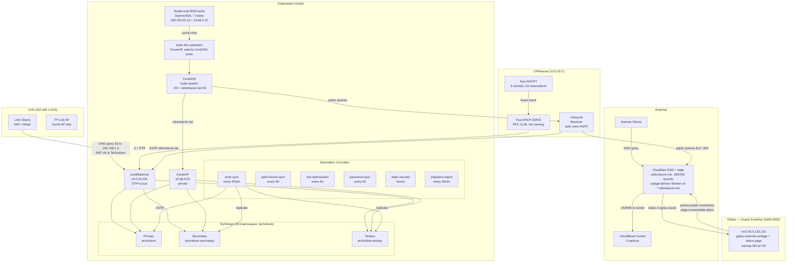
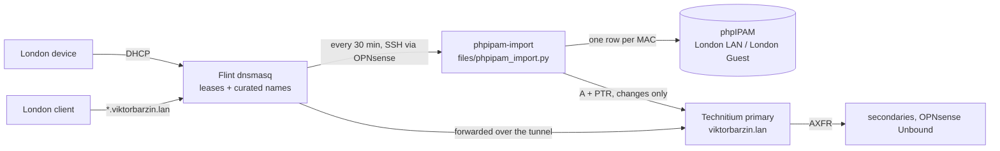

# DNS Architecture

<!-- showcase: Technitium answers for the internal zone and for recursive lookups, Cloudflare hosts the public zone, and records for new ingresses are created from the Kubernetes API. -->

Last updated: 2026-11-10 (OPNsense replaced pfSense as the edge firewall, ADR-0038: Unbound, Kea and the WAN DNS redirect run on OPNsense on the same addresses). Previously 2026-10-14 (external-dns now creates and deletes the records for `*.viktorbarzin.lan` Ingress hosts from the kube API, ADR-0033; the `technitium-dynamic-updates` CronJob keeps the TSIG keys and update policy on all three Technitium instances. Previously 2026-07-08: record cleanup: 13 verified-dead Cloudflare records deleted, zone now **185/200** of the free-plan cap — see "Zone record budget" below. Same day, ADR-0020 — mx2 is the deployed external vantage; `status.viktorbarzin.me` moves proxied-CNAME → grey-cloud A on mx2; new `test-failover` synthetic record. Previously 2026-04-19: WS C — NodeLocal DNSCache deployed; WS D — pfSense Unbound replaces dnsmasq; WS E — Kea multi-IP DHCP option 6 + TSIG-signed DDNS)

## Overview

DNS is served by a split architecture: **Technitium DNS** handles internal resolution (`.viktorbarzin.lan`) and recursive lookups, while **Cloudflare DNS** manages all public domains (`.viktorbarzin.me`). Kubernetes pods use **CoreDNS** which forwards to Technitium for internal zones. All three Technitium instances run on encrypted block storage with zone replication via AXFR every 30 minutes. A **NodeLocal DNSCache** DaemonSet runs on every node and transparently intercepts pod DNS traffic, caching responses locally so pods keep resolving even during CoreDNS, Technitium, or OPNsense disruptions.

## Architecture Diagram

The public edge + offsite failover picture (steady-state, outage, mail and monitoring paths) is also drawn in [`public-edge-failover.svg`](public-edge-failover.svg) (as-built 2026-07-08, ADR-0019/0020). The mermaid below focuses on DNS resolution paths:



## Components

| Component | Location | Version | Purpose |
|-----------|----------|---------|---------|
| Technitium DNS | K8s namespace `technitium` | 14.3.0 | Primary internal DNS + recursive resolver |
| CoreDNS | K8s `kube-system` | Cluster default | K8s service discovery + forwarding to Technitium |
| NodeLocal DNSCache | K8s `kube-system` (DaemonSet) | `k8s-dns-node-cache:1.23.1` | Per-node DNS cache, transparent interception on 10.96.0.10 + 169.254.20.10. Insulates pods from CoreDNS/Technitium/OPNsense disruption. |
| Cloudflare DNS | SaaS | N/A | Public zone management — 185/200 records (free-plan hard cap; see "Zone record budget") |
| OPNsense Unbound | 10.0.20.1 | OPNsense 26.7.8 (Unbound 1.26.2) | DNS resolver on VLAN 10/VLAN 20/WAN; AXFR-slaves `viktorbarzin.lan` from Technitium and serves it `for-downstream` (see "Zone serial" below); forwards `viktorbarzin.me` to Technitium; DoT upstream to Cloudflare. Declared in `playbooks/files/opnsense/unbound.yml` |
| Kea DHCP-DDNS | 10.0.20.1 | OPNsense 26.7.8 | Automatic DNS registration on DHCP lease. Not running on pfSense since 2026-07-18 and not configured on OPNsense (see "Dynamic updates" below) |
| external-dns | K8s namespace `technitium` | v0.23.0 (chart 1.23.0) | A + TXT ownership records for `*.viktorbarzin.lan` Ingress hosts, over TSIG-signed RFC 2136 (ADR-0033) |
| phpIPAM | K8s namespace `phpipam` | v1.7.0 | IPAM ↔ DNS bidirectional sync |

### Terraform Stacks

| Stack | Path | DNS Resources |
|-------|------|---------------|
| Technitium | `stacks/technitium/` | 3 deployments, services, PVCs, CronJobs (including `technitium-dynamic-updates`), external-dns Helm release, CoreDNS ConfigMap |
| NodeLocal DNSCache | `stacks/nodelocal-dns/` | DaemonSet (5 pods), ConfigMap, kube-dns-upstream Service, headless metrics Service |
| Cloudflared | `stacks/cloudflared/` | Cloudflare DNS records (A, AAAA, CNAME, MX, TXT), tunnel config |
| phpIPAM | `stacks/phpipam/` | `phpipam-import` CronJob |
| OPNsense | `stacks/opnsense/` | VM only. The Unbound configuration is `playbooks/files/opnsense/unbound.yml`, applied by `playbooks/opnsense.yml --tags unbound`; see `docs/runbooks/opnsense.md` |

## DNS Resolution Paths

### Zone serial — `viktorbarzin.lan` uses the date scheme, and must keep doing so

OPNsense does **not** forward `.lan` to Technitium. Unbound holds its own AXFR
copy (`auth-zone`, master `10.0.20.201`, `for-downstream: yes`) and answers VLAN
clients from it, refreshing on the zone's SOA refresh (900s). It accepts NOTIFY
from `10.0.20.201` (`allow-notify`) but receives none: the zone's NS record is the
Technitium **pod name**, so nothing points at the firewall.

That makes the serial load-bearing. A refresh only transfers when the master's
serial is **higher** than the cached one — a lower serial reads as "nothing new".
On 2026-08-15 the primary's plain counter had regressed below the copy pfSense
held (`64125` vs `684609`), so Unbound had not re-transferred since 2026-08-04
and **every `.lan` record created after that date was invisible to every LAN
client**, while queries straight to `10.0.20.201` were correct.

Fixed by switching the zone to Technitium's **date-based serial scheme**
(`useSerialDateScheme`), taking the serial to `2026081500`. Keep it there: a plain
counter can regress if the zone is ever recreated, and the failure is silent.

**Symptom to recognise:** an old `.lan` name resolves everywhere, a newly added
one resolves only at `10.0.20.201` and NXDOMAINs elsewhere with a fresh negative
TTL each time — which looks like negative caching and is not. Compare
`dig +short @10.0.20.201 viktorbarzin.lan SOA` with the serial Unbound returns
(`dig +short @10.0.10.1 viktorbarzin.lan SOA`; `192.168.1.2` reaches Technitium
through the NAT rdr, not Unbound); a lower number upstream is the signature.

### K8s Pod → Internal Domain (.viktorbarzin.lan)

```
Pod → NodeLocal DNSCache (intercepts on kube-dns:10.96.0.10)
  → cache hit: serve locally (TTL 30s / stale up to 86400s via CoreDNS upstream)
  → cache miss: forward to kube-dns-upstream (selects CoreDNS pods directly)
     → CoreDNS: template matches 2+ labels before .viktorbarzin.lan → NXDOMAIN
     → CoreDNS: forward to Technitium ClusterIP (10.96.0.53)
     → Technitium resolves from viktorbarzin.lan zone
```

The ndots:5 template in CoreDNS short-circuits queries like `www.cloudflare.com.viktorbarzin.lan` (caused by K8s search domain expansion) by returning NXDOMAIN for any query with 2+ labels before `.viktorbarzin.lan`. Only single-label queries (e.g., `idrac.viktorbarzin.lan`) reach Technitium.

### K8s Pod → Public Domain

```
Pod → NodeLocal DNSCache (intercepts on kube-dns:10.96.0.10)
  → cache hit: serve locally
  → cache miss: forward to kube-dns-upstream (selects CoreDNS pods directly)
     → CoreDNS: forward to OPNsense (10.0.20.1), fallback 8.8.8.8, 1.1.1.1
     → OPNsense Unbound:
        - .viktorbarzin.lan → local auth-zone (AXFR-cached from Technitium)
        - public → DoT to Cloudflare (1.1.1.1 / 1.0.0.1 port 853)
```

### LAN Client (192.168.1.x) → Any Domain

```
Client gets DNS=192.168.1.2 (OPNsense WAN) from DHCP
  → OPNsense NAT rdr: TCP/UDP 53 to the WAN address → Technitium LB 10.0.20.201
    (Unbound also listens on 192.168.1.2:53; the rdr takes the query first)
  → Technitium, which sees the client's own address:
    - .viktorbarzin.lan → its own zone
    - non-proxied *.viktorbarzin.me → Split Horizon translation to 10.0.20.203
    - other public → recursive resolution
```

Checked 2026-11-10: from the devvm, `192.168.1.2` returned Technitium's current
`viktorbarzin.lan` serial while Unbound on `10.0.10.1` returned its own copy one
refresh behind. The rdr is `DNS forward to Technitium (preserve client IP)` in
`playbooks/files/opnsense/nat_port_forwards.yml`, carried over from pfSense. LAN
DNS therefore depends on Technitium, and the Unbound auth-zone serves the VLANs.

**History**: from 2026-04-19 (Workstream D) pfSense Unbound answered
192.168.1.2:53 directly with no rdr, which took the Split Horizon translation
off the LAN path; the pre-Unbound state and that change are in
`docs/runbooks/opnsense-unbound.md`. The rdr was back on pfSense before the
cutover and was ported unchanged.

### Management VLAN (10.0.10.x) → Any Domain

```
Client gets DNS from Kea DHCP → OPNsense (10.0.10.1)
  → OPNsense Unbound:
    - .viktorbarzin.lan → auth-zone (local)
    - .viktorbarzin.me → forwarded to Technitium 10.0.20.201 (domain override)
    - other → DoT to Cloudflare (1.1.1.1 / 1.0.0.1 port 853)
```

### K8s VLAN (10.0.20.x) → Any Domain

```
Client gets DNS from Kea DHCP → OPNsense (10.0.20.1)
  → OPNsense Unbound:
    - .viktorbarzin.lan → auth-zone (local)
    - .viktorbarzin.me → forwarded to Technitium 10.0.20.201 (domain override)
    - other → DoT to Cloudflare (1.1.1.1 / 1.0.0.1 port 853)
```

## Technitium DNS — Internal DNS Server

### Deployment Topology

Three independent Technitium instances, each with its own encrypted block storage PVC (`proxmox-lvm-encrypted`, 2Gi each):

| Instance | Deployment | PVC | Web Service | Role |
|----------|-----------|-----|-------------|------|
| Primary | `technitium` | `technitium-primary-config-encrypted` | `technitium-web:5380` | Authoritative primary, zone edits happen here |
| Secondary | `technitium-secondary` | `technitium-secondary-config-encrypted` | `technitium-secondary-web:5380` | AXFR replica |
| Tertiary | `technitium-tertiary` | `technitium-tertiary-config-encrypted` | `technitium-tertiary-web:5380` | AXFR replica |

All three pods share the `dns-server=true` label, so the DNS LoadBalancer (10.0.20.201) and ClusterIP (10.96.0.53) route queries to any healthy instance.

### High Availability

- **Pod anti-affinity**: `required` on `kubernetes.io/hostname` — all 3 pods run on different nodes
- **PodDisruptionBudget**: `minAvailable=2` — at least 2 DNS pods survive voluntary disruptions
- **Recreate strategy**: Each deployment uses `Recreate` (RWO block storage)
- **Zone sync CronJob** (`technitium-zone-sync`, every 30min): Replicates all primary zones to secondary/tertiary via AXFR. Idempotent and type-aware: a Primary zone becomes a Secondary on the replicas, and a Forwarder zone (e.g. `ntp.org`, which Technitium auto-creates to skip DNSSEC validation for NTP) becomes a SecondaryForwarder. A replica zone of the wrong type is deleted and recreated. A Forwarder mirrored as a plain Secondary is authoritative with only SOA + FWD records and answers NXDOMAIN for every name under it (infra#169: all of `*.ntp.org` failed on both replicas).

### Services

| Service | Type | IP | Selector | Purpose |
|---------|------|-----|----------|---------|
| `technitium-dns` | LoadBalancer | 10.0.20.201 | `dns-server=true` | External LAN access, `externalTrafficPolicy: Local` |
| `technitium-dns-internal` | ClusterIP | 10.96.0.53 (pinned) | `dns-server=true` | CoreDNS forwarding, survives Service recreation |
| `technitium-primary` | ClusterIP | auto | `app=technitium` | Zone transfers (AXFR) + API access to primary only |
| `technitium-web` | ClusterIP | auto | `app=technitium` | Web UI (port 5380) + DoH (port 80) |
| `technitium-secondary-web` | ClusterIP | auto | `app=technitium-secondary` | Secondary API access |
| `technitium-tertiary-web` | ClusterIP | auto | `app=technitium-tertiary` | Tertiary API access |

### Zones

**Primary zones** (managed on primary, replicated to secondary/tertiary):

| Zone | Type | Records | Notes |
|------|------|---------|-------|
| `viktorbarzin.lan` | Primary | 30+ A/CNAME | Internal hosts (idrac, grafana, proxmox, vaultwarden, etc.) |
| `10.0.10.in-addr.arpa` | Primary | PTR | Reverse DNS for management VLAN |
| `20.0.10.in-addr.arpa` | Primary | PTR | Reverse DNS for K8s VLAN |
| `1.168.192.in-addr.arpa` | Primary | PTR | Reverse DNS for LAN |
| `2.3.10.in-addr.arpa` | Primary | PTR | Reverse DNS for VPN |
| `0.168.192.in-addr.arpa` | Primary | PTR | Reverse DNS for Valchedrym site |
| `8.168.192.in-addr.arpa`, `9.168.192.in-addr.arpa` | Primary | PTR | Reverse DNS for the London LAN and guest networks (created and kept by `phpipam-import`, see "London devices"); `0.168.192` and `3.168.192` are kept by it too |
| `3.168.192.in-addr.arpa` | Primary | PTR | Reverse DNS for Mladost 3 site (created and kept by `technitium-static-records`, `static_ptr_records`) |
| `emrsn.org` | Primary (stub) | — | Returns NXDOMAIN locally (avoids 27K+ daily corporate query floods) |

**Dynamic updates** (RFC 2136, TSIG required). Two writers, each with its own HMAC-SHA256 key:

| writer | key | sends to | allowed |
|---|---|---|---|
| external-dns | `external-dns` (Terraform `random_id`, `stacks/technitium/modules/technitium/dynamic_updates.tf`) | the primary, via ClusterIP `technitium-primary` | A, AAAA, CNAME, TXT under `*.viktorbarzin.lan` |
| Kea DHCP-DDNS | `kea-ddns` (Vault `secret/viktor` `kea_ddns_tsig_secret`) | LB 10.0.20.201, so any instance; a replica checks the signature with its own copy of the key and forwards to the primary | ANY under `*.viktorbarzin.lan` and the three Kea reverse zones |

The update ACL is the firewall addresses (10.0.20.1, 10.0.10.1, 192.168.1.2, OPNsense's since the cutover) plus the pod network 10.10.0.0/16 on the primary (external-dns, and replicas forwarding Kea updates), and the firewall addresses on the replicas. Key policies exist on the primary only, since Technitium accepts them on primary zones only. Zone options and TSIG keys are per-instance settings that AXFR does not copy, and a replica zone recreated by `technitium-zone-sync` starts at `update=Deny`. The hourly `technitium-dynamic-updates` CronJob therefore sets the full key list and these options on all three instances. When it first ran on 2026-10-14, all three had drifted back to `update=Deny` with no policies, so neither writer could update. Kea itself is also off: pfSense regenerated `kea-dhcp4.conf` on 2026-07-18 without the DDNS settings added by hand on 2026-04-19, and OPNsense's Kea has no DDNS configured (`playbooks/files/opnsense/dhcp.yml` has none, and `kea-dhcp-ddns` was not running on 2026-11-10). Re-enabling it is a separate task; the Technitium side accepts its updates again from 2026-10-14.

### Resolver Settings

| Setting | Value | Rationale |
|---------|-------|-----------|
| Forwarders | Cloudflare DoH (1.1.1.1, 1.0.0.1) | Encrypted upstream DNS |
| Cache max entries | 100K | Ample for homelab |
| Cache min TTL | 60s | Reduces re-queries for short-TTL domains (e.g., headscale: 18s) |
| Cache max TTL | 7 days | Long cache for stable records |
| Serve stale | Enabled (3 days) | Resilience during upstream failures |

### Ad Blocking

Blocking is configured on the primary and copied to the replicas:
- Built-in block lists: **OISD Big List** (~486K domains) and the **StevenBlack hosts list**, answered as NXDOMAIN.
- The **Advanced Blocking** app: an `everyone` group (StevenBlack, `^ads\.`) and a `kids` group for `192.168.10.20` (StevenBlack's social list).
- The **Drop Requests** app: drops `viktorbarzin.lan` questions from outside the private ranges.

Change blocking on the primary (web UI or API). The `technitium-blocking-sync` CronJob (`blocking_sync.tf`, every 6h at :20) copies the built-in blocking settings and both app configs to secondary and tertiary, and installs any of those apps a replica is missing. It sends only the blocking keys, so the replicas' forwarders and recursion settings stay their own (today the primary forwards to Cloudflare DoH and the replicas resolve recursively).

Until 2026-11-04 only the primary blocked. `DNS_SERVER_ENABLE_BLOCKING=true` turned blocking on for the replicas, but they had no lists, and the LB sends about 7 in 10 lookups to them (last-hour share measured that day: tertiary 46%, secondary 25%, primary 29%). An ad domain tested against each pod was blocked by the primary and answered by both replicas.

### Query Logging

| Backend | Status | Retention | Purpose |
|---------|--------|-----------|---------|
| MySQL (`technitium` DB) | Disabled | — | Legacy, disabled by password-sync CronJob |
| PostgreSQL (`technitium` DB on CNPG) | Enabled on all three instances | 90 days | Query log store (`dns_logs`), read by Grafana and the daily `dns-digest` |

All three instances write to the same `dns_logs` table. The `server` column holds each instance's server name, which is the pod name it first started with (`technitium-658c8944b9-lmd52` for the primary); strip the two pod suffixes to get the deployment name.

- The primary runs a side-loaded build named **Query Logs (Postgres)** 1.0 (installed from a zip on 2026-04-12). It owns retention: it deletes rows older than 90 days by timestamp.
- Secondary and tertiary run the store app **Query Logs (PostgreSQL)** (installed by `technitium-blocking-sync`, configured by `technitium-password-sync`) with `maxLogDays=0`. The store app trims by counting old rows and then deleting that many of the lowest `dlid`s, which removes rows inside the window when several instances run it at once, so it does no retention here.
- Before 2026-11-04 only the primary logged (about 6.6 GB for 13.75M rows). With all three, expect roughly 20 GB at steady state; the CNPG volumes autoresize up to 100Gi.

Grafana dashboard (`grafana-technitium-dashboard` ConfigMap) visualizes query logs from the MySQL datasource. A Grafana datasource is auto-provisioned via sidecar.

### Web UI & Ingress

- **Web UI**: `technitium.viktorbarzin.me` (Authentik-protected via `ingress_factory`)
- **DNS-over-HTTPS**: `dns.viktorbarzin.me` (separate ingress, port 80)
- **Homepage widget**: Technitium widget showing totalQueries, totalCached, totalBlocked, totalRecursive

## Split Horizon (Hairpin NAT Fix)

### Problem

The TP-Link AP (dumb AP on 192.168.1.x) does not support hairpin NAT. LAN clients resolving non-proxied `*.viktorbarzin.me` domains get the public IP `176.12.22.76`, but can't reach it because the TP-Link won't route back to the local network.

### Solution

Technitium's **Split Horizon AddressTranslation** app post-processes DNS responses for 192.168.1.0/24 clients, translating the public IP to the internal Traefik LB IP:

```
176.12.22.76 → 10.0.20.203
```

(Was `10.0.20.200` until Traefik's 2026-05-30 move to its dedicated `.203` LB IP.)

**DNS Rebinding Protection** has `viktorbarzin.me` in `privateDomains` to allow the translated private IP without being stripped as a rebinding attack.

### Scope

- **Affected**: Non-proxied domains (ha-sofia, immich, headscale, calibre, vaultwarden, etc.) for 192.168.1.x clients
- **Not affected**: Cloudflare-proxied domains (resolve to Cloudflare edge IPs, no translation needed)
- **10.0.x.x clients (k8s nodes, devvm, other VMs)** — handled at the resolver since 2026-06-10: **OPNsense Unbound carries a domain override forwarding the whole `viktorbarzin.me` zone to Technitium** (`10.0.20.201`, `domain_overrides` in `playbooks/files/opnsense/unbound.yml`). Technitium's split-horizon zone answers with the zone apex A record, which auto-tracks the live Traefik LB IP (`technitium-ingress-dns-sync` CNAMEs every ingress host hourly; the `apex-dns` blackbox scrape is the drift canary — a `dns_apex` module asking Technitium for the apex A record every 60s and failing unless the answer is the live LB IP, replacing the `viktorbarzin-apex-probe` CronJob on 2026-08-16). Every client of OPNsense Unbound, all VLANs and k8s nodes included, therefore gets internal answers with **zero per-host configuration** (no `/etc/hosts` pins, no resolved drop-ins; both earlier same-day approaches were removed, nodes are stock). Names not behind Traefik keep distinct records in the zone (e.g. `mail.viktorbarzin.me → 10.0.20.1`, verified working on :993/:25; since 2026-06-10 its :443 also works internally: OPNsense carries an SNI-routed HAProxy frontend on 443 (`internal_https_443` in `playbooks/files/opnsense/haproxy.yml`) that sends hostname traffic to Traefik and bare-IP/no-SNI traffic to the webGUI on :8443; see `docs/runbooks/mailserver-opnsense-haproxy.md`). See `docs/runbooks/opnsense-unbound.md` for the override's history + rollback (written for pfSense; OPNsense operations are in `docs/runbooks/opnsense.md`), and `docs/post-mortems/2026-06-10-tuya-bridge-forgejo-pull-hairpin.md` for the incident that motivated this (kubelet forgejo pulls riding the broken hairpin; the containerd hosts.toml mirror cannot fix it — Traefik 404s bare-IP requests and the registry auth realm is an absolute public URL).
  - **devvm**: also covered by a `~viktorbarzin.me → 10.0.20.201` resolved routing domain (predates the resolver override, provisioned by `setup-devvm.sh`) — redundant-but-harmless belt-and-suspenders.
  - **in-cluster PODS are ordinary internal clients too** (since 2026-06-10 evening): CoreDNS's dedicated `viktorbarzin.me:53` block (in `stacks/technitium`, TF-managed) forwards to the Technitium ClusterIP (`10.96.0.53`, same as the `.lan` block), so pods get the same split-horizon answers as everyone else. This works because on k8s 1.34 **pods CAN reach the ETP=Local Traefik LB IP** — kube-proxy short-circuits in-cluster traffic to LB IPs via the cluster path (verified from pods on three non-Traefik nodes; re-verify after major k8s upgrades — the canary is the uptime-kuma `[External]` fleet going red). forgejo stays pinned to Traefik's **ClusterIP** in the same block so CI pushes survive a Technitium outage. History: the block briefly forwarded to `8.8.8.8/1.1.1.1` (morning of 2026-06-10), which kept pods on public IPs and the broken TP-Link NAT loopback — 27 non-proxied `[External]` uptime-kuma monitors dark (beads code-yh33). Note: in-cluster `[External]` monitors now test DNS+Traefik+service via the internal path for ALL names, including Cloudflare-proxied ones — genuine edge-path fidelity is the job of a true external vantage, not in-cluster probes. **Since 2026-07-08 that vantage is deployed: gatus on mx2** (Oracle Frankfurt, [ADR-0020](../adr/0020-mx2-outage-failover-and-external-vantage.md)) probes the public hostnames from outside, serves `status.viktorbarzin.me`, and fires edge-unreachable Slack alerts — superseding the earlier ha-london aspiration.
  - **Trade-off**: `viktorbarzin.me` resolution via OPNsense depends on in-cluster Technitium (3 replicas). During a full cluster outage the zone SERVFAILs LAN-wide — acceptable, the services behind it are down anyway; node bootstrap images pull via the IP-addressed `10.0.20.10` mirrors, so cold-start self-unwinds.
  - **Residual nondeterminism**: nodes keep `94.140.14.14` as a secondary resolver (netplan/qm `--nameserver`). If systemd-resolved fails over to it during an OPNsense DNS blip, `.me` answers are public again until it switches back — a rare, self-healing window, accepted.

Config is synced to all 3 Technitium instances by CronJob `technitium-split-horizon-sync` (every 6h).

**Superset rule for the internal `viktorbarzin.me` zone**: it is authoritative for every internal client (pods included since 2026-06-10), so it must carry every record type those clients consume — not just ingress A/CNAMEs. The `technitium-ingress-dns-sync` CronJob therefore also maintains the static **mail-auth records** (apex SPF + brevo-code TXT, MX → mail.viktorbarzin.me, `_dmarc`, `mail._domainkey` DKIM), mirrored from the public Cloudflare zone. Without them, rspamd on the mailserver saw `SPF=none` for inbound `@viktorbarzin.me` mail and quarantined it (broke the Brevo email-roundtrip probe, 2026-06-10). If these records change in Cloudflare, update the sync script too. **Off-infra Valia sites** (Cloudflare Pages, ADR-0018) are the other class of public-only names with no Traefik ingress — without internal records they NXDOMAIN for every internal client while working fine externally. Since 2026-07-03 they are reconciled **declaratively**: `stacks/valia-sites` writes the ConfigMap `valia-sites-dns` (technitium ns, `<name> → <project>.pages.dev`), and the sync script ensures/updates a CNAME per entry and **deletes** stale internal CNAMEs targeting `*.pages.dev` that left the map (retire/rename cleans itself up; deletion is suffix-scoped so nothing else can be touched).

## NodeLocal DNSCache

A DaemonSet in `kube-system` (`node-local-dns`, image `registry.k8s.io/dns/k8s-dns-node-cache:1.23.1`) runs on every node including the control plane. Each pod uses `hostNetwork: true` + `NET_ADMIN` and installs iptables NOTRACK rules so it transparently serves DNS on both:

- **169.254.20.10** — the canonical link-local IP from the upstream docs
- **10.96.0.10** — the `kube-dns` ClusterIP, so existing pods (which already use this as their nameserver) hit the on-node cache with no kubelet change

Cache misses go to a separate `kube-dns-upstream` ClusterIP service (not `kube-dns`, to avoid looping back to ourselves) that selects the CoreDNS pods directly via `k8s-app=kube-dns`.

Priority class is `system-node-critical`; tolerations are permissive (`operator: Exists`) so the DaemonSet runs on tainted master and other reserved nodes. Kyverno `dns_config` drift is suppressed via `ignore_changes` on the DaemonSet.

**Caching**: `cluster.local:53` caches 9984 success / 9984 denial entries with 30s/5s TTLs. Other zones cache 30s. If CoreDNS is killed, nodes keep answering cached names — verified on 2026-04-19 by deleting all three CoreDNS pods and running `dig @169.254.20.10 idrac.viktorbarzin.lan` + `dig @169.254.20.10 github.com` from a pod (both returned answers).

**Kubelet clusterDNS**: **Unchanged** — still `10.96.0.10`. NodeLocal DNSCache co-listens on that IP so traffic interception is transparent; switching kubelet to `169.254.20.10` would require a rolling reconfigure of every node and provides no additional cache benefit over transparent mode.

**Query log for the network IDS**: the `.:53` block (names outside the cluster) logs every query with the `log` plugin and a `netsec-dns` marker. Alloy sends those lines to the netsec Vector, and from there to `netsec.dns_queries` in ClickHouse; they are kept out of Loki. See `docs/architecture/network-security-monitoring.md`, phase 4.

**Metrics**: A headless Service `node-local-dns` (ClusterIP `None`) exposes each pod on port `9253` for Prometheus scraping (annotated `prometheus.io/scrape=true`).

## CoreDNS Configuration

CoreDNS is managed via Terraform in `stacks/technitium/modules/technitium/` — the Corefile ConfigMap lives in `main.tf`, and scaling/PDB are in `coredns.tf` (a `kubernetes_deployment_v1_patch` against the kubeadm-managed Deployment).

```
.:53 {
  errors / health / ready
  kubernetes cluster.local in-addr.arpa ip6.arpa  # K8s service discovery
  prometheus :9153                                  # Metrics
  forward . 10.0.20.1 8.8.8.8 1.1.1.1 {
      policy sequential                             # try upstreams in order
      health_check 5s                               # mark unhealthy in 5s
      max_fails 2
  }
  cache {
    success 10000 300 6
    denial 10000 300 60
    serve_stale 86400s                        # resilience during upstream outage
  }
  loop / reload / loadbalance
}

viktorbarzin.lan:53 {
  template: .*\..*\.viktorbarzin\.lan\.$ → NXDOMAIN  # ndots:5 junk filter
  forward . 10.96.0.53 {                             # Technitium ClusterIP
    health_check 5s
    max_fails 2
  }
  cache (success 10000 300, denial 10000 300, serve_stale 86400s)
}
```

**Scaling**: 3 replicas, `required` anti-affinity on `kubernetes.io/hostname` (spread across 3 distinct nodes). PodDisruptionBudget `coredns` with `minAvailable=2`.

**Kyverno ndots injection**: A Kyverno policy injects `ndots:2` on all pods cluster-wide to reduce search domain expansion noise. The template regex is a second layer of defense for any queries that still get expanded.

**Failover behaviour**: With `policy sequential` on the root forward block, CoreDNS tries OPNsense first; if `health_check 5s` detects OPNsense as down, it fails over to 8.8.8.8 then 1.1.1.1 within ~5s rather than timing out per-query. Combined with `serve_stale`, pods keep resolving cached names for up to 24h even with full upstream failure.

## Cloudflare DNS — External Domains

All public domains are under the `viktorbarzin.me` zone. DNS records are **auto-created per service** via the `ingress_factory` module's `dns_type` parameter. A small number of records (Helm-managed ingresses, special cases) remain centrally managed in `config.tfvars`.

### How DNS Records Are Created

```
stacks/<service>/main.tf
  module "ingress" {
    source   = ingress_factory
    dns_type = "proxied"    # ← auto-creates Cloudflare DNS record
  }
```

- **`dns_type = "proxied"`**: Creates CNAME → `{tunnel_id}.cfargotunnel.com` (Cloudflare CDN)
- **`dns_type = "non-proxied"`**: Creates A → public IP + AAAA → IPv6
- **`dns_type = "none"`** (default): No DNS record

The Cloudflare tunnel uses a **wildcard rule** (`*.viktorbarzin.me → Traefik`) — no per-hostname tunnel config needed. Traefik handles host-based routing via K8s Ingress resources.

### Record Types

Counts are exact as of the 2026-07-08 record cleanup (zone total **185**):

| Type | Records | Target | Example |
|------|---------|--------|---------|
| Proxied CNAME (tunnel) | 99 | `{tunnel_id}.cfargotunnel.com` | blog (apex), hackmd, homepage, ntfy |
| Non-proxied A | 30 (live, 2026-09-04) | `176.12.22.76` (public IP) | mail, headscale, immich |
| Non-proxied AAAA | 26 (live, 2026-09-04) | IPv6 (HE tunnel) | Same set as non-proxied A (minus the IPv4-only names: turn, vpn, xray-reality, vlmcs) |
| Internal-IP A (`dns_type = "internal"`) | 2 | `10.0.20.203` (internal Traefik LB) | highlights-immich kiosks — publicly resolvable, routable only from home/WG/VPN |
| MX | 2 | `mail.viktorbarzin.me` (pri 1), `mx2.viktorbarzin.me` (pri 20, ADR-0019) | Inbound email + offsite store-and-forward backup |
| TXT (SPF) | 1 | `v=spf1 include:spf.brevo.com ~all` | Email authentication (Brevo relay) |
| TXT (DKIM) | 2 | RSA keys (`mail`, `cf2024-1`) | Email signing (Brevo selectors are the 2 CNAMEs below) |
| CNAME (DKIM, Brevo) | 2 | `b{1,2}.viktorbarzin-me.dkim.brevo.com` | brevo1/brevo2 selector delegation |
| TXT (DMARC) | 1 | `v=DMARC1; p=quarantine; pct=100` | Email policy |
| TXT (MTA-STS) | 1 | `v=STSv1; id=20261031` | MTA-STS policy pointer; the policy itself is served by the `mta-sts` Worker on `mta-sts.viktorbarzin.me` (`mta_sts.tf`) |
| TXT (Brevo verification) | 1 | `brevo-code:…` | Relay domain verification |
| A (keyserver) | 1 | `130.162.165.220` (Oracle VPS) | PGP keyserver |
| A (mx2) | 1 | `92.5.132.215` (Oracle VM, reserved IP) | Backup MX + external vantage (ADR-0019/0020) |
| CNAME (CF Pages) | 2 | `<project>.pages.dev` (Cloudflare Pages) | bridge, stem95su — Valia sites (ADR-0018), managed by `stacks/valia-sites` |
| A (status) | 1 | `92.5.132.215` (mx2, grey-cloud) | Status page served from mx2 (ADR-0020) — moved from proxied CNAME 2026-07-08 so it resolves + serves through a homelab **and** tunnel outage |
| CNAME (test-failover) | 1 | all-zeros tunnel UUID (proxied) | Permanent synthetic always-530 host — end-to-end verification of the failover Worker (ADR-0020); see the drill in `runbooks/backup-mx.md` |

### Zone record budget (free-plan 200 cap)

The free plan hard-caps the zone at **200 records** (error 81045 on overflow — first hit 2026-07-04). Standing at **185/200** after the 2026-07-08 cleanup, which deleted 13 verified-dead records (crowdsec/finance/redis from the legacy tfvars list; orphaned deemix, lidarr, soulseek, rybbit-api, wrongmove-api, registry ×2; 2 stale `_acme-challenge` tokens). Cleanup method that works: dump the zone via API (keep the dump as a restore backup), cross-reference every name against live cluster Ingresses/IngressRoutes, then probe — dead names serve the Traefik 404 catch-all, which answers **HTTP 200 with a "404 Not Found" body** on HEAD/plain requests, so don't trust status codes alone. Remember each new `dns_type = "non-proxied"` service costs 2 records (A+AAAA). When the cap bites again: next cleanup → wildcard-record migration → paid plan.

### Proxied vs Non-Proxied

- **Proxied (orange cloud)**: Traffic routes through Cloudflare CDN → Cloudflared tunnel → Traefik. Benefits: DDoS protection, caching, no public IP exposure.
- **Non-proxied (grey cloud)**: DNS resolves directly to public IP. Required for services needing direct connections (mail, VPN, WebSocket-heavy apps).
- **Outage behaviour (ADR-0020, since 2026-07-08)**: during a homelab outage, proxied hosts no longer show Cloudflare's raw 530/1033 — a free-plan Worker on `*.viktorbarzin.me/*` + apex intercepts origin-down errors (fetch-error/530/521–523, browser GET/HEAD HTML only) and serves a branded **503 + Retry-After** from mx2's self-contained `/error.html`. It deliberately does NOT touch 502/504 (in-cluster error-pages owns app errors). Grey-cloud hosts still time out — automatic DNS flip to mx2 was rejected (see the ADR); their story is MX pri 20 for mail + status-page visibility.

### Which names stay grey, and why (2026-09-04, code-6m20)

ADR-0026 observed that most direct A/AAAA names were direct for reasons about
authentication rather than about Cloudflare, and left the follow-up untracked.
This is that pass. Every name whose A record pointed at the WAN IP on
2026-09-04 was classified against one question: does Cloudflare's proxy break
this specific service? Forward-auth breaking a native client is a Traefik
concern and does not answer it, because a proxied name gains no auth.

Measured on the live zone that day: 35 names carried an A record to
`176.12.22.76`, 31 of them with a matching AAAA, for 66 of the zone's 95
records. Five names moved to `dns_type = "proxied"` and gave up their explicit
records, leaving **30 names / 56 records**. That remaining set is the scope of
the DDNS updater tracked as `code-dvla`, since a proxied name creates no record
and needs no update when the WAN IP moves (ADR-0021).

Moved to proxied: `health`, `health-api`, `k8s-portal`, `novelapp`,
`plotting-book`. Each is a small text or JSON web app with no large bodies, no
long-held requests and no non-browser client that Cloudflare's bot management
would challenge.

| name | why it stays direct | basis |
|---|---|---|
| `turn` | STUN/TURN on UDP 3478. The proxy carries HTTP(S) on its published port list only. | protocol |
| `vpn` | WireGuard on UDP 51820/51821. | protocol |
| `xray-reality` | REALITY on TCP 7443; the transport depends on the client completing TLS against the origin. | protocol |
| `vlmcs` | KMS activation on TCP 1688, NAT'd to the vlmcsd MetalLB IP (`stacks/kms`). | protocol |
| `mail` | MX target for the zone at priority 1, plus SMTP, IMAP and submission. Proxying would point inbound mail at Cloudflare addresses. | protocol |
| `immich` | 413 at 104,857,600 bytes, measured in ADR-0026. Also the CDN large-file terms (memory #8163). | measured |
| `forgejo` | A fresh full push of `infra.git` is 183 MB (ADR-0026). | measured |
| `files` | Synology NAS transfers routinely exceed the edge body cap. | body size |
| `send` | End-to-end encrypted file drop; large files are the feature. | body size |
| `stremio` | infra#80 chose the direct path to stay outside the CDN video terms; CrowdSec nftables covers the origin. | recorded decision |
| `poison` | The trap exists to be scraped. Cloudflare bot management in front would defeat it. | recorded decision |
| `traefik` | The dashboard is wanted most when the tunnel is the thing that broke. Same reasoning as `status` in ADR-0020. | recovery path |
| `ci` | Woodpecker is how a fix gets deployed, including a fix to the tunnel. | recovery path |
| `audiobookshelf`, `audiblez`, `ebook2audiobook`, `f1`, `music-assistant`, `music-emo`, `music-viktor`, `yt`, `yt-highlights` | Audio and video delivery. The same CDN terms question already answered for `immich` and `stremio` applies, and the conversion jobs behind `audiblez` and `ebook2audiobook` also hold a request open for minutes. | CDN terms |
| `ha-london`, `ha-sofia`, `headscale`, `openclaw`, `qbittorrent`, `soulseek` | Long-held or streaming HTTP: Home Assistant websockets, the Tailscale map long-poll, LLM streaming, torrent and P2P transfers. Cloudflare's 100 s first-byte timeout has not been measured against any of them. | open question |
| `kms`, `webhook` | The clients are not browsers: PowerShell `iwr \| iex` for the activator scripts, third-party webhook POSTs for the handler. Cloudflare bot management could challenge either. | open question |

The last two groups are open questions rather than settled constraints. Each
can be answered by measuring one host, and any that clears moves out of the
DDNS scope.

### Zone Settings

- **HTTP/3 (QUIC)**: Enabled globally via `cloudflare_zone_setting.http3` in `stacks/cloudflared` (it was `cloudflare_zone_settings_override` until the provider moved to v5 on 2026-10-16)

## DHCP → DNS Auto-Registration

Devices get automatic DNS registration without manual intervention. See [networking.md § IPAM & DNS Auto-Registration](networking.md#ipam--dns-auto-registration) for the full data flow diagram.

Summary:
1. **Kea DHCP** on OPNsense assigns IP (53 reservations across 3 subnets). DHCP option 6 (DNS servers) is pushed with two IPs per internal subnet: internal resolver + AdGuard public fallback (`94.140.14.14`) — clients survive an internal DNS outage.
2. **Kea DDNS** sends **TSIG-signed** RFC 2136 dynamic update to Technitium (A + PTR records) — immediate. Key `kea-ddns` (HMAC-SHA256); Technitium enforces both source-IP ACL and TSIG signature on `viktorbarzin.lan` + reverse zones. Off since 2026-07-18 on pfSense and not configured on OPNsense (see "Dynamic updates" above), so DHCP names currently reach DNS through phpipam-import only.
3. **phpipam-import** CronJob (every 30 min, ADR-0032) records every address in phpIPAM from Kea, OPNsense ARP (after a ping sweep of the home LAN), the site routers, Kubernetes, WireGuard and Headscale. Names flow into phpIPAM from DHCP and DNS; it publishes to Technitium only the OpenWrt sites' lease names (below) and the names on hand rows (rows whose description does not start with `-- `), marking the records it owns outside the site ranges with the record comment `phpipam`. It never overwrites a record it does not own. `phpipam-pfsense-import`, `phpipam-remote-import` and `phpipam-dns-sync` were replaced by it on 2026-10-13.

### London devices

Every device that takes a lease from the London Flint (LAN 192.168.8.0/24, guest 192.168.9.0/24) is named `<name>.viktorbarzin.lan`, and resolves the same way from London, Sofia, the devvm and pods. Since 2026-10-13.



- **Names.** A curated name wins: a Flint static lease (`uci` dhcp `host`) with a `name`, declared in `scripts/london-flint/provision.sh` (`ensure_host`), keyed by MAC with no pinned address so the name follows the device between SSIDs. Otherwise the hostname the device announces, lowercased to `[a-z0-9-]`. A name that already exists outside London (any record type, including Sofia's Kea DDNS names and the Ingress records external-dns writes) gets `-london`; a name several London devices announce gets each one's last four MAC hex digits (`kp115-3011`). A device that announces no name stays unnamed until it is given a curated one.
- **Ownership.** `phpipam-import` is the only writer of A records that point into London (and, by the same rules, into Valchedrym `192.168.0.0/24` and Mladost 3 `192.168.3.0/24`, with `-valchedrym` and `-mladost3` as the site suffixes). It writes only what differs, and deletes London A records that no current device or hand-made row claims, so a renamed or moved device does not leave its old name behind. Rows it creates in phpIPAM carry a description starting with `-- ` (`-- dhcp london --`, `-- reservation london --`, `-- arp london --`); hand-made rows (`ha-london`, `rpi-london`, `openwrt-london`) are read as fixed names and never changed. A departed device keeps its row and name for 24 hours.
- **London clients.** The Flint forwards `viktorbarzin.lan`, `1.168.192.in-addr.arpa` and `10.in-addr.arpa` to `10.0.20.201` over the tunnel, so London clients see the same answers Sofia does. Bare names and `<name>.lan` are still answered by the Flint from its own leases, including while the tunnel is down. GL's firewall drops dnsmasq's TCP fallback (`tcp_dns_leak_drop`), so a forwarded answer larger than 1232 bytes fails; A lookups are far below that.
- **Code and tests.** `stacks/phpipam/files/phpipam_import.py` and `fetch_sources.sh`, tests in `test_phpipam_import.py` next to them (`cd stacks/phpipam/files && python3 -m unittest test_phpipam_import`). `DRY_RUN=1` prints every write instead of making it.
- **Before 2026-10-13** the remote import ran hourly with a MariaDB client that could not log in to MySQL 8.4 and discarded the error, so it had written nothing since 2026-04-10; London names were three hand-made records plus three in `technitium-static-records`. `phpipam-pfsense-import` (Sofia) uses the same client and has the same failure; Kea DDNS keeps Sofia's names in DNS independently of it.

## Automation CronJobs

| CronJob | Schedule | Namespace | Purpose |
|---------|----------|-----------|---------|
| `technitium-zone-sync` | `*/30 * * * *` | technitium | AXFR replication to secondary/tertiary |
| `technitium-password-sync` | `0 */6 * * *` | technitium | Vault-rotated PG password → Technitium config, configure PG logging on all three instances |
| `technitium-blocking-sync` | `20 */6 * * *` | technitium | Copy the primary's block lists, Advanced Blocking and Drop Requests configs to the replicas; install the replicas' query-log app |
| `dns-anomaly-monitor` | `*/30 * * * *` | technitium | Last-hour dashboard stats summed over all three instances → Pushgateway |
| `technitium-split-horizon-sync` | `15 */6 * * *` | technitium | Split Horizon + DNS Rebinding Protection on all 3 instances |
| `technitium-dns-optimization` | `30 */6 * * *` | technitium | Min cache TTL 60s, emrsn.org stub zone |
| `technitium-static-records` | `35 * * * *` | technitium | Internal-only A records for names served by a LoadBalancer rather than an Ingress (currently `turn`) |
| `phpipam-import` | `*/30 * * * *` | phpipam | Address inventory (ADR-0032): every source → phpIPAM; site lease names and hand-row names → Technitium A + PTR. Alert `PhpipamImportStale` after 90 min without a success |

### Password Rotation Flow

Vault's database engine rotates the Technitium **PostgreSQL** password every 7 days
(static role `pg-technitium`). The flow:

```
Vault DB engine rotates password
  → ExternalSecret (refreshInterval=15m) pulls from static-creds/pg-technitium
  → K8s Secret technitium-db-creds updated
  → CronJob technitium-password-sync (every 6h):
    1. Logs into Technitium API
    2. Uninstalls MySQL + SQLite query-log plugins (migrated to PG)
    3. Checks PG plugin is loaded (warns if missing)
    4. Configures PG query logging: the primary's app with 90-day retention,
       the replicas' app with retention off (see Query Logging)
    5. Sets maxLogFileDays=7 on all three instances (see below)
```

> **The ExternalSecret MUST track `pg-technitium`, not `mysql-technitium`.**
> Until 2026-08-05 it read `static-creds/mysql-technitium` — a leftover from when
> query logging went to MySQL — while step 4 injected that value into the
> **PostgreSQL** connection string. A MySQL role's password can never authenticate
> to Postgres, so every query-log flush threw `Npgsql 28P01` and the exception
> traces accumulated in `/etc/dns/logs/` until the 5Gi primary config PVC was full.
> Technitium's `LogManager` opens the day's log file *before* it binds `:53`, so
> a full config PVC is a hard startup failure that no restart can clear: the DNS
> primary crashlooped for 27.6h (2026-08-04 02:00 → 08-05 UTC). DNS kept serving
> throughout via secondary + tertiary.
>
> Three guards now exist: the corrected Vault role, `maxLogFileDays=7` (was the
> 365-day default), and a 10Gi autoresize ceiling (was 5Gi, already exhausted).

### PostgreSQL Query-Log Database

The `technitium` database is created idempotently by the `technitium-pg-db-init`
Job (`CREATE DATABASE technitium OWNER technitium`). The **role** is created and
rotated by Vault, but the **database** was never created until 2026-08-05 — so
query logging was silently dead (no rows, and a broken Grafana
`technitium-postgres` datasource) even when the password was right. The role has
`rolcreatedb=false`, so the Job bootstraps with the CNPG root credential from
Vault. The app's connection string carries no `Database=`, so Npgsql defaults to
the username `technitium` — which is why the missing database and the wrong
password produced the same-looking auth-path failure.

## Monitoring

| Metric Source | Dashboard | Alerts |
|---------------|-----------|--------|
| Technitium query logs (PostgreSQL) | Grafana `technitium-dns.json` | — |
| CoreDNS Prometheus metrics (:9153) | Grafana CoreDNS dashboard | `CoreDNSErrors`, `CoreDNSForwardFailureRate` |
| Technitium zone-sync CronJob (Pushgateway) | — | `TechnitiumZoneSyncFailed`, `TechnitiumZoneSyncStale`, `TechnitiumZoneCountMismatch` |
| Technitium DNS pod availability | — | `TechnitiumDNSDown` |
| `dns-anomaly-monitor` CronJob (Pushgateway) | Grafana Network Traffic | `DNSQueryRateDropped`, `DNSHighErrorRate`, `DNSAnomalyMonitorDown`, `DNSAnomalyMonitorStale` |
| `technitium-blocking-sync` CronJob (Pushgateway) | — | `TechnitiumBlockingSyncFailed`, `TechnitiumBlockingSyncStale` |
| `dns-digest` CronJob (monitoring ns, daily 08:00 London) | Slack #alerts, only when there is something to report | `DNSDigestStale`, `DNSDigestBlind` |
| Uptime Kuma | External monitors for all proxied domains | ExternalAccessDivergence (15min) |

### Metrics pushed by `technitium-zone-sync`

The zone-sync CronJob (runs every 30min) pushes the following to the Prometheus Pushgateway under `job=technitium-zone-sync`:

| Metric | Labels | Meaning |
|--------|--------|---------|
| `technitium_zone_sync_status` | — | 0 = last run succeeded, 1 = at least one zone failed to create |
| `technitium_zone_sync_failures` | — | Number of zones that failed to create this run |
| `technitium_zone_sync_last_run` | — | Unix timestamp of last run (used by `TechnitiumZoneSyncStale`) |
| `technitium_zone_count` | `instance=primary\|<replica-host>` | Zone count on each Technitium instance (drives `TechnitiumZoneCountMismatch`) |

### DNS volume alerts

`dns-anomaly-monitor` (`stacks/technitium/modules/technitium/anomaly_monitor.tf`) logs in to each instance, reads `/api/dashboard/stats/get?type=LastHour`, and PUTs the sums to the Pushgateway as `dns_anomaly_total_queries`, `_server_failure`, `_nx_domain`, `_blocked` and `_no_error`, plus `dns_anomaly_up` (1 when every instance answered), `dns_anomaly_instances_up` and `dns_anomaly_check_timestamp`. The volume gauges are pushed only when all three instances answered, so a partial read cannot look like a traffic drop.

- `DNSQueryRateDropped`: under 10% of the previous hour's average. `DNSHighErrorRate`: more than 100 SERVFAIL in the last hour.
- `DNSAnomalyMonitorDown` / `DNSAnomalyMonitorStale`: the monitor cannot read every instance, or has not reported for 2h.

History. Until 2026-11-04 the monitor ran in the monitoring namespace and called `/api/stats/get` (a path Technitium 15.x no longer serves) with an empty token. jq turned the `invalid-token` reply into zeros, so it reported 0 queries for at least 180 days and none of its alerts could fire. The 2x spike rule and the 50% drop rule were removed rather than revived (Viktor): replayed over the 7 days before, they would have fired in 13 half-hour windows, none of them an outage. The top-domains "DGA" heuristic was dropped too; `dns-digest` checks every name against a threat feed instead.

### Daily DNS digest

`dns-digest` (`stacks/monitoring/modules/monitoring/dns_digest.py`, tests `dns_digest_test.py`) checks the last 24 h of lookups at both sites against HaGeZi's Threat Intelligence Feeds list (about 1.8M malware, phishing and C2 domains; an entry covers its subdomains). Sofia's lookups come from `dns_logs` through psql, London's from the Flint's dnsmasq log in Loki (`docs/architecture/london-site.md`). The post lists threat-feed matches per site and device with whether the lookup was blocked, London DNS errors that point at a real problem, GL content-protection blocks, and hours in which a query log recorded nothing (per Sofia instance, and for London). It posts nothing on a quiet day. Each successful run PUTs `dns_digest_last_success`, `dns_digest_names_checked{site}`, `dns_digest_feed_entries` and `dns_digest_threat_matches`; `DNSDigestStale` (no success in 26h) and `DNSDigestBlind` (a site checked no names, or the feed is nearly empty) fire when it stops working.

Replayed before rollout over London's 30 days (19,933 names) and Sofia's 90 days (25,849 names), the feed matched two names, both from Sofia, both real and both already blocked: `cdn.polyfill.io` (the compromised polyfill CDN, 20 lookups from the devvm on 2026-09-23, a browser session) and `pahtef.tech` (malvertising on a news site, 2026-11-01).

Run by hand inside the cluster with `DRY_RUN=1` (prints the post and the metrics instead of sending them). The CNPG server refuses connections that arrive through `kubectl port-forward`, so a run from the devvm cannot reach `dns_logs`.

## Troubleshooting

### DNS Not Resolving Internal Domains

1. Check NodeLocal DNSCache pods first — pod queries go through these: `kubectl -n kube-system get pod -l k8s-app=node-local-dns -o wide`
2. Check Technitium pods: `kubectl get pod -n technitium`
3. Check all 3 are healthy: `kubectl get pod -n technitium -l dns-server=true`
4. Test via NodeLocal DNSCache from a pod: `kubectl exec -it <pod> -- dig @169.254.20.10 idrac.viktorbarzin.lan`
5. Bypass NodeLocal DNSCache (test CoreDNS directly): `kubectl exec -it <pod> -- dig @<kube-dns-upstream-ClusterIP> idrac.viktorbarzin.lan` (`kubectl get svc -n kube-system kube-dns-upstream`)
6. Check CoreDNS logs: `kubectl logs -n kube-system -l k8s-app=kube-dns`
7. Verify ClusterIP service: `kubectl get svc -n technitium technitium-dns-internal`

### LAN Clients Can't Resolve

Queries to `192.168.1.2` reach Technitium through the NAT rdr (see "LAN Client" above), so start with Technitium (the section above), then check the rdr and Unbound on OPNsense:

1. Verify the rdr: `ssh root@10.0.10.1 "pfctl -s nat | grep 'port = domain'"`, expect `rdr on vtnet0 ... -> 10.0.20.201 port 53` for TCP and UDP
2. Verify OPNsense Unbound is running: `ssh root@10.0.10.1 "sockstat -l -4 -p 53 | grep unbound"`, expect listeners on `192.168.1.2:53`, `10.0.10.1:53`, `10.0.20.1:53`, `127.0.0.1:53`
3. Verify the auth-zone is loaded: `ssh root@10.0.10.1 "unbound-control -c /var/unbound/unbound.conf list_auth_zones"`, expect `viktorbarzin.lan. serial N`
4. Test from the LAN: `dig @192.168.1.2 idrac.viktorbarzin.lan` (should return with `aa` flag)
5. Test Unbound's public upstream: `dig @10.0.10.1 example.com +dnssec` (should have `ad` flag, DoT via Cloudflare working)
6. If auth-zone can't AXFR: check Technitium `viktorbarzin.lan` zone options → `zoneTransferNetworkACL` contains `10.0.20.1, 10.0.10.1, 192.168.1.2`
7. See `docs/runbooks/opnsense.md` for OPNsense operations; `docs/runbooks/opnsense-unbound.md` has the pfSense-era Unbound history

### Hairpin NAT Not Working (LAN → *.viktorbarzin.me Fails)

**Since 2026-06-10 this is largely solved at the resolver**: OPNsense Unbound
carries a domain override forwarding the entire `viktorbarzin.me` zone to
Technitium, and the NAT rdr sends 192.168.1.x clients pointed at `192.168.1.2`
to Technitium directly, so ANY client that queries the firewall gets the
internal Traefik answer. If hairpin still fails for a client, first check
which resolver it actually uses: clients on the TP-Link's own DHCP DNS
(router/ISP) bypass the firewall entirely. Options for those:

(Historical context: 2026-04-19 Workstream D made Unbound answer LAN
queries directly, which had removed the Technitium Split Horizon
post-processing from the LAN path until the 2026-06-10 domain override
restored internal answers at the zone level.)

1. **Switch service to proxied Cloudflare** (preferred) — set `dns_type = "proxied"` in the `ingress_factory` module call; DNS now resolves to Cloudflare edge, hairpin-independent.
2. **Add a host override on OPNsense Unbound**: an entry in `host_overrides` in `playbooks/files/opnsense/unbound.yml` for `<service>.viktorbarzin.me → 10.0.20.203` (Traefik LB IP), applied with `playbooks/opnsense.yml --tags unbound`. This is equivalent to what Split Horizon does, applied at the resolver.
3. **Technitium Split Horizon** already applies to clients whose queries reach Technitium, which includes `192.168.1.2` through the NAT rdr; the earlier rdr removal and its rollback are in `docs/runbooks/opnsense-unbound.md`.

K8s-side Split Horizon is still configured and applies when `*.viktorbarzin.me` queries DO reach Technitium (e.g., from pods that query via CoreDNS → Technitium forwarding for `.viktorbarzin.me` via OPNsense). Verify Technitium split-horizon app:

1. Verify Split Horizon app is installed on all instances
2. Check CronJob status: `kubectl get cronjob -n technitium technitium-split-horizon-sync`
3. Run the job manually: `kubectl create job --from=cronjob/technitium-split-horizon-sync test-sh -n technitium`
4. Test: `dig @10.0.20.201 immich.viktorbarzin.me` — should return 10.0.20.203 for 192.168.1.x source

### Zone Not Replicating to Secondary/Tertiary

1. Check zone-sync CronJob: `kubectl get cronjob -n technitium technitium-zone-sync`
2. Check recent jobs: `kubectl get jobs -n technitium | grep zone-sync`
3. Verify AXFR is enabled on primary: Check zone options → Zone Transfer = Allow
4. Run sync manually: `kubectl create job --from=cronjob/technitium-zone-sync test-sync -n technitium`

### High NXDOMAIN Rate in Logs

Common causes:
- **ndots:5 expansion**: Pods query `host.search.domain.viktorbarzin.lan` — mitigated by CoreDNS template + Kyverno ndots:2
- **Corporate domains (emrsn.org)**: 27K+ daily queries — mitigated by stub zone returning NXDOMAIN locally
- **Ad blocking**: Expected for blocked domains

### Adding a New DNS Record

For internal `.viktorbarzin.lan` records:
0. A service behind Traefik needs nothing: give its Ingress a `*.viktorbarzin.lan` host (`root_domain = "viktorbarzin.lan"` on `ingress_factory`) and external-dns writes the A record on the primary within seconds, and deletes it when the Ingress goes away. Replicas and OPNsense's Unbound copy follow on their next refresh, up to about 30 minutes. Hosts on a Traefik IngressRoute with no Ingress object are not covered; declare those in `technitium-static-records`.
1. In the phpIPAM web UI (`phpipam.viktorbarzin.me`), set the hostname on the address and give it a description that does not start with `-- ` (that makes it a hand row, which the importer never changes)
2. Within 30 minutes `phpipam-import` publishes it to Technitium, unless the name already points elsewhere (it logs a warning and leaves it)
3. A London, Valchedrym or Mladost 3 device is better named with a static lease on its site router (`ensure_host` in `scripts/london-flint/provision.sh` for London)
4. Or add directly in Technitium web UI (`technitium.viktorbarzin.me`), or declaratively in `technitium-static-records`

For external `.viktorbarzin.me` records:
1. Add `dns_type = "proxied"` (or `"non-proxied"`) to the `ingress_factory` module call in the service stack
2. Run `scripts/tg apply` on the service stack — DNS record is auto-created
3. For non-standard records (MX, TXT), add a `cloudflare_dns_record` resource in `stacks/cloudflared/modules/cloudflared/cloudflare.tf`
4. For a Valia site (off-infra Cloudflare Pages), add the entry to `local.sites` in `stacks/valia-sites/main.tf` — public CNAME + internal record both follow (`docs/runbooks/valia-sites.md`)

## Incident History

- **2026-04-14 (SEV1)**: NFS `fsid=0` caused Technitium primary data loss on restart. Fixed by migrating all 3 instances to `proxmox-lvm-encrypted`, adding zone-sync CronJob (30min AXFR). See [post-mortem](../post-mortems/2026-04-14-nfs-fsid0-dns-vault-outage.md).
- **2026-04-19 (hardening, not outage)**: Workstream D — pfSense Unbound replaces dnsmasq as the pfSense DNS service. Unbound AXFR-slaves `viktorbarzin.lan` from Technitium so LAN-side resolution survives a full K8s outage. WAN NAT rdr `192.168.1.2:53 → 10.0.20.201` removed (Unbound listens on WAN directly). DoT upstream via Cloudflare. See `docs/runbooks/opnsense-unbound.md` and bd `code-k0d`.
- **2026-04-19 (hardening, not outage)**: Workstream E — Kea DHCP now pushes TWO DNS IPs (internal + AdGuard public fallback `94.140.14.14`) via option 6 to the internal subnets (10.0.10/24, 10.0.20/24); 192.168.1/24 was already dual-IP (served by TP-Link). Kea DHCP-DDNS now TSIG-signs its RFC 2136 updates (key `kea-ddns`, HMAC-SHA256) and the Technitium zones require both source-IP ACL AND TSIG signature. See `docs/runbooks/opnsense-unbound.md` § "Kea DHCP-DDNS TSIG" and bd `code-o6j`.

## Related

- [Networking Architecture](networking.md) — VLAN topology, IPAM auto-registration, ingress flow, MetalLB
- [Mailserver Architecture](mailserver.md) — DNS records for email (MX, SPF, DKIM, DMARC)
- [Security Architecture](security.md) — Kyverno ndots policy
- [Monitoring Architecture](monitoring.md) — CoreDNS metrics, Uptime Kuma external monitors
- Runbook: `docs/runbooks/add-dns-record.md` (referenced but not yet created)

### git over SSH (2026-09-06)

`git.viktorbarzin.me` is an A-only, non-proxied record for git traffic, added so
`forgejo.viktorbarzin.me` can move behind Cloudflare without breaking git.
Cloudflare caps request bodies at 100 MB on our plan and a full push of
`infra.git` is 183 MB; SSH does not pass through Cloudflare, so neither that cap
nor the 100 s first-byte timeout applies to git.

Both halves are needed, and the internal one is easy to miss:

| view | answer | set where |
|---|---|---|
| public | 176.12.22.76 | `cloudflare_dns_record.git`, `stacks/forgejo/main.tf` |
| internal | 10.0.20.200 | Technitium, by hand via the API (same as `vlmcs`) |

Without the Technitium record the name resolves publicly and **not at all** on
the LAN or in the cluster, so every internal client fails to resolve it. Path
from outside: `git.viktorbarzin.me` -> 176.12.22.76 -> ISP router forward
`ssh-pfense` (22 -> 192.168.1.2:22) -> OPNsense rdr -> `k8s_shared_lb`
(10.0.20.200:22) -> `forgejo-ssh` Service -> forgejo pod :2222.

Forgejo's built-in SSH server is public-key only, so there is no password to
brute force.

**Woodpecker is unaffected by the Cloudflare move.** It talks to
`https://forgejo.viktorbarzin.me`, which resolves to the in-cluster service
address 10.111.111.95 from every pod, so its API calls and clones never reach
Cloudflare. Verified from the `woodpecker` namespace on 2026-09-06.
