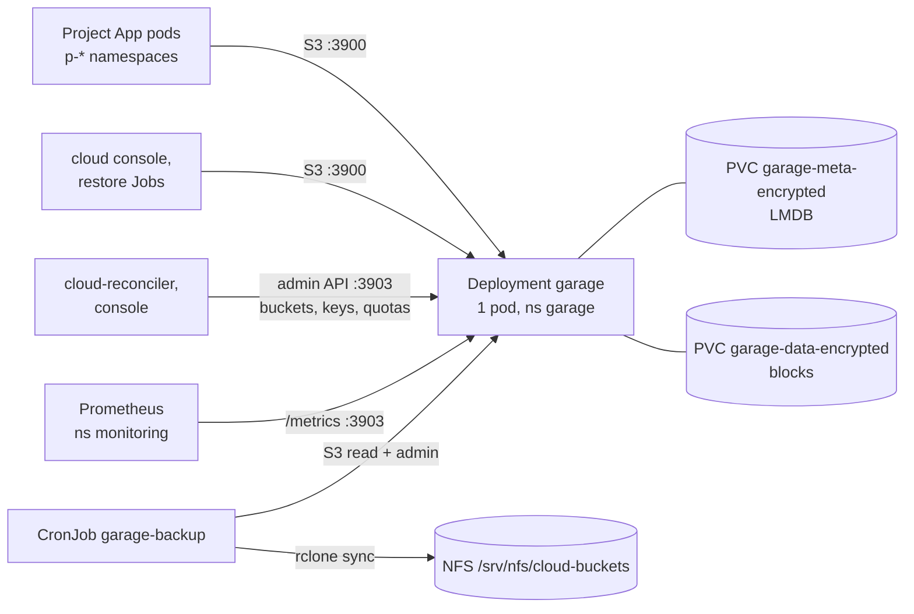

# Garage

Garage is the S3 store behind Cloud Buckets (cloud render-parity item B25). It runs in namespace `garage`, inside the cluster only: Viktor's decision V6 is cluster-only S3, with Apps proxying uploads, and no public S3 host. Cloud's reconciler makes the buckets, keys and quotas through Garage's admin API; Apps talk S3 to it. Stack: `stacks/garage`. Runbook: `docs/runbooks/garage.md`.

## What runs where



| Piece | Where | Notes |
|---|---|---|
| Server | Deployment `garage` (1 replica, Recreate), `docker.io/dxflrs/garage:v2.5.0` pinned by digest, uid 1000, labels `app=garage` and `app.kubernetes.io/name=garage` | `files/garage.toml`. Started with `--single-node`: on the first start it assigns its own layout (zone `dc1`, capacity = the data volume's size) and later starts change nothing. `replication_factor = 1`, `db_engine = "lmdb"`, a metadata snapshot every 24 h in `metadata_dir/snapshots` |
| Endpoints | Service `garage`: `s3` 3900, `admin` 3903 | `http://garage.garage.svc.cluster.local:3900` (S3, region `garage`, path-style), `http://garage.garage.svc.cluster.local:3903` (admin API v2, `/health`, `/metrics`). No Ingress, no DNS record, no Cloudflare entry. RPC 3901 is not on the Service |
| Metadata | PVC `garage-meta-encrypted`, `proxmox-lvm-encrypted-sas`, 1Gi, autoresizer (grows at 80% full) to 10Gi | Never on NFS: LMDB needs working locks and fsync |
| Data | PVC `garage-data-encrypted`, `proxmox-lvm-encrypted-sas`, 20Gi, autoresizer (grows at 80% full) to 100Gi | Sized on 2026-11-21 from the SAS thin pool: 537.6 GiB, 189.6 GiB written, about 240 GiB below the 80% `SASThinPoolFilling` line. 100Gi keeps Garage under half of that |
| Credentials | Vault `secret/garage` (`rpc_secret`, `admin_token`) and `secret/cloud/garage` (`admin_token`, `admin_url`, `s3_url`) | Both written by `stacks/garage` from `random_bytes`/`random_password`, which plans never print. The pod reads `secret/garage` through ExternalSecret `garage-secrets` as the env vars `GARAGE_RPC_SECRET` and `GARAGE_ADMIN_TOKEN` (Garage refuses secret files a group can read, which a Kubernetes secret volume with fsGroup is). Cloud reads `secret/cloud/garage` through its own ExternalSecret. CI's Vault policy `ci` may write both paths |
| Backup | CronJob `garage-backup` (suspended, run by `nightly-chain`), PV/PVC `garage-backup-host` on `/srv/nfs/cloud-buckets` | See "Backup" below |
| Monitoring | Scrape job `garage` (Prometheus, no token: `metrics_require_token = false`, the NetworkPolicy is what limits who reads `/metrics`), alert group `Garage`, Uptime Kuma TCP monitor `Garage S3 (garage)` | `GarageDown`, `GarageDiskFull`, `GarageBackupStale`, `GarageBackupNeverRun` |

## Who may connect

NetworkPolicy `garage` (Kubernetes, default tier) polices ingress only:

| Port | From |
|---|---|
| 3900 S3 | every namespace labelled `cloud.viktorbarzin.me/managed=true`; all of namespace `cloud` (console, reconciler, `cloud bucket restore` Jobs); `garage` (the backup); `uptime-kuma` (its TCP monitor) |
| 3903 admin | pods `app in (cloud, cloud-reconciler)` in `cloud`; `monitoring`; `garage`; the node network 10.0.20.0/24 (the kubelet's readiness probe on `/health`) |

A Project pod passes Calico tier `cloud` first. The Project egress floor there denies other namespaces unless a rule passes them; the Pass to Garage 3900, and the Project policy that allows it only for Projects with a Bucket, belong to Cloud's Bucket kind (cloud B26a, `stacks/cloud`). Every admin call except `/health` and `/metrics` needs the admin token; `/metrics` is open to whoever reaches 3903.

## Buckets and keys

Cloud owns them: bucket global aliases `p-<project>-<service>-<10 hex>`, keys named `cloud:<project>/<service>`, quotas from the Bucket's Size. Garage accepts global aliases that are valid S3 bucket names: lowercase letters, digits, dashes and dots, 3 to 63 characters. A quota is `maxSize` in bytes; a PUT that would pass it gets HTTP 403, S3 code `AccessDenied`, message `Forbidden: Bucket size quota is reached, ...` (checked per object before the write, `tests/garage.test.sh`).

One key belongs to this stack: `cloud-backup`, read only, granted on every bucket by the backup each night. Cloud must not delete or change it.

## Backup

`files/backup_prepare.py` (Python image) lists the buckets with the admin token, makes sure `cloud-backup` can read each, and hands the key and the bucket list to `files/backup_sync.sh` (rclone image, uid/gid 10001) in a memory-only volume. For every bucket:

```
rclone sync garage:<bucket> /backup/current/<bucket> --backup-dir /backup/<YYYY-MM-DD>/<bucket>
```

Layout under `/srv/nfs/cloud-buckets` (a contract: Cloud's `cloud bucket restore` reads it):

- `current/<bucket>/<key>`: the mirror as of the last run.
- `<YYYY-MM-DD>/<bucket>/<key>`: what that run (UTC date) overwrote or deleted, so the version the run before it had copied. A night that changed nothing makes no directory.
- A bucket that is gone from Garage moves whole from `current/` into that night's dated directory, so it ages out like a deleted object.
- The newest 7 dated directories stay; older ones are deleted in the same run. Retention counts directories, not days.

So an object that changes every night has up to 8 copies on NFS. Directory names are the bucket's global alias. The root is `10001:10001`, mode 750; files inside are written by uid 10001 with umask 022. A restore Job runs as uid 10001 and mounts the root read-only.

The CronJob carries `backup.viktorbarzin.me/nightly-chain=daily` and `suspend = true`: the Proxmox host's `nightly-chain` starts it from 00:00 UTC with the other dumps, before `nfs-mirror` copies `/srv/nfs` to sda and `offsite-sync-backup` to the Synology (`docs/architecture/backup-dr.md`). It pushes `backup_last_success_timestamp{job="garage-backup"}` only when every bucket synced, plus `garage_backup_buckets`, `garage_backup_failed_buckets`, `garage_backup_duration_seconds` and `garage_backup_last_run_timestamp`.

The Garage PVCs are also in the host's `lvm-pvc-snapshot` (3 days) and `daily-backup` (weekly file copies, 4 weeks) like every PVC outside dbaas and monitoring. Those are crash-consistent copies of Garage's own files; the NFS mirror is the one to restore objects from.

## Limits

- One node: a node drain or a pod restart stops S3 for every App until the pod is back (about 10 s plus volume attach). Garage supports more nodes; adding one means a layout change and `replication_factor` above 1, and `--single-node` then refuses to start.
- The layout capacity is the data volume's size at first start. With one node it only places partitions; it does not cap writes. The PVC's free space does.
- A second backup run on the same day stages what it replaces in `.staging/` and moves into that day's directory only the files it lacks (`rclone move --ignore-existing`), so the dated copy stays the previous night's version. A `.staging/` left by a killed run is merged at the next start. The Job does not retry (`backoff_limit = 0`); the next night does.
