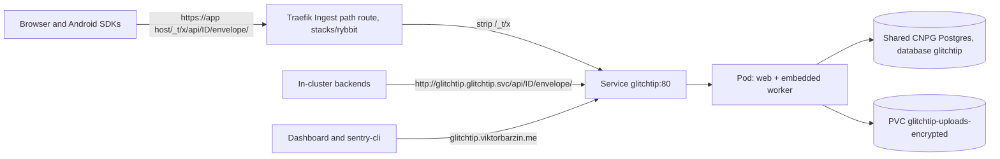

# GlitchTip

GlitchTip is the error and crash tracker (ADR-0041). Apps report through the Sentry SDKs for browser, Python, Go, Node/Bun and Android. The dashboard is at `https://glitchtip.viktorbarzin.me`. Stack: `stacks/glitchtip`. Design: `docs/plans/2026-11-09-product-analytics-design.md`.

## Shape

| Piece | Value |
|---|---|
| Image | `docker.io/glitchtip/glitchtip:6.2.6`, an exact pin that Renovate bumps |
| Workload | Deployment `glitchtip`, 1 replica, `Recreate`. The web server runs the background worker in the same process (`GLITCHTIP_EMBED_WORKER=true`), as GlitchTip's Helm chart does since 6.x. There is no Celery or beat process |
| Init containers | `migrate` runs `bin/run-migrate.sh` (migrations, cache table, partitions). `oidc-app` writes the allauth SocialApp for Authentik |
| Service | `glitchtip.glitchtip`, port 80 to container port 8000 |
| Database | `glitchtip` on the shared CNPG cluster, owner role `glitchtip` (`stacks/dbaas` `app_databases`). Password from the Vault static role `pg-glitchtip`, rotated Tuesdays at 10:42 UTC |
| Queue, cache, sessions | Postgres. `VALKEY_URL` is empty, which GlitchTip supports, so the stack does not use the shared Redis |
| Uploads | Source maps, ProGuard mappings and debug files on `glitchtip-uploads-encrypted` (`proxmox-lvm-encrypted`, 1Gi, autoresized to 10Gi) at `/code/uploads` |
| Retention | `GLITCHTIP_RETENTION_DAYS=90`. Events, transactions, logs, uptime checks and files inherit it |

## Ingest

DSNs point at the app's own host: `https://<key>@tv.viktorbarzin.me/_t/x/<project_id>`. The Sentry SDK posts to `/_t/x/api/<project_id>/envelope/`, the Ingest path route strips `/_t/x`, and GlitchTip serves `/api/<project_id>/envelope/`. GlitchTip finds the project from the path and the key, not from the host, so one GlitchTip serves every app host.

`ALLOWED_HOSTS` is `.viktorbarzin.me` plus the Service names, so requests arriving with an app's Host header are accepted. GlitchTip adds the pod IP itself for the kubelet probes.

The DSN that the GlitchTip UI shows uses `GLITCHTIP_DOMAIN` (`https://<key>@glitchtip.viktorbarzin.me/<project_id>`). Apps rewrite the host and add `/_t/x` when they set their DSN. In-cluster backends can use `http://<key>@glitchtip.glitchtip.svc.cluster.local/<project_id>` and skip the public route.

The pod also serves its dashboard, API, `/admin/`, OTLP logs at `/v1/logs` and uptime pages on the same port. The Ingest path route should forward only the ingest paths: `/_t/x/api/<digits>/envelope/`, and `/_t/x/api/<digits>/minidump/` if native crash reports are wanted.

## Sign-in and access

- Authentik OIDC application `glitchtip` (`stacks/glitchtip/authentik.tf`), confidential client `glitchtip`, bound to Home Server Admins only.
- The `oidc-app` init container upserts the matching allauth SocialApp (provider `openid_connect`, id `authentik`, PKCE on) on every pod start from the client secret in Vault, so nothing is configured by hand in `/admin/`. The callback is `https://glitchtip.viktorbarzin.me/accounts/oidc/authentik/login/callback/`.
- Local sign-up is closed (`ENABLE_USER_REGISTRATION=false`) once the first account exists. OIDC sign-up is open (`ENABLE_SOCIAL_APPS_USER_REGISTRATION=true`), because Authentik admits only Home Server Admins. A new admin gets an account on first login and then needs adding to the organization in GlitchTip.
- `ENABLE_ORGANIZATION_CREATION=false`: after the first organization, only superusers create organizations.
- The ingress is `auth = "app"`, so GlitchTip's own login is the gate. Forward auth would block `sentry-cli` and `glitchtip-cli`, which upload source maps and ProGuard mappings from CI with GlitchTip API tokens.

GlitchTip reads neither `SECURE_PROXY_SSL_HEADER` nor `ACCOUNT_DEFAULT_HTTP_PROTOCOL` from the environment, and without them Django treats every request behind Traefik as http, so allauth would send Authentik an http `redirect_uri`. The stack mounts `glitchtip/settings_proxy.py` (`glitchtip.settings` plus those two lines) and sets `DJANGO_SETTINGS_MODULE` to it.

## Secrets

Vault KV `secret/glitchtip`, synced by the `glitchtip-secrets` ExternalSecret:

| Key | Use |
|---|---|
| `secret_key` | Django `SECRET_KEY` |
| `oidc_client_secret` | Authentik client secret, read by Terraform for the provider and by the `oidc-app` init container |
| `email_url` (optional) | `smtp+tls://<user>:<password>@mail.viktorbarzin.me:587`, with `@` in the user written as `%40`. Without it GlitchTip sends no mail, and alerts can go to webhooks |

## Backups

The events live in Postgres, and the nightly `postgresql-backup` job dumps every database on the shared cluster (`pg_dump -Fc` per database), which reaches the offsite copy (`docs/agents/storage-backup.md`). The uploads volume has no backup job: its files are build artifacts that CI uploads again with each release. Losing it means older releases' crashes stay obfuscated until they age out.

## Monitoring

- Uptime Kuma: `[External] glitchtip` is created by `external-monitor-sync`, because the ingress is `dns_type = "proxied"`.
- Kubernetes: pod restarts, OOM kills and replica mismatch come from the cluster-wide alerts.
- GlitchTip's Prometheus endpoint (`ENABLE_OBSERVABILITY_API`) stays off. It serves `/metrics` without authentication on the same port as the dashboard, so it would be public on `glitchtip.viktorbarzin.me` and on every app host through the Ingest path.

## First apply checks

Order: `dbaas` (creates the database and role), `vault` (the `pg-glitchtip` role), then `glitchtip`. `secret/glitchtip` has to exist before the `glitchtip` plan, because Terraform reads `oidc_client_secret` from it.

1. `kubectl -n glitchtip logs deploy/glitchtip -c migrate` ends with the partition step, and `-c oidc-app` prints `SocialApp openid_connect/authentik configured`.
2. `https://glitchtip.viktorbarzin.me/login` shows an Authentik button. Signing in lands back on GlitchTip. If Authentik reports a redirect URI mismatch with `http://`, the settings module is not loaded.
3. The first account to sign in creates the first organization. Make it a superuser if `/admin/` is needed: `kubectl -n glitchtip exec deploy/glitchtip -- ./manage.py shell -c "from apps.users.models import User; User.objects.filter(email='<email>').update(is_staff=True, is_superuser=True)"`.
4. Send a test event through the Ingest path once the route in `stacks/rybbit` exists, for example with `sentry-cli send-event` against the `/_t/x/` DSN, and check it appears.

## Open questions

- Not yet checked on a live install: the SocialApp upsert, the https redirect fix through the settings module, the first login, and ingest through the Ingest path. The checks above cover them.
- Memory requests are an estimate (384Mi request, 1Gi limit). Right-size with `krr` after a few weeks of traffic.
- GlitchTip finds the project from the path and the key. Whether it also compares the `dsn` field in the envelope header with its own domain has not been checked; the test event in step 4 settles it.
