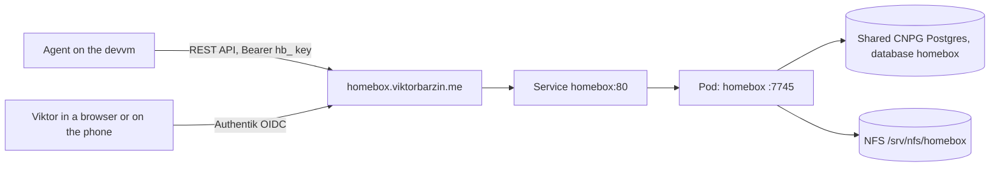

# Homebox

Homebox is the home inventory: the things Viktor owns, where each one is stored, and a photo of it. Viktor sends an agent photos in chat. The agent adds the things through the Homebox API and later answers "do I have X, and where is it" by searching. People browse and search at `https://homebox.viktorbarzin.me`. Stack: `stacks/homebox`. Upstream: [sysadminsmedia/homebox](https://github.com/sysadminsmedia/homebox), AGPL-3.0.

## Shape



| Piece | Value |
|---|---|
| Image | `ghcr.io/sysadminsmedia/homebox:0.27.1` |
| Workload | Deployment `homebox`, 1 replica, `Recreate`, because Homebox migrates its schema at start |
| Database | `homebox` on the shared CNPG cluster (`stacks/dbaas` `app_databases`). Password from the Vault static role `pg-homebox`, rotated Tuesdays at 10:31 UTC |
| Files | NFS `/srv/nfs/homebox` at `/data`: photos and attachments, one folder per collection. The nightly NFS mirror and offsite sync carry it |
| Secrets | Vault `secret/homebox`: `oidc_client_secret`, `api_key_pepper`. Vault `secret/homebox-agent`: `api_key`, `url` |
| Ingress | `auth = "app"`, proxied. Homebox's own login gates the UI and the API. Per-client rate limit of 50 average, 300 burst, after real-ip, as for Bambuddy |
| Uploads | Up to 30 MB a file (`HBOX_WEB_MAX_UPLOAD_SIZE`) |

## Sign-in and access

People sign in with Authentik only. The Authentik application `homebox` (`stacks/homebox/authentik.tf`) admits the Home Server Admins group. Homebox creates the account on the first login, with its own empty collection. Local passwords and self-registration are off (`HBOX_OPTIONS_ALLOW_LOCAL_LOGIN`, `HBOX_OPTIONS_ALLOW_REGISTRATION`), so the public hostname has no password form.

To share one inventory with another person: bind their Authentik group in `authentik.tf`, let them sign in once, then invite them to the collection from Homebox's collection settings. A user can belong to more than one collection; API calls pick one with the `X-Tenant` header, and the default collection is used without it.

## Agents

The API key in `secret/homebox-agent` belongs to Viktor's own account (created 2026-11-27), so what an agent adds lands in his collection. The key has the same rights as Viktor in Homebox. `HBOX_AUTH_API_KEY_PEPPER` is mixed into every stored key hash: changing the pepper makes every existing key invalid, and a new key must then be created from Viktor's session (Homebox UI, Profile, API keys) and written back to Vault.

Locations and items are both entities. Entity types: `Location` (`isLocation: true`) and `Item`; read their ids from `GET /api/v1/entity-types`. Locations nest through `parentId` (room > shelf > box), and an item sits in a location the same way.

```sh
K=$(vault kv get -field=api_key secret/homebox-agent)
B=https://homebox.viktorbarzin.me/api/v1
H="Authorization: Bearer $K"

# Find something; the path gives where it is kept.
curl -s -H "$H" "$B/entities?q=hdmi" | jq '.items[] | {id, name, location: .parent.name}'
curl -s -H "$H" "$B/entities/<id>/path" | jq '[.[].name]'

# Add an item to an existing location, then its photo.
curl -s -H "$H" -H 'Content-Type: application/json' \
  -d '{"name":"HDMI cable","description":"2 m, black","parentId":"<location id>","entityTypeId":"<Item type id>","quantity":1}' \
  "$B/entities" | jq -r .id
curl -s -H "$H" -F file=@photo.jpg -F type=photo -F primary=true -F name=photo.jpg "$B/entities/<item id>/attachments"
```

How an agent adds a thing from a photo:

1. Look at the photo and name the thing, with brand and model when they are visible.
2. Get the storage place from Viktor. A photo does not show where a thing is kept; ask when he did not say.
3. Reuse the existing location. Search for it first, and create a new one under its parent only when none matches.
4. Create the item, then attach the photo as the primary picture.
5. Reply with what was added and its path.

`homelab how "do I have a spare hdmi cable"` routes to this section.

## Upgrades

Change the image tag in `stacks/homebox/main.tf`. Homebox migrates its own schema on start. Read the release notes for API changes: 0.26 replaced `/v1/items` and `/v1/locations` with `/v1/entities`.
