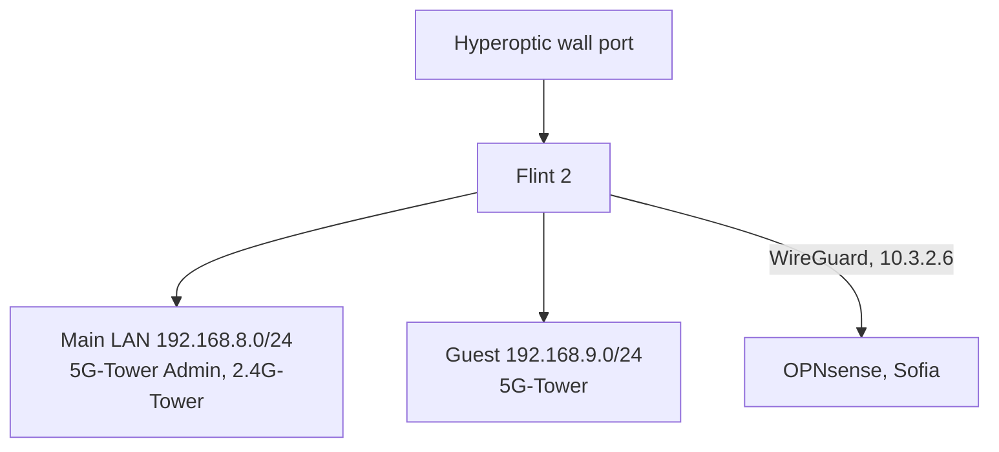

# London site

The London flat's network: one GL.iNet Flint 2 (GL-MT6000) router, a main LAN
and a guest network, and a WireGuard tunnel to OPNsense in Sofia. The router is
configured through its own web UIs (GL admin UI and LuCI, under
SYSTEM → Advanced Settings), not from this repo. This page lists the intended
settings and why, so the live router can be compared against it.

Design and decisions: `docs/plans/2026-09-27-london-flint-main-router.md`.
Cutover day: `docs/runbooks/london-cutover.md`.

## Topology



Since 2026-10-02 the Flint takes the Hyperoptic line directly; the Hyperoptic
router is gone. The WAN gets 100.67.94.6/18 by DHCP, a carrier-grade NAT range
(RFC 6598), and leaves the internet as 137.220.71.46 (AS56478). That address is
most likely shared with other Hyperoptic customers, so it is not ours to
allowlist. IPv6 is native: Hyperoptic delegates 2a01:4b00:ab23:1200::/56 and the
LAN gets real addresses from it.

Firmware is GL 4.11.0 since 2026-10-02 (was 4.9.1).

## Access

| what | how |
|---|---|
| GL admin UI | `http://192.168.8.1` on the LAN, `http://10.3.2.6` from Sofia |
| LuCI | GL UI → SYSTEM → Advanced Settings → Go To LuCI |
| admin password | Vaultwarden item `london.viktorbarzin.me` (user `root`) |
| APIs | GL JSON-RPC `POST /rpc` (challenge, login, call); OpenWrt ubus at `http://10.3.2.6:8080/ubus` (session.login as root) |
| SSH | `ssh root@10.3.2.6`, read-only diagnostics only. With the tunnel down: `ssh -o HostKeyAlias=10.3.2.6 root@2a01:4b00:ab23:1200::1` from the devvm (IPv6), same host key. Keys only: the list is `scripts/london-flint/authorized_keys`, and a machine missing from it cannot log in |

Every change goes through the GL UI settings or LuCI, or the RPC calls those UIs
make, so the result is visible in one of the two UIs. The exception is the
monitoring packages, which `scripts/london-flint/provision.sh` installs over SSH
(see [After a firmware upgrade](#after-a-firmware-upgrade)).

Firmware 4.11 answers 403 on the admin page to any request whose Host header is
not `localhost` or one of the router's own addresses (DNS-rebinding protection,
hardcoded in `/usr/share/gl-ngx/oui-access.lua`). A browser on the LAN using
`192.168.8.1` is unaffected; a reverse proxy that forwards another hostname gets
403.

## Intended settings

| setting | value | UI | why |
|---|---|---|---|
| Country | GB on both radios | LuCI → Network → Wireless | Location. GL applies a per-rate power table only for DE; GB was chosen anyway (2026-09-27). Changing the country needs one reboot to reach the radio. |
| 2.4 GHz | channel 11, 20 MHz (HE20) | GL → Wireless | Channel 1 at 40 MHz logged 2.85M receive errors against 2.89M packets. 11 had the weakest neighbours in the 2026-09-27 scan once the Hyperoptic router (channel 7) is gone. |
| 5 GHz | channel 44, 80 MHz (HE80) | GL → Wireless | Pinned off DFS channels: auto selection with radar detection on could land on a DFS channel after any radio restart, which silences 5 GHz for 1–10 minutes. |
| 5 GHz security | WPA2-PSK on both 5 GHz SSIDs | GL → Wireless | The closed MediaTek driver's WPA3-SAE PMKID cache fails (fixed 2026-09-13). |
| Scheduled reboot | off | GL → System → Scheduled Tasks | Memory and conntrack were healthy after 6.7 days; the reboot wiped the kernel log used for diagnosis. |
| DNS cache | 10000 entries, "All servers" on | LuCI → Network → DHCP and DNS | The 150-entry default evicted 3,038 live entries in 6.8 days. Upstreams stay AdGuard public DNS (94.140.14.14, 94.140.15.15). |
| DNS upstreams | AdGuard public DNS over IPv4 (94.140.14.14, 94.140.15.15) and IPv6 (2a10:50c0::ad1:ff, 2a10:50c0::ad2:ff) | LuCI → Network → DHCP and DNS; IPv6 pair set by `provision.sh` | IPv6 added 2026-10-06. Over IPv4 the flat leaves through the ISP's CGNAT (WAN 100.67.94.6), and AdGuard stopped answering it for 52 to 283 s at a time (six `LondonDnsFailure` drops 2026-10-02 to 10-06) while ping to it stayed at 0% loss and 1.1.1.1, 9.9.9.9 and AdGuard over IPv6 answered every lookup. Follow-up tests the same day narrowed it to UDP: over IPv4, UDP to 94.140.14.14 timed out on 7 of 15 lookups (silent drops, never REFUSED), while TCP to the same address answered 15 of 15 and DNS over HTTPS 20 of 20; all three AdGuard IPv4 addresses (14.14, 15.15, 14.140) lost about a third over UDP. The likely cause is AdGuard limiting UDP per source address on the shared CGNAT address (137.220.71.46); AdGuard publishes no limit for its public resolver, so this is not confirmed, and loss on the IPv4 path to AdGuard is not ruled out. If IPv4 itself needs to be reliable, sending the IPv4 upstreams over TCP (DoT through the stubby package already on the router) avoids it. With "All servers" on, dnsmasq takes the first answer from any of the four. |
| Device names | Curated static leases (`ensure_host` in `provision.sh`): plug-livia, plug-jinx, plug-pikkachu, plug-michelle, plug-thor, plug-tapo, mbp-london, anca-mba-london, portal-london, projector-london, plus iphone-london with its pinned address | set by `provision.sh` | Every leased device is named in `viktorbarzin.lan` from these or from the hostname it announces (`docs/architecture/dns.md`, "London devices"). The five Kasa plugs all announce `KP115` and are named after their nickname in the Kasa app. No address is pinned, so a name follows its device between SSIDs. Previous config backed up on the router at `/etc/config/dhcp.bak.20261013-london-dns`. |
| `viktorbarzin.lan` forwarding | `server` entries `/viktorbarzin.lan/10.0.20.201`, `/1.168.192.in-addr.arpa/10.0.20.201`, `/10.in-addr.arpa/10.0.20.201` | set by `provision.sh`, which checks afterwards that `openwrt-london.viktorbarzin.lan` resolves | London clients get Technitium's answers for internal names, the same as Sofia. The GL DNS page and the Tailscale toggle rewrite dnsmasq settings; re-run `provision.sh` after using either. |
| DNS query log | on: `logqueries '1'` (`--log-queries=extra`) | LuCI → Network → DHCP and DNS → Log queries; set by `provision.sh` | Every lookup (serial, client, name, answer) goes to Loki for the daily DNS digest (`docs/plans/2026-10-02-london-dns-block-monitoring.md`). About 575k lookups a day. Sent over the TCP syslog; nothing is written to flash. |
| DNS concurrent queries | `dnsforwardmax '1000'` (default 150) | set by `provision.sh` | `Maximum number of concurrent DNS queries reached (max: 150)` appeared four times on 2026-10-02 next to a 283 s DNS drop; "All servers" sends each miss to both upstreams, which doubles the in-flight count. |
| Wi-Fi driver debug | level 0 on `ra0` and `rax0`, hook `/etc/hotplug.d/net/60-mtk-debug-off` (kept across upgrades via `/etc/sysupgrade.conf`) | set by `provision.sh` | Firmware 4.11.0 runs the MediaTek driver at debug level 1, which logged `MlmeEnqueueForRecv` about 47 times a second: the ring held about 80 s and Loki received about 90k Flint lines an hour. The level resets when an interface comes up, so the hook sets it again. |
| Router's own 10.x traffic | IPv4 rule `router_to_sofia_via_tunnel`: from loopback, to 10.0.0.0/8, table 1001, priority 5990 (was 9950 until 2026-10-13) | LuCI → Network → Routing → IPv4 Rules; set by `provision.sh` | GL installs the tunnel routes in table 1001, which only forwarded LAN traffic consults. Without the rule the router's own traffic to Sofia (syslog, the probe) left through the WAN. With the tunnel down, table 1001 holds only a blackhole, so the traffic is dropped rather than leaked. It sits before GL's fwmark rules (6000) because dnsmasq copies each client query's mark (0x8000, "use main") onto the query it forwards: at 9950, `viktorbarzin.lan` lookups forwarded for London clients left through the WAN and were never answered, while the router's own unmarked lookups worked. |
| System log | 8 MB ring in RAM (`log_size '8192'`), not written to flash | LuCI → System → System → Logging; set by `provision.sh` | The 64 KB ring held about 5 hours; once the DNS query log was on, the 512 KB ring held 3 to 14 minutes (99% of it lookups). 8 MB is about one to four hours and costs 8 MB of the router's 1 GB RAM. A flash copy (`/root/system.log`) was on from 2026-09-27 to 2026-09-28 and removed to keep eMMC writes down (Viktor). The ring is what the drop probe backfills tunnel outages from, so its size is how long an outage can be and still reach Loki whole. A crash loses the ring: there is no flash or pstore copy. |
| Remote syslog | `10.0.20.208`, TCP 514 | LuCI → System → System → Logging | Kernel Wi-Fi lines and firmware resets land in Loki as `{job="syslog", host="flint-london"}`. TCP, not UDP: over UDP only the first line after a quiet spell arrived (195 of about 3,000 lines on 2026-09-27/28); logread sends everything on one UDP flow and the rest of each burst was lost between the tunnel and the cluster. Over TCP a 5-minute window matched 20 of 20 lines. The receiver (`alloy-syslog`) keeps each line's program as the `app` label and its severity as `level` (since 2026-10-03). The forwarder (`logread -f -r`) sends over TCP, so through a short tunnel outage TCP holds the lines and retransmits them (a 46 s simulated outage on 2026-10-03 lost nothing). Lines are lost only when the connection dies, after about 15 minutes of retransmits (`tcp_retries2` 15): logread reconnects and does not replay what it missed. The drop probe backfills that gap (`source="backfill"`, see the drop probe row). |
| kmwan (multi-WAN watchdog) | unchanged: failover, pings 8.8.8.8 / 9.9.9.9 / 208.67.222.222 | GL → Network → Multi-WAN | Kept pending data; the probe records its state during each drop. Switch its tracking off if drops line up with it. |
| DPI / per-app stats | on | GL → Network | Viktor uses them. |
| Guest network | forwards to the tunnel | unchanged | Viktor's call (2026-09-27). Guest traffic reaches Sofia masqueraded as 10.3.2.6. |
| No NAT to the Kubernetes VLAN | `iptables -t nat -I postrouting_rule -s 192.168.8.0/24 -d 10.0.20.0/24 -j ACCEPT` at the top of `/etc/firewall.user` | set by `provision.sh` (marker `london-lan-no-nat`) | Since 2026-11-22 (ADR-0045). The tunnel zone masquerades London traffic as 10.3.2.6, but a London Kubernetes node must reach the Sofia nodes from its own address, because Calico accepts VXLAN only from known node addresses. `postrouting_rule` runs before the zone's masquerade. Main-LAN traffic to every other Sofia network is still masqueraded. Traefik `local-only` and the Loki alert K9 admit `192.168.8.0/24`. |
| Dell worker lease | `dell-worker` 48:89:e7:18:0e:66 → 192.168.8.20 | set by `provision.sh` | The Ubuntu worker on the Dell Precision registers this address as its node IP (ADR-0045). Fedora and Windows on the same laptop use private Wi-Fi addresses and get ordinary leases. |
| SSH and admin page on WAN | open to every source; SSH takes keys only (`PasswordAuth` and `RootPasswordAuth` off) | set by `provision.sh` | Open by Viktor's call (2026-09-27) so the router stays reachable over IPv6 when the tunnel is down. Over IPv4 the WAN is behind the ISP's CGNAT, but over IPv6 the whole internet reaches both ports: in the 30 days to 2026-11-22 scanners from DigitalOcean, IONOS and China Telecom connected to SSH, and none got past authentication. Password login went off on 2026-11-22 (Viktor). The key list replaces the router's on every run. |
| WAN brute-force bans | A source that opens 5 new SSH connections within 60 s is dropped on SSH for 24 h; 20 new admin-page connections within 10 s drop it on 443 for 1 h. Each new attempt during a ban restarts the timer. Sofia's IPv6 ranges (`2001:470:5a7f::/48`, `2001:470:6f:43d::/64`) are exempt | firewall include `/etc/firewall.bruteforce` from `scripts/london-flint/wan-bruteforce.sh`, kept across upgrades via `/etc/sysupgrade.conf`; set by `provision.sh` | Kernel `recent` lists, IPv4 and IPv6, WAN (`eth1`) only, so the tunnel and the LAN are never counted. The exemption keeps `provision.sh` working over IPv6, which opens about ten connections in a row. Chosen over fail2ban and CrowdSec, which would need Python or a Go agent on a router with about 480 MB free, and which a firmware upgrade removes. A ban logs `wan-bruteforce ban ssh` or `ban admin` (kernel, `{job="syslog", host="flint-london"} |= "wan-bruteforce"`). Lift one with `echo -<address> > /proc/net/xt_recent/bf_ssh_ban` (or `bf_admin_ban`). Tested 2026-11-22 with the exemption removed: the 5th SSH connection and the 20th admin request from the devvm timed out. |
| IPv6 | Native with the delegated /56 (set 2026-10-02) | GL → Network → IPv6 | Real addresses skip NAT and the ISP's IPv4 CGNAT. |

## Monitoring

| piece | where | what |
|---|---|---|
| node exporter | package `prometheus-node-exporter-lua` (+ `-wifi_stations`, `-netstat`, `-openwrt`), `listen_interface '*'` | Prometheus job `flint-london` scrapes `10.3.2.6:9100`. The WAN zone drops 9100; the tunnel zone accepts it. The `wifi` collector is left out because the MediaTek iwinfo backend lacks noise/quality/bitrate. `wifi_stations` packet counters read 0 on this driver; signal and rates are real. |
| tunnel ping | blackbox job `london-flint-icmp`, 30 s | `LondonTunnelDown` after 10 minutes |
| drop probe | package `london-drop-probe` 0.6.3, built by `scripts/london-flint/build-ipk.py`, installed by `scripts/london-flint/provision.sh`, a procd service shown in LuCI → System → Startup | HTTP checks to http://1.1.1.1 and https://8.8.8.8, and over IPv6 to Cloudflare and Google, every 10 s (every 2 s after a failure); a fresh name (`probe-<time>.viktorbarzin.me`) resolved through dnsmasq every 30 s. A drop is 30 s or more: `layer=internet`/`gateway` (IPv4), `ipv6` (IPv6 failing while IPv4 works, since 0.5.0), `dns` (lookups through dnsmasq failing while HTTP works). Snapshots routing/kmwan/DPI-queue state and pushes one event per drop to Loki (`{job="london-drops", source="flint"}`) after the path returns; the queue survives reboots in `/root/drop-probe.queue` (written only when a drop ends). Every 5 minutes it also pushes the IPv4/IPv6 neighbour tables and DHCP leases as `{job="london-neigh"}`, which the DNS digest uses to name devices. Since 0.6.0 each check also asks Loki's `/ready` over the tunnel. When it answers again after failing, the probe waits 20 s and looks in the ring for a forwarder reconnect (`Logread connected to`) since the outage began. If there was one, it pushes the ring's lines from the start of the outage to the reconnect with their original timestamps as `{job="syslog", host="flint-london", source="backfill"}`; if not, TCP delivered everything and nothing is pushed. Either way one summary line (`drop-probe backfill:`) records the outage, what was done, and whether the ring still reached back to the start of it. Tested 2026-10-03 with a simulated outage both ways (connection surviving, and killed by lowering `tcp_retries2` for the test). History: ping-based 0.1.x produced false drops; the cron-driven 0.1–0.3 missed every other minute; 0.4.x queried AdGuard directly for DNS, skipping dnsmasq. |
| Mac probe | launchd agent `me.viktorbarzin.london-probe` on mbp-london (Viktor's M4 MacBook), source in the `dot_files` repo under `mac/london-probe` | Reports drops of the Mac's own Wi-Fi and DNS (`source="mac"`). The Mac has no git access to Forgejo, so deploy by copying `mac/london-probe` over SSH and running its `install.sh` (runs the tests, then bootstraps the agent). Log: `~/Library/Logs/london-probe.log`. |
| alerts | Loki rules `LondonInternetDrop`, `LondonDnsFailure` (probe `layer=dns`, split out 2026-10-02), `LondonFirmwareReset`; Prometheus rule `LondonTunnelDown` | Event alerts go to the `slack-event` receiver: one post per drop, no RESOLVED. |
| DNS digest | CronJob `dns-digest` (monitoring namespace, `stacks/monitoring/modules/monitoring/dns_digest.py`), 08:00 Europe/London; covers Sofia too | Posts to #alerts only when there is something to report: lookups of names on HaGeZi's Threat Intelligence Feeds list (blocked or not, per device), London DNS errors when they point at a real problem (a `config error`, meaning no upstream answered; dnsmasq's concurrent-query limit; or three or more different failing names), names added to `GL_DPI_BLOCK`, and hours in which the query log recorded nothing. Lookups DNS fingerprinting tools send on purpose (`version.bind`, `version.maradns` and similar, from Avast's daily network check on `MGhe`) are left out. Replaced `london-dns-digest` on 2026-11-04, whose "newly blocked by AdGuard" section listed 300 to 760 ad and tracker names a day. It asks Loki for every name London looked up in 24 h (about 2.8k, without the probe's own `probe-<time>` names) and halves the window if Loki's `max_query_series: 5000` is ever exceeded. Details, metrics and alerts: `docs/architecture/dns.md`, "Daily DNS digest". |

The probe and the Mac push to `https://loki.viktorbarzin.lan/loki/api/v1/push`
pinned to Traefik's `10.0.20.203`. London LAN traffic to the Kubernetes VLAN
(10.0.20.0/24) keeps its own `192.168.8.x` source address since 2026-11-22;
Traefik's `local-only` allowlist admits `192.168.8.0/24`. The probe runs on the
router itself, so it still leaves as 10.3.2.6.

### Useful queries

```
{job="london-drops"} | json                       # every drop, both vantage points
{job="syslog", host="flint-london"} |= "mt7986_dump_ser_stat"   # firmware resets
wifi_station_signal_dbm{instance="flint-london"}  # per-client signal
{job="syslog", host="flint-london", app!="dnsmasq"}               # everything except DNS lookups (since 2026-10-03)
{job="syslog", host="flint-london", app="kernel"}                 # kernel and Wi-Fi driver lines
{job="syslog", host="flint-london", level=~"error|critical|alert|emergency"}  # errors and worse
{job="syslog", host="flint-london", source="backfill"}            # lines recovered after a tunnel outage
```

Backfilled lines carry the router's own `facility.level program[pid]:` prefix
in the line, because they come from the ring rather than through the receiver,
so `app` and `level` filters do not match them; filter them by text instead.

DNS, on demand (dnsmasq `--log-queries=extra` lines: `<serial> <client>/<port> <verb> ...`):

```
{job="syslog", host="flint-london"} |~ " (reply|cached) [^ ]+ is (0\\.0\\.0\\.0|::)$"   # blocked answers
{job="syslog", host="flint-london"} |~ " (reply|config) error is (SERVFAIL|REFUSED)"   # errors; the name is on the query[ line with the same serial. "config error is REFUSED (EDE: network error)" = no upstream answered
{job="syslog", host="flint-london"} |= " ipset add GL_DPI_BLOCK "                     # GL content protection
{job="syslog", host="flint-london"} |= "query[" |= " from 192.168.8.198"             # everything one device asked
{job="london-neigh"}                                                                 # address -> MAC -> hostname snapshots
```

To unblock one name that AdGuard blocks, on the Flint:

```sh
uci add_list dhcp.@dnsmasq[0].server='/<domain>/94.140.14.140'   # AdGuard's unfiltered resolver
uci commit dhcp && /etc/init.d/dnsmasq restart
```

Devices may keep the cached block for up to an hour (AdGuard answers blocks with a 3,600 s TTL).

Client disconnects, on demand (MediaTek driver lines, one per event):

```
{job="syslog", host="flint-london"} |= "Del Sta:"                       # a client left (station removed)
{job="syslog", host="flint-london"} |= "New Sta:"                       # a client joined
{job="syslog", host="flint-london"} |~ "ReasonCode|4Way-MSG1 timeout"   # AP-side deauths, failed handshakes
sum by (mac) (count_over_time({job="syslog", host="flint-london"} |= "Del Sta:" | regexp "Del Sta:(?P<mac>[0-9a-f:]+)" [24h]))  # leaves per client
```

Remote syslog has been complete only since 2026-09-28 10:43 BST (the switch to
TCP); earlier router lines in Loki are a sample.

## After a firmware upgrade

A GL firmware upgrade keeps UCI settings (everything in the Intended settings
table survived 4.9.1 → 4.11.0) but removes every package installed with opkg.
On 2026-10-02 that took out the node exporter and the drop probe. Reinstall
both from the devvm:

```sh
scripts/london-flint/provision.sh
```

It builds the probe package, installs whatever is missing, sets the exporter to
listen on every interface, installs the SSH key list and the WAN brute-force
bans, and checks from Sofia that the exporter answers, the probe runs, SSH
offers only `publickey` and the bans are loaded. It is idempotent, so a second run changes nothing. After an
upgrade, also check that the tunnel came up (`ifstatus wgclient1` shows
`"up": true`): on 2026-10-02 a network restart left it `pending` with no
address until `ifup wgclient1`.

## Rebuilding the probe package

Edit `scripts/london-flint/drop-probe.sh`, bump `PROBE_VERSION` in
`provision.sh`, and run `provision.sh`. To build the package alone:

```sh
python3 scripts/london-flint/build-ipk.py <version> <out-dir>
```

## Home Assistant Pi (ha-london)

ha-london is Home Assistant OS on a Raspberry Pi 3 B (1 GB RAM, 953 MB visible to
Linux with `gpu_mem=16`; 32 GB SD card) at 192.168.8.103, on Wi-Fi. It runs Core 2026.11.0 since 2026-11-05. Three
add-ons run: Advanced SSH, which is the access path when Core is down
(`ssh hassio@192.168.8.103`, then `sudo -n`), LED strip (`local_led_strip`,
below) and Journal upload (`local_journal_upload`, below). Whisper, Piper, VS Code and
the ESPHome builder were uninstalled on 2026-11-05 to free memory and disk;
the ESPHome device YAMLs stay in `/homeassistant/esphome`.

| Item | State | Notes |
|---|---|---|
| Power | Tapo P100 "pi living room Tapo P100", `plug-tapo` (192.168.8.108) | Third-Party Compatibility is on (Tapo app, Tapo Lab), so it speaks KLAP and python-kasa can switch it from the devvm: `kasa --host 192.168.8.108 --username <u> --password <p> off`, then `on`. The working login is the Vaultwarden item `www.tplinkcloud.com`. |
| Wi-Fi | USB adapter TP-Link TL-WN722N v1 (Atheros AR9271, `ath9k_htc`), interface `wlu1u3`, MAC `c4:e9:84:10:52:c8`, static 192.168.8.103/24 on `2.4G-Tower`, set with `ha network update wlu1u3` | The onboard chip is off (`dtoverlay=disable-wifi` in `/mnt/boot/config.txt`). Plug the adapter in before power-on: HAOS detects it only at boot. Without it the Pi has no network until the overlay line is removed from the SD card's boot partition. Since 2026-11-21 the card runs on the board that was rpi-london (onboard MAC `b8:27:eb:de:b2:36`); the first board (`b8:27:eb:e9:18:92`) is a spare. Onboard Wi-Fi failed on both boards. On the first board the chip stopped under load while the Pi kept running (kernel line `mmc1: Timeout waiting for hardware interrupt`, mmc1 is the SDIO Wi-Fi chip), so the hardware watchdog never fired; it stayed off the network until a power-cycle. On the second board, tested 2026-11-21, there were no driver errors, but from 7 minutes after boot it lost 80 to 100% of packets for stretches of 1 to 3 minutes. The onboard profile `Supervisor wlan0` holds static .103 too, so if onboard Wi-Fi is switched on again, unplug the adapter first: NetworkManager refuses an address another interface already holds. The Flint lease for 192.168.8.103 still names `b8:27:eb:e9:18:92`, which keeps the address reserved. An Ethernet cable is still the most reliable option. |
| Self-recovery | HA automation `wifi_watchdog_reboot` | Every 2 minutes: if `binary_sensor.192_168_8_1` (ping of the Flint) has been off for 6 minutes and the automation has not run in the last 30 minutes, it calls `hassio.host_reboot`. It cannot help while Core is stopped; power-cycle through the plug then. |
| LED strip "Livia" | Local add-on `local_led_strip`, source `ha-addons/led_strip/` in this repo | 150 WS2812 LEDs. Data on GPIO10 (pin 19, SPI MOSI), ground on pin 20; the strip's own 5 V supply is on the Kasa plug `switch.livia`. Boot config has `dtparam=spi=on` and `core_freq=250` (the Pi 3 SPI clock follows the core clock). HA entity `light.livia`, exposed to Alexa as "Livia", dashboard `livia-strip`. Never drive the strip while `switch.livia` is off: an unpowered strip draws power through the data pin. The Pi froze three times on 2026-11-18 while the strip was driven unpowered; the last freeze also followed an out-of-memory kill, so the cause is not proven. The automation `livia_stop_when_unpowered` enforces it; HA side in `packages/livia.yaml` of the ha-london-config repo. Details: `ha-addons/led_strip/README.md`. |
| Logs | Local add-on `local_journal_upload`, source `ha-addons/journal_upload/` in this repo | The whole journal (kernel, Core, Supervisor, every add-on) streams to Loki as `{job="systemd-journal", host="ha-london"}`; `container` names the Docker container (`homeassistant`, `hassio_supervisor`, `app_<slug>`), `app` the syslog identifier (`kernel`). The add-on starts the host's own `systemd-journal-upload` with a `/run` drop-in pointing at `10.0.20.200:19532` (receiver `alloy-journal` in `stacks/monitoring`). The upload cursor is in `/var/lib/systemd/journal-upload/state`, which HAOS keeps across reboots, so a tunnel outage or reboot sends the backlog instead of losing it. Alerts: `HostOutOfMemoryKill` (pages), `HostJournalSilent`. Since 2026-11-19; earlier history is only on the Pi (`/host/logs/boots/-N` through the Supervisor API). |
| Memory | Core uses about 430 to 560 MB, Supervisor about 95 MB, so the Pi depends on swap | Out-of-memory kills hit add-ons first (`oom_score_adj` 200): 91 from 2026-11-05 to 11-11, 4 on 2026-11-19. A profiler run on 2026-11-19 found no leak (object counts flat; Core grew about 25 MB in 6 days); Core is simply large for 1 GB. Fixes on 2026-11-19: `gpu_mem=16` in `/mnt/boot/config.txt` (the Pi is headless; +50 MB for Linux) and the built-in Marketplace (HACS) integration disabled, because it keeps its 6,729-repository catalog in memory. Enable it again to update a custom integration, then disable it. `vm.swappiness` stays at the HAOS default 1. Swap goes first to zswap (compressed RAM, 20% pool); the SD swapfile is written only when that pool is full: check `pswpout` and `zswpwb` in `/proc/vmstat`. `local_led_strip` has the Supervisor watchdog on, so it restarts after a kill. Memory history: `sensor.home_assistant_core_memory_percent`. |
| Upgrades | Core image needs about 3.1 GB free at peak | Procedure that worked three times (last 2026-11-21, 2026.11.0 to 2026.11.2): stop Core, `nohup docker pull` the image over SSH, `ha core update --version <v> --backup=false`, `ha core start`. A UI update with a backup starved the Pi on 2026-11-04. Over SSH, run `ha` inside `bash -lc "..."`: a plain non-interactive command has no Supervisor token and gets `unauthorized`. Add-ons without a published image, such as Version Control (`4ab554b2_home-assistant-version-control`), are built on the Pi: on 2026-11-21 that build with Core running froze the Pi for 14 minutes until the hardware watchdog reset it. Stop Core and `local_led_strip` first; with about 600 MB free the build took 80 seconds. For the OS: stop Core, `ha os update --version <v>`; on 2026-11-21 (18.4 to 18.5) it installed to the other slot but did not reboot by itself, so run `ha host reboot`. The previous OS stays in the other slot as the fallback. |

### Backups

Since 2026-11-11 ha-london's weekly automatic backup (Sunday 05:00 London time,
encrypted, key in Vault `secret/viktor` `ha_london_backup_encryption_password`)
goes to two places: the SD card (`hassio.local`) and the Proxmox host, through
Supervisor network storage (Settings > System > Storage, mount `proxmox`,
backup agent `hassio.proxmox`).

| piece | value |
|---|---|
| mount | NFS `192.168.1.127:/srv/nfs/ha-london-backup`, usage backup. Supervisor mounts it with `softerr,timeo=100,retrans=2` (NFS 4.2), so a stalled tunnel fails a write after about 30 s instead of blocking |
| default backup location | still local (`default_backup_mount` null). Adding the mount made it the default; that was undone so add-on and update backups stay on the card as before |
| retention | 4 copies, per location |
| export | `scripts/pve-nfs-exports`, clients `192.168.1.2` and `10.3.2.6`. The Pi's traffic reaches the host as 192.168.1.2: the Flint masquerades it to 10.3.2.6 and OPNsense source-NATs that to its LAN address (measured 2026-11-11). An export limited to 10.3.2.6 alone would refuse the Pi, which is how the Synology mount hung the Pi for 4 minutes on 2026-09-18 |
| copies | nfs-mirror carries the directory to sda nightly and offsite-sync to the Synology (`docs/architecture/backup-dr.md`) |
| alert | `HomeAssistantLondonBackupStale` pages when the newest `*.tar` there is over 8 days old or the metric is missing, from `ha-london-backup-status` on the host (hourly, `playbooks/pve-host.yml` tag `ha-london-backup`) |

First run, 2026-11-11 12:56 UTC (`backup/generate_with_automatic_settings`):
256,727,040 bytes, 4.5 minutes in all, of which about 75 s was the copy over
the tunnel. The host copy and the card copy had the same sha256. The Pi kept
answering ping and the API throughout.

The file on the host only started growing in the backup's `finishing_file`
stage, so Supervisor appears to build the archive on the card and then copy
it. The network location therefore does not reduce SD writes; it removes the
card as the only copy.

### Sleep stage cleanup

Since 2026-11-12 a job on ha-london repairs Viktor's sleep stage history every
hour. The iOS companion app (2026.10.3) merges each stage's samples across all
sources. When the Apple Watch and Sleep Cycle both stage a night, a minute that
one calls core and the other deep counts in both sensors. On 2026-11-12 the
stages were 662 min against 488 min of sleep. Sleep Duration is correct, because
the app merges all asleep stages together. Viktor keeps both apps writing to
Apple Health, so the job repairs the data in HA. A fix for the app is written
but not submitted: the project's AI policy needs a person to submit it.

| piece | value |
|---|---|
| code | `scripts/ha-london/sleep_stage_cleanup.py`, tests in `sleep_stage_cleanup_test.py` next to it (`python3 scripts/ha-london/sleep_stage_cleanup_test.py`). Standard library only |
| deployed copy | `/homeassistant/sleep_stage_cleanup/sleep_stage_cleanup.py` on the Pi, which is `/config/...` inside the Core container |
| schedule | `command_line` sensor `sensor.sleep_stage_cleanup` in `configuration.yaml`, `scan_interval: 3600`. It runs the job inside the Core container and shows its JSON status: `ok`, `dry_run`, `self_check_failed`, `schema_changed` or `error` |
| sensors it repairs | `sensor.viktor_barzins_iphone_17_{core_sleep,deep_sleep,rem_sleep,awake}`, checked against `_sleep_duration`. Window: the last 72 h |
| alert | automation `sleep_stage_cleanup_alert`: a push to Viktor's iPhone 17 and an HA notification when the status is not `ok` for 10 minutes, or there was no run for 3 hours. It does not use `notify.viktorbarzin`, because that Slack bot is not in its default channel (`not_in_channel`, 2026-11-12) |
| undo | each run that writes saves the original rows to `/homeassistant/sleep_stage_cleanup/undo-<UTC time>.sql`, kept 30 days. To undo a run: `sudo sqlite3 /homeassistant/home-assistant_v2.db < <file>` |
| cost | about 1-2 s a run on the Pi; 3,736 statistics rows are checked on each run |

How it decides, per phone update:

- **Clean:** core + deep + REM is within 2 min of Sleep Duration, since each sensor is rounded.
- **Inflated:** the stages of the last clean update of the same night are used. The same night means at most 12 h earlier, with Sleep Duration grown by 0-90 min.
- **Inflated with no clean update that night:** the stages become `unknown`, because HA never held the right values.
- **The same inflated values again,** such as after an HA restart: the same answer as before.

It then recomputes the hourly and 5-minute statistics of the changed hours from
the corrected states.

Before it writes, the job recomputes the statistics rows it does not change.
It compares them with HA's own. Any difference stops the run with
`self_check_failed`, because the job's model of HA's statistics compiler no
longer holds, for example after an HA upgrade. A missing database column stops
it with `schema_changed`. Before it went live, a replay of the 2026-11-06 to
11-12 data gave the same 12 state rows and 2,376 statistics changes as the
manual repair of 2026-11-12.

Limits:

- **Sleep Cycle data arrives before the Watch's:** the night keeps Sleep Cycle's split, because HA only receives totals.
- **The live tile:** it shows the inflated value until the next night, because the phone sends it again on every update. The history and the graphs are correct.
- **ha-sofia:** it gets the same sensors but has no job. No dashboard uses them there, and they have no `state_class`, so Sofia keeps no statistics for them.

Remove the job when a companion app release counts each stage from one source:
delete the `command_line` entry and the automation, then the folder.

## Alexa voice control

The Echo Dot on the guest network ("Milea's Echo Dot", `cc:9e:a2:24:11:e0`)
controls ha-london devices through a private Alexa Smart Home skill and an AWS
Lambda, with no Home Assistant Cloud subscription. Today it exposes one device,
the air sensor's LED switch ("Air light"). The guest network is fine for this:
the Echo only talks to Amazon, and Amazon reaches ha-london through
`ha-london.viktorbarzin.me`. How it fits together, how to add a device, and what
to watch for: `docs/runbooks/london-alexa.md`.

## Projector

The Anker Nebula projector (Google TV, MAC `f4:9d:8a:26:0b:18`) is reachable
from the devvm as `projector-london.viktorbarzin.lan`, with adb on port 5555.
Its address has moved between 192.168.8.0/24 and 192.168.9.0/24, so use the
name; on 2026-11-04 it held 192.168.8.100 on `br-lan`. Its energy mode is
"Increased (Always connected)", which keeps Wi-Fi up in standby, so it answers
ping and adb with the lamp off.

`scripts/london-projector/wake-projector.sh --status` reports whether it is
free (asleep or on the launcher), in use, or off the network, and changes
nothing on the set. Without `--status` it wakes the screen over adb, falling
back to wake-on-LAN and a layer-2 probe on the Flint 2 when the set does not
answer. Put it back to standby with
`adb -s <address>:5555 shell input keyevent KEYCODE_SLEEP`. The tests are
`scripts/london-projector/wake_projector_test.py` (pytest, no network). The
device's measured quirks live in the tv repo, `docs/design/device-facts.md`.

## Robot vacuum camera

The robot vacuum Yiko (Ecovacs DEEBOT X8 PRO OMNI, 192.168.8.175) is
controlled by ha-london's core Ecovacs integration through the Ecovacs cloud.
Its camera is shown on demand: a "Camera" toggle on the `vacuum-yiko`
dashboard scales the `ecovacs-video-proxy` bridge in the Sofia cluster from 0
to 1 replica over the WireGuard tunnel, and the bridge serves the robot's
video as RTSP on `10.0.20.200:8554`. The video itself travels robot → bridge
over the tunnel after a WebRTC handshake through the Ecovacs cloud and AWS
Kinesis. It switches off after 5 minutes. Details and re-verification steps:
`docs/runbooks/london-yiko.md`.
