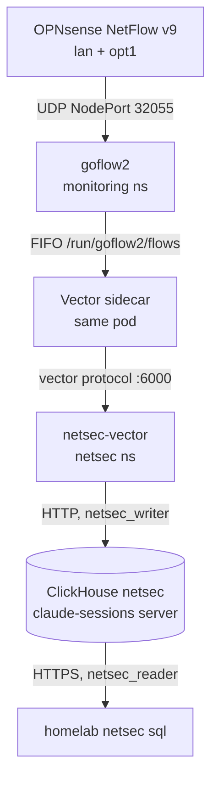

# Network security monitoring

As-built record of the network IDS pipeline. Plan and decisions:
`docs/plans/2026-11-10-network-ids.md` (approved 2026-11-10). Operations:
`docs/runbooks/network-ids.md`. Suricata on the firewall: `docs/runbooks/opnsense.md`.

## Status

| Phase | What | State |
|---|---|---|
| 0 | Suricata tuning on OPNsense (VLAN 10 and 20 only, own-traffic signatures off) | live 2026-11-10 |
| 1 | `netsec` database, its own Vector, NetFlow into ClickHouse, `homelab netsec sql` | live 2026-11-10 |
| 2-5 | Suricata metadata, alerts into bans, server logs and pod DNS, Tetragon, decryption | planned |

## Phase 1: store and shipper

**Store.** Database `netsec` on the claude-sessions ClickHouse
(`stacks/claude-sessions`, encrypted SAS PVC). Schema in
`stacks/claude-sessions/files/schema.sql`, after the `claude` tables.

| Table | Rows | Kept | Fed by |
|---|---|---|---|
| `flows` | one NetFlow record | 14 days | goflow2 (phase 1) |
| `eve` | one Suricata EVE event; typed columns plus the whole event in `payload` | alerts 365 days, everything else 30 | OPNsense (phase 2) |
| `proxy` | one Squid request | 30 days | phase 5 |
| `dns_queries` | one pod DNS lookup | 30 days | CoreDNS dnstap (phase 4) |
| `tetragon` | one process start or outbound connect | 30 days | phase 4b |

Addresses are `IPv6` columns; IPv4 is stored mapped (`::ffff:10.0.20.101`).
Tables are partitioned by day, so TTL drops whole parts.

**Users.** `netsec_writer` (INSERT on `netsec.*`, quota 4 GB written and
20,000 inserts per hour, about ten times the measured rate) and
`netsec_reader` (SELECT on `netsec.*`, the claude-sessions reader profile:
read-only, 120 s, 2 GB, 100,000 rows). Passwords in Vault
`secret/claude-sessions` (`netsec_writer_password`, `netsec_reader_password`).
The reader credential is on the devvm at `/etc/netsec/reader.env`,
`root:sudo 0640`; Viktor is the only member of `sudo`.

**Not backed up.** `backup.sh` saves `DATABASE claude` only, so browsing data
stays off NFS and the offsite copy (plan decision 7). Losing the PVC loses
history, not protection.

**Not in Grafana.** Every Authentik user is a Grafana Viewer, and OSS Grafana
cannot restrict a datasource, so netsec has no Grafana datasource (plan
decision 8).

**Shipper.** `stacks/netsec`: Vector 0.61.0 (`deploy/netsec-vector`), config
and unit tests in `stacks/netsec/files/vector.yaml`. Sources:

- `opnsense`: TCP 5140 on LoadBalancer `10.0.20.211`
  (`svc/netsec-opnsense`, externalTrafficPolicy Local, source ranges
  `10.0.20.1/32` and `10.0.10.1/32`). Unused until phase 2.
- `shippers`: the vector protocol on `svc/netsec-vector:6000`, for in-cluster
  Vectors. Each sets `netsec_kind`; `flow` routes to `netsec.flows`.

Sinks are memory-buffered (a disk buffer stalled on 0.61.0 in rybbit,
2026-11-09). A NetworkPolicy admits only OPNsense on 5140, the goflow2 pod on
6000 and the monitoring namespace on 9598 (metrics).

**goflow2.** `stacks/monitoring/modules/monitoring/goflow2.tf`. goflow2 writes
JSON lines into a FIFO on a memory emptyDir; a Vector sidecar runs
`cat` on it (exec source, respawned) and forwards to `netsec-vector`. A FIFO
needs no rotation at ~100 flows/s. If the sidecar stops, goflow2's writes
fail and those flows are lost, but goflow2 keeps running; the sidecar drops
rather than blocks when its buffer is full. Its pod logs stay out of Loki
(`alloy.yaml`), because a dead sidecar would make goflow2 log one error per
flow.

**One decode worker.** goflow2's file transport writes each record and its
newline as two writes. With its default two workers they interleaved and
about 0.4% of lines held two records, which the netsec Vector rejected. It
runs with `-listen netflow://:2055?workers=1`.

**Byte counts.** OPNsense's ng_netflow exports IN_BYTES/IN_PKTS and also
OUT_BYTES/OUT_PKTS set to 0. goflow2 v2.2.7 decodes both pairs into
`bytes`/`packets`, the zeros come last, and every record read 0 bytes. A
goflow2 mapping copies fields 1 and 2 into extra fields `in_bytes` and
`in_packets`, which the netsec Vector stores as `bytes` and `packets`.

**Exporter address.** goflow2 is reached through NodePort 32055 with
externalTrafficPolicy Cluster, so `flows.exporter` is the node that forwarded
the packet (10.0.20.100), not OPNsense.

**Alerts** (lane `security`, `prometheus_chart_values.tpl`):
`NetsecVectorDown`, `NetsecSinkErrors`, `NetsecFlowsStale` (no row written to
`flows` for 30 minutes).

## Open questions

- Pod traffic reaches the firewall with the node's address (Calico NAT), so
  `flows` attributes it to a node. Phase 4 (CoreDNS dnstap) and 4b (Tetragon)
  add the pod.
- The ClickHouse server is shared with the claude-sessions store (4 GiB
  limit). Measure after phase 2 and split if netsec load hurts it.
