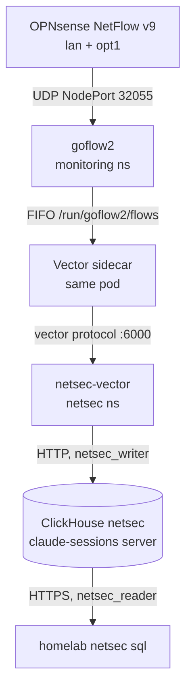
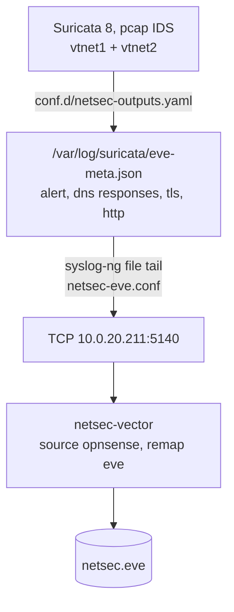
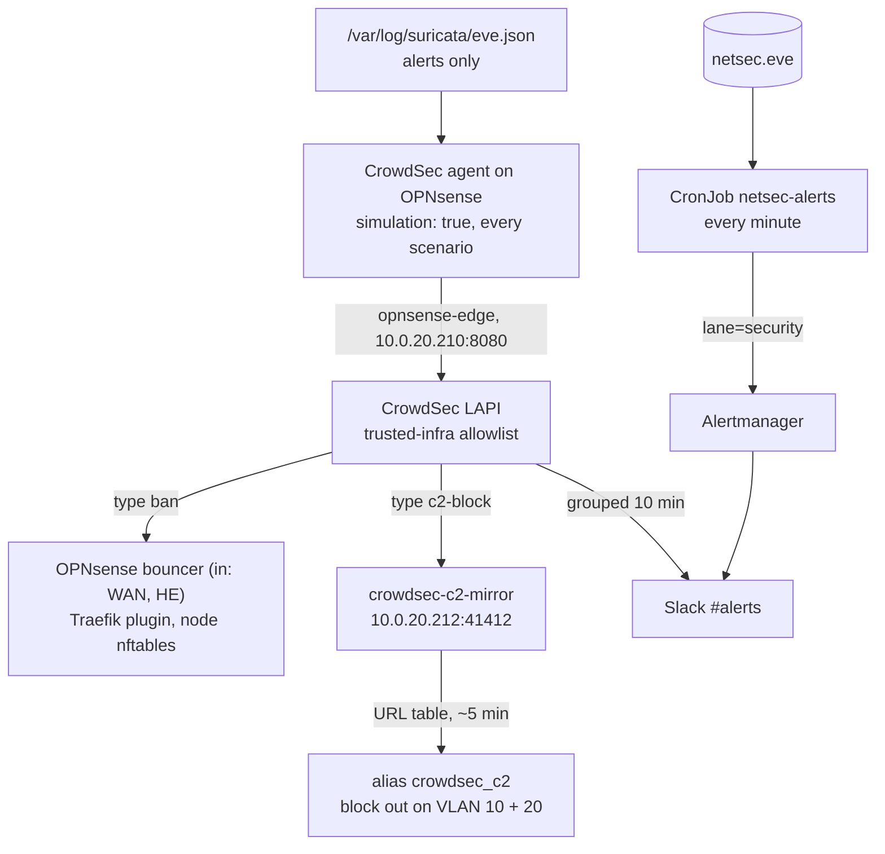
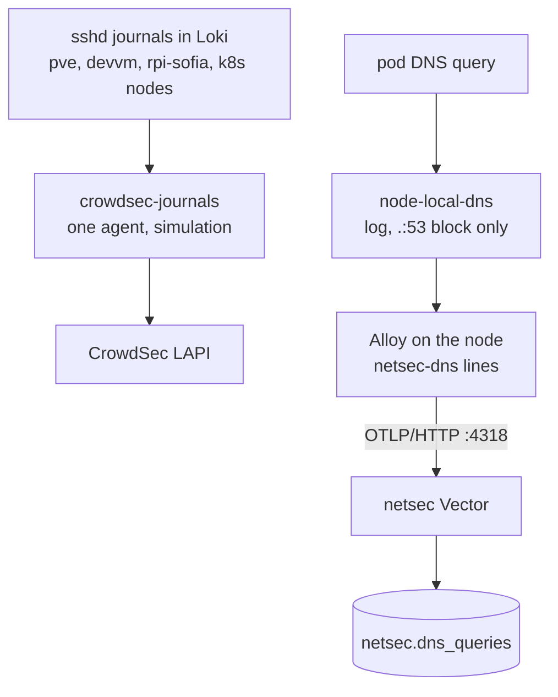

# Network security monitoring

As-built record of the network IDS pipeline. Plan and decisions:
`docs/plans/2026-11-10-network-ids.md` (approved 2026-11-10). Operations:
`docs/runbooks/network-ids.md`. Suricata on the firewall: `docs/runbooks/opnsense.md`.

## Status

| Phase | What | State |
|---|---|---|
| 0 | Suricata tuning on OPNsense (VLAN 10 and 20 only, own-traffic signatures off) | live 2026-11-10 |
| 1 | `netsec` database, its own Vector, NetFlow into ClickHouse, `homelab netsec sql` | live 2026-11-10 |
| 2 | Suricata alert, dns, tls and http events into `netsec.eve` | live 2026-11-10 |
| 3 | Suricata alerts into CrowdSec decisions (simulated), outbound C2 blocks, `netsec-alerts`, camera VLAN alert | live 2026-11-10, simulation until the phase 6 review |
| 4 | Server sshd journals into CrowdSec (simulated), pod DNS queries into `netsec.dns_queries` | live 2026-11-10, simulation until the phase 6 review |
| 4b-5 | Tetragon, decryption | planned |

## Phase 1: store and shipper

**Store.** Database `netsec` on the claude-sessions ClickHouse
(`stacks/claude-sessions`, encrypted SAS PVC). Schema in
`stacks/claude-sessions/files/schema.sql`, after the `claude` tables.

| Table | Rows | Kept | Fed by |
|---|---|---|---|
| `flows` | one NetFlow record | 14 days | goflow2 (phase 1) |
| `eve` | one Suricata EVE event; typed columns plus the whole event in `payload` | alerts 365 days, everything else 30 | OPNsense (phase 2) |
| `proxy` | one Squid request | 30 days | phase 5 |
| `dns_queries` | one pod DNS lookup | 30 days | CoreDNS dnstap (phase 4) |
| `tetragon` | one process start or outbound connect | 30 days | phase 4b |

Addresses are `IPv6` columns; IPv4 is stored mapped (`::ffff:10.0.20.101`).
Tables are partitioned by day, so TTL drops whole parts.

**Users.** `netsec_writer` (INSERT on `netsec.*`, quota 4 GB written and
20,000 inserts per hour, about ten times the measured rate) and
`netsec_reader` (SELECT on `netsec.*`, the claude-sessions reader profile:
read-only, 120 s, 2 GB, 100,000 rows). Passwords in Vault
`secret/claude-sessions` (`netsec_writer_password`, `netsec_reader_password`).
The reader credential is on the devvm at `/etc/netsec/reader.env`,
`root:sudo 0640`; Viktor is the only member of `sudo`.

**Not backed up.** `backup.sh` saves `DATABASE claude` only, so browsing data
stays off NFS and the offsite copy (plan decision 7). Losing the PVC loses
history, not protection.

**Not in Grafana.** Every Authentik user is a Grafana Viewer, and OSS Grafana
cannot restrict a datasource, so netsec has no Grafana datasource (plan
decision 8).

**Shipper.** `stacks/netsec`: Vector 0.61.0 (`deploy/netsec-vector`), config
and unit tests in `stacks/netsec/files/vector.yaml`. Sources:

- `opnsense`: TCP 5140 on LoadBalancer `10.0.20.211`
  (`svc/netsec-opnsense`, externalTrafficPolicy Local, source ranges
  `10.0.20.1/32` and `10.0.10.1/32`). Fed by syslog-ng on OPNsense (phase 2).
- `shippers`: the vector protocol on `svc/netsec-vector:6000`, for in-cluster
  Vectors. Each sets `netsec_kind`; `flow` routes to `netsec.flows`.

Sinks are memory-buffered (a disk buffer stalled on 0.61.0 in rybbit,
2026-11-09). A NetworkPolicy admits only OPNsense on 5140, the goflow2 pod on
6000 and the monitoring namespace on 9598 (metrics).

**goflow2.** `stacks/monitoring/modules/monitoring/goflow2.tf`. goflow2 writes
JSON lines into a FIFO on a memory emptyDir; a Vector sidecar runs
`cat` on it (exec source, respawned) and forwards to `netsec-vector`. A FIFO
needs no rotation at ~100 flows/s. If the sidecar stops, goflow2's writes
fail and those flows are lost, but goflow2 keeps running; the sidecar drops
rather than blocks when its buffer is full. Its pod logs stay out of Loki
(`alloy.yaml`), because a dead sidecar would make goflow2 log one error per
flow.

**One decode worker.** goflow2's file transport writes each record and its
newline as two writes. With its default two workers they interleaved and
about 0.4% of lines held two records, which the netsec Vector rejected. It
runs with `-listen netflow://:2055?workers=1`.

**Byte counts.** OPNsense's ng_netflow exports IN_BYTES/IN_PKTS and also
OUT_BYTES/OUT_PKTS set to 0. goflow2 v2.2.7 decodes both pairs into
`bytes`/`packets`, the zeros come last, and every record read 0 bytes. A
goflow2 mapping copies fields 1 and 2 into extra fields `in_bytes` and
`in_packets`, which the netsec Vector stores as `bytes` and `packets`.

**Exporter address.** goflow2 is reached through NodePort 32055 with
externalTrafficPolicy Cluster, so `flows.exporter` is the node that forwarded
the packet (10.0.20.100), not OPNsense.

**Measured 2026-11-10** (15:45-15:59 UTC, after the fixes): about 203,000
flow rows an hour, every one with a byte count; about 10 bytes a row
compressed (92 uncompressed), so roughly 50 MB a day and 0.7 GB for the 14
days kept. Memory: netsec-vector 54 MiB, goflow2 18 MiB, its sidecar 38 MiB;
the ClickHouse pod 295 MiB.

**Alerts** (lane `security`, `prometheus_chart_values.tpl`):
`NetsecVectorDown`, `NetsecSinkErrors`, `NetsecFlowsStale` (no row written to
`flows` for 30 minutes), `NetsecEveStale` (the same for `eve`).

## Phase 2: Suricata metadata

All in `playbooks/tasks/opnsense/netsec_eve.yml` (tag `netsec_eve`), files in
`playbooks/files/opnsense/`:

- `suricata-netsec-outputs.yaml`, installed as
  `/usr/local/etc/suricata/conf.d/netsec-outputs.yaml`. OPNsense's template
  includes `conf.d/*.yaml`, and Suricata replaces a list key an include
  repeats: an include holding only the new output removed eve.json and the
  syslog EVE stream (tested on a scratch copy, 2026-11-10). So the file
  restates the four stock outputs exactly as rendered (diffed against
  `suricata --dump-config`: identical) and adds `eve-meta.json` with
  `community-id` on. The playbook installs it only while the template's
  outputs section has the recorded sha256 and `LogPayload`, `syslog`, `eveLog`
  http/tls are off and `syslog_eve` on; afterwards it asserts that
  `--dump-config` shows all five outputs.
- `eve-meta.json` holds no `anomaly` (Suricata allows one anomaly logger, eve.json
  has it; a second stopped Suricata from starting) and DNS responses only (they
  carry the query).
- `newsyslog-netsec-eve`: 100 MB per file, three kept, SIGHUP to Suricata.
- `syslog-ng-netsec-eve.conf`: its own `file()` source (`flags(no-parse)`, so a
  line is sent unchanged with `template("${MSG}\n")`) and TCP destination, no
  flow-control, fifo of 100,000 lines. When Vector is down the oldest lines are
  dropped and the Alloy and CrowdSec paths never wait. Reading the file avoids
  the 8 KB limit of `syslog(3)`. The playbook syntax-checks the whole syslog-ng
  config after copying and removes the file again if it fails.

Traffic between VLAN 10 and VLAN 20 crosses both inspected interfaces, so it
is logged twice with the same `community_id` (DNS from the devvm to Technitium,
for example). Collapse with `LIMIT 1 BY community_id, event_type` (runbook).

## Phase 3: alerts into bans

- **Agent** (`playbooks/tasks/opnsense/crowdsec.yml`, files in
  `playbooks/files/opnsense/crowdsec/`): the os-crowdsec agent registered as
  machine `opnsense-edge` reads the filter, GUI and audit logs plus Suricata's
  stock `eve.json` (`acquis.d/suricata.yaml`, collection
  `crowdsecurity/suricata`). `simulation.yaml` sets `simulation: true`, so
  every scenario's decisions are recorded as simulated and no bouncer receives
  them; the playbook asserts it after every run. No scenario bans on UDP.
- **Allowlist**: the LAPI's `trusted-infra` list (`stacks/crowdsec`
  `lapi_allowlist`, kept by the `crowdsec-lapi-reconcile` CronJob) holds our
  address space plus what we depend on: the HE tunnel server, upstream
  resolvers, Cloudflare and GitHub's own ranges.
- **C2 blocks**: the local parser `viktor/abusech-c2` re-labels abuse.ch alerts
  (Feodo Tracker, SSL Blacklist) so the alert's source is the C2 address, never
  our host, and the hub's Suricata scenarios skip them. Scenario
  `viktor/abusech-c2-destination` triggers on one hit; the LAPI profile
  `c2_destination_block` turns it into a 24h decision of type `c2-block`. Only
  `crowdsec-c2-mirror` (crowdsecurity/blocklist-mirror, `c2_mirror.tf`) serves
  that type; every other bouncer and `ipv6-ban-widen.sh` take type `ban` only,
  so a C2 on a shared cloud address is never banned inbound. OPNsense pulls the
  list into URL-table alias `crowdsec_c2` (`update_tables.py` runs each minute,
  refresh about every 5 minutes) and blocks it, logged, on `lan` and `opt1`.
  The os-crowdsec bouncer fills one pair of pf tables, so a separate list needed
  a second consumer; the mirror is CrowdSec's own and needs no code.
- **Slack**: the LAPI's `slack_alerts` plugin has `group_wait: 10m`, so bans
  arrive as one message per 10 minutes.
- **`netsec-alerts`** (`stacks/netsec`, `files/alerts.sql`, test
  `files/alerts_test.sh`): every minute, malware and C2 alerts that involve one
  of our hosts (abuse.ch, `ET MALWARE`, `ET TROJAN`, `ET MOBILE_MALWARE`,
  `ET CNC`, outbound `ET COMPROMISED`) go to Alertmanager as
  `NetsecHomeHostMalware` with `lane=security`. CrowdSec drops private sources,
  so this is the path that reports an infected host. ClickHouse user
  `netsec_alerts` reads `netsec.eve` only.
- **Camera VLAN**: Loki rule `CameraVlanBlockedTraffic` fires on any
  default-deny block of traffic the VLAN 30 camera starts. Its late RTSP and
  HTTP replies to Frigate and ha-sofia are excluded.
- **Alerts**: `CrowdSecOpnsenseAgentSilent`, `CrowdSecOpnsenseBouncerNotPulling`,
  `CrowdSecC2MirrorNotPulling` (lane `security`).

## Phase 4: server logs and pod DNS

- **Server journals**: nothing runs on the servers. The journals they already
  ship to Loki are read by one CrowdSec agent Deployment, `crowdsec-journals`
  (`stacks/crowdsec/modules/crowdsec/journals.tf`), registered with the LAPI as
  machine `journals` by the `crowdsec-lapi-reconcile` CronJob (password: Vault
  `secret/platform` `crowdsec_journals_agent_password`). A Loki acquisition in
  the DaemonSet agents would count each event once per node, hence the single
  replica. The journal lines in Loki are bare messages, so each LogQL query
  rebuilds `<time> <host> sshd[1]: <message>` with `line_format`, and the stock
  `crowdsecurity/sshd` and `crowdsecurity/linux` parsers apply unchanged.
  `simulation.yaml` sets `simulation: true` for every scenario until the phase 6
  review. Sources: `{job="sshd-pve"}`, `{job="sshd-devvm"}`,
  `{job="systemd-journal", host="rpi-sofia", unit="ssh.service"}`,
  `{job="node-journal", unit="ssh.service"}`. Windows VM 300 ships no logs and
  is not covered. Scraped by the `crowdsec-agent` job (`type=agent-journals`).
- **Pod DNS**: pods resolve through NodeLocal DNSCache (`stacks/nodelocal-dns`),
  which answers from its own cache and reaches CoreDNS with the node's address,
  so CoreDNS never sees the asking pod; the node-cache build has no `dnstap`
  plugin. Its `.:53` block (names outside the cluster) carries
  `log . "netsec-dns {remote} {type} {name} {rcode}"`. The `log` plugin runs
  before the cache, so cache hits are rows too. Alloy tails only the node-cache
  container a second time (`loki.process.netsec_dns`), sends the marked lines to
  `netsec-vector:4318` over OTLP/HTTP, and the main pod-log pipeline drops them
  from Loki. Vector parses them into `netsec.dns_queries` (pod IP, name, type,
  rcode; the log line has no answers), 30 days. The sink drops rather than
  blocks when full, so a slow ClickHouse never backs up Alloy.
- **Pod names**: `kube_pod_info` in Prometheus keeps pod IP history; the
  runbook has the lookup.
- **Alert**: `NetsecDnsStale` (no `dns_queries` row for 30 minutes, lane
  `security`).

## Open questions

- Pod traffic reaches the firewall with the node's address (Calico NAT), so
  `flows` attributes it to a node. Phase 4 names the pod behind a DNS lookup;
  an IP reached without a lookup needs phase 4b (Tetragon).
- The ClickHouse server is shared with the claude-sessions store (4 GiB
  limit). Measure after phase 2 and split if netsec load hurts it.
