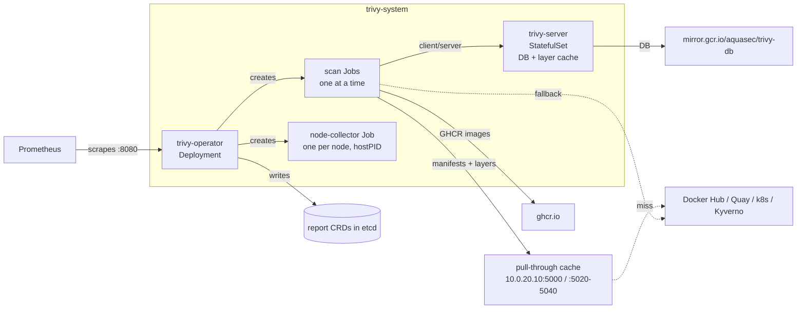

# Trivy Operator

Continuous scanning of what runs in the cluster: image vulnerabilities, secrets baked into images, workload and RBAC configuration, and node/control-plane configuration. Built on 2026-10-10 as Phase 2 of the software-currency design (`docs/plans/2026-10-09-software-currency-design.md`). Stack: `stacks/trivy-operator`.

## What runs

| Component | Image | Notes |
|---|---|---|
| `trivy-operator` Deployment | `mirror.gcr.io/aquasec/trivy-operator:0.35.0` | Watches workloads, runs config audit in-process, serves `trivy_*` metrics. 256Mi request, 1Gi limit. |
| `trivy-server` StatefulSet | `mirror.gcr.io/aquasec/trivy:0.75.0` | Holds the vulnerability DB and the per-layer analysis cache on an emptyDir. 512Mi request, 2Gi limit. Priority `tier-3-edge`, so the scheduler does not preempt it for ordinary workloads (it did at the namespace's `tier-4-aux` on 2026-10-10 and the cache was lost). |
| scan Jobs | `mirror.gcr.io/aquasec/trivy:0.75.0` | One per workload, one at a time. 128M request, 1Gi limit, 10 minute timeout, failed scans retried after 15 minutes. |
| node-collector Jobs | `ghcr.io/aquasecurity/node-collector:0.3.1` | One per node, one at a time. Tolerates the control-plane and GPU taints so every node is assessed. |

Chart `aquasecurity/trivy-operator` 0.37.0, pinned in `stacks/trivy-operator/main.tf`. The namespace is in the aux tier, so scan pods get the `tier-4-aux` priority and are the first evicted under memory pressure.

## Scan types

| Scan | Report CRD | Trigger |
|---|---|---|
| Image vulnerabilities (Critical and High only) | `VulnerabilityReport` | New workload revision, then every 72h (`scannerReportTTL`) |
| Secrets in image layers | `ExposedSecretReport` | Same scan job as vulnerabilities |
| Workload, Service, Role, ClusterRole, NetworkPolicy, Ingress and LimitRange config | `ConfigAuditReport` | Resource change, in the operator |
| RBAC | `RbacAssessmentReport`, `ClusterRbacAssessmentReport` | Role change, in the operator |
| Node and control-plane config | `ClusterInfraAssessmentReport` (one per node), `InfraAssessmentReport` (control-plane static pods) | node-collector Job per node |
| CIS 1.23, NSA 1.0, PSS baseline/restricted | `ClusterComplianceReport` | Every 6h, summary form |

Choices that keep the load down, and how to change them:

- **Severity is `CRITICAL,HIGH`.** The alerts act on these two and the digest counts them. The setting applies to every scanner, so config-audit, RBAC and infra findings below High are not stored either. Medium, Low and Unknown would roughly triple each `VulnerabilityReport` in etcd. To widen, edit `trivy.severity`; reports refresh on their next rescan (72h TTL).
- **SBOM reports are off** (`sbomGenerationEnabled = false`). They are the largest report type and nothing reads them.
- **What is not scanned.** The `verify` and `local-path-storage` namespaces (`excludeNamespaces`; their pods live for minutes, and the local-path provisioner image goes unscanned with them), Woodpecker step pods and their Services (`skipResourceByLabels` on `woodpecker-ci.org/step` and `woodpecker-ci.org/task-uuid`; the woodpecker server and agent are still scanned), and ResourceQuotas, PersistentVolumes and PersistentVolumeClaims in config audit (left out of `trivy.supportedConfigAuditKinds`; PV and PVC were dropped on 2026-10-19, when their 329 reports held no Critical or High finding). Before these exclusions, on 2026-10-10, the operator created about 350 scan Jobs and 1,300 ConfigAuditReport writes per hour, mostly for short-lived pods and for ResourceQuota status changes; ResourceQuota reports are keyed on the whole object, so every pod start rewrote one.
- **Rescans every 72h, 1 scan Job at a time.** Changed on 2026-10-10 from 24h and 3 jobs to 72h and 2, after the first scan coincided with etcd WAL fsync p99 up to 2.4 s on the shared HDD. Lowered to 1 job on 2026-10-19: a scan unpacks the image layers onto its node disk, all node disks share one thin pool with etcd, and two parallel scans (frigate:0.18.2-tensorrt at 16.7 MB/s on node5, calibre-web-automated at 30 MB/s on node2) were the largest disk writers while the pool sat at 100% utilisation and etcd WAL fsync p99 was 3-8 s. A full pass over the cluster takes longer as a result. A new CVE in an unchanged image appears within 3 days.
- **Client/server mode** (`builtInTrivyServer = true`). Scan jobs ask the server which layers it has not analysed yet and send only those. A daily rescan of an unchanged image fetches the manifest and config and little else. The server cache is an emptyDir: after a restart the next pass re-downloads every layer once through the registry cache (about 44 GB on the first pass, 2026-10-10), so avoid restarting `trivy-server` without need.
- **Image mode, not node filesystem mode.** Trivy Operator can instead scan a workload's root filesystem on its own node (`trivy.command = "rootfs"`, no registry pulls). Evaluated on 2026-10-10 against operator v0.35.0 and not adopted: CronJobs are unsupported in that mode (about 130 CronJob images would lose coverage), Sablier-parked workloads go unscanned while parked, every rescan re-reads each image's files from node disks on the same HDD as etcd, and scan pods are pinned onto nodes at 82-99% memory requests. The reasoning is also in `stacks/trivy-operator/main.tf`.
- **Registry mirrors.** Scan jobs read image manifests and layers from the LAN pull-through caches on `10.0.20.10` (`:5000` Docker Hub, also used for `docker.n8n.io`, which fronts Docker Hub's `n8nio/n8n`; `:5020` Quay; `:5030` registry.k8s.io; `:5040` reg.kyverno.io) through Trivy's own `registry.mirrors` config file. Images from other registries (ghcr.io, nvcr.io, lscr.io, mcr.microsoft.com, codeberg.org, mirror.gcr.io) are fetched upstream. GHCR was mirrored until 2026-10-10: its images were about 20 GB of the 42 GB the first scan wrote into the cache VM's 61 GB disk, which filled it, and GHCR has no anonymous limit comparable to Docker Hub's. Trivy tries the mirror first and falls back to the original registry on any error, and reports keep the original image name. Without it, about 108 Docker Hub images rescanned daily would run into Docker Hub's anonymous pull limit, which the nodes share. On the first full scan the one unmirrored Docker Hub front, `docker.n8n.io`, already returned `TOOMANYREQUESTS`, which is why it now maps to the cache too.

## Admission prerequisites (stacks/kyverno)

The question the design left open was which registry the scanner images come from and what the node-collector needs. Measured against chart 0.37.0 and trivy-kubernetes v0.9.1, which trivy-operator v0.35.0 pins:

- The operator, server and scan jobs use `mirror.gcr.io/aquasec/*`. That pattern is on the `require-trusted-registries` list. The node-collector uses `ghcr.io/aquasecurity/node-collector`, already trusted.
- The node-collector pod (`pkg/jobs/template/node-collector.yaml` in trivy-kubernetes) sets `hostPID: true`, mounts `/var/lib/{etcd,kubelet,kube-scheduler,kube-controller-manager}`, `/etc/systemd`, `/lib/systemd`, `/etc/kubernetes` and `/etc/cni/net.d` read-only, and runs as root with `privileged: false`, `allowPrivilegeEscalation: false`, all capabilities dropped and a read-only root filesystem. Of the four pod-security policies, only `deny-host-namespaces` objects to it.
- PolicyException `kyverno/trivy-node-collector-hostpid` exempts Pods and Jobs named `node-collector-*` in `trivy-system` from `deny-host-namespaces` (the Pod rule and its Job autogen rule). Scan jobs are not covered and stay fully enforced. PolicyExceptions were enabled for this, honoured only in the `kyverno` namespace (`docs/architecture/security.md`).

## Metrics

The operator Service carries `prometheus.io/scrape: "true"`, so the `kubernetes-service-endpoints` job scrapes the operator pod on `:8080`. That job keeps only allowlisted metric names, and `trivy_.+` is on the list (`stacks/monitoring/modules/monitoring/prometheus_chart_values.tpl`).

| Metric | Series | Used by |
|---|---|---|
| `trivy_image_vulnerabilities{severity}` | 5 per container | Digest totals (Critical/High; the other severities read 0 because they are not stored) |
| `trivy_vulnerability_id` | one per fixable Critical/High CVE per container | Fixable-CVE alert, digest top items |
| `trivy_image_exposedsecrets{severity}` | 4 per container | Exposed-secret alert |
| `trivy_resource_configaudits`, `trivy_role_rbacassessments`, `trivy_clusterrole_clusterrbacassessments`, `trivy_resource_infraassessments` | 4 per resource | Digest counts |
| `trivy_cluster_compliance` | per spec | Digest |

`trivy_vulnerability_id` is filtered at scrape time: series with an empty `fixed_version`, and Medium/Low/Unknown series, are dropped, and the free-text labels `vuln_title`, `vuln_score`, `published_date` and `last_modified_date` are removed. Unfixable findings remain visible as counts in `trivy_image_vulnerabilities` and in the report CRDs.

Internet reachability comes from `kube_ingress_annotations{annotation_cloudflare_viktorbarzin_me_dns_type}`. `ingress_factory` already stamps `cloudflare.viktorbarzin.me/dns-type` on every ingress it creates (141 of the 201 ingresses on 2026-10-10 are `proxied` or `non-proxied`, across 103 namespaces), and kube-state-metrics exports it through `metricAnnotationsAllowList`. A namespace counts as internet-reachable when any of its ingresses is `proxied` or `non-proxied`.

The design proposed a new `ingress_factory` label for this. The existing annotation carries the same information, and a module change would re-apply all 113 consuming app stacks plus every platform stack (the CI fan-out in `.woodpecker/default.yml`), including the 9 stacks with unaddressed drift on 2026-10-10. The annotation was used instead; a label can still be added later if a consumer needs one.

## Alerts and the weekly digest

Since 2026-11-10 the CVE alerts fire when the upgrade pipeline fails, not whenever a fixable CVE exists. Until then `TrivyFixableCVEInternetReachable` fired for every internet-reachable namespace with any fixable Critical/High CVE: 65 namespaces and 589 distinct CVEs on 2026-11-09, most of them in third-party images already on their newest upstream release, where "fixable" means a patched package exists but upstream has not shipped an image with it. Viktor chose to keep Renovate and the rails as the only fixer (no image patching, first-party images unchanged) and to alert on two conditions instead. Everything else goes into the weekly summary. Rules live in the `Trivy` group of `prometheus_chart_values.tpl`.

| Alert | Fires when | Granularity | Severity |
|---|---|---|---|
| `TrivyKnownExploitedCVE` | an image run by an internet-reachable namespace has a fixable Critical/High CVE that is on CISA's Known Exploited Vulnerabilities catalogue, for 1h | one alert per CVE; the value is the number of namespaces | critical |
| `UpgradeFixNotLanded` | a newer version of an image (or a chart in `stacks/<ns>/`) that an internet-reachable namespace runs with fixable Critical/High CVEs has been available for 7 days and has not landed | one alert per namespace and package | warning |
| `CisaKevFeedStale` | the catalogue has not refreshed for 3 days | single alert | warning |
| `RenovateCveFixSignalStale` | the pending-fix signal has not refreshed for 2 days | single alert | warning |
| `TrivyExposedSecretInImage` | an image holds at least one secret, for 1h | one alert per namespace and image repository | warning |
| `TrivyMetricsAbsent` | no `trivy_image_vulnerabilities` series for 2h | single alert | warning |

Where the two signals come from:

- **Known exploited.** The `cisa-kev` CronJob (`stacks/monitoring/modules/monitoring/cisa_kev.tf`, daily 05:40 UTC) downloads CISA's catalogue (1,773 CVEs on 2026-11-10) and PUTs `cisa_kev_listed{vuln_id}` to the Pushgateway, valued at the date CISA added the CVE. A download that fails, or a catalogue under 1,000 entries, pushes nothing and leaves the previous one in place. On 2026-11-10 this matched 3 CVEs: Brotli `CVE-2026-111497` in 27 internet-reachable namespaces, HTTP/2 Rapid Reset `CVE-2023-44487` in frigate, and FreeType `CVE-2025-27363` in frigate. Only fixable findings reach Prometheus (the scrape filter below), so an exploited CVE with no fixed package anywhere does not alert.
- **Fix not landed.** After each successful infra Renovate run, `stacks/renovate/files/cve-fix-pending.js` reads Renovate's report (`reportType=file`) and pushes `renovate_cve_fix_available_since_seconds{namespace,package,current,new,update_type,kind}` for every pending update of a running image with fixable CVEs. The match is by image repository and the exact running tag, so a bump of the same image in another stack does not count. Chart updates count for namespaces with CVEs when the chart is in `stacks/<ns>/`. The value is the release date, or for registries that publish none (GHCR, Quay) the first run that saw the update, carried from the previous push. The alert means the pipeline should have landed the update and has not: an ignore entry left by a revert, a queue backlog, or a schedule. Only patch, minor and digest updates count. Nearly every `HELD:` rule in `renovate.json5` holds majors (MySQL, Postgres, Nextcloud and others), the report lists held updates like any other and does not say which rule holds them, and unheld majors get the Saturday slot; on the first run 43 of 48 matches were held Postgres and MySQL majors. A non-major hold (Woodpecker) still counts. Whether the new version clears the CVEs shows only after Trivy scans it.

Both CVE alerts leave out a Deployment's old ReplicaSets (since 2026-11-04). The operator keeps a report for the previous ReplicaSet after a rollout until the 72h TTL, so a bumped app kept alerting on the image it no longer runs: on 2026-11-04 tripit counted 1631 findings across 8 builds and 572 on the running one. A ReplicaSet finding counts only for the Deployment's current ReplicaSet, the one whose `deployment.kubernetes.io/revision` annotation equals the Deployment's (`kube_replicaset_annotations` and `kube_deployment_annotations`; kube-state-metrics exports that annotation through `metricAnnotationsAllowList`). This also holds for a Deployment scaled to 0, such as an app Sablier has parked, and after a revert, where the controller reuses an older ReplicaSet and gives it the new revision number. Findings on StatefulSets, DaemonSets, CronJobs, Jobs and bare pods count as before. The weekly digest still counts every report.

`TrivyKnownExploitedCVE` and `TrivyExposedSecretInImage` use `keep_firing_for: 6h`, which covers the gap while a report is deleted at its 72h TTL and rescanned. The finding alerts go through their own Alertmanager child routes (`TrivyKnownExploitedCVE` to `slack-critical`, `UpgradeFixNotLanded` and `TrivyExposedSecretInImage` to `slack-warning`): grouped by alertname, `group_wait` 30m, `group_interval` 24h, `repeat_interval` 8760h. Each post lists every affected namespace or image, and a new finding joins the next daily post rather than sending its own message. Without this, the first full scan, which adds namespaces one at a time over about two hours, would have posted a fresh list every five minutes under the root route's 5m `group_interval`.

Trivy's secret scanner also matches keys that ship inside third-party images: Debian snakeoil keys, python-ldap test fixtures, a key in the lua-resty-rsa docs, the public Azurite key in Nextcloud's Azure SDK, a public AWS key ID in yt-dlp's `extractor/shahid.py`, and an expired SAS URL in the Playwright base image's npm cache. These are suppressed in Trivy's ignore file, not in Alertmanager: `trivy.ignoreFile` in `stacks/trivy-operator/main.tf` renders a `.trivyignore.yaml` that every scan Job mounts (`TRIVY_IGNOREFILE`). Each entry names a rule ID, the paths it covers (doublestar globs against the report target, which starts with `/`) and a statement saying why. A suppressed secret never reaches the `ExposedSecretReport`, so the alert, the metric and the weekly digest all stop counting it, while the same rule at any other path still reports. Entries were reviewed on 2026-10-19. An edit takes effect at each image's next scan.

The weekly section is the Monday `alert-digest` post (`TRIVY_WEEKDAY` in `alert_digest.tf`); since 2026-11-10 that CronJob runs only on Mondays with `ALERT_BOARD=off`, so the post is this section alone. It reads Prometheus only and shows:

- Critical/High CVE findings (counted per workload container) and the change since last week, split into fixable and unfixable
- fixable Critical/High on internet-reachable workloads (alerting only when known exploited or when a fix has not landed in 7 days)
- the 10 images with the most distinct fixable Critical/High CVEs, marked when internet-reachable (an image shared by several workloads counts once)
- how many images hold secrets
- config-audit, RBAC and control-plane assessment counts, with the config-audit change since last week
- failed controls per compliance spec (CIS 1.23, NSA, PSS baseline and restricted), which is where node-level CIS results show up, since per-node `ClusterInfraAssessmentReport`s have no metric

The daily digest collapses more than five firing instances of one alertname into a single line, so the per-namespace alerts take one line there instead of one per namespace.

Findings decide the order of upgrades but do not start them: Renovate (Phase 3 of the design) gives the pending updates of images with the most fixable CVEs the highest priority (`cve-priority.js`) and lands one bump per run.

## Upgrades

Renovate owns the chart pin (Phase 3 of the design). Helm installs the chart's CRDs on first install and never updates them on upgrade. When a release changes a report CRD, apply the CRDs from the new chart's `crds/` directory before or alongside the bump; the chart's release notes say when that is needed.

## Open questions

- Whether 7 days is the right grace period for `UpgradeFixNotLanded`. At one bump an hour the queue cleared within a day in early November; a longer queue would trip it for updates that are merely waiting.
- Whether an exploited CVE in a LAN-only namespace should alert too. Today only internet-reachable namespaces count, as before.

- Whether Critical/High is the right severity floor. Medium findings are not stored today.
- Whether 72h is the right rescan cadence. With the server's layer cache warm, a rescan fetches only manifests and configs; the cost is mostly report writes to etcd.
