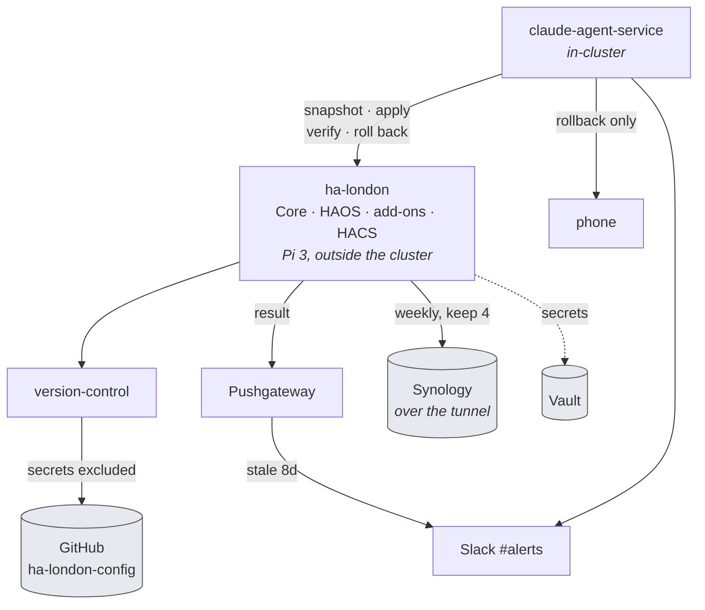
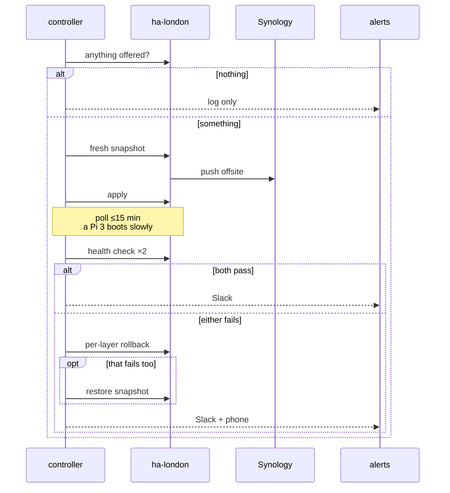

# ha-london: working backups and unattended upgrades

**Scope:** ha-london only. ha-sofia gets one targeted fix, and the machinery is
built generic for it, but stays off there.

## Why now

Two findings, both measured on 2026-09-18.

**ha-london has never had an offsite backup.** It takes a daily local backup and
has done for months. Every one of them records `failed_agent_ids:
["hassio.truenas"]`, because `ha mounts info` returns `{"default_backup_mount":
null, "mounts": []}` and there is no mount for that agent to resolve to. The
local write finishes clean, the supervisor log never mentions truenas (the agent
lives in HA Core's backup integration, not the supervisor), and nothing alerts.

So every byte sits on `/backup` on `/dev/mmcblk0p8`, the same 27.7 GB SD card as
`/config`, 68% used. The backup encryption password is in
`/config/.storage/backup` on that same card. Losing the card loses the backups
and the key to them together.

**Nothing upgrades ha-london.** Core is two release trains behind, HAOS is a
major behind, and four HACS components are between 4.8 and 8.5 months stale. The
homelab does have an upgrade pipeline, and it cannot reach this box.

| | London | Sofia |
|---|---|---|
| offsite copies | 0 | every automatic backup, `locations: [null, "synology"]` |
| agent failures | 3 of 3 automatic | 0 across 37 backups |
| backup store | 27.7 GB SD card, 68% used, same fs as `/config` | 62.3 GB SSD, 56% used |
| config in version control | none | `home-assistant-version-control` add-on, 6 weeks |

Sofia solved both. London did not, and nobody knew.

## What is actually stale

| component | installed | available | behind |
|---|---|---|---|
| HA Core | 2026.7.3 | 2026.9.2 | 2 trains, ~2 months |
| HAOS | 17.3 | 18.2 | 1 major, 4.4 months |
| Supervisor | 2026.09.2 | current | up to date |
| ESPHome Device Builder | 2026.4.2 | 2026.9.0 | 5 months |
| Whisper | 3.1.0 | 3.5.3 | stale, and in `error` state |
| Piper | 2.2.2 | 2.5.2 | stale, and in `error` state |
| ookla_speedtest | 2.0.4 | 3.1.2 | 8.5 months, 1 major |
| extended_openai_conversation | 2.0.1 | 2.0.2 | 7.5 months |
| glinet | 0.1.9 | 0.1.10 | 6 months |
| cowboy | 1.2.0 | 1.4.0 | 4.8 months |

The supervisor is the one component that is current, and that is not a
coincidence: it is the only one with a working `auto_update` flag.

## Why the existing pipeline cannot help

The homelab runs DIUN every 6 hours, which webhooks n8n, which calls
`claude-agent-service` `POST /execute` to run an upgrade agent, rate limited to
5 per 6 hours. It is alive and firing. It covers container images in the
cluster, and ha-london is neither.

Four independent reasons:

1. `DIUN_PROVIDERS_KUBERNETES=true` is its only provider, so it enumerates
   images from pods. ha-london runs Docker on its own Pi, outside the cluster.
2. `upgrade-config.json` is image-shaped: `github_repo_overrides`,
   `helm_chart_repo_overrides`, `db_backed_services`, `skip_image_patterns`.
   There is no host, SSH or appliance concept in the schema, so "upgrade HA
   core" has nothing to map onto.
3. Keel reaches workloads through a Kyverno namespace label on Deployments,
   StatefulSets and DaemonSets. ha-london has no Kubernetes object at all.
4. Grepping `ha-london`, `192.168.8.103`, `home.?assistant`, `hassio` and `haos`
   across the DIUN stack, the agent prompt, the upgrade config and the
   architecture doc returns zero hits.

## Why the controller has to live outside London

Home Assistant cannot do this to itself, in two separate senses.

The supervisor exposes `auto_update` as a boolean for itself and per add-on.
There is **no such field for Core and none for HAOS**, and no scheduling or
maintenance window anywhere in the API. So the upgrade has to be driven from
outside regardless.

More importantly, a rollback controller running on the box it rolls back cannot
do its job. If a core upgrade leaves HA unable to start, an HA automation is
gone with it. The thing that decides "this upgrade failed, undo it" must survive
the upgrade failing.

`claude-agent-service` already runs headless agent jobs in-cluster behind a
bearer token, and it can read a changelog before applying rather than bumping
blindly. It is the controller.

## Design

### Backups: two mechanisms, because they fail differently

Git gives a diff, a review and a revert for a hand-edit. Snapshots give disaster
recovery when the card dies. Neither substitutes for the other, so we run both.

**Snapshots.** Create a supervisor NFS mount `synology` on London pointing at
`192.168.1.13:/volume1/Backup/HomeAssistant`, `usage=backup`, set as
`default_backup_mount`. Replace the dead `hassio.truenas` agent with
`hassio.synology`. This is the exact share Sofia already writes to with zero
failures in 37 backups.

Reachability is confirmed rather than assumed: from ha-london, ping to
`192.168.1.13` is 3/3 at 49 ms, and tcp/111 and tcp/2049 are both open. The
49 ms is the WireGuard tunnel round trip, which means **London's backup now
depends on the tunnel being up at 05:00 on Sunday**. That is precisely why the
failure alert matters.

Schedule moves from daily keep 3 to **weekly, Sunday 05:00, keep 4**, about a
month of history. Sunday morning is clear of the Flint's Monday 04:00 reboot.

**Config to git.** Install `home-assistant-version-control` on London, the same
add-on Sofia has run for six weeks, pointed at a new private GitHub repo
`ha-london-config`. One-way, box to git. HA's own UI writes `automations.yaml`,
`scenes.yaml` and `.storage` directly, so making git authoritative would mean
giving up editing automations in the app; instead git is a record and a revert
source, and it captures UI changes too.

Committed: `yaml`, `yml`, `json`, `conf`, `sh`, `py`, plus `lovelace*`,
`core.entity_registry` and `core.device_registry` from `.storage`.

Excluded: `secrets.yaml`, `.ssh/`, and **`core.config_entries`**. That last one
holds every integration credential. Sofia currently commits it, which is covered
below. What it would have restored is covered by the snapshot instead.

**The key.** The backup encryption password moves into Vault. Without this, an
offsite copy of an encrypted archive is a file nobody can open. `secrets.yaml`
turns out to hold two keys, `some_password` and `ntfy_url_1`, so the mirror is
small.

**Alerting.** Backup results push to Pushgateway so they ride the existing
`WeeklyBackupStale` (8 days) and `WeeklyBackupFailing` alerts, which already
cover six PVE timers and twenty in-cluster CronJobs. Neither HA instance feeds
that today. An 8-day threshold fits a weekly backup without tuning.

### The one-off upgrade pass

In order, verifying between each:

1. Remove Whisper and Piper. Both are in `error` state and months stale, and
   local voice is not in use.
2. Core 2026.7.3 to 2026.9.2, verify.
3. HAOS 17.3 to 18.2, verify.
4. ESPHome Device Builder to 2026.9.0.
5. HACS: glinet 0.1.10, cowboy 1.4.0, ookla_speedtest 3.1.2,
   extended_openai_conversation 2.0.2.

The OS step reboots the Pi, so presence goes dark for a few minutes.

### The nightly loop

Built generic, parameterised by instance, since `homelab ha ssh` already takes
`--instance`. London on, Sofia built but off.

Runs nightly, avoiding Monday 04:00.

Layers covered: Core, HAOS (all versions including majors), add-ons, HACS
components.

**Healthy means all four:** the API answers, `check_config` returns valid, the
entity count has not dropped, and `binary_sensor.anca_home`,
`binary_sensor.anca_phone_on_home_lan`, `binary_sensor.gheorghe_home` and
`device_tracker.xiomi` are not `unavailable`. The entity-count and named-sensor
checks exist to catch an upgrade that boots cleanly but silently drops an
integration, which is the failure a smoke test misses.

Two consecutive passes are required, so we do not call it healthy during the
window where HA has started but integrations are still loading.

**Rollback is per-layer first.** Each layer can undo itself: HACS repins a
version, the supervisor reinstalls the previous add-on, core takes a version
argument, the OS swaps boot slot. Full snapshot restore is the fallback only,
because it also rolls back the recorder database and any config change made that
day.

**Majors are included for HAOS, deliberately.** The failure modes split cleanly.
If the Pi boots but HA is broken, the controller catches it and rolls back. If
the Pi does not boot at all, the controller cannot help, but HAOS uses RAUC A/B
slots: it tries the new slot three times and then reverts to the other one
without us. That behaviour is documented and has been observed in the wild, most
recently on HAOS 18.0 falling back to 17.3 (on x86 with a SATA SSD, not a Pi).

One caveat worth stating: slot A currently holds 17.1, not 17.3, so an OS
rollback today lands two versions back rather than one. After the upgrade pass
the inactive slot will hold 17.3 and that gap closes.

### Sofia, one targeted fix

Sofia's version-control add-on lists `core.config_entries` in `include_storage`,
so 108 KB of integration credentials is being committed, and its options hold a
GitHub personal access token in plaintext. The repo is private, confirmed by a
404 from an unauthenticated API call, so this is not public exposure.

Two changes: drop `core.config_entries` from its include list, and rotate the
token into Vault. The git history still holds the old credentials, so rotating
the integrations themselves would be a larger separate job and is not in this
scope.

## Order of work

1. Backups: mount, agent, schedule, key to Vault, config to git, Pushgateway.
2. Sofia's two fixes.
3. The one-off upgrade pass.
4. The nightly loop.

Backups first, deliberately. Today's presence work is in that config and is not
backed up anywhere yet.

Also cleaned up in passing: 18 hand-made `.bak` files in `/config` root, dating
from 2026-01-02, several of them created during today's presence work. Once git
holds the history they are redundant.

## What we are not doing, and what that costs

**No restore drill.** The backup is unproven until the day it is needed, and the
secrets split introduced here is the part most likely to surprise us on restore.
A drill would restore a snapshot into a disposable HA container and check the
entities come back. Deferred by choice; worth an hour whenever.

**The hardware.** ha-london is a Raspberry Pi 3 on a 32 GB SD card at 68%, with
a 485 MB recorder database writing to it constantly. Sofia runs on a 62 GB SSD.
SD cards fail from write wear, and this is the disaster the backups exist for.
Out of scope here, and working offsite backups do turn that from catastrophic
into recoverable. The SSD swap needs someone physically in London.

**Keel is at 0 replicas.** Committed as `replicaCount = 1`, live at 0 since
2026-09-13, so in-cluster image auto-updates are not running at all. Two commits
that day fought over it, which suggests it was deliberate. Separate system,
out of scope, noted here so it is written down somewhere.

## Open questions

- We could not determine when `hassio.truenas` was configured on London or
  whether it ever worked. The 16 older tracked backups show
  `failed_agent_ids: []`, but that may mean the agent succeeded then or simply
  was not configured yet. `homelab ha ssh` lands inside the SSH add-on container
  rather than the HAOS host, so `/mnt/data/supervisor/` was not inspectable.
- HAOS 18 has at least one reported boot failure in the wild. It fell back
  correctly via A/B, and the report is on different hardware, but rpi3-64 is not
  a heavily tested board and this is the riskiest step in the plan.
