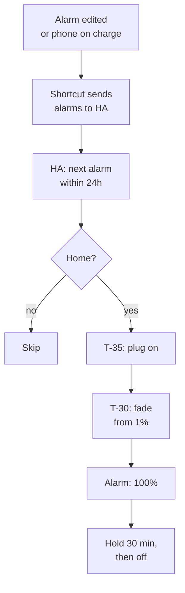

# London sunrise lamp

Status: approved (grilling with Viktor, 2026-10-12). Building starts after ha-london is back online.

## Goal

A bedside lamp in the London flat that brightens gradually before Viktor's
alarm, so he wakes to light rather than only to sound. It wakes Viktor only,
runs from Home Assistant on ha-london, and follows the alarms he already sets
on his iPhone.

```stats
£55–75 | hardware cost
30 min | fade before the alarm
1 | new radio (Zigbee) in London
0 | new hubs or subscriptions
```

## Context

Measured or found on 2026-10-12:

| piece | state |
|---|---|
| ha-london | HAOS on a Raspberry Pi 4, static lease 192.168.8.103. Offline since 2026-09-19 (502 today, FAILED in the Flint's neighbour table). Its newest backup (2026-09-18) is on the Pi's own SD card. Revival is tracked separately in `code-y6w2` |
| Radios | London has no Zigbee, Z-Wave, Thread or Matter coordinator; every device is Wi-Fi. The Pi 4 has onboard Bluetooth |
| Bedside lamp | An IKEA NÄVLINGE LED work lamp behind one of the five Kasa KP115 plugs. Its LED is built in (1.9 W, 220 lm, 2700 K), cannot be replaced, and is not dimmable, so it cannot fade |
| Pi placement | Across the flat from the bedroom |
| iPhone alarms | The iOS Companion app has no next-alarm sensor (Android has one). Community Shortcuts that sync Clock alarms to HA exist; several users report them breaking on iOS 18 and iOS 26 |

## Decisions

| decision | choice | why |
|---|---|---|
| Who it wakes | Viktor only | Anca keeps her own wake time |
| Lamp | IKEA TERTIAL work lamp (E27, adjustable arm and head) replaces the NÄVLINGE | Same aimable shape as the NÄVLINGE, so the light points at Viktor's pillow; takes a standard bulb. About £15–25 |
| Bulb | Philips Hue White Ambiance E27 | Dims very low, goes warm (2200K), pairs directly with HA over Zigbee without a Hue Bridge |
| Radio | SONOFF ZBDongle-E on the Pi, using HA's ZHA integration | HA reconnects Zigbee devices on its own; the Bluetooth path (`hue_ble`) does not retry after a long dropout. Also gives London a Zigbee network for later devices |
| Range | Move the Pi to within one wall of the bedroom during its revival | The Pi only needs power and Wi-Fi, and a single bulb has no other Zigbee devices to relay through |
| Trigger | The iPhone alarm, through a Shortcut; no HA schedule | Viktor sets alarms in the Clock app already. No alarm means no sunrise |
| Which alarm | Earliest enabled alarm in the next 24 hours | Backup alarms (07:05, 07:10) are ignored |
| Skips | Not home, or no alarm | Uses `person.viktorbarzin` |
| Fade | 1% at 2200K to 100% warm white over 30 minutes, ending at the alarm; hold 30 minutes, then off | Peak tuned after a week if it bothers Anca |
| Smart plug | Kept. HA turns it on 35 minutes before the alarm if it is off | Switching the lamp off at the plug no longer breaks the next morning |
| Bulb power-on | Set to "off" | Restoring power through the plug does not flash the lamp at full brightness |
| Daily control | HA tile in iPhone Control Center; the lamp's own switch stays on | The bulb dims itself, so an on/off lamp is fine; only cutting power stops the sunrise |
| Manual override | Any change to the lamp during the fade stops it for that morning | A person acting on the lamp wins over the automation |
| Warnings | One push at 23:00, only when tomorrow's sunrise is at risk | Quiet on normal nights |
| Purchase | Lamp, bulb and Zigbee stick, after ha-london answers again | Nothing to pair the hardware with until then |

## How it works



Two paths sit beside this one. Changing the lamp by hand during the fade
stops it for that morning. A 23:00 check sends one push when the last sync is
older than 24 hours or the bulb has no power.

### iPhone side

A Shortcut written for this setup (not an imported community one) runs on two
personal automations, both set to run without asking:

- when the Clock app is closed, which catches alarms edited in Clock;
- when the charger is connected, which catches alarms set by Siri or from the
  lock screen. Viktor charges the phone every night.

It reads every alarm and sends the enabled ones to HA, each with its time and
repeat days, plus a sync timestamp.

### HA side

- Helpers that hold the synced alarms and the time of the last sync.
- A template sensor for the next alarm: the earliest enabled occurrence in the
  next 24 hours, taking repeat days into account.
- One automation for the sunrise: plug on at T-35, fade from T-30, hold, off.
  It runs in `single` mode and stops if the light's state changes from outside
  the automation.
- One automation for the 23:00 check, which sends a push only when the last
  sync is older than 24 hours or the bulb is unavailable while an alarm is set.
- A dashboard card showing the next sunrise, the last sync, and the peak
  brightness setting.

## Build steps

1. ha-london revived and moved within one wall of the bedroom (`code-y6w2`, separate task).
2. Buy an IKEA TERTIAL, a Hue White Ambiance E27 bulb and the SONOFF
   ZBDongle-E. The NÄVLINGE is freed for use elsewhere.
3. Update the bulb's firmware once from the Hue app over Bluetooth. Philips
   ships Zigbee firmware only through its Bridge, so the bulb gets no updates
   after it joins ZHA.
4. Plug the dongle into the Pi on a short USB extension, add ZHA, pair the bulb,
   set its power-on behaviour to "off".
5. Identify the bedside Kasa plug by its power draw while Viktor switches the
   lamp on and off.
6. Write and install the Shortcut and its two automations on Viktor's iPhone.
7. Build the HA helpers, sensor, automations and dashboard card.
8. Verify: a test alarm 35 minutes out, watched through the plug turning on,
   the fade, the hold and the turn-off; a manual change mid-fade; a stale sync
   producing the 23:00 push.
9. One-week trial, then tune the peak brightness with Anca.

## Open questions

- Whether Shortcuts exposes each alarm's repeat days in a form the Shortcut can
  send. Without them, HA cannot tell that a weekday-only alarm should not fire
  on Saturday. This is checked first in step 7, before the HA side is built.
- How often iOS updates break the Shortcut. The 23:00 stale-sync push is the
  signal; repairs are expected maintenance.
- Zigbee range from the Pi's new position. If the bulb drops out, a Zigbee
  smart plug (about £10) halfway between them relays the signal.
- UK prices are from undated comparison listings; check at order time.
