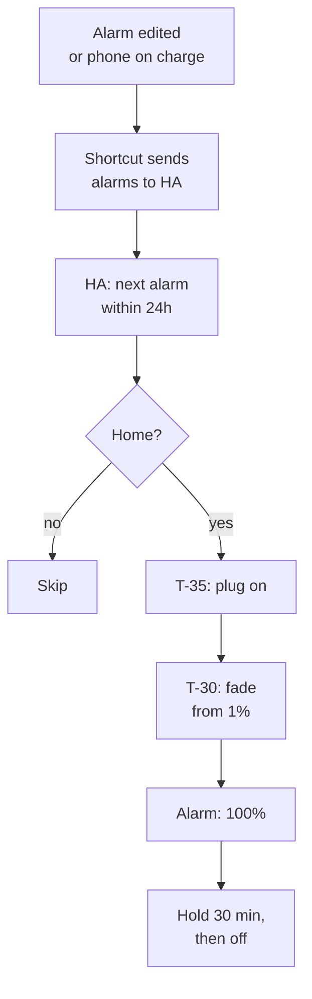

# London sunrise lamp

Status: draft (grilling with Viktor, 2026-10-12; hardware revised the same day). Two items to confirm: the bulb model and the lamp. Building starts after ha-london is back online.

## Goal

A bedside lamp in the London flat that brightens gradually before Viktor's
alarm, so he wakes to light rather than only to sound. It wakes Viktor only,
runs from Home Assistant on ha-london, and follows the alarms he already sets
on his iPhone.

```stats
£15–25 | hardware cost (a small GU10 lamp)
30 min | fade before the alarm
0 | new radios or hubs
0 | subscriptions
```

## Context

Measured or found on 2026-10-12:

| piece | state |
|---|---|
| ha-london | HAOS on a Raspberry Pi 4, static lease 192.168.8.103. Offline since 2026-09-19 (502 today, FAILED in the Flint's neighbour table). Its newest backup (2026-09-18) is on the Pi's own SD card. Revival is tracked separately in `code-y6w2` |
| Radios | London has no Zigbee, Z-Wave, Thread or Matter coordinator; every device is Wi-Fi |
| Bedside lamp | An IKEA NÄVLINGE LED work lamp (5 cm head) behind one of the five Kasa KP115 plugs. Its LED is built in (1.9 W, 220 lm, 2700 K), cannot be replaced, and is not dimmable, so it cannot fade |
| Spare bulbs | Viktor has unused TP-Link smart bulbs with a two-pin base, most likely Tapo L630 (GU10). To be confirmed from the label |
| Tapo L630 | Wi-Fi GU10, dims 1–100%, white from 2200K to 6500K plus colour. Listed as supported by HA's TP-Link integration |
| Tapo firmware | Newer Tapo firmware blocks third-party access until Third-Party Compatibility is enabled in the Tapo app (Tapo Lab). This is why the Tapo P100 plug has been unavailable in HA since July |
| iPhone alarms | The iOS Companion app has no next-alarm sensor (Android has one). Community Shortcuts that sync Clock alarms to HA exist; several users report them breaking on iOS 18 and iOS 26 |

## Decisions

| decision | choice | why |
|---|---|---|
| Who it wakes | Viktor only | Anca keeps her own wake time |
| Bulb | One of Viktor's Tapo L630 GU10 bulbs | Already owned. Dims to 1% and goes warm (2200K). Wi-Fi, so it needs no new radio |
| Lamp | A small GU10 lamp with an aimable head, similar in size to the NÄVLINGE | GU10 is the smallest standard socket for a smart bulb (5 cm), the same size as the NÄVLINGE head. Model to be picked; about £15–25 |
| Radio and range | Wi-Fi through the existing Flint | No Zigbee stick, and the Pi can stay where it is |
| Trigger | The iPhone alarm, through a Shortcut; no HA schedule | Viktor sets alarms in the Clock app already. No alarm means no sunrise |
| Which alarm | Earliest enabled alarm in the next 24 hours | Backup alarms (07:05, 07:10) are ignored |
| Skips | Not home, or no alarm | Uses `person.viktorbarzin` |
| Fade | 1% at 2200K to 100% warm white over 30 minutes, ending at the alarm; hold 30 minutes, then off | Peak tuned after a week if it bothers Anca |
| Smart plug | Kept. HA turns it on 35 minutes before the alarm if it is off | Switching the lamp off at the plug no longer breaks the next morning |
| Daily control | HA tile in iPhone Control Center; the lamp's own switch stays on | The bulb dims itself, so an on/off lamp is fine; only cutting power stops the sunrise |
| Manual override | Any change to the lamp during the fade stops it for that morning | A person acting on the lamp wins over the automation |
| Warnings | One push at 23:00, only when tomorrow's sunrise is at risk | Quiet on normal nights |
| Purchase | The lamp only, after ha-london answers again | Nothing to pair the bulb with until then |

## How it works



Two paths sit beside this one. Changing the lamp by hand during the fade
stops it for that morning. A 23:00 check sends one push when the last sync is
older than 24 hours or the bulb is unavailable.

### iPhone side

A Shortcut written for this setup (not an imported community one) runs on two
personal automations, both set to run without asking:

- when the Clock app is closed, which catches alarms edited in Clock;
- when the charger is connected, which catches alarms set by Siri or from the
  lock screen. Viktor charges the phone every night.

It reads every alarm and sends the enabled ones to HA, each with its time and
repeat days, plus a sync timestamp.

### HA side

- Helpers that hold the synced alarms and the time of the last sync.
- A template sensor for the next alarm: the earliest enabled occurrence in the
  next 24 hours, taking repeat days into account.
- One automation for the sunrise: plug on at T-35, then a fade from T-30 in
  small brightness and colour-temperature steps (about every 30 s), hold, off.
  Stepping from HA keeps the fade independent of whether the bulb supports
  long transitions. It runs in `single` mode and stops if the light's state
  changes from outside the automation.
- One automation for the 23:00 check, which sends a push only when the last
  sync is older than 24 hours or the bulb is unavailable while an alarm is set.
- A dashboard card showing the next sunrise, the last sync, and the peak
  brightness setting.

## Build steps

1. ha-london revived (`code-y6w2`, separate task).
2. Viktor confirms the bulb model from its label or box.
3. Pick and buy a small GU10 lamp. The NÄVLINGE is freed for use elsewhere.
4. Add the bulb in the Tapo app, update its firmware, enable Tapo Lab →
   Third-Party Compatibility, and give it a static DHCP lease on the Flint.
5. Add the bulb to HA through the TP-Link integration. While there, the same
   toggle on the Tapo P100 plug would bring it back into HA too.
6. Identify the bedside Kasa plug by its power draw while Viktor switches the
   lamp on and off.
7. Write and install the Shortcut and its two automations on Viktor's iPhone.
8. Build the HA helpers, sensor, automations and dashboard card.
9. Verify: a test alarm 35 minutes out, watched through the plug turning on,
   the fade, the hold and the turn-off; a manual change mid-fade; a stale sync
   producing the 23:00 push.
10. One-week trial, then tune the peak brightness with Anca.

## Open questions

- The bulb model. If it is a Tapo L610 instead, it dims 1–100% but stays at
  2700K, and HA's supported list does not name it, so it needs a test first.
- Which GU10 lamp. The requirement is a head about the size of the NÄVLINGE's,
  an aimable arm, and no built-in dimmer.
- What the L630 does when the plug restores power: whether its default state
  can be set so it comes back dark instead of at its last brightness. Checked
  in step 4; if it cannot, the T-35 step turns the plug on and HA immediately
  sets the bulb to 1%.
- Whether Shortcuts exposes each alarm's repeat days in a form the Shortcut can
  send. Without them, HA cannot tell that a weekday-only alarm should not fire
  on Saturday. This is checked first in step 7, before the HA side is built.
- How often iOS updates break the Shortcut. The 23:00 stale-sync push is the
  signal; repairs are expected maintenance.
- UK prices are from undated listings; check at order time.
