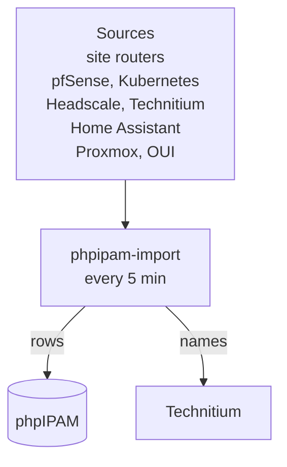
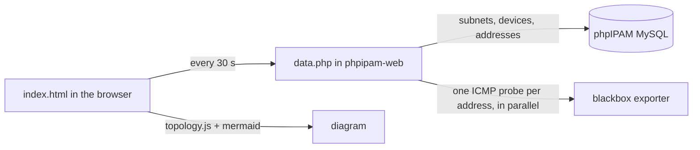

# phpIPAM as the address inventory

- Status: done 2026-10-13 (enrichment added the same day)
- Decision record: `docs/adr/0032-phpipam-is-an-auto-filled-address-inventory.md`
- Glossary: `CONTEXT.md`, "Address inventory"

## Goal

phpIPAM shows every IPv4 address in use across Sofia, London, Valchedrym,
Mladost 3, the WireGuard tunnel network and Headscale, and keeps showing it
without anyone typing it in. People still add notes and names by hand, and
the automation leaves those rows alone.

## Starting state (measured 2026-10-13)

| Network | phpIPAM before | Live addresses | Best source |
|---|---|---|---|
| Sofia home LAN `192.168.1.0/24` | 44 rows, last written 2026-04-10 | 24 in pfSense ARP, about 42 reserved on the TP-Link | pfSense ARP after a ping sweep (the TP-Link has no readable API) |
| Sofia mgmt `10.0.10.0/24` | 4 rows, April | 2 in ARP, 4 Kea reservations | Kea reservations and leases, ARP |
| Sofia k8s `10.0.20.0/24` | 9 rows, April | about 18 | k8s nodes and LoadBalancer Services, Kea, ARP |
| Sofia CCTV `10.0.30.0/24` | no subnet | 2 | Kea |
| WireGuard `10.3.2.0/24` | 2 rows, April | 5 | `wg show tun_wg0` on pfSense |
| London LAN and guest | current (rewritten earlier the same day) | 29 | Flint leases and static leases |
| Valchedrym `192.168.0.0/24` | 6 hand rows, April | 4 leases, 17 ARP | OpenWrt leases and ARP |
| Mladost 3 `192.168.3.0/24` | no subnet | 7 ARP | OpenWrt leases and ARP |
| Headscale `100.64.0.0/10` | no subnet | 9 nodes | Headscale API |

Two of the three phpIPAM jobs had written nothing since 2026-04-10: their
MariaDB client cannot log in to MySQL 8.4 and the error was discarded.

## Design



People add and edit hand rows in the phpIPAM UI; the importer never changes
what they wrote.

### Rows

| Kind | Description | Key | Lifetime |
|---|---|---|---|
| Hand row | anything not starting with `-- ` | IP | never touched by the importer |
| Dynamic row | `-- dhcp <site> --`, `-- arp <site> --` | MAC | deleted 24 h after last seen |
| Declared row | `-- k8s node --`, `-- k8s lb <ns>/<svc> --`, `-- kea reservation --`, `-- wireguard peer --`, `-- headscale --` | IP | while the source lists it |

An address held by a hand row is never given a second row. Rows written before
2026-10-13 with a `-- ` description (`-- autodiscovered --`, `-- wg tunnel
scan --`) are adopted and expire unless a source sees them again.

### Names

Hand row, then reservation name, then lease hostname, then the existing DNS
name. Names that come from DNS are not written back to DNS.

### DNS writes

| What | Owned records |
|---|---|
| OpenWrt site leases (London, Valchedrym, Mladost 3) | every A record pointing into the site's subnets, and the site reverse zones (London rules: curated name wins, `-<site>` on a clash with another site, `-<mac4>` inside a site) |
| Hand rows anywhere | A and PTR records marked with the Technitium comment `phpipam`; a record without the mark is adopted only when it already has the same name and address |

A hand-row name already used for a different address elsewhere is logged and
not published. Kea DDNS, the ingress sync and `technitium-static-records` keep
their own records.

### Failure handling

Every source is read before anything is written. A source that fails is
logged; its rows are left as they are, and the run exits non-zero after the
other sources are applied, so `JobFailed` fires and names the job.
`PhpipamImportStale` fires when no run has succeeded for 30 minutes.

## Enrichment (amendment, 2026-10-13)

Every row also carries a MAC, a vendor, a model, an OS and a state tag where a
source knows them, and infrastructure addresses link to a phpIPAM Device.

| Field | Source, in order of preference |
|---|---|
| MAC | the row, then the lease, reservation or ARP entry at its address |
| Vendor | Home Assistant manufacturer, Proxmox ("Proxmox VE" for a VM NIC), IEEE OUI registry ("private MAC" for a randomised one) |
| Model | Home Assistant model, Kubernetes node (vCPU, memory, GPU), Proxmox VM (vCPU, memory) |
| OS | Kubernetes node (OS image, kernel, kubelet), Proxmox OS type, Home Assistant firmware version |
| State | DHCP for a lease, Reserved for a reservation, Used, Offline for a hand row unseen for 24 h |
| Device | `stacks/phpipam/files/devices.yaml`, matched by address or MAC |

Hand rows only get empty fields filled. Vendor, Model and OS are phpIPAM
custom fields (plain columns on `ipaddresses` and `devices`, as phpIPAM's own
admin page adds them), created by the importer.

## Topology page (amendment, 2026-10-14)

phpIPAM shows addresses per subnet (an address grid for every /24 and smaller,
usage bars, dashboard widgets) but has no view of how the subnets connect.
`phpipam.viktorbarzin.me/topology/` draws one, live:

- one box per Location, holding its subnets and its network devices (types
  Router, Firewall, Wireless and Switch in `devices.yaml`);
- a line from each network device to every subnet it holds an address in;
- subnets with no Location, or with network devices from more than one site
  (the WireGuard tunnels, the tailnet), drawn above the sites with dotted
  lines labelled with the live round-trip time;
- a green border on a device with any address answering ping, red dashed when
  none answers, grey when the probe could not run.



The files live in `stacks/phpipam/files/topology/` (`index.html`,
`topology.js` with tests in `topology.test.js`, `data.php`) and ship in the
`phpipam-topology` ConfigMap, mounted into the web pod at `/phpipam/topology`.
A refresh pings 16 addresses and takes about as long as the slowest reply;
an address that does not answer gives up after 3 s. The page polls only while
its tab is visible. Status comes from ping rather than the import's last-seen
time because the import marks a WireGuard or tailnet row seen whenever the hub
lists the peer, and a router whose SSH login fails would otherwise show as
down while it answers ping. Through Traefik the page sits behind the same
Authentik login as phpIPAM. Inside the cluster `data.php` answers without a
login; it returns subnets, router addresses and reachability, and no
credentials.

The four Locations also get town-level coordinates where they have none, so
phpIPAM's own Locations map shows a pin per site.

## Rollout

1. `stacks/phpipam/files/phpipam_import.py` with unit tests (the London module
   generalised).
2. Dry run (`DRY_RUN=1`) from the devvm against live phpIPAM, Technitium,
   pfSense, the site routers, Kubernetes and Headscale.
3. One Terraform change: `phpipam-import` replaces `phpipam-remote-import` and
   `phpipam-pfsense-import`; `phpipam-dns-sync` is removed; a ServiceAccount
   that can list nodes and Services; the Headscale key from `secret/platform`;
   `mladost3-openwrt` moves from `technitium-static-records` to a hand row;
   `PhpipamImportStale` in the monitoring stack.
4. Watch the first runs, then check the phpIPAM UI and DNS from Sofia and
   London.
5. List the hand rows that disagree with live data for review.

## Result (2026-10-13)

```stats
130 | addresses tracked
103 | with a MAC
93 | with a vendor
23 | infrastructure Devices
6 | sources, all answering
```

- `phpipam-import` runs every 5 minutes; a steady-state run writes no DNS
  records and refreshes rows' last-seen times and state tags.
- Nine hand rows are Offline, each a device that is not on the network
  (TrueNAS, Emo's laptop and phone, the Valchedrym thermostat, rpi-london and
  four others).
- Three hand rows carry a MAC that differs from the device answering at that
  address: `switch-garaj` (192.168.1.6), `tp-link-rpi` (192.168.1.16) and
  `hydrawise` (192.168.1.230, now answered by a Proxmox VM MAC). The importer
  leaves hand rows as written, so these are for a person to check.

## Open questions

- Whether a ping sweep every 5 minutes disturbs any Sofia LAN device. None is
  known to.
- Whether some Sofia LAN devices stay silent while idle and drop out after
  24 hours. A hand row keeps any device that matters.
