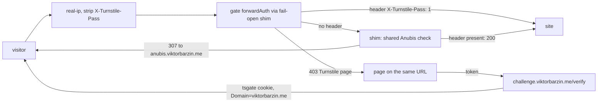

# Turnstile as the main bot check on public sites

Status: approved 2026-10-16, executing.

## Context

The Forgejo canary (2026-10-15, `stacks/turnstile-gate`) split untrusted visitors 50/50 between Cloudflare Turnstile and Anubis. After about 10 hours, about 0.8% of crawler IPs got past Turnstile, against about 42% that solved Anubis, and Viktor's phone passed the widget. Viktor asked to make Turnstile the main bot check across the public sites. The decisions below come from a `/grill-with-docs` interview on 2026-10-16.

## Decisions

| # | decision |
|---|---|
| 1 | Turnstile is on by default for public sites; a site opts out with `turnstile = false` on its `ingress_factory` call |
| 2 | Sites behind Authentik (`auth = "required"` or `"public"`), carve-out paths (ingresses without `/` in `ingress_path`) and raw IngressRoutes are out of scope |
| 3 | Opted out from the start: Home Assistant (both), Music Assistant, Immich, Nextcloud, EuroOffice, Stremio, cinemeta, public-auth, Vaultwarden, Headscale, files, turnstile-lab, and the machine-only hosts (claude-memory, health-api, owntracks, pages-publish, paperless-mcp, tripit-api, tuya-bridge, webhook, xray, nextcloud-todos, recruiter-responder) |
| 4 | Every untrusted browser asking for an HTML page is challenged. No A/B split |
| 5 | The challenge page shows on the requested URL. Its script sends the token to `challenge.viktorbarzin.me`, which sets one pass cookie for `.viktorbarzin.me`, valid 30 days |
| 6 | A visitor whose widget fails falls back to one shared Anubis instance in forwardAuth mode. The 8 per-site Anubis instances fold into it in the last phase |
| 7 | Search engines verified by IP pass, through Anubis's built-in crawler rules. AI crawlers stay blocked by `ai-bot-block` |
| 8 | One variable in `stacks/turnstile-gate` is the global switch. No new alerts |
| 9 | Build started before the 48-hour canary readout; every affected app stack is applied in one pass |

## Design

### Two gate variants

| | standard (sites without their own Anubis) | strict (the 8 Anubis sites until the fold) |
|---|---|---|
| passes with the header | pass cookie, non-GET, trusted networks, non-browser user agents, non-HTML requests | pass cookie only |
| goes to Anubis (no header) | fallback cookie, browser UAs that declare themselves a bot, switch set to `anubis` | everything else, as today |
| gets the Turnstile page | untrusted browser, HTML GET, no pass cookie | same |

The strict variant keeps today's Anubis behaviour on the 8 sites, so a crawler cannot skip the check by asking for something other than HTML. The standard variant only adds a check: those sites have no challenge today, and their phone apps call APIs that never ask for HTML.

### Global switch

`local.mode` in `stacks/turnstile-gate`: `on` (default), `anubis` (the gate never challenges; standard sites send browser HTML to Anubis), `open` (no challenge from the gate; per-site Anubis behaves as it did before the canary). One apply of that stack flips every site.

### Failure behaviour

Both forwardAuth calls go through the nginx shim, which turns a timeout or 5xx into a plain 200. Gate down: standard sites send unchecked visitors to Anubis. Shared Anubis down: those visitors reach the site. The shim itself has two replicas and a PDB, since forwardAuth to a dead address is a 500.

### Header trust

`X-Turnstile-Pass` is deleted at the edge by the `strip` middleware, which `ingress_factory` now attaches to every ingress, so a client cannot send it to any Anubis instance.

## Phases

1. Gate v2 (multi-host, two variants, CORS verify on `challenge.viktorbarzin.me`, domain cookie), the shared Anubis in forwardAuth mode on `anubis.viktorbarzin.me`, and the Anubis module's `allow-turnstile-pass` rule for every instance. Forgejo moves from the canary wiring to the strict variant.
2. `ingress_factory` default-on, with the opt-outs in place; apply every affected app stack in one pass. Test the switch before that apply.
3. Fold: each Anubis site points its ingress at its backend and moves to the standard chain with Anubis as the fallback, then its per-site instance is deleted.

## Verification

From the UK egress (untrusted): the Turnstile page on an HTML GET for a sample of sites; API, asset, POST and git requests unchanged; a valid pass cookie admits across two different sites; a forged header is ignored; with the gate scaled to 0 a standard site sends browsers to Anubis. From the devvm: no challenge. Uptime Kuma green. A TalkBack pass on the shared Android emulator.

## Open questions

- Link-preview bots (Slack, Discord) declare themselves as bots, so on standard sites they go to Anubis and are likely challenged; previews of those sites may stop rendering.
- The token-reuse cache is still per gate replica.
- Whether a site's own CSP blocks `challenges.cloudflare.com` is checked per site after the apply, not before.
