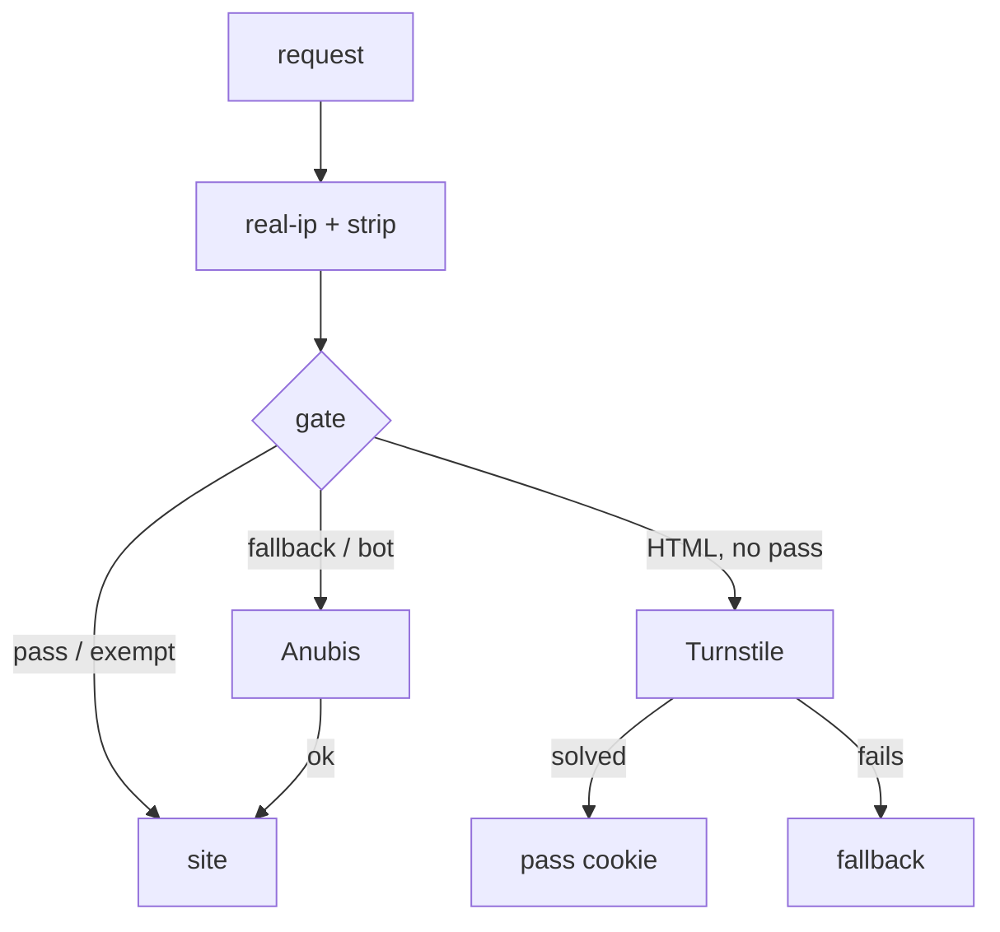

# Turnstile as the main bot check on public sites

Status: approved 2026-10-16, executing. Phase 1 live; phase 2 on master, applied stack by stack (forgejo and f1 gated so far); phase 3 after phase 2 has run cleanly.

## Context

The Forgejo canary (2026-10-15, `stacks/turnstile-gate`) split untrusted visitors 50/50 between Cloudflare Turnstile and Anubis. After about 10 hours, about 0.8% of crawler IPs got past Turnstile, against about 42% that solved Anubis, and Viktor's phone passed the widget. Viktor asked to make Turnstile the main bot check across the public sites. The decisions below come from a `/grill-with-docs` interview on 2026-10-16.

## Decisions

| # | decision |
|---|---|
| 1 | Turnstile is on by default for public sites; a site opts out with `turnstile = false` on its `ingress_factory` call |
| 2 | Sites behind Authentik (`auth = "required"` or `"public"`), carve-out paths (ingresses without `/` in `ingress_path`) and raw IngressRoutes are out of scope |
| 3 | Opted out from the start: Authentik's own host, Home Assistant (both, through their own reverse-proxy ingress), Music Assistant, Immich, Nextcloud, EuroOffice, Stremio, cinemeta, public-auth, Vaultwarden, Headscale, files, turnstile-lab, and the machine-only hosts (claude-memory, health-api, owntracks, pages-publish, paperless-mcp, tripit-api, tuya-bridge, webhook, xray, nextcloud-todos, recruiter-responder) |
| 4 | Every untrusted browser asking for an HTML page is challenged. No A/B split |
| 5 | The challenge page shows on the requested URL. Its script sends the token to `challenge.viktorbarzin.me`, which sets one pass cookie for `.viktorbarzin.me`, valid 30 days |
| 6 | A visitor whose widget fails falls back to one shared Anubis instance in forwardAuth mode. The 8 per-site Anubis instances fold into it in the last phase |
| 7 | Search engines verified by IP pass, through Anubis's built-in crawler rules. AI crawlers stay blocked by `ai-bot-block` |
| 8 | One variable in `stacks/turnstile-gate` is the global switch. No new alerts |
| 9 | Build started before the 48-hour canary readout; every affected app stack is applied in one pass |

## Design

### Two gate variants

| | standard (sites without their own Anubis) | strict (the 8 Anubis sites until the fold) |
|---|---|---|
| passes with the header | pass cookie, non-GET, trusted networks, non-browser user agents, non-HTML requests | pass cookie only |
| goes to Anubis (no header) | fallback cookie, browser UAs that declare themselves a bot, switch set to `anubis` | everything else, as today |
| gets the Turnstile page | untrusted browser, HTML GET, no pass cookie | same |

The strict variant keeps today's Anubis behaviour on the 8 sites, so a crawler cannot skip the check by asking for something other than HTML. The standard variant only adds a check: those sites have no challenge today, and their phone apps call APIs that never ask for HTML.

### Global switch

`local.mode` in `stacks/turnstile-gate`: `on` (default), `anubis` (the gate never challenges; standard sites send browser HTML to Anubis), `open` (no challenge from the gate; per-site Anubis behaves as it did before the canary). One apply of that stack flips every site.

### Failure behaviour

Both forwardAuth calls go through the nginx shim. Gate down: standard sites let every request through with the header, as they were before Turnstile (sending them to Anubis instead would challenge every API call and app client), and strict sites fall back to their own Anubis. Shared Anubis down, or answering 400: those visitors reach the site. In forwardAuth mode Anubis answers DENY with 200 by default, which Traefik reads as allowed, so the shared instance sets `status_codes: DENY: 403`. Writes never reach Anubis: Traefik sends every forwardAuth request as a GET, so the shim answers non-GET methods itself. The shim has two replicas and a PDB, since forwardAuth to a dead address is a 500.

### Header trust

`X-Turnstile-Pass` is deleted at the edge by the `strip` middleware, which `ingress_factory` attaches to every gated ingress and to every ingress whose backend is an Anubis instance, gated or not, so a client cannot send it to any Anubis instance.

## Challenger review (2026-10-16)

Two blind reviewers checked the design against the code, Traefik v3.7.14 and Anubis v1.28.1 source, and the canary's logs. Changes made before landing:

| finding | change |
|---|---|
| In the canary about 98% of the crawler's wins in the Turnstile arm came through the fallback, and `/fallback` gave a cookie to anyone who asked | The challenge page carries a signed nonce bound to the visitor's network; `/fallback` accepts it only after 10 s and from that network. The page waits the 10 s out |
| A pass cookie is a bearer token for 30 days across the whole domain | Pass and fallback cookies carry the IPv4 /16 or IPv6 /48 that earned them and only work from it (the other address family is accepted, for dual-stack browsers) |
| A siteverify outage turned any junk token into a 30-day pass | An outage now gives the Anubis fallback |
| Gate down sent every API call on standard sites to Anubis | Standard sites fail fully open |
| DENY is a 200 in Anubis forwardAuth mode | The shared instance answers DENY with 403 |
| Authentik's own host, `anubis.` and `challenge.` would have been gated | Opted out |
| A failed verify stranded the visitor | Any verify failure goes to the fallback |

Recorded, not changed: the pass header is the constant `1`, guarded by the strip middleware (all 8 routes into Anubis are factory ingresses, checked live); `allow-turnstile-pass` sits ahead of the per-site deny rules; the token-reuse cache is per replica. Phase 3 must keep the strict variant for content sites: the standard variant lets non-HTML requests skip Anubis, which on Forgejo would let a crawler through by changing its Accept header.

## Phases

1. Gate v2 (multi-host, two variants, CORS verify on `challenge.viktorbarzin.me`, domain cookie), the shared Anubis in forwardAuth mode on `anubis.viktorbarzin.me`, and the Anubis module's `allow-turnstile-pass` rule for every instance. Forgejo moves from the canary wiring to the strict variant.
2. `ingress_factory` default-on, with the opt-outs in place; apply every affected app stack in one pass. Test the switch before that apply.
3. Fold: each Anubis site points its ingress at its backend, keeps the strict variant, and uses the shared Anubis in place of its own; then its per-site instance is deleted. Per-site Anubis rules (Forgejo's machine paths, kms's script paths) move into the shared policy keyed on `headers["X-Forwarded-Host"]`.

## Verification

From the UK egress (untrusted): the Turnstile page on an HTML GET for a sample of sites; API, asset, POST and git requests unchanged; a valid pass cookie admits across two different sites; a forged header is ignored; with the gate scaled to 0 a standard site lets everything through and a strict site falls back to its own Anubis; the global switch flips every site in one apply (tested 2026-10-16: `open` returned Forgejo to its own Anubis within about a minute). From the devvm: no challenge. Uptime Kuma green. A TalkBack pass on the shared Android emulator.

## Open questions

- Safari caps cookies to 7 days when the server that sets them is on a different IP range from the page (its CNAME-cloaking rule). The challenge host is proxied, so visitors to the DNS-only sites (forgejo, kms and others) on Safari may solve weekly rather than monthly. Not tested.
- Phase 3 (fold): in forwardAuth mode Anubis rules see the shim's host and an empty query; per-site rules need `headers["X-Forwarded-Host"]`.
- Link-preview bots (Slack, Discord) declare themselves as bots, so on standard sites they go to Anubis and are likely challenged; previews of those sites may stop rendering.
- The token-reuse cache is still per gate replica.
- The challenge page never reaches the backend, so a site's own CSP cannot block the widget; only a Traefik headers middleware placed before the gate could. The shared `csp-headers` middleware is before it and the widget loads under it on Forgejo; each site is still checked after its apply.
