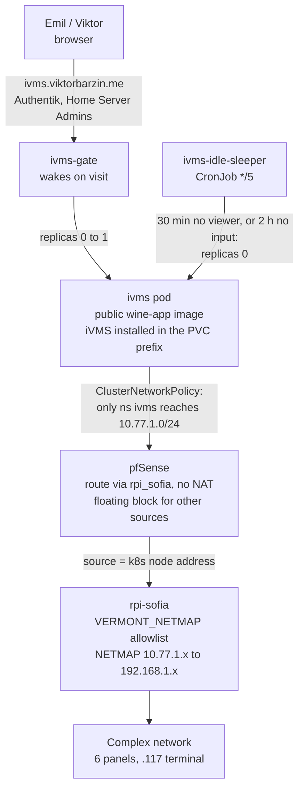

# Windows apps under Wine in the cluster, starting with iVMS-4200

- Status: superseded on 2026-10-19 (iVMS stays on VM 300, see ADR-0035)
- Date: 2026-10-17
- Decision record: `docs/adr/0035-ivms-runs-under-wine-in-the-cluster.md`
- Supersedes the phase 2 proposal in infra#121 (iVMS-4200 on VM 300)

## Goal

Emil manages access control at the Vermont complex: 6 DS-KD9203-E6 entrance
panels (`.111`-`.116`) and the DS-K1T805MBFWX access terminal (`.117`). Each
device keeps its own list of people, cards and faces, so adding or removing a
resident means repeating the change on every device. Hikvision's tool for one
shared list is iVMS-4200, a Windows client.

Emil's session on 2026-10-17 planned to run iVMS on VM 300, a Windows 10 VM
with 8 GB of RAM that was already swapping, and the plan needed a reboot, a
display change and a raise to 12 GB (infra#121). Viktor wants a graphical
iVMS without a Windows VM running for it, and expects Emil to want more
Windows apps later (Paradox BabyWare is the likely next one). This design
runs each Windows app under Wine in its own cluster pod that sleeps when
nobody is using it, from one shared module and one shared base image.

## What we measured first

A spike on the devvm (2026-10-17, memory #15883) installed iVMS-4200
V3.14.1.4 under WineHQ 11.0 in a Debian bookworm container:

| Step | Result |
|---|---|
| Installer | completes; one browser plugin (`WebVideoActiveX.ocx`) fails to register and is not needed |
| First run | super user, security questions, main window |
| Access control pages | Person, Card, Access Group and Video Intercom render; a local test person saved and deleted |
| Device login | Emil's own indoor station (`.134`) logged in over a tunnel and showed Online |
| Cost while awake | about 3.2 GB RAM (PSS), 0.67 of a core idle, 7 client processes, 6 services and nginx |
| Not measured | live view (out of scope); pushing a person to a device |

Other options looked at:

- iVMS-4200 for Mac does not support access control (Hikvision product page).
- Hikvision ships no Linux build. HikCentral is Windows-only and larger.
- No maintained self-hosted tool syncs people across Hikvision devices. The
  closest are client libraries (Laravel `Shaykhnazar/hikvision-isapi`, PHP
  `jot/hf-hkvsn`).
- Sablier (ADR-0022) does not refresh its session on WebSocket traffic, and
  noVNC runs over one long WebSocket, so the android-emulator wake gate is the
  pattern reused.
- Baking iVMS into a private image was considered and dropped: a private
  package cannot use the node pull-through cache, kubelet removes images
  unused for 7 days, so most wakes would pull about 3.7 GB from ghcr. App and
  state also live in one Wine prefix, which makes image upgrades awkward.

## Design

### Base image: `ghcr.io/viktorbarzin/wine-app` (public)

- `images/wine-app/`: Debian bookworm, WineHQ stable 11.0 pinned, winetricks
  pinned, Xvfb, x11vnc on loopback, noVNC with websockify on :6080, a window
  manager, xdotool, xprintidle. No app inside.
- Update 2026-10-19: Emil chose iVMS on VM 300 over RDP, so the cluster copy
  was retired and `stacks/ivms` deleted (the last commit with `stacks/ivms` is `ec0ecbdd3`). The `wine_app` module and image
  stay for future Windows apps.
- Update 2026-10-18: the display is now TigerVNC `Xvnc` with noVNC 1.6.0,
  chosen by a benchmark after Emil reported lag: 29 ms median click-to-screen
  against 56 ms for the Xvfb + x11vnc setup described here (ADR-0036).
- Built by GitHub Actions (`.github/workflows/build-wine-app.yml`) on changes
  under `images/wine-app/`, per ADR-0002. Stacks pin the commit-sha tag.
- The app contract, mounted at `/app` from a ConfigMap: `app.env` (name,
  version, installer URL, sha256, optional Referer, launch command, main
  window title, winetricks verbs) and `install.sh` (the app's scripted
  install, driven with xdotool under Xvfb). Two optional hooks:
  `post-start.sh` (iVMS uses it to answer Disable to the Upgrade Detection
  prompt on every start) and `pre-stop.sh` (iVMS stops WatchDog.exe first,
  since it restarts the iVMS servers).
- On start the entrypoint checks `/data/.installed-<app>-<version>`. If it is
  missing it downloads the installer, checks the sha256 (hard gate) and the
  Authenticode signature (logged), runs `install.sh`, writes the marker, and
  restarts the entrypoint so the first session starts from a clean boot. In
  one local run, a super user created in the same run as the install was
  never written to disk; after this restart was added it was. A version bump
  in `app.env` reruns the installer over the existing prefix, which is
  Hikvision's in-place upgrade path. If the installer opens its
  Modify/Repair/Remove page instead, `install.sh` stops without pressing
  anything and the old marker and prefix stay as they were.
- Idle signals: `/tmp/last-viewer` (touched while x11vnc has a client),
  `/tmp/input-idle-ms` (X input idle time). Readiness: `app-ready` passes when
  noVNC answers and the app's main window exists. SIGTERM runs the app's
  `pre-stop.sh`, then `wineboot --shutdown` and `wineserver -k`; local stops
  took 27 to 38 seconds of the 60-second grace period.

### Module: `modules/kubernetes/wine_app`

One call per app. It creates:

- an encrypted PVC (`proxmox-lvm-encrypted`) for the Wine prefix, because apps
  like iVMS hold residents' personal and biometric data;
- the Deployment, `replicas = 0` and owned by the gate and the sleeper,
  Recreate, a Memory-backed `/dev/shm`, uid 1000, no CPU limit, startup probe
  allowing 30 minutes for the first-start install;
- the wake gate (stdlib Python, unit-tested) and the idle sleeper CronJob,
  which sleeps the app after 30 minutes with no viewer or 2 hours with no
  input, and leaves it running on any read error;
- the ingresses: gate on `/`, noVNC paths to the pod, both behind Authentik
  with the caller's `allowed_groups`;
- a daily backup CronJob: hardlinked rsync generations of the prefix to
  `/srv/nfs/<name>-backup`, 14 kept.

Alerts in the monitoring stack, scoped by the `wine-app` Deployment label:
`WineAppWakeFailed` (woken, not ready for 45 minutes) and `WineAppStuckAwake`
(awake for 12 hours).

### Stack: `stacks/ivms`

- Namespace `ivms`, tier 3-edge (an 8Gi container is allowed; 4-aux caps at
  4Gi). Memory request 3.5Gi, limit 5Gi.
- The iVMS recipe in `stacks/ivms/app/`.
- ClusterNetworkPolicy `complex-alias-ivms-only` (v1alpha2, Admin tier): every
  namespace except `ivms` is denied egress to `10.77.1.0/24`. v1alpha1
  AdminNetworkPolicy is not enforced on this cluster since Calico 3.33
  (infra#123), so the older pattern in `stacks/terminal` is not reused.

### Network path

| Where | Change | Managed by |
|---|---|---|
| pfSense | delete the disabled gateway `4g_router` (it pointed at the Pi's address; the 4G router is at .7) and its disabled route 34.117.118.44/32 | `playbooks/pfsense-vermont-alias.yml` |
| pfSense | gateway `rpi_sofia` = 192.168.1.10 on WAN, monitoring off; static route `10.77.1.0/24` via it | same |
| pfSense | outbound NAT: no NAT from `vermont_complex_clients` (6 k8s nodes, devvm) to the alias | same |
| pfSense | floating block, quick, out on WAN, from any other source to the alias | same |
| rpi-sofia | `VERMONT_NETMAP` chain: allowed sources arriving on eth1 continue, others drop; return routes for the nodes and the devvm via 192.168.1.2 | `playbooks/rpi-sofia-netmap.yml` |
| rpi-sofia | `vermont-netmap.sh` and its unit move from hand-placed files into the playbook | same |

NAT is avoided because pfSense's automatic rule for its own WAN address
(`let out anything from firewall host itself`) carries route-to the TP-Link,
so NATed traffic would never reach the Pi. Without NAT, the Pi's allowlist
also names real sources instead of everything behind pfSense.

The devvm stays allowed, as Viktor decided: every devvm user and container
can reach the complex devices, guarded by the device passwords. VM 300 stays
allowed as the dormant fallback. `camera_net_setup2.sh` and the forwarding
path from the complex through the Pi are outside this change.

### iVMS setup

1. Create the iVMS super user; credentials in Vault `secret/emo/ivms-admin`.
2. Set "Auto-Upgrade Device" to Disable and check the other system settings,
   because the mouse wheel changes dropdowns under Wine.
3. Add the 6 panels and `.117` as `10.77.1.x`, with the credentials already in
   Vault (`secret/emo/vermont-panels`, `secret/emo/vermont-intercom-admin`).
4. Import people from every device into iVMS. No push to any device.
5. Produce a table of who is on which device and where they differ, for Emil
   and Viktor to decide on.
6. One push test: a throwaway person `TEST-IVMS`, no card and no face, applied
   to `.111`, confirmed with `AccessControl/UserInfo/Search`, then deleted and
   confirmed gone.

### VM 300 and the old backup

VM 300 keeps its `10.77.1.0/24` route, the `pre-ivms-20261017` snapshot and
`C:\ivms-setup` as a dormant fallback. Stopanka's iVMS backup from 02.09.2026
stays on the NAS; what to do with it is Emil's decision.

### Adding the next app

1. Spike it under Wine in a container, as was done for iVMS. Apps that fail
   (Microinvest TRZ needs SQL Server 2014, which Wine cannot run) are decided
   one by one.
2. Write `app.env` and `install.sh` in a new stack, call the module, and give
   the namespace whatever network reach the app needs.

## Verification

Results on 2026-10-17:

| Check | Result |
|---|---|
| Authentik in front of both ingresses | `/` and `/vnc.html` redirect to Authentik, inside the LAN and through Cloudflare |
| Wake | `/wake` on the gate scaled the Deployment to 1; the first start installed iVMS in 293 seconds |
| Network policy | from the ivms pod, `10.77.1.111` ISAPI answers 401 and `.117` answers 200; from `claude-agent` on the same node, `10.77.1.111` times out while Traefik answers |
| Devices | the 6 panels and `.117` are Online in iVMS |
| Import | 95 people taken from the devices; every device's person list was byte-identical before and after |
| Push test | `TEST-IVMS` appeared on `.111` and nowhere else; after deletion every device matched the pre-test snapshot |
| Persistence | after a pod restart: login, 95 people, 7 devices; the stop took 28 seconds |
| Idle sleep | with no viewer, the sleeper scaled the Deployment to 0 at its 20:25 run, 1999 seconds after the last viewer |
| Playbooks | both report no changes on a second run |

Not checked: the wake page in a browser through Authentik with a real login,
because that needs Emil's or Viktor's session. The gate behind it was
exercised directly and is covered by its unit tests.

## Open questions

- Deleting a person in iVMS does not remove them from a device they were
  already applied to (seen in the push test). How iVMS should be used for
  removals is still to be settled; until then a removal is also done on the
  device.
- "Apply All to Device" has not been tried.
- A real iVMS version upgrade has not been tried, because 3.14.1.4 is the only
  version Hikvision offers today. A newer installer will probably open on a
  different first page, so `install.sh` will need its coordinates, and
  whether iVMS migrates its `UserData` on upgrade is unknown. Copy
  `drive_c/users/Public/iVMS-4200 Site/UserData` off the PVC before the first
  upgrade.
- The iVMS servers do not exit within `pre-stop.sh`'s wait, so every stop
  ends with the forced Wine shutdown. The database survived every local stop.
- Whether the Pi's 100 Mb/s link, shared with Frigate, is enough for iVMS's
  event and person traffic has not been measured. Access-control traffic is
  small compared with video.
- Only node3 and node5 had 3.5Gi of unrequested memory on 2026-10-17, so a
  wake can wait for scheduling if those fill up.
