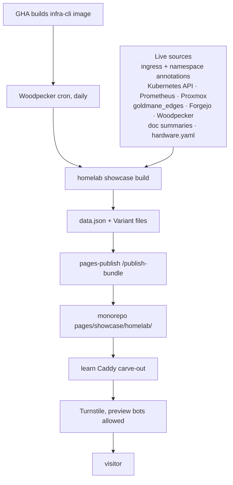
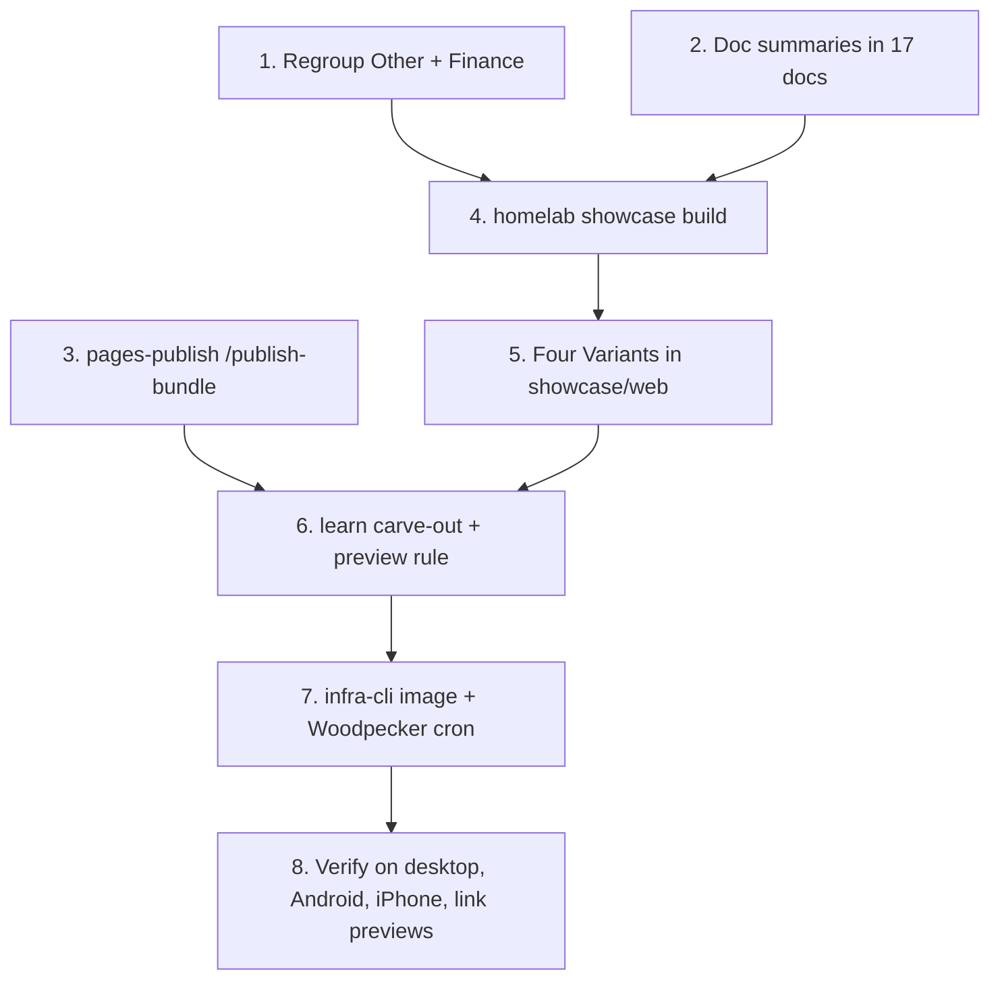

# Homelab showcase page

Status: done 2026-10-20. Approved the same day from a `/grill-with-docs` interview and two independent challenger reviews. Live at https://pages.viktorbarzin.me/homelab/, rebuilt daily at 06:30 UTC by `.woodpecker/showcase.yml`.

## Context

Viktor wants a page to show the homelab to other homelabbers, for example as a link posted to r/homelab or a Discord server. Visitors should be able to explore what runs here interactively, and the page should stay current without anyone editing it by hand.

Most of what the page needs already exists in a live form:

- The service catalog: `homelab services --json` reads 139 services from the `gethomepage.dev/*` annotations on each ingress. Homepage already serves the same list publicly at `home.viktorbarzin.me/api/services`.
- Size and traffic numbers: Prometheus and the Proxmox exporter.
- Service-to-service flows: the `goldmane_edges` Postgres database (915 rows, 171 namespaces), filled by `goldmane-edge-aggregator`.
- Prose: the architecture docs, which are public on GitHub with the rest of this repo.

The page collects these into one generated **Snapshot** and renders it four ways.

```stats
139 | services in the catalog
168 | Terraform stacks
340 | running pods on 6 nodes
440k | requests a day through Traefik
11 | running VMs on one R730
```

## Decisions

| # | decision |
|---|---|
| 1 | Public at `pages.viktorbarzin.me/homelab`, no login, using the pinned-root carve-out pattern of `/pe-summit-trip` |
| 2 | Turnstile on, matching the 2026-10-16 policy for public pages. Link-preview bots (Discord, Reddit, Slack, Twitter, Facebook) reach the page through an Anubis allow rule, following the existing `f1-share-link-previews` rule |
| 3 | Content may include anything already in the docs. The infra repo is public, so the docs add nothing new |
| 4 | Every catalog service shows by default. An ingress opts out with `showcase.viktorbarzin.me/hidden = "true"` in `extra_annotations`, which `ingress_factory` already passes through. The same annotation on a namespace hides it from the graph |
| 5 | Content comes from live state, generated deterministically into one `data.json`. No LLM-written text |
| 6 | Four **Variants** share that `data.json`: layered map with a guided tour (the default), follow a request, live service graph, and a filterable catalog. One switcher moves between them |
| 7 | Each Variant has its own visual style, designed with the `frontend-design` skill. Readability comes first, and every Variant works at phone width |
| 8 | Numbers shown: size (services, stacks, pods, nodes, cores, RAM, Proxmox storage) and activity (requests a day, infra commits a week, CI runs, issues fixed by the agent), each from a pinned query |
| 9 | Each service links to its stack's `main.tf` on GitHub, and each layer links to its architecture doc on GitHub |
| 10 | The stack for a service is its namespace, with a 6-entry override map. A test fails the build when a visible service does not resolve to a `stacks/<dir>` |
| 11 | The graph shows only namespaces that have a visible catalog service. Shared infrastructure (Vault, Postgres, Redis, mail) appears as "uses X" badges on a node, not as edges. Only allowed flows seen in the last 30 days, with **Plumbing edges** removed |
| 12 | Each service shows one of three access states: SSO, app login, or LAN only. The page never labels a service "public" or "no login" |
| 13 | Physical kit that Prometheus does not see goes in a short `showcase/hardware.yaml` |
| 14 | Every mapped architecture doc carries a required `<!-- showcase: ... -->` summary without numbers. The build fails when one is missing |
| 15 | "Follow a request" is generated from a per-service `route` key: DNS type, auth middleware, Turnstile state and storage classes |
| 16 | The generator is a Go verb, `homelab showcase build`, reusing the CLI's services, edges and metrics code |
| 17 | A daily Woodpecker cron runs it from the GHA-built `infra-cli` image. GHA also triggers a run after building a new `infra-cli` image |
| 18 | `pages-publish` gets a `POST /publish-bundle` endpoint. Publishing goes through one writer that already serializes pushes |
| 19 | Catalog cleanup in scope: move the 30 services out of "Other" and merge the lone "Finance" entry into "Finance & Personal". This also improves Homepage |

## Design



### Snapshot (`data.json`)

One file, written by the generator and read by every Variant:

| key | content | source |
|---|---|---|
| `generated` | timestamp, infra commit SHA | the pipeline |
| `stats` | size and activity numbers | pinned queries, below |
| `hardware` | Proxmox host, running VMs, nodes, physical kit | Proxmox exporter, `kube_node_*`, `hardware.yaml` |
| `layers` | hardware, network, platform, how it is run, each with its summary and doc link | `docs/architecture/*.md` summaries |
| `services` | name, description, group, stack, GitHub link, access state, `route` | ingress annotations, middlewares, PVCs |
| `edges` | namespace pairs with flow counts, plus per-namespace infra badges | `goldmane_edges.edge` |

Layers and their docs:

| layer | docs |
|---|---|
| hardware | `compute.md`, `london-site.md`, `storage.md` |
| network | `networking.md`, `vpn.md`, `dns.md`, `security.md` |
| platform | `overview.md`, `databases.md`, `secrets.md`, `authentication.md`, `monitoring.md`, `backup-dr.md` |
| how it is run | `ci-cd.md`, `automated-upgrades.md`, `incident-response.md`, `multi-tenancy.md` |
| apps | the service catalog |

The map draws hardware, network, platform and apps as four stacked layers, with "how it is run" as a band beside them. The guided tour has five stops in the order of the table.

### Pinned queries

| stat | source |
|---|---|
| running VMs | `count(pve_guest_info{type="qemu",template="0"} * on(id) pve_up == 1)` |
| storage | `sum(pve_disk_size_bytes{id=~"storage/.*"})` (about 12.7 TB). Not `kubelet_volume_stats_*`, which counts each NFS export once per PVC |
| pods | `sum(kube_pod_status_phase{phase="Running"})` |
| nodes, cores, RAM | `kube_node_info`, `kube_node_status_capacity` |
| requests a day | `sum(increase(traefik_service_requests_total[1d]))` |
| infra commits a week | Forgejo API, `viktor/infra` commits since 7 days ago |
| CI runs a week | Woodpecker API, with a read token from Vault |
| issues fixed by the agent | Forgejo issues labelled `broken`, closed by `infra-agent` (from the issue timeline), last 30 days |

### Graph filtering

The CLI's edges JSON drops `dst_port`, so the generator runs its own read-only query against `goldmane_edges.edge`:

- `action = 'allow'` and `last_seen > now() - interval '30 days'`.
- Plumbing: `dst_port` 53 and the scrape ports, source `-` (host traffic), and the `kube-system`, `monitoring`, `uptime-kuma`, `verify` and `traefik` namespaces.
- Destinations in `vault`, `dbaas`, `redis` and `mailserver` become badges on the source node.
- The remaining nodes are kept only when the namespace has a visible catalog service.

On a phone, the graph view falls back to a list of nodes and their neighbours.

### Variants

| Variant | what the visitor does |
|---|---|
| Layered map + tour | Taps a layer or node to read about it. "Take the tour" walks the five stops in order |
| Follow a request | Picks a service and follows one request through Cloudflare, Turnstile, Traefik, its auth, the pod and its storage, using that service's `route` |
| Live service graph | Pans and zooms a force-directed graph of namespaces built from real flows |
| Filterable catalog | Filters service cards by group, access state and search. Each card links to its Terraform. A hardware header sits on top |

The Variant source lives in `showcase/web/`. Third-party libraries such as d3-force are copied into the bundle, and the page uses no absolute `/assets/` paths. The footer shows the generation time and the infra commit. `og:image` is an absolute URL.

### Publishing

- `POST /publish-bundle` on `pages-publish` takes a set of files (text, or base64 for the OpenGraph image) for one slug.
- Inside each attempt of the existing loop, after the sync to master, it replaces `pages/<user>/<slug>/` as a whole, so files the new bundle dropped disappear. `git add` is scoped to that directory.
- A synthetic user `showcase` owns the bundle, so the page lands in `pages/showcase/homelab/`, apart from Viktor's private space.
- Its token sits in a separate `PAGES_BUNDLE_KEYS` map of the shape `{token: {user, slug}}`. The existing `PAGES_API_KEYS` keeps its one-token-per-user shape.
- `render.py` already ignores subdirectories when it rebuilds `index.html`.
- The pipeline publishes every run. Live stats change daily, so expect about one small commit a day in the monorepo.
- A failed run leaves the last good page in place and posts to Slack #alerts.

### Serving

`stacks/learn` gets a second carve-out modelled on `ingress_pe_summit_trip`:

- An `ingress_factory` call with `host = "pages"`, `ingress_path = ["/homelab"]`, `auth = "none"`, `turnstile = true`, `anti_ai_scraping = true` and `homepage_enabled = false`, plus the `router.priority = "150"` annotation.
- A Caddy `handle` block with its root pinned to `pages/showcase/homelab`, and `redir /homelab /homelab/ 308`.
- `stacks/turnstile-gate` gets an Anubis rule that lets preview user agents through on `pages.viktorbarzin.me/homelab`.

### CI

- GHA builds `ghcr.io/viktorbarzin/infra-cli:<sha>` on every `cli/**` push, so `cli/Dockerfile` gains `kubectl`. Generator tests run there, following ADR-0002.
- A Woodpecker pipeline `.woodpecker/showcase.yml` runs the image, logs in to Vault with the CI role, builds the Snapshot, and calls `/publish-bundle`. It sets `HOMELAB_TELEMETRY=0`.
- The daily schedule is registered through the Woodpecker cron API (`/api/repos/1/cron`), the same way `drift-detection` is.

## Plan



1. Move the 30 "Other" services into real groups and merge "Finance" into "Finance & Personal".
2. Add the `<!-- showcase: ... -->` summary to the 17 mapped architecture docs.
3. Add `/publish-bundle` and `PAGES_BUNDLE_KEYS` to `pages-publish`, test first.
4. Add `homelab showcase build --src showcase --out <dir>`, test first, including the stack-resolution test and the graph filter.
5. Build the four Variants with `frontend-design`, previewed locally against a real `data.json`.
6. Add the `/homelab` carve-out to `stacks/learn` and the preview rule to `stacks/turnstile-gate`.
7. Add `kubectl` to the `infra-cli` image, the Woodpecker pipeline, and the cron schedule.
8. Open the public URL in a desktop browser, on the shared Android emulator and on the iPhone (`homelab ios shot`). Paste the link into Discord and Slack to check the preview card.

## Verification (2026-10-20)

- From outside, through Cloudflare, with each platform's user agent: Discordbot, Slackbot, facebookexternalhit, Twitterbot, redditbot, TelegramBot and WhatsApp all received the page and `og.png` with HTTP 200. Before the `showcase-link-previews` rule, Discordbot and redditbot were sent to the Anubis challenge. A browser user agent gets the Turnstile check, and GPTBot gets 403.
- The four Variants render with no console errors and no horizontal scroll in headless Chrome at 1440px and 390px, and the map renders in real Chrome on the shared Android emulator.
- Not checked yet: the iPhone (`homelab ios doctor` could not reach the London Mac that drives it), and a real share into Discord or Slack. Those platforms fetch from their own networks, which the user-agent test above stands in for but does not reproduce.

## Open questions

- Whether Cloudflare Bot Fight Mode (`fight_mode = true` in `stacks/cloudflared/cloudflare.tf`) blocks a link-preview bot coming from the platforms' own networks. The user-agent tests passed through Cloudflare from the home connection; a real share on each platform settles it.
- Which scrape ports to treat as plumbing. The generator test pins the list against current data.
- The homelab v3 blog draft (`Website/content/blog/21-home-lab-v3-the-foundation.md`, a draft since 2026-03-01) covers the same layers. The page does not link to it, by decision. Whether the draft gets finished is outside this design.
