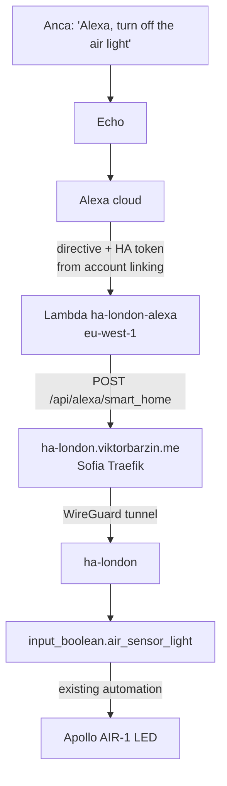

# Alexa voice control for the London air light

Status: approved (grilling with Viktor, 2026-10-31). Building started the same night.

## Goal

Anca can say "Alexa, turn off the air light" and "Alexa, turn on the air light"
to the Echo in the London flat. The command flips the same switch as the
"Sensor light" tile on the Air Quality dashboard in ha-london, so voice and
dashboard always agree.

```stats
1 | device exposed to Alexa
0 | subscriptions (no Home Assistant Cloud)
2 | logins needed from Viktor (AWS console, Amazon)
1 | ha-london restart
```

## Context

Found on 2026-10-30 and 2026-10-31:

| piece | state |
|---|---|
| Switch | `input_boolean.air_sensor_light` ("Air sensor light"), added 2026-10-30. Off turns the Apollo AIR-1 LED off and keeps the CO2 colour automation and the morning turn-on from lighting it. On restores the CO2 colour. It keeps its value across restarts |
| ha-london | HAOS 2026.10.1 on the Pi at 192.168.8.103. Home Assistant Cloud is not subscribed (`cloud/status`: logged out) |
| Public reachability | `https://ha-london.viktorbarzin.me` is served by Sofia's Traefik over the London tunnel, not through Cloudflare. `/api/` answers 401 from HA and `/auth/authorize` answers 200, with no forward-auth in front. That is what Alexa account linking and the AWS function need |
| Echo | Two unnamed Amazon devices sit on the London guest Wi-Fi: `cc:9e:a2:24:11:e0` (192.168.9.117) and `98:cc:f3:3d:5e:05` (192.168.9.135). One is the Echo. The guest network is fine for this design, since the Echo only talks to Amazon |
| Amazon accounts | Viktor and Anca share an Amazon Household. Which account the Echo is registered to is checked in the shared browser at the start of the build |
| AWS | Viktor has an AWS account (login in Vaultwarden). Vault holds no AWS access keys yet. Nothing in infra uses the AWS provider |

## Decisions

| # | decision | why |
|---|---|---|
| 1 | A private Alexa Smart Home skill, with HA's reference code in an AWS Lambda | Free. Home Assistant Cloud is about $6.50 a month. Emulated Hue would also be free, but the Echo is on the guest network and the skill route doesn't depend on local discovery |
| 2 | Expose only `input_boolean.air_sensor_light`, as a light named "Air light" | One device for now. More is a config line plus "Alexa, discover devices" |
| 3 | The skill is built under the Amazon account the Echo is registered to | A development skill is only visible to the account that owns it |
| 4 | The Lambda lives in Viktor's AWS account in EU (Ireland), `eu-west-1` | Alexa routes UK English to Ireland. If the Echo turns out to be set to US English, the region becomes `us-east-1` |
| 5 | AWS work is done with the AWS CLI using a dedicated IAM user, `alexa-ha-london`, whose key is in Vault | One console login to create the user. Its policy reaches only this Lambda, its role and its log group |
| 6 | The skill is created with the ASK CLI after one "Login with Amazon"; its refresh token is kept in Vault | The skill manifest is a file in the repo, so a future session can change the skill without another login |
| 7 | A committed, re-runnable deploy script, not a Terraform stack | One function and one role that rarely change, and no AWS credentials in CI |
| 8 | The deploy script fetches the Lambda code from the gist linked in HA's docs on every run | Viktor's choice: always the current reference code. The script records the gist revision in the Lambda's description so the running version can be traced |
| 9 | Alexa links to ha-london as a new non-admin HA user, `alexa`, whose password is in Vault | The token Amazon holds cannot change HA configuration, shows up as its own user, and can be revoked on its own |
| 10 | No state reporting (proactive events) | Voice on and off works without it. Can be added later with an unlink and relink |
| 11 | No alerting on the voice path | If it breaks, the dashboard tile still works and Anca will notice |
| 12 | ha-london restarts when the build reaches that step, with the four presence automations paused | The restart resets the presence template sensors, which can otherwise send a false "Anca left/is home" push |

## How a command travels



Account linking happens once. The Echo's owner enables the skill in the Alexa
app and logs in to ha-london as the `alexa` user. Alexa keeps that user's token
and sends it with every directive.

## Pieces

### ha-london

```yaml
# configuration.yaml
alexa:
  smart_home:
    locale: en-GB
    filter:
      include_entities:
        - input_boolean.air_sensor_light
    entity_config:
      input_boolean.air_sensor_light:
        name: "Air light"
        display_categories: LIGHT
```

A new HA user `alexa`, non-admin (group `system-users`), allowed to log in from
outside the LAN. The config change needs a restart.

### AWS (`infra/scripts/london-alexa/`)

- `deploy.sh`, idempotent, run by hand with the key from Vault:
  - creates or updates role `ha-london-alexa-lambda` with `AWSLambdaBasicExecutionRole`;
  - fetches `lambda_function.py` from the gist and creates or updates function `ha-london-alexa` (latest Python runtime, arm64) with `BASE_URL=https://ha-london.viktorbarzin.me`, recording the gist revision in the description;
  - sets 14-day retention on its log group, so logs stay inside the free tier;
  - grants `alexa-connectedhome.amazonaws.com` permission to invoke it, limited to the skill ID.
- `iam-policy.json` for the `alexa-ha-london` user.
- The CLIs run in Docker containers (`amazon/aws-cli` and a Node image running `ask-cli`), following the infra rule that tools run in containers, so nothing is installed on the devvm.

### Alexa skill (`infra/scripts/london-alexa/skill/`)

- `skill.json`: a Smart Home skill, payload v3, locale en-GB, endpoint = the Lambda ARN.
- `account-linking.json`: auth code grant, authorization URI `https://ha-london.viktorbarzin.me/auth/authorize`, token URI `https://ha-london.viktorbarzin.me/auth/token`, client ID `https://layla.amazon.com/` (the EU value), credentials in the request body, scope `smart_home`. HA does not check the client secret.

The Lambda needs the skill ID and the skill needs the Lambda ARN, so the order
is: Lambda first, then the skill, then the invoke permission for the skill ID.

### Vault (`secret/viktor`)

| key | holds |
|---|---|
| `aws_alexa_access_key_id`, `aws_alexa_secret_access_key` | the `alexa-ha-london` IAM user |
| `ask_cli_refresh_token` | the ASK CLI's Login with Amazon token for the Echo owner's account |
| `home_assistant_london_alexa_password` | the HA `alexa` user |

## Build order

1. Viktor logs in to the Alexa web app in the shared browser; read which account owns the Echo and its language.
2. Viktor logs in to the AWS console in the shared browser; create the `alexa-ha-london` IAM user and its key, store the key in Vault.
3. Run `deploy.sh` to create the role and the Lambda.
4. ASK CLI login with the Echo owner's Amazon account; create the skill and its account linking; store the token in Vault; run `deploy.sh` again to add the skill trigger.
5. ha-london: create the `alexa` user, add the `alexa:` config, pause the four presence automations, restart, wait for the presence sensors to settle, resume the automations.
6. Direct test: invoke the Lambda with a discovery directive and with off and on directives, using a token for the `alexa` user; watch the switch and the LED in HA.
7. The Echo owner enables the skill in the Alexa app (Skills, Your Skills, Dev), logs in as `alexa`, and asks Alexa to discover devices.
8. Voice test: someone in the flat says "Alexa, turn off the air light" and then "turn on"; confirm both flips in HA's history, credited to the `alexa` user.
9. Add an "Alexa" section to `docs/architecture/london-site.md` describing what runs and how to change it.

## Cost

Lambda's free allowance is 1 million requests a month and does not expire; this
uses a handful a day. Logs are kept for 14 days, inside CloudWatch's free 5 GB.
The Alexa developer account is free. No CloudWatch alarm is created.

## What we don't know yet

- Which Amazon account owns the Echo, and whether it is set to UK English. Step 1 answers both; a US English Echo moves the Lambda to `us-east-1` and the client ID to `https://pitangui.amazon.com/`.
- Whether CrowdSec on Sofia's Traefik or HA's own login ban lets AWS addresses through. Step 6 shows it before anyone talks to the Echo.
- Whether enabling a development skill and account linking can be done outside the Alexa phone app. Planned as one step on the owner's phone.

## Out of scope

- Any other London device in Alexa.
- Alexa routines that react to the switch, which would need state reporting.
- Home Assistant Cloud.
