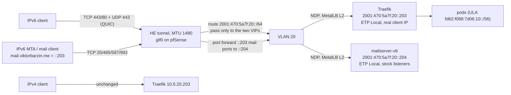
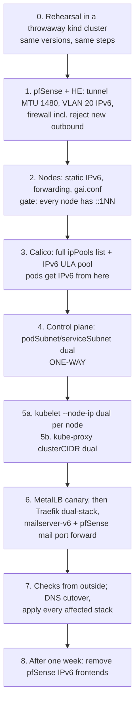

# Cluster dual-stack: IPv6 and HTTP/3 over IPv6, natively

Status: draft v2, 2026-11-02 (revised after two blind challenger reviews). Decisions by Viktor in a grilling session the same
day. Builds on `docs/research/2026-08-31-cluster-dual-stack-ipv6.md` (feasibility,
flags, rollback) and `docs/research/2026-11-02-reliable-ipv6-ingress.md` (today's
IPv6 path); facts from those are cited, not repeated.

## Goal

Serve the 28 origin-direct hostnames and mail over IPv6 natively from the
cluster, with HTTP/3 working over IPv6 as it does over IPv4. Viktor's reason:
serve over the current stack (IPv6 and HTTP/3). Today IPv6 enters through the
pfSense HAProxy package, which is TCP only, so IPv6 clients are told about
HTTP/3 (`alt-svc`) and then cannot use it.

## Decisions

| # | Decision | Choice |
|---|---|---|
| 1 | Design | Full cluster dual-stack (not a hostNetwork QUIC listener) |
| 2 | Prefix | HE routed /48 `2001:470:5a7f::/48`, assigned 2026-11-02 |
| 3 | Node outbound | IPv4: new outbound IPv6 from VLAN 20 is rejected at pfSense (Go binaries ignore `gai.conf`, so a reject is what makes it hold); `gai.conf` set as well for glibc programs |
| 4 | Scope | Web (Traefik) and mail; `mail.viktorbarzin.me` stays one name (MX and webmail) |
| 5 | Pod and Service addressing | Private ULA `fd62:f088:7d06::/48`; public addresses only for nodes and the two entry points |
| 6 | Cutover | All 28 AAAA records together; pfSense IPv6 frontends kept one week as fallback |
| 7 | Window | Now (2026-11-02), after the rehearsal passes |

This plan accepts that the control-plane step is one-way. Once the apiserver
gains an IPv6 Service range, the `kubernetes` ServiceCIDR object cannot return to
single-stack (2026-08-31 research, section A, "Rollback"). Rolling back the rest
leaves a cosmetic warning event.

## Addressing

| Purpose | Prefix / address | Notes |
|---|---|---|
| VLAN 20 (k8s nodes) | `2001:470:5a7f:20::/64` | pfSense `::1`; nodes static `::100`-`::105` (last IPv4 octet). Both VIPs pinned with `metallb.io/loadBalancerIPs`; nothing else asks for IPv6 |
| MetalLB IPv6 pool | `2001:470:5a7f:20::200` - `::220` | On-link with the nodes, so L2 (NDP) announcement works |
| Traefik VIP | `2001:470:5a7f:20::203` | Pairs with `10.0.20.203`, TCP 80/443 + UDP 443 |
| Mail VIP | `2001:470:5a7f:20::204` | IPv6-only LoadBalancer for 25/465/587/993; reached through a pfSense IPv6 port forward from `::203` (see phase 6), because `mail.viktorbarzin.me` is both the MX target and the Roundcube host |
| Pod pool (Calico) | `fd62:f088:7d06:100::/56` | Aligned /56 (v1 used `:10::/56`, which has host bits set and masks to `::/56`, containing the Service range). Not routed outside the cluster; no NAT66 |
| Service range | `fd62:f088:7d06:96::/112` | Matches the kubeadm guide's /112 |

Why ULA for pods and Services: the internet cannot route to them even if a
firewall rule is wrong, and RFC 6724 address selection makes a host with only a
ULA IPv6 source prefer IPv4 for global destinations, so pod outbound stays IPv4
without DNS filtering. Inbound from the internet is allowed only to the two VIPs.

Tunnel MTU: the HE tunnel and `gif0` go from 1280 to 1480. Traefik v3.7.14 uses
quic-go v0.62.0, whose `InitialPacketSize = 1280` is both the starting and the
minimum UDP payload (`internal/protocol/params.go:6`), so a QUIC packet over IPv6
is 1328 bytes and cannot cross a 1280-byte tunnel. pfSense's IPv4 path to the HE
server carries 1500 (`ping -D -s 1472 216.66.86.122` passes). The TCP MSS clamp on
`gif0` moves from 1220 to 1420 to match.

## Target data path

## Phases

Each phase lists what it changes, where the change is declared, how it is
checked, and how it is undone.

### 0. Rehearsal (gate)

A kind cluster on the devvm at the same Kubernetes minor (v1.35), Calico through
the Tigera operator at the live versions (operator v1.44.0, Calico v3.33.0) with the same Installation
shape (VXLANCrossSubnet IPv4 pool, BGP enabled), MetalLB v0.15.3 L2,
kube-proxy iptables mode, NodeLocal DNSCache. Run phases 3-6 exactly as written
below, then check: existing IPv4 pods and Services keep working through every
step; new pods get both families; a `PreferDualStack` LoadBalancer gets an IPv6
VIP and answers on it with ETP Local; existing nodes without an IPv6 podCIDR do
not break the controller-manager's node IPAM; the full-list `ipPools` patch keeps
the IPv4 pool. kind cannot exercise FreeBSD NDP takeover when MetalLB moves a VIP,
so phase 6 drains the announcing node once on the live cluster. Delete the
cluster afterwards. If any check fails, stop and report.

### 1. pfSense

- HE tunnel MTU 1480 on tunnelbroker.net (tunnel Advanced tab, same login as the
  /48) and `gif0` MTU 1480 on pfSense; MSS clamp on gif0 1220 -> 1420. Check:
  from mx2, `ping -6 -s 1400 -M do 2001:470:6e:43d::2` passes.
- VLAN 20 interface (`vtnet2`) gets `2001:470:5a7f:20::1/64`; no RA (nodes are
  static). The connected /64 needs no static route; pfSense already forwards
  IPv6 (`net.inet6.ip6.forwarding: 1`). Check that HE routes the /48 down the
  tunnel: from mx2, `ping -6 2001:470:5a7f:20::1`.
- `vtnet2` inet6 rules (today only `pass in quick on vtnet2 inet all` exists,
  IPv4): pass ICMPv6 and NDP; pass node-to-node; reject (`block return`)
  every other new outbound IPv6 connection from VLAN 20, so node Go binaries and
  pods fall back to IPv4 at once instead of timing out. Replies to inbound
  connections pass by state.
- `HE_IPv6` (gif0) inbound: pass TCP 80/443 and UDP 443 to `::203`; port forward
  TCP 25/465/587/993 on `::203` to `::204` (phase 6 enables it); everything else
  to the /48 stays blocked by the default deny.
- Block any packet with a ULA (`fc00::/7`) source leaving on gif0.
- Declared in a PHP configurator run by a new `playbooks/pfsense-k8s-ipv6.yml`
  with `--check`, same pattern as `pfsense-haproxy.yml`.
- Check: from a node, `ping -6 2001:470:5a7f:20::1`; from a node, `curl -6
  https://example.com` is refused at once (reject works); from mx2, the VIPs are
  unreachable until phase 6.
- Undo: remove the interface address and rules (config history).

### 2. Nodes

- Netplan: static `2001:470:5a7f:20::1NN/64` on `ens18`, IPv6 default route via
  `::1`. `net.ipv6.conf.all.forwarding=1` (Calico needs it; it also turns off
  RA processing, which is why addressing is static).
- `/etc/gai.conf`: `precedence ::ffff:0:0/96 100`, so glibc programs prefer IPv4.
  Go binaries (kubelet, containerd, calico-node) ignore it; for them the phase 1
  reject is what keeps outbound on IPv4.
- Gate: every node holds its `::1NN` address before phase 3 (calico-node's IPv6
  autodetection needs a matching address).
- Declared in a new `playbooks/k8s-node-ipv6.yml` (the nodes' OS config is
  Ansible-managed, per the 2026-07-19 steer to codify node config).
- Check: every node `ping -6` pfSense and another node; `curl` from a node still
  goes out over IPv4.
- Undo: remove the netplan file and sysctl, `netplan apply`.

### 3. Calico

- `Installation.spec.calicoNetwork.ipPools` gets a second entry `{name:
  default-ipv6-ippool, cidr: fd62:f088:7d06:100::/56, blockSize: 122,
  encapsulation: VXLANCrossSubnet, natOutgoing: Disabled, nodeSelector: all()}`,
  and `nodeAddressAutodetectionV6: {cidrs: ["2001:470:5a7f:20::/64"]}`.
- The `ipPools` list is atomic (no `x-kubernetes-list-type`) and the operator's
  pool controller deletes owned pools missing from the spec
  (`pool_controller.go:343-372`), so the change sends the full list with the
  IPv4 entry byte-identical to the live spec. Diff the Installation before and
  after.
- Where declared: no stack owns the Installation today (`stacks/calico/main.tf`,
  `installation.enabled = false`, bead code-3ad). The change is recorded as a
  manifest in `stacks/calico/` and applied once, with the reason in the commit;
  adopting the Installation into Terraform stays a separate decision.
- From this phase pods already get IPv6 addresses (the operator turns on CNI
  `assign_ipv6` and `FELIX_IPV6SUPPORT` as soon as an IPv6 pool exists), which is
  why the phase 1 reject comes first.
- Disruption: rolling `calico-node` restart, `maxUnavailable: 1`.
- Check: both IPPools exist; tigerastatus Available; calico-node 6/6; a new test
  pod has both families.
- Undo: remove the pool entry; the operator deletes the IPPool.

### 4. Control plane (one-way)

- `kubeadm-config` `ClusterConfiguration.networking`: `podSubnet:
  10.10.0.0/16,fd62:f088:7d06:100::/56`, `serviceSubnet:
  10.96.0.0/12,fd62:f088:7d06:96::/112`. kubeadm derives `service-cluster-ip-range`,
  `cluster-cidr` and `allocate-node-cidrs` from these (`manifests.go:189,351-355`),
  and `kubeadm upgrade` keeps them.
- Procedure, following the house pattern in `stacks/rbac/modules/rbac/*-tuning.tf`:
  claim `stack:rbac`; dump the ConfigMap and edit `networking` only;
  `kubeadm init phase upload-config kubeadm`; `kubeadm upgrade diff v1.35.10` must
  show only the apiserver and controller-manager flag changes; scale
  tigera-operator to 0 (it crash-loops into an I/O storm while the apiserver is
  down, `upgrade-step.sh:728-751`); regenerate the apiserver and
  controller-manager only, with `advertiseAddress: 10.0.20.100` set explicitly;
  scale the operator back.
- Existing nodes keep their single IPv4 podCIDR and never get an IPv6 one;
  Calico IPAM does not use node podCIDRs, so nothing breaks
  (`range_allocator.go:116-123`).
- Disruption: kube-apiserver and controller-manager restart on the single
  master, a few minutes without the Kubernetes API; workloads keep serving.
- Check: `kubectl get servicecidr kubernetes` lists both ranges; existing
  Services unchanged; the nightly k8s-upgrade jobs read the same ClusterConfiguration.
- Undo: not possible for the ServiceCIDR object (see Decisions). Also: a node
  that joins after this phase gets two podCIDRs, and reverting `--cluster-cidr`
  then crash-loops the controller-manager (`range_allocator.go:123`), so no node
  joins or rebuilds during the fallback week.
- The weekly `k8s-version-check` runs Sundays 23:00 (next 2026-11-08); phases 4-5
  finish before it.

### 5. kubelet and kube-proxy

- 5a. kubelet `--node-ip=10.0.20.1NN,2001:470:5a7f:20::1NN` per node in
  `/etc/default/kubelet` `KUBELET_EXTRA_ARGS` (not `kubeadm-flags.env`, which
  kubeadm and `scripts/renew_worker_certs.sh` rewrite), via the phase-2 playbook.
  Restart kubelet one node at a time; gate each on Ready plus a dual InternalIP
  (a typo leaves the node NotReady). No drain needed.
- 5b. Only after all six nodes show a dual InternalIP (kube-proxy reads node IPs
  at startup):
- kube-proxy ConfigMap `clusterCIDR: 10.10.0.0/16,fd62:f088:7d06:10::/56`
  (empty `detectLocalMode` means ClusterCIDR, so it matters; 2026-08-31
  research), roll the DaemonSet.
- Check: `kubectl get node -o wide` shows both InternalIPs; new pods get both
  families; existing pods keep IPv4 and pick up IPv6 when next restarted.
- Undo: revert flag and ConfigMap.

### 6. MetalLB, Traefik, mail

- MetalLB: add `2001:470:5a7f:20::200-2001:470:5a7f:20::220` to the `default`
  pool only. A dual-stack Service needs both IPs in one pool (`allocator.go:663-681`),
  and when the requested IPs change MetalLB clears the Service state before
  reallocating; a failed allocation writes an empty status and withdraws the IPv4
  VIP too (`controller/service.go:150-154`). So: land the pool change, prove it
  with a throwaway dual-stack LoadBalancer Service, delete it, then change Traefik.
- Traefik `svc/traefik` and `svc/traefik-udp`: `ipFamilyPolicy: RequireDualStack`
  through the chart's `service.spec` passthrough (chart 42.0.0 has no
  `ipFamilyPolicy` key; `_service.tpl:22`), and `metallb.io/loadBalancerIPs:
  10.0.20.203,2001:470:5a7f:20::203`. Changing the policy in place is allowed and
  touches no ports, and MetalLB checks sharing per IP. Roll the Traefik pods so
  they get IPv6 addresses (the `:8443` entrypoints bind both families). Check
  `svc/traefik` ports and `IngressAllTargetsUnreachable` afterwards anyway.
- Drain the node announcing `::203` once and confirm pfSense follows the NDP
  move (kind cannot test this).
- Mail: new `mailserver-v6` LoadBalancer, `ipFamilies: [IPv6]`, ETP Local,
  `2001:470:5a7f:20::204`, targeting the stock (non-PROXY) listeners for
  25/465/587/993 (stock `:25` runs the same postscreen as `:2525`; Dovecot listens
  on `::`), so Postfix and Dovecot see the real client IPv6 directly. Roll the
  mailserver pod for an IPv6 address. Then enable the pfSense IPv6 port forward
  `::203` 25/465/587/993 -> `::204`, so `mail.viktorbarzin.me` (one AAAA, `::203`)
  serves webmail through Traefik and mail through the cluster. Outbound mail stays
  IPv4 (relay has no AAAA; unbound `do-ip6: no`). mx2 cannot test port 25 (OCI
  blocks outbound 25); test 465/587/993 from mx2 and 25 from the devvm.
- Network policies: checked by the challenger, nothing to change. There are no
  NetworkPolicies in `traefik` or `mailserver`; the GlobalNetworkPolicies are
  egress-only. Re-check right before phase 6.
- Check from mx2 (outside): `curl -6` each class of host to `::203`;
  `curl --http3-only` over IPv6 (a curl build with HTTP/3, e.g.
  `ymuski/curl-http3`); TLS on `::204` ports; Traefik and Postfix log the real
  client IPv6.

### 7. DNS cutover

- `public_ipv6` (config.tfvars) from `2001:470:6e:43d::2` to
  `2001:470:5a7f:20::203`; it is read by `ingress_factory`, the reverse-proxy
  factory, `bastion` and `terminal_api.tf` (cloudflared declares it but does not
  use it). `mail.viktorbarzin.me` follows automatically (Roundcube's ingress).
  config.tfvars is git-crypt encrypted, so the edit is made in the main checkout.
- CI applies only platform stacks on a global-file change, so the 18 app stacks
  with non-proxied ingresses (immich, forgejo, bastion, terminal, affine,
  servarr, ...) are applied explicitly. Gate: `dig AAAA` all 28 names returns
  `::203` before phase 8.
- gatus on mx2 (hand-converged plus cloud-init mirror, since metadata is in
  `ignore_changes`): `tcp://[::203]:443`, `tcp://[::203]:993` and a QUIC check
  (open question 4); keep the tunnel-address probes until phase 8.
- Undo: set `public_ipv6` back; the pfSense IPv6 frontends are still running.

### 8. After one week

Remove the six IPv6 frontends from `scripts/pfsense-haproxy-bootstrap.php`, the
old gatus probes, and update `docs/architecture/networking.md` (IPv6 Ingress) and
the mail runbook. The `transparent` binds and 1 h timeouts go with them, and the
`IPv6IngressBridge`-era gatus probes are replaced by the new ones.

## What could break, and how we would see it

| Risk | Signal | Response |
|---|---|---|
| Calico pool add misbehaves on a live cluster | tigerastatus degraded, calico-node not Ready | Remove the pool entry; rehearsal should catch it first |
| Controller-manager node IPAM errors on nodes without an IPv6 podCIDR | controller-manager logs, nodes NotReady | Rehearsal; Calico IPAM does not use node podCIDRs |
| Traefik Service loses 443 during the ipFamilyPolicy change | `IngressAllTargetsUnreachable` | Re-add with the JSON patch recipe; check ports after apply |
| IPv6 clients dropped by an IPv4-only network policy | gatus IPv6 probes red, IPv4 green | Add the `::/0` rule |
| QUIC packets too big for the tunnel | `curl --http3-only` over IPv6 fails while TCP works | Tunnel MTU 1480 (phase 1); quic-go's minimum is 1280-byte payloads |
| MetalLB withdraws the IPv4 VIP during the Traefik change | `IngressAllTargetsUnreachable`, all sites down | Canary Service first; IPv6 range in the `default` pool only |
| ipPools patch drops the IPv4 pool | new pods get no IPv4 | Full-list patch, diff before and after |
| Some AAAA records stay on the tunnel address | `dig` gate in phase 7 | Apply the remaining stacks before phase 8 |
| A pod or node reaches the internet over IPv6 | pfSense reject/ULA counters | Rules in place from phase 1 |

## Open questions

1. Settled by the challengers: node IPAM tolerates existing single-podCIDR nodes
   (see phase 4); the Installation is unmanaged (phase 3); no policy blocks IPv6
   (phase 6); internal clients get no AAAA from Technitium, so they stay IPv4.
2. Is there a QUIC-capable probe for gatus on mx2, or does it need a small
   `curl --http3-only` check (container image with HTTP/3) on a timer?
3. Does HE actually route the /48 down this tunnel? Checked in phase 1.
4. CrowdSec parsers for mail: do they match the stock-listener syslog names the
   same way as the `smtpd-proxy*` ones? Check in phase 6.
