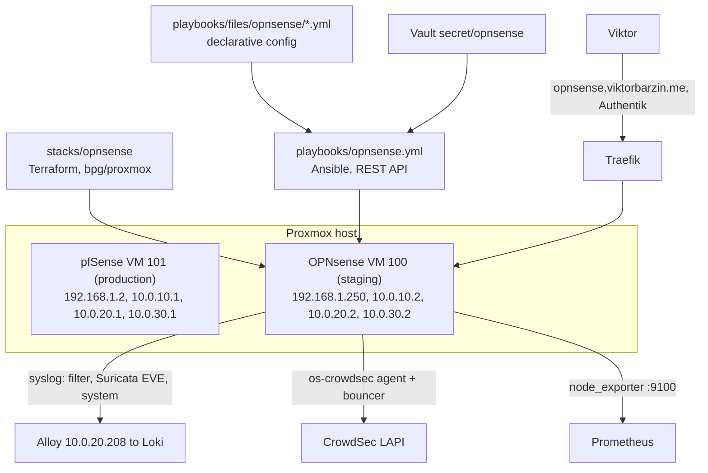
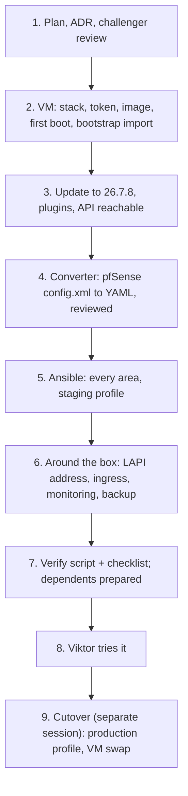

# Replace pfSense with OPNsense: build alongside, then swap

Status: approved 2026-11-03 (grilling session with Viktor, same day; revised after two blind challenger reviews). Decision record: ADR-0038. Research behind it: `docs/research/2026-11-03-network-ids-options.md`; the pfSense inventory it ports is summarised under "What moves".

## Goal

Run the homelab's edge firewall on OPNsense instead of pfSense CE, built from this repo (Terraform for the VM, Ansible for the configuration), with Suricata IDS feeding CrowdSec. OPNsense is built and run next to pfSense on spare addresses until Viktor has tried it through `https://opnsense.viktorbarzin.me`; the switch happens later, with him, as a VM swap.

Why now: pfSense CE 2.7.2 is out of support ([Netgate versions](https://docs.netgate.com/pfsense/en/latest/releases/versions.html)), and from 26.10 pfSense moves to one edition whose PHP GUI is to be removed ([pfSense at 20](https://www.netgate.com/blog/pfsense-at-20)). Our pfSense automation is PHP run against pfSense internals, so it needs rewriting either way; OPNsense offers a documented REST API, free online upgrades, built-in Suricata 8 and an official CrowdSec plugin.

## Decisions

| # | Decision | Choice |
|---|---|---|
| 1 | Firewall | OPNsense 26.7.8 (current, 2026-10-30) |
| 2 | VM | VMID 100, 8 vCPU, 8 GB RAM, 32 GB on `local-lvm`; Terraform with `bpg/proxmox` in a new stack `stacks/opnsense`, scoped API token, `prevent_destroy` |
| 3 | Install | `nano` image (preinstalled), first boot with all NICs disconnected, bootstrap `config.xml` imported over the serial console |
| 4 | Configuration | Ansible over the OPNsense REST API (`oxlorg.opnsense` where its modules work on 26.7, `ansible.builtin.uri` against the API where they don't); a minimal bootstrap `config.xml` for what the API cannot set |
| 5 | Source of truth | Declarative YAML under `playbooks/files/opnsense/`, first generated from pfSense's `config.xml` by a converter and reviewed; from then on the YAML is edited, not regenerated |
| 6 | Staging | Same bridges and VLANs, spare addresses: WAN 192.168.1.250, VLAN 10 10.0.10.2, VLAN 20 10.0.20.2, VLAN 30 10.0.30.2. Off until cutover: production routing, Kea DHCP, router advertisements, the HE tunnel, WireGuard |
| 7 | Scope | Like-for-like, except: FRR BGP, FreeRADIUS, UPnP, Netgate cloud backup, the rules and port-143 forward that point at the missing `mailserver` alias, and the HAProxy :2525 test listener are not ported. Snort becomes Suricata; softflowd becomes OPNsense's built-in NetFlow export to goflow2. The WAN `pass inet46 any` rule is ported as-is and tightened later as its own change |
| 8 | IDS | Suricata in IDS mode (alerts, no drops) on WAN, VLAN 10 and VLAN 20; ET Open and the abuse.ch lists; EVE alerts to syslog |
| 9 | CrowdSec | `os-crowdsec` registered with our LAPI as a bouncer from staging onwards. Its agent (OPNsense and Suricata logs) pushes to the shared LAPI only after a LAPI-side allowlist exists (see review changes), prepared on this branch and applied at cutover |
| 10 | Monitoring | node_exporter plugin scraped by Prometheus; all logs to Loki through the Alloy syslog receiver; gatus edge checks after cutover |
| 11 | GUI | `https://opnsense.viktorbarzin.me`, public behind Authentik (Viktor's choice), proxied by the reverse-proxy factory to `10.0.20.2:8443`. The GUI listens on 8443 from day one, as pfSense's does, because the internal SNI frontend takes 443 after cutover |
| 12 | Tailscale | Joins now as `opnsense-staging` with no advertised routes and no exit node; routes move at cutover |
| 13 | Secrets | Vault `secret/opnsense`; WireGuard reuses pfSense's private key, so the four sites need no change |
| 14 | Dependents | Changes prepared on this branch, applied at cutover |
| 15 | Cutover | Later, with Viktor: stop pfSense, give VM 100 pfSense's MAC addresses, import a prepared production `config.xml` and reboot it; then run Ansible for idempotence. Boot-order roster: 100 active, 101 disabled. Rollback: the same steps reversed; pfSense stays stopped and untouched for two weeks |
| 16 | Done | `scripts/opnsense-verify` passes against staging, plus a manual checklist |
| 17 | Overnight boundary | Allowed: the new VM, its disks, a scoped PVE API token, Vault secrets, the ingress, monitoring wiring, commits and docs, any OPNsense configuration. Not allowed: changing pfSense, taking a production address, starting DHCP or RA, touching the HE tunnel or WireGuard peers, rebooting anything that exists |

## Design

### Profiles

One configuration, two profiles, chosen by an inventory variable `opnsense_profile`:

| Setting | `staging` (now) | `production` (cutover) |
|---|---|---|
| Interface addresses | `.250` / `.2` | pfSense's: 192.168.1.2, 10.0.10.1, 10.0.20.1, 10.0.30.1, VLAN 20 IPv6 `::1` |
| Kea DHCP, radvd | configured, disabled | enabled |
| HE tunnel (`gif`) | configured, disabled | enabled |
| WireGuard hub | configured, disabled | enabled |
| Tailscale | `opnsense-staging`, no routes | pfSense's routes and exit node |
| Everything else | enabled | enabled |

Rules, NAT and aliases refer to interfaces and aliases rather than literal addresses wherever pfSense's do, so they are the same in both profiles.

### VM and first boot

- `stacks/opnsense` (new, Tier 1 state) holds one `proxmox_virtual_environment_vm`: UEFI off (BIOS, as the nano image expects), virtio NICs in pfSense's order and VLAN tags (WAN `vmbr0`, VLAN 10 `vmbr1` tag 10, VLAN 20 `vmbr1` tag 20, VLAN 30 `vmbr0` tag 30), a serial socket, and the nano image imported as the boot disk. `lifecycle { prevent_destroy = true }`; the provider token may only manage VM 100 and the storage it uses.
- First boot runs with every NIC disconnected (`disconnected = true`), because the nano image's default LAN is 192.168.1.1, the home router's address. A second small disk carries the bootstrap `config.xml`; an expect script on the PVE host drives the serial console through the configuration importer. After the import and a reboot, Terraform reconnects the NICs.
- The bootstrap `config.xml` sets interface assignment and staging addresses, the GUI on 8443, SSH with key-only login, the root password hash and an API key (both from Vault), and the gateway via 192.168.1.1 so the box can fetch updates, plugins and rules. It is rendered from a template; no secret is committed.
- The box is then updated to 26.7.8 and gets its plugins: `os-crowdsec`, `os-haproxy`, `os-tailscale`, `os-node_exporter`, `os-acme-client` only if needed.

### Configuration (Ansible)

`playbooks/opnsense.yml`, one task file per area, each idempotent and `--check`-able, reading `playbooks/files/opnsense/*.yml`:

| Area | From pfSense | Notes |
|---|---|---|
| Interfaces, gateways, static routes | 6 interfaces, 8 gateways, 6 routes | VLAN tags stay on the Proxmox side, so OPNsense sees untagged NICs |
| Aliases, filter rules | 10 aliases, 57 rules | rules for the missing `mailserver` alias are dropped (decision 7) |
| NAT | 23 enabled port forwards, hybrid outbound NAT with 15 rules | 26.7's source-NAT model |
| Kea DHCP | 3 subnets, 12 reservations, PXE next-server on VLAN 20 | disabled in staging |
| Router advertisements | LAN and WAN (the Sofia LAN ULA for Matter) | disabled in staging |
| Unbound | the `viktorbarzin.lan` auth-zone from Technitium | listens on staging addresses |
| NTP | every interface; CCTV on VLAN 30 depends on it | |
| HE tunnel and IPv6 | gif tunnel, VLAN 20 `2001:470:5a7f:20::/64`, the IPv6 rules, mail port forwards and anti-spoof from `pfsense-k8s-ipv6.yml` | disabled in staging |
| WireGuard | hub, 4 peers, pfSense's private key | disabled in staging |
| Tailscale | exit node, 7 routes | staging node without routes |
| HAProxy | IPv4 mail 25/465/587/993 with PROXY v2; internal SNI on :443 | the :2525 listener is dropped |
| Vermont alias | ADR-0035 alias and rules | |
| NetFlow | softflowd to goflow2 on k8s-master | built-in NetFlow |
| Suricata | IDS on WAN, VLAN 10, VLAN 20 | ET Open, abuse.ch |
| CrowdSec | agent + bouncer to LAPI | |
| Logging, monitoring | syslog to Alloy and CrowdSec; node_exporter | |

The converter (`scripts/pfsense-to-opnsense.py`) reads a copy of pfSense's `config.xml` fetched over SSH, writes the YAML, and prints every object it could not map; secrets in that file never reach the repo (they go to Vault). Its output is committed and reviewed like any other change.

### Around the box

- **CrowdSec LAPI access**: today LAPI is ClusterIP only. A MetalLB address on VLAN 20 for `crowdsec-service:8080`, allowed only from the firewall addresses (10.0.20.1 and 10.0.20.2), in `stacks/crowdsec`.
- **Ingress**: a `module "opnsense"` in the reverse-proxy factory, `dns_type = "proxied"`, Authentik required, backend `https://10.0.20.2:8443`.
- **Monitoring**: a Prometheus scrape job for `10.0.20.2:9100` and an alert when it is down; OPNsense's hostname labels its syslog lines in Loki.
- **Backups**: the daily backup copies OPNsense's `/conf/config.xml` as it does pfSense's.

### Dependents (prepared, applied at cutover)

Most keep working because OPNsense takes the same addresses: CoreDNS's forwarder, Traefik's PROXY trust of 10.0.20.1, backup-mx's relay, Headscale ACLs, bastion, Technitium update sources, rpi-sofia routes. Changes prepared on this branch: phpIPAM's lease import (Kea leases on OPNsense), the daily backup path, the Homepage widget (OPNsense API instead of the pfSense REST package), and the docs that describe pfSense.

## Review changes (two blind challenger reviews, 2026-11-03)

Both reviews read OPNsense 26.7 source and the live systems. They found no blocker for the overnight build as first written, but the points below change how it is done.

| Finding | Change |
|---|---|
| OPNsense brings a `gif` device up whenever WAN is configured, even if its assigned interface is disabled (`interfaces.inc`, `link_interface_to_gif`) | The staging render contains no `gif`, no HE gateway and no opt interface for it; the production profile adds them. The verify script asserts there is no `gif` device |
| A fresh `config.xml` enables dnsmasq with DHCP and RA on LAN (`config.xml.sample`) | The bootstrap template sets dnsmasq off with no ranges; the verify script asserts dnsmasq, Kea and radvd are not running |
| The configuration importer never prompts on the nano image (`opnsense-importer -b` exits when `/` is writable) | Primary path: serial login as root, mount a bootstrap ISO, `opnsense-importer <dev>`, reboot. NICs reconnect only after a serial check shows the staging addresses and no DHCP/RA daemons, VLAN 20 first and the home LAN last |
| A remote CrowdSec agent's alerts reach LAPI without our parser-stage whitelist, so a Suricata alert about a node or home host could ban it cluster-wide | Staging registers the bouncer only. A LAPI-side allowlist (trusted addresses, 10.0.0.0/8, 192.168.0.0/16, our IPv6 prefixes) is prepared in `stacks/crowdsec`; the agent pushes after it is applied |
| Some objects use literal production addresses: rule to 192.168.1.2:53, CCTV NTP to 10.0.30.1, mail port forwards to 10.0.20.1, the `(self)` SNAT to 10.0.20.200, HAProxy SNI binds, Kea DNS options | The converter maps each to a per-profile value and lists them; the verify script does not count checks that land on pfSense |
| Re-running Ansible with the production profile drops its own connection when the addresses change | Cutover artifact is a prepared production `config.xml`; Ansible runs afterwards for idempotence only |
| pfSense has `onboot: 1`, and `playbooks/reboot-boot-order.yml` forces unrostered VMs to onboot 0 | VM 100 is added to the roster now; at cutover 101 becomes `disabled` |
| New VM means new MAC addresses (TP-Link forwards and the nodes' ARP/NDP caches) | At cutover, with pfSense stopped, VM 100 takes pfSense's four MACs |
| pfSense also has IPv6 on LAN (`2001:470:6f:43d::1`) and WAN (`fdfe:e989:d3ce:1::1`) | Staging has no IPv6 on any interface; production carries all three |
| OPNsense checks DNS rebind and HTTP referer by default | Bootstrap sets `althostnames` to `opnsense.viktorbarzin.me` |
| NTP, GUI port, SSH, NAT reflection and the first API key have no API; the Unbound auth-zone is file-only | Bootstrap `config.xml` for the first group; a templated file in `/var/unbound/etc/` for the zone |
| WAN defaults block private networks and bogons | Bootstrap sets both off on WAN, as on pfSense |
| bpg imports compressed images through `download_file` (iso content, bz2); the existing PVE token is Administrator on `/` | `download_file` + `file_id`; a new privilege-separated token limited to VM 100, `local`/`local-lvm` and the two bridges |
| os-tailscale accepts DNS by default, and `tag:infra` auto-approves routes and exit node | Staging node with `acceptDNS` off and no tag; the production key carries `tag:infra` |
| Missing from the move list | NAT reflection (pure NAT) and the UDP helper to 10.0.20.200:3479, Unbound's `viktorbarzin.me` override and WAN listener, DNSSEC and serve-expired, KMS connection limits, offload settings, gif MSS 1480, the Prometheus target moving from .2 to .1 |

What staging cannot test, so the cutover checks it: WAN port forwards (the TP-Link forwards to .2), DHCP, router advertisements, the HE tunnel, WireGuard, Tailscale routes, and HAProxy's PROXY path (Traefik trusts 10.0.20.1 only).

## Phases

Phases 1 to 7 run overnight on 2026-11-03 inside the boundary in decision 17. A step that would cross it stops that branch and is written down for the morning.

## Risks and how we would see them

| Risk | Signal | Response |
|---|---|---|
| The nano image's default LAN (192.168.1.1) answers on the home LAN | ARP for 192.168.1.1 from OPNsense's MAC | NICs stay disconnected until the bootstrap import has been verified |
| A staging service answers production clients (DHCP, RA) | Kea or radvd running on OPNsense | Disabled in the staging profile; the verify script checks they are stopped |
| bpg provider rewrites the VM | plan shows replace or disk changes | dedicated stack holding one VM, `prevent_destroy`, plans reviewed before apply |
| `oxlorg.opnsense` modules break on 26.7 | module errors | direct API calls for that area |
| A converted rule changes meaning | the converter's unmapped list; side-by-side rule review | review before the YAML is applied; cutover only after Viktor's check |
| CrowdSec bouncer on OPNsense blocks a legitimate address after cutover | users report | same whitelist and unban tooling as today |

## Open questions

1. Whether the configuration importer can be driven reliably over the serial socket on 26.7 (the boot prompt waits for a key). Fallback: write `config.xml` from the console shell after a default boot with NICs disconnected.
2. Which parts of interface configuration the 26.7 API exposes; anything it doesn't stays in the bootstrap `config.xml`.
3. Whether the TP-Link passes protocol 41 to whichever address holds 192.168.1.2 (expected, since the address moves with the VM at cutover; checked at cutover).
