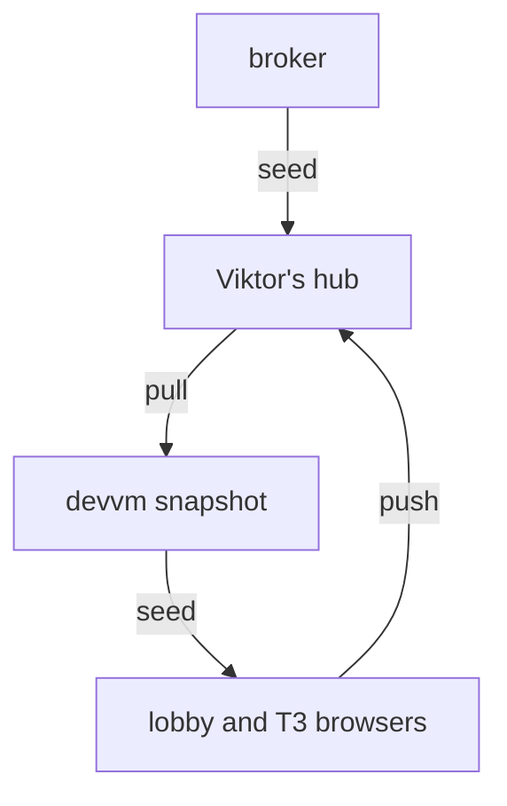

# Sign in once, per person, in every browser

Status: done, 2026-11-08.

## Goal

Each person signs in to a site once, and every browser their agents use is signed in too: the cluster browser, `homelab browser` pool jobs, each terminal-lobby session browser, and T3's browser on the devvm. A login made in any of those is kept and reused. Viktor's and emo's logins stay separate.

```stats
2 | hubs (Viktor, emo)
4 | kinds of browser per person
269 | cookies in Viktor's hub at rollout
0 | Viktor cookies reachable with emo's credentials
```

## Decisions (Viktor, 2026-11-08)

| question | answer |
|---|---|
| where existing logins live | the cluster browser at chrome.viktorbarzin.me |
| where "sign in once" happens | each person's own hub; any of their browsers works as a sign-in point |
| logins made inside agent browsers | pushed back to the hub and reused |
| emo | his own hub, headless (no live view), synced to all his browsers |
| T3 browser reload | only while it has no tab open |
| tv | keeps using Viktor's hub and cookies (accepted: emo deploys tv) |
| emo in the devvm docker group | kept for now (his agents convert documents with LibreOffice in Docker) |

## Design



The broker seeds each job from the caller's own hub. Each person's devvm snapshot is pulled hourly and after every push. Lobby browsers start from it; T3's browser gets it injected while it has no tab open. Both push new logins back to the hub. emo's side has the same shape on his own hub.

- **Hub API.** A sidecar beside each hub's Chrome serves `GET /api/snapshot` (read token) and `POST /api/cookies` (write token) on a LAN-only host per person (`chrome-hub`, `chrome-hub-emo`).
- **Merge rules** (`stacks/chrome-service/files/broker/cookie_merge.py`). A pushed cookie replaces the hub's only if it expires later. A sign-out at the hub leaves a tombstone that an old copy cannot pass. On protected domains (Google, Fidelity, chess.com, TripIt and others) a push only fills gaps. A push may replace a site's cookies only when it carries every cookie the hub holds live for that site. Session cookies and our own hosts are never taken, and nothing is deleted.
- **devvm clients** read `~/.config/chrome-hub/hub.json`, staged per person from Vault: the hourly snapshot refresh, terminal-lobby's tl-browser push (0.141.1, ADR-0047), and `t3-browser-cookies@<user>.timer`.
- **Broker and CLI.** The bearer picks the hub a seed comes from and the namespace a worker runs in. `homelab browser` (CLI v0.35.0) reaches the broker over the LAN-only `chrome-fleet-api` host.
- **Access.** chrome.viktorbarzin.me and chrome-fleet are users-only Authentik hosts (Viktor and svc-agent). emo's ServiceAccount may port-forward only in `chrome-emo`.

Full reference: `docs/architecture/chrome-service.md`, "One hub per person".

## What was measured on 2026-11-08

| check | result |
|---|---|
| Viktor's token on his hub / emo's token on Viktor's hub | 200 (269 cookies) / 401 |
| broker without a token / with emo's token | 401 / 200 with 0 cookies |
| emo port-forward in `chrome-service` / `chrome-emo` | no / yes |
| `homelab browser run` as Viktor / as emo | Amazon "Hello, Viktor" / emo's worker in `chrome-emo`, signed out |
| write-back: stale copy, newer login, Google `SID` replace | skipped `not_newer`, accepted, skipped `protected` |
| T3 default profile after sync | signed in to Amazon, chess.com and MyFitnessPal |
| tv leases and seeds after broker auth | 200 |

> [!IMPORTANT]
> T3 0.1.7 opens an agent's `preview_open` tab in an empty throwaway context unless the call passes `profileId: "default"`. Only the default profile carries the synced logins. Both people's agent rules say so.

## What changed along the way

- emo's hub is headless instead of a full neko copy, because any of his browsers can now be a sign-in point.
- The `site_incomplete` rule was added after a live test: a fresh context's anonymous Amazon cookies expired later than the hub's signed-in ones, and the later-expiry rule alone would have let them replace the hub's. The T3 sync was paused before anything was pushed. Clients now send their whole cookie set when anything changes.
- T3's sync writes hub session cookies with a 1-day expiry, because Chrome drops session cookies from its store at startup.

## Known limits

- tv keeps CDP and seed access to Viktor's hub, and emo deploys tv.
- emo is in the devvm `docker` group, which can read any file on the box, Viktor's hub config included.
- Profile backups on NFS hold cookies under Chrome's fixed Linux key. emo's hub has no NFS backup; its hourly snapshot is the restore source.
- localStorage logins are not synced; the harvester has never captured localStorage.
- A share guest who takes control of a lobby browser can push to the owner's hub; the lobby has no owner-versus-guest signal yet (ADR-0047 open question).
