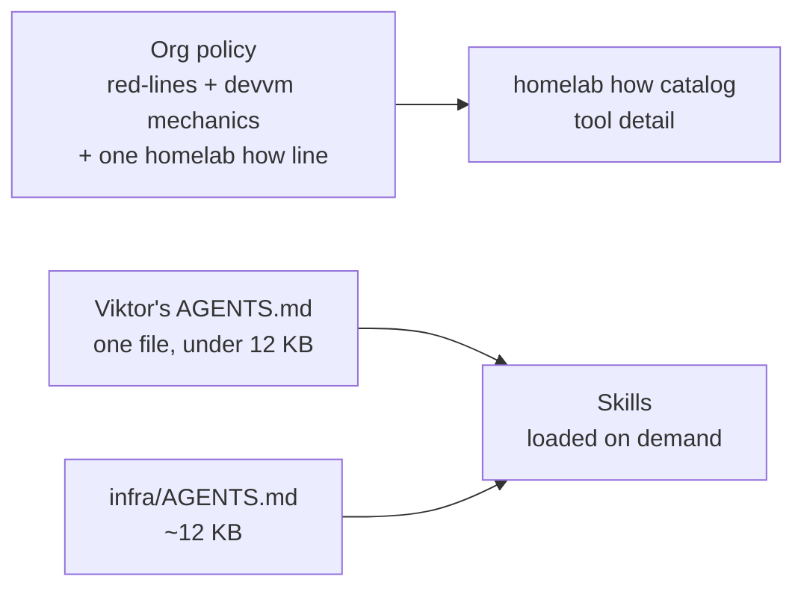

# Agent files cleanup, round 3

Status: approved 2026-11-09 (grilling with Viktor). Drafts next, then review, replay, landing.

## Goal

Less always-loaded text, with every remaining rule earning its place. A rule stays when session evidence shows it changes behaviour (the model gets it wrong without it, or Viktor corrected it). Preferences such as tone and zero-cost stay regardless.

This finishes the one-file rewrite decided on 2026-11-03.

## Where the bytes are today

| layer | loads | bytes |
|---|---|---|
| Org policy text (`claudeMd` in managed settings) | every session, every user | 8,401 |
| Viktor's `~/.agents/AGENTS.md` (core.md + personal.md) | every session | 33,463 |
| `infra/AGENTS.md` | infra sessions (30 of 58 interactive sessions since 2026-11-04) | 16,499 |
| Skill and agent descriptions | every session | ~12,400 |
| Memory-recall hook + beads/presence hook | every prompt | ~8,800 |

## What the usage data says

Window: 2026-10-04 to 2026-11-09, 681 sessions, from `homelab claude-sessions`.

| measure | count |
|---|---|
| `homelab memory store` / `recall` | 1,352 / 1,036 calls |
| `homelab work start` / `land` | 646 / 859 calls |
| `presence claim` | 691 calls (22 still on the removed `~/code/scripts/presence` path) |
| `homelab how` | 228 calls in 121 sessions |
| Recommended option picked in AskUserQuestion | 66% (1,670 of 2,531) |
| Corrections: "reuse what exists" | 34 |
| Corrections: "scope it down" (no rule covered it) | 17 |
| Corrections: "check it yourself / right device" | 13 |

Skills with zero use in the window: job-hunter, lesson-harvester, teach, wizard, and 9 of the 10 infra skills.

## Decisions

### Viktor's file

- One file, `~/.agents/AGENTS.md`, edited directly; `core.md`, `personal.md` and `work.md` go away and agents-sync stops building a hub.
- Grouped by when a rule applies. Target under 12 KB.
- Keeps: writing (chat and markdown merged, about 1.5 KB), ask-first, quality, "done means you watched it work" (shortened), a tiered planning rule plus a scope line, memory in about 5 lines, zero-cost, one publishing line, the browser tiers.
- Moves out: devvm mechanics (to the org policy), the publishing procedure (to publish-page), versioning (to the implement skill), the note about Matt's nightly skill refresh (to the writing-for-agents patch), the end-of-task memory prompt (to wrap-up only).
- Fixes stale content: presence path, monorepo mentions, TodoWrite.

### Org policy

- Red-lines (RBAC tier, Terraform only, git audit trail, OS access) plus devvm-wide mechanics in short form: worktree verbs, presence claims, waiting on conditions instead of sleeping, devvm changes through Ansible, holding the turn under T3.
- One line pointing at `homelab how`. Tool detail (logs and metrics, VPN egress, phones, browsers) lives in that catalog.
- The catalog entry for "wait for a deployment rollout" currently matches the tv deploy verb; it should name `homelab deploy wait`.

### infra/AGENTS.md

- Contributor Onboarding moves to a doc under `docs/`, one pointer line stays.
- Ingress paragraph becomes a pointer to `docs/agents/ingress.md`; the health-check line, the Home Assistant and brew preference lines go; one copy of the no-in-cluster-build rule; the 590 B `.claude/reference/known-issues.md` merges into `docs/agents/known-issues.md`.

### Hooks (Viktor's `~/.claude/settings.json`)

- Remove `homelab-memory-recall.py` and `agent-state-context.sh` from UserPromptSubmit. Recall and presence checks become agent-initiated.
- Remove the Orca hooks and uninstall Orca.
- Delete unregistered scripts: `beads-task-context.sh`, `beads-block-builtin-tasks.py`, `claudeception-activator.sh`.
- `auto-learn.py` stays.

### Skills

- Delete the 9 unused infra skills: add-user, disk-wear, extend-vm-storage, k8s-ndots-search-domain-nxdomain-flood, pfsense, setup-project, upgrade-state, uptime-kuma, plus the memory-overcommit-node-removal saved workflow. Fix references (infra AGENTS.md names setup-project; postmortem-todo-resolver's uptime-kuma line is dropped).
- Slash-only: job-hunter, lesson-harvester, teach, grill-me, grill-with-docs.
- Exclude Matt's wizard skill via the updater exclude list; delete `grill-with-docs.patch`, which duplicates `grilling.patch`.
- publish-page description cut to about 250 characters.
- Codex support stays.

## Validation

1. Viktor reviews the drafts section by section.
2. Blind replay: about 8 of Viktor's past corrections and 2 of emo's, each run against the old and new files by agents that see only the prompt and the files.
3. agentmd checker on the new files.
4. After landing: a fresh session loads the new files (checked by size and content), and the removed hooks no longer inject context.

## Open questions

- Whether auto-learn alone captures enough corrections without the per-prompt recall hook. The replay checks recall; capture quality is unmeasured.
- The usage window is about 5 weeks, so a skill used monthly or less can look unused.
