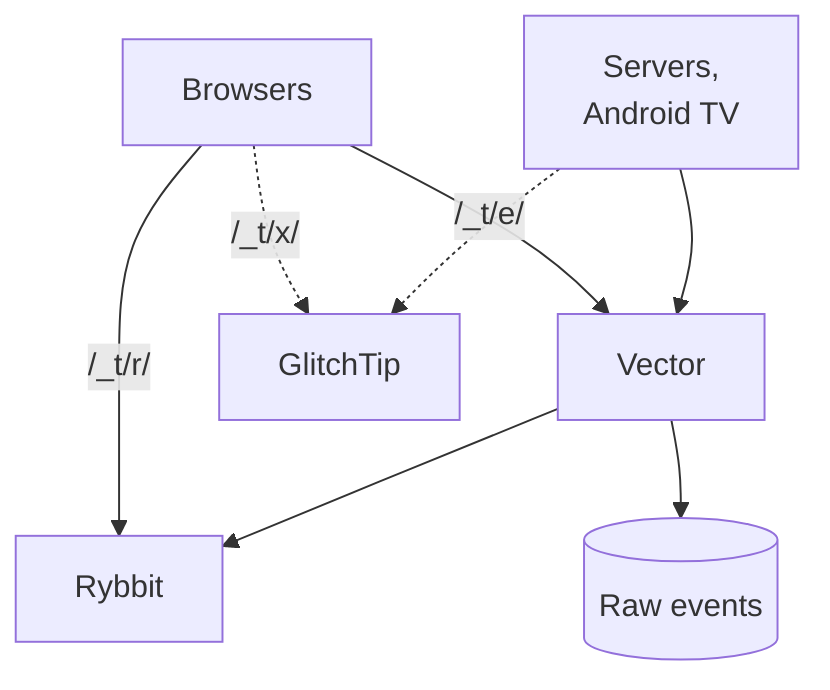

# Product analytics and the telemetry standard: design

Date: 2026-11-09. Decision record: [ADR-0041](../adr/0041-product-analytics-on-rybbit-behind-vector.md). Comparison: [2026-11-09-product-analytics-platforms.md](../research/2026-11-09-product-analytics-platforms.md).

This design adds one analytics pipeline covering every app we serve, and a shared standard for **Product events** and logs, so that new telemetry fits the stack without per-app decisions. The terms follow `CONTEXT.md` (Product analytics section).

## Shape

Browsers cover first-party apps (Rybbit script and Segment SDK) and third-party apps (Rybbit script injected by the Traefik plugin). Vector also sends rejected events to Loki.

| Part | What it does | Where it lives |
|---|---|---|
| Rybbit | Pageviews, product events, funnels, retention, replay, Persons | `stacks/rybbit` |
| Vector | Receives Segment-spec events, checks them, fans them out | `stacks/rybbit` (same namespace as its targets) |
| Raw events | Every accepted event as received, kept forever | ClickHouse database `events_raw` on Rybbit's ClickHouse |
| GlitchTip | Errors and crashes from the Sentry SDKs | `stacks/glitchtip` |
| Ingest path | `/_t/` on every host, routed to the three services above | one host-independent Traefik route in `stacks/rybbit` |
| Injection plugin | Adds the Rybbit script to HTML from third-party apps | `stacks/traefik/modules/traefik/` local plugin, run as a `websecure` entrypoint middleware |

## One standard, several transports

Each app imports one library per language and follows one naming and id scheme. The data still travels by more than one path, because the clients differ:

| Data | App code calls | Path |
|---|---|---|
| Logs (backends) | its usual logger | JSON on stdout, Alloy, Loki |
| Product events | `track`, `identify` | Segment SDK, `/_t/e/`, Vector, Rybbit and Raw events |
| Pageviews and replay (browser) | nothing, the script loads itself | Rybbit script, `/_t/r/`, Rybbit |
| Errors and crashes | nothing, captured automatically | Sentry SDK, `/_t/x/`, GlitchTip |

Browsers and the Android TV app can only send over HTTP. Logs stay on stdout so they survive a pipeline outage. Vector could later replace Alloy as the log shipper as well, giving one collector for everything. That is a separate change, because Alloy also ships logs from software we did not write.

## Ingest path

One Traefik `IngressRoute` matches `PathPrefix(/_t/)` on any host, at a priority above app routes. It carries no forward-auth, because beacons have to work for signed-out visitors. The middlewares strip the prefix as follows:

| Prefix | Target | Used by |
|---|---|---|
| `/_t/r/` | Rybbit backend `/api/` | the Rybbit browser script: `script.js`, track, identify, replay, tracking config |
| `/_t/e/` | Vector | Segment SDKs: `/v1/batch`, the browser SDK's `/t`, `/p`, `/i`, `/b` paths, and the settings file the Kotlin SDK fetches at start |
| `/_t/x/` | GlitchTip | Sentry SDKs, through a DSN whose path is `/_t/x/<project>` |

Backends inside the cluster send to Vector's Service directly, so their events skip the public route.

## Product event standard

Events use the [Segment spec](https://segment.com/docs/connections/spec/) and are sent with Segment's open-source SDKs (MIT): `@segment/analytics-next`, `@segment/analytics-node`, `analytics-python`, `analytics-go` and `analytics-kotlin`, each pointed at the Ingest path.

| Field | Rule |
|---|---|
| `type` | `track`, `identify`, or `screen` (Android). Browser pageviews come from the Rybbit script, so the browser SDK does not send `page` |
| `event` | `noun.past_verb`, lower case, matching `^[a-z][a-z0-9_]*\.[a-z][a-z0-9_]*$`, e.g. `recording.started`, `trip.created` |
| `userId` | The Person's Authentik hashed user id (`uid`) once signed in, omitted before. It equals the OIDC `sub` under Authentik's default `hashed_user_id` mode (tv, every `tanstack_app`). tripit's provider issues the email as `sub`, so tripit sends `uid` |
| `anonymousId` | Browser and Android: the SDK's own id, sent on every event, so Rybbit can merge it into the Person at `identify`. In the browser it is the Rybbit script's visitor id (localStorage `rybbit-visitor-id`). Server events sent while handling a browser's request: that visitor id, read from the request's `X-Visitor-Id` header. Server events with neither: omitted when `userId` is set, otherwise a stable id (`server:<app>` by default). Never a new random id per event, which Rybbit would count as a new person |
| `X-Visitor-Id` | Request header the browser sets on same-origin API calls to its Rybbit visitor id (`visitorHeaders()` in `@viktorbarzin/telemetry`). It reaches `anonymousId` and the raw events copy. Rybbit itself does not use it when the event also carries a browser User-Agent and IP: Vector then leaves `anonymous_id` out, so Rybbit gives the event the same IP and user-agent fingerprint as that browser's pageviews (decided 2026-11-12, because the Rybbit script never sends its visitor id with pageviews) |
| `context.ip`, `context.userAgent` | Server events sent during a request carry the person's IP (`X-Real-Ip`, else the first `X-Forwarded-For` entry, else the peer) and User-Agent, which Vector maps to Rybbit's `ip_address` and `user_agent` for country and device. Vector forwards a User-Agent to Rybbit only when it is a browser's (`Mozilla/...`). An SDK or HTTP-client agent (`analytics-python`, `okhttp` on Android TV, `Python-urllib`) matches Rybbit's bot patterns, so Vector sends none and the event keeps its stable `anonymousId`. The raw events copy keeps whatever arrived |
| `properties` | snake_case keys, at most 2,048 characters as JSON (Rybbit's limit) |
| `context.page.url` | Set by the browser SDK. Server and Android events set `context.app` instead |
| write key | One per app, in Vault at `secret/rybbit` in the `write_keys` JSON, keyed by app. Vector derives `app` from it and ignores any `app` the client sends |

Vector rejects an event, and sends it to Loki under `{job="event-pipeline", outcome="rejected"}` with the reason, when:
- the write key is unknown;
- the name or a property key breaks the pattern;
- the properties are too long;
- the browser host is not a production host (`*.viktorbarzin.me` and `viktorbarzin.me`).

The client libraries implement the server side of this from telemetry 0.2.0 (Python `viktorbarzin-telemetry` 0.2.0, Go `go/v0.2.0`) and `@viktorbarzin/telemetry` 0.2.0: Python `RequestContextMiddleware` (ASGI) or `request_context()`, Go `RequestMiddleware`, TypeScript `withRequestContext()`. Up to 0.1.0 the Python and Go libraries gave every event without an anonymousId a new uuid4, so each anonymous backend event counted as a new person. Every Python app moved to 0.2.0 on 2026-11-10 (tv, tripit, wrongmove, offline-reader, learning, health, fire-planner, priority-pass, nextcloud-todos); events recorded before that keep their per-event ids. The TypeScript apps moved on 2026-11-12, onto 0.2.1, which also holds a new visitor's first browser events until the Rybbit visitor id exists, so they don't carry a random id. terminal-lobby moved to Go 0.2.0 the same day; it keeps a per-user hash instead of `server:terminal-lobby` as the fallback id, so different users' pre-sign-in events stay apart.

## Log standard

Each app writes one JSON object per line to stdout. The existing Alloy collector ships it to Loki. Field names follow the OpenTelemetry log data model and semantic conventions. Attributes we add are snake_case.

This replaces the earlier contract in app-kit ADR-0001 (`ts`, `level`, `logger`, `msg`, `exc`), which tripit, offline-reader, tasks and alexa-assistant use today. No Loki rule or dashboard reads those field names, so they change in the rollout without breaking a query. `@viktorbarzin/log` moves to the fields below in a major version (app-kit ADR-0002).

| Field | Meaning |
|---|---|
| `timestamp` | RFC 3339 with nanoseconds, UTC |
| `severity_text`, `severity_number` | `DEBUG` 5, `INFO` 9, `WARN` 13, `ERROR` 17, `FATAL` 21 |
| `body` | The message |
| `service.name`, `service.version` | App and release |
| `deployment.environment.name` | `production` or `dev` |
| `trace_id`, `span_id` | From the active OTel span, when there is one |
| `enduser.id` | The Person's Authentik `sub`, when known |
| other keys | snake_case attributes, e.g. `channel_id`, `duration_ms` |

The per-language libraries set these fields, so app code calls its usual logger.

## Errors

Apps use the Sentry SDKs with a DSN per app pointing at `/_t/x/<project>` on their own host. Retention is GlitchTip's default of 90 days. Releases are tagged with the app version, so errors group by release. Android uploads its ProGuard mapping at build time.

## Client libraries

| Language | Home | Contents |
|---|---|---|
| TypeScript (browser, Bun/Node) | `app-kit`, `@viktorbarzin/telemetry` | Rybbit script tag, Segment client with our host and inline settings, Sentry init, JSON logger. On by default in new app-kit apps |
| Python | `telemetry` repo, `viktorbarzin-telemetry` | Segment client config, Sentry init, `logging` JSON formatter |
| Go | `telemetry` repo, `telemetry/go` | Segment client config, Sentry init, `slog` JSON handler |
| Kotlin | `telemetry` repo, `telemetry-android` | Segment client config (our settings host, telemetry off), Sentry init |

The libraries are public, as app-kit is. The TypeScript packages publish through app-kit's release workflow to Forgejo's npm registry, which the apps install from, and to npm as a public mirror (app-kit ADR-0003, 2026-11-12). The npm mirror is paused until the owner's npm account is unlocked. The Python package publishes to PyPI through trusted publishing from the `telemetry` repo's GitHub mirror. The Go module is fetched from the mirror. JitPack builds the Android library from tags. The code holds no secrets: Write keys and DSNs come from each app's configuration.

## Settings

| Setting | Value |
|---|---|
| Event retention | Forever, in Rybbit and in the raw table |
| Replay retention | 90 days |
| Replay masking | Password inputs only (`data-replay-mask-all-inputs="false"`, `data-replay-mask-input-options='{"password":true}'`) |
| Error retention | 90 days |
| Access | Rybbit and GlitchTip behind Authentik, for Viktor and the infra admins |
| Backups | Rybbit's ClickHouse (events, replays, raw table) and GlitchTip's Postgres go to the offsite copy |
| Consent | Measurement is assumed on visit. There is no banner or notice |

## Third-party apps

The injection plugin adds `<script src="/_t/r/script.js" data-site-id="<hosted>" defer>` before `</head>` of HTML documents. It acts only on `GET` requests that ask for HTML and get a `text/html` 200 back.

It runs as an entrypoint middleware on `websecure`, as CrowdSec and compression do, so every host is covered from one place and a new service needs no change. Putting it in `ingress_factory` instead would change a module about 100 stacks use, and CI would then apply all of them in turn. The plugin filters hosts itself:

- `excludeHosts` lists the denylisted services: Authentik, Vault, Vaultwarden, the Kubernetes dashboard, Proxmox, OPNsense, Headscale, and APIs that serve no HTML.
- First-party apps load the script themselves, so they opt out with `<meta name="analytics" content="sdk">` in their HTML or an `X-Analytics: sdk` response header. The plugin strips that header before it reaches the browser.
- `includeHosts` limits the plugin to named hosts for a staged start. It is cleared once the first hosts work.

## Rollout

1. **Platform.**
   - Rybbit gets Redis, the 90-day replay TTL, the two sites, and an ingest key.
   - Add Vector and the raw table.
   - Add GlitchTip.
   - Add the Ingest path route.
2. **Libraries.** The TypeScript, Python, Go and Kotlin libraries.
3. **tv test.** Wire tv's web app, backend and Android TV app, then check that:
   - web, backend and Android TV events reach Rybbit and the raw table;
   - replay records with only password fields masked;
   - an anonymous visitor who signs in becomes one Person;
   - retention counts Persons, not sessions;
   - one shared site gives usable per-app views by hostname.

   Passing those checks ends the test.
4. **Every other app.**
   - tripit (with tripit ADR-0076), terminal-lobby (its `TLEVENT` events move to the standard), the remaining first-party apps, and the static sites.
   - The injection plugin for third-party apps.
   - Logs moved to the standard.
5. **Clean-up.** Retire the duplicated Loki dashboards for events that moved. tv's viewing tables stay, because tv features read them.

## Rollout status (2026-11-14)

| App | Server events | Browser | Errors | Logs on the standard | App ADR |
|---|---|---|---|---|---|
| tv (pilot, includes the Android TV app) | live | live; `link.shared`, `cast.started`, `quality.chosen` | server | yes | 2026-11-09-tv-sends-product-events |
| tripit | live | live; `search.opened`, `offline_copy.toggled`, `tour.started` | server | yes (keeps its formatter and secret scrubbing) | 0077 |
| terminal-lobby | live on Go 0.2.0 (v0.142.3, 2026-11-12); events carry the browser, and the visitor IP since the lobby API routes got `traefik/real-ip` | live | live | yes | 0048 |
| offline-reader | live | `download.completed`, `download.interrupted`, `page.read` | server | yes | 0007 |
| learning | live | `reference.opened`, `routine_guide.opened`, `progress.queued` | server | yes | 0005 |
| health | live | `plate_calculator.opened`, `rest_timer.skipped`, `rest_timer.adjusted` | server | yes | 0014 |
| fire-planner | live | `scenario_tab.opened`, `info_tip.opened` | server | yes | 0002 |
| wrongmove | live | live; `user.signed_in` (Authentik sign-ins; the server sends passkey ones), `view_mode.changed`, `swipe_review.opened`, `rightmove_listing.opened` | server | yes | 0004 |
| priority-pass | live | `pass.selected`, `pass.shared`, `pass.downloaded` | server | yes | 0001 |
| tasks | `account.connected`, `task.created`, `task.completed`, `list.created` | `smart_view.opened`, `completed_tasks.toggled`, `search.started`, `task_sheet.opened` | server and browser | yes (`@viktorbarzin/log` 1.0) | 0005 |
| alexa-assistant | `turn.completed`, `person.paired`, `result.delivered`, `pairing.started` (voice events use `alexa:<person>`) | `access_requests.opened`, `unknown_voice.shown`, `status.load_failed` | server and browser | yes | 0004 |
| reels (repo trip-reel) | `library.connected`, `trip.created`, `cut.created`, `render.requested` (2026-11-14) | `preview.played`, `render.played`, `render.downloaded` | server and browser | yes (`@viktorbarzin/log` 1.0); the Python worker sends nothing | 0002 |
| cloud (console only, not the reconciler) | `project.created`, `plan.applied`, `project.deleted`, `access_token.created` (2026-11-14) | pageviews and replay; no browser events | server and browser | yes | 0007 |
| vpn-portal | `wg_device.registered`, `wg_device.revoked`, `wg_device.rotated`, `tailscale_device.enrolled` | `subscription.copied`, `client_app.opened`, `proxy_config.copied`, `wg_config.exported` | server and browser | yes | 2026-11-10-telemetry-in-the-browser |
| plotting-book | `account.registered`, `project.created`, `writing_session.logged`, `share_link.created` | `project.exported`, `scene_filter.toggled`, `outline_mode.switched` | server and browser | yes | 2026-11-10-telemetry-in-the-browser |
| interview-prep (no server; nginx serves the browser settings) | n/a | `lesson.played`, `lesson.completed`, `scene.selected` | browser | n/a | 2026-11-10-telemetry-in-the-browser |
| nextcloud-todos (no web UI; Person id from config) | live | n/a | live | yes | 0001 |
| blog, kms, pages | n/a | pageviews (pages: on each page's next publish) | n/a | n/a | n/a |
| Third-party apps (Forgejo, Immich, Home Assistant, Paperless, CyberChef and the rest) | n/a | pageviews through the injection plugin, `hosted` site | n/a | n/a | n/a |

Every browser above runs `@viktorbarzin/telemetry` 0.2.1 from Forgejo's npm registry. "Server" under Errors means GlitchTip gets backend errors only; those frontends had no browser Sentry before, and none was added.

Until 2026-11-12, Segment events and pageviews did not share a Rybbit `user_id` for a visitor who was not signed in. The Rybbit script (v2.9.2, and upstream master on 2026-11-12) keeps `rybbit-visitor-id` only for feature flags and experiments, and pageviews get an IP and user-agent fingerprint, while events sent with the visitor id hashed it instead (terminal-lobby: events `5d421c561c62`, pageviews `d867526b0b51`). Vector now leaves `anonymous_id` out of any event with a browser User-Agent and IP, so both get the fingerprint. The owner chose this over patching Rybbit's script and server. The cost: an anonymous visitor who changes network becomes a new Rybbit user, as their pageviews already did. Signed-in visits join through the identified user id. Android and background events keep their stable id.

The server and browser events were checked by sending them by hand with real headers, and the served bundles were read. No real signed-in browser visit has been checked since the 2026-11-12 changes. Rybbit files headless browsers under `bot_events`, so automated checks never reach the counted tables; a signed-in visit settles it.

## Open questions

- Whether Vector's `http_server` answers before or after the disk buffer write. This decides how much an outage can lose, and the tv test measures it.
- Android TV behaviour of the Segment and Sentry SDKs. Neither documents TV devices.
- Third-party apps with nonce-based Content Security Policy will block the injected script. Those apps keep server-side counts only.
