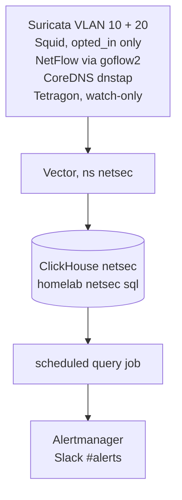
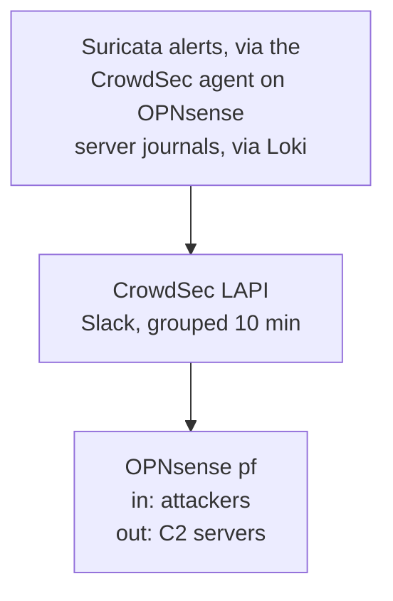

# Network intrusion detection and prevention

Status: approved by Viktor on 2026-11-10; executing. Phase 0 (Suricata tuning) and phase 1 (store and shipper) done; as-built in `docs/architecture/network-security-monitoring.md`. Grilled with Viktor on 2026-11-10 (memory #17435); revised the same day after two blind challenger reviews. Research: `docs/research/2026-11-03-network-ids-options.md`, ADR-0038.

## Goal

Inspect Sofia traffic for malicious flows, keep what the IDS sees queryable in ClickHouse, tell us in Slack, and turn detections into firewall bans. Built from parts already running. OPNsense became the production edge firewall on 2026-11-10 (ADR-0038 amendment, `7979f6d36`); pfSense VM 101 stays stopped as the rollback.

## Decisions

| # | Area | Decision |
|---|---|---|
| 1 | DPI | Suricata protocol metadata: DNS, TLS names and JA4, HTTP hosts. No Zenarmor or ntopng: neither exports to ClickHouse for free |
| 2 | Prevention | Suricata stays in IDS mode. Alerts become CrowdSec bans, enforced by OPNsense in pf tables. No inline IPS |
| 3 | Inbound bans | Outside addresses that attack us, from TCP alerts only (`crowdsecurity/suricata` hub scenarios). No UDP-based bans: spoofed UDP could ban our WireGuard peers |
| 4 | Destination bans | Only abuse.ch C2 hits (Feodo Tracker, SSL Blacklist) when one of our hosts is the source. They go into a separate list that only a new OPNsense outbound rule uses; Traefik, node and host bouncers never see them, and IPv6 widening skips them. Other malware hits alert without banning. Home devices are never banned |
| 5 | Ban start | Every scenario on every agent runs in CrowdSec simulation for 2 weeks; Viktor reviews the would-be bans; then real bans |
| 6 | Data | Alerts 365d, dns/tls/http 30d, NetFlow 14d, proxy URLs 30d, pod DNS queries 30d, Tetragon process and connection events 30d. No Suricata flow events |
| 7 | Store | Database `netsec` on the existing `claude-sessions` ClickHouse (encrypted SAS). Not backed up: losing the disk loses history only, and no browsing data lands on NFS or offsite |
| 8 | Access | Viktor only. No Grafana datasource, because every Authentik user is a Grafana Viewer and OSS Grafana cannot restrict a datasource. Queries through `homelab netsec sql` |
| 9 | Notify | Slack #alerts for everything. Bans grouped into one message per 10 minutes by the CrowdSec Slack plugin; home-device malware alerts post at once from a scheduled query job through Alertmanager (`lane=security`) |
| 10 | Shipper | Its own Vector Deployment in `stacks/netsec`, same image and config pattern as rybbit's `event-pipeline` (ADR-0041). Viktor first chose to share `event-pipeline`, then reversed after the review showed a netsec fault would stop app analytics |
| 11 | No host agents | Nothing is installed on any server OS or personal device (Viktor, 2026-11-10). Tetragon is the one exception in the cluster: a watch-only Helm DaemonSet, like the CrowdSec node bouncer, added back because nothing else sees a compromise inside a pod before it reaches the network. The central CrowdSec reads server journals that already reach Loki (Proxmox, devvm, rpi-sofia, k8s nodes); OPNsense does the blocking; CoreDNS query logs in ClickHouse show which pod looked up a name. Given up: the exact program per connection, blocking an attacker already inside, and Windows VM 300 (it ships no logs) |
| 12 | Decryption | Squid SSL bump on OPNsense for an `opted_in` alias. URLs only, no virus scanning |
| 13 | Sites | Sofia only |
| 14 | Interfaces | Suricata inspects lan (VLAN 10) and opt1 (VLAN 20) only, not WAN, so each internet flow is seen once with its inside address. On 2026-11-10 the same alerts appeared on both `vtnet0` and `vtnet2` (7,034 alerts in 24h). VLAN 10 to 20 flows still appear twice and are merged by `community_id` at query time |
| 15 | VLAN 30 | No Suricata: the camera may reach only NTP on the firewall, so its traffic is video. Instead a Slack alert fires on any firewall block of traffic from VLAN 30, the sign of a tampered camera |

## Pipeline

Detect and store:

Block and notify:

## What it sees and what it does not

| Path | Seen |
|---|---|
| Internet to direct (non-proxied) hosts, IPv4 and HE IPv6 | yes, on opt1 after the port forward, with the real source |
| Mail (25, 465, 587, 993) | ends at HAProxy on the firewall, so Suricata sees the firewall as the source; CrowdSec's postfix and dovecot scenarios keep the real address |
| The firewall's own traffic | no: WAN is not inspected |
| Proxied hostnames | no: they arrive inside the cloudflared tunnel as TLS to Cloudflare. Traefik's CrowdSec plugin keeps covering them |
| Homelab hosts to the internet, and between VLANs | yes, on lan and opt1, with the inside address |
| Road-warrior WireGuard (ends in a pod) and node-to-node traffic | no: east-west. Goldmane records it by workload, without external addresses |
| Pod DNS | reaches the firewall as the node's address; CoreDNS query logs name the pod |
| DoH, DoT from clients, ECH | names hidden; flows still recorded |
| Home LAN devices behind the AX6000 | no, until open question 1 is settled |

## Phases

Every OPNsense change lands on the production firewall: `--check --diff` first, applied in a quiet hour, verified, with the listed rollback. Each phase is verified before the next.

### 1. Store and shipper
- `netsec` database, a writer user with a real quota (rows and bytes per hour) and a reader user for Viktor, tables `eve` (typed columns plus JSON, TTL per event type, IPv6 columns), `flows`, `proxy`, `dns_queries`, on the claude-sessions instance (`stacks/claude-sessions`). `backup.sh` stays `DATABASE claude` only.
- `stacks/netsec`: a Vector Deployment with memory buffers (disk buffers jammed on 0.61.0, `stacks/rybbit/files/vector.yaml:294`), a TCP input on an internal LoadBalancer with source ranges limited to OPNsense, and a NetworkPolicy so only OPNsense, goflow2 and CoreDNS reach it.
- goflow2 writes flows to a file on a shared emptyDir; a Vector sidecar in the goflow2 pod tails it and forwards to the netsec Vector.
- `homelab netsec sql` verb next to `homelab claude-sessions sql`.
- Verify: rows arrive in `flows` from live NetFlow; `homelab netsec sql` returns them.
- Rollback: delete the stack; goflow2 returns to stdout.

### 2. Suricata metadata off the box
- **Done 2026-11-10.** As built: `docs/architecture/network-security-monitoring.md`, phase 2. Deviation: `eve-meta.json` has no `anomaly` (Suricata allows one anomaly logger) and logs DNS responses only.
- Done 2026-11-10: Suricata inspects `lan,opt1` only, and 16 own-traffic signatures are off (runbook `docs/runbooks/opnsense.md`, "Suricata tuning").
- A conf.d file that restates all four stock outputs (eve.json, syslog eve, stats, syslog) and adds `eve-meta.json`. A repeated `outputs:` key replaces the template's list, so the playbook asserts with `suricata --dump-config` that all five exist.
- A `newsyslog.conf.d` entry rotates `eve-meta.json`.
- A syslog-ng `conf.d` file tails it and sends raw JSON lines over TCP to Vector, avoiding the 8 KB syslog limit.
- All in `playbooks/tasks/opnsense/`; `--check` must stay a no-op after apply.
- Verify: `dig icanhazip.com @10.0.10.1` from the devvm (testmynids.org is parked) lands in `netsec.eve`; dns and tls rows arrive; Intrusion Detection > Alerts and Loki still show the alert.
- Rollback: remove the two conf.d files and reconfigure the IDS.

### 3. Alerts into bans, in simulation
- Done 2026-11-10: live in simulation; as-built in `docs/architecture/network-security-monitoring.md` "Phase 3", operations and the phase 6 review in `docs/runbooks/network-ids.md`. Deviations: the separate C2 list is served by `crowdsec-c2-mirror` (crowdsecurity/blocklist-mirror) into an OPNsense URL-table alias refreshed about every 5 minutes, because the os-crowdsec bouncer fills only one pair of tables; C2 decisions are isolated by decision type `c2-block`, not by origin.
- LAPI allowlist in Terraform, copied from the existing parser whitelist (`stacks/crowdsec/modules/crowdsec/main.tf:320-370`: private ranges, 100.64/10, 172.16/12, Sofia egress 176.12.22.76, Viktor's work ranges) plus `2001:470:6f:43d::/64`, `2001:470:6e:43d::/64`, the HE endpoint, Cloudflare, upstream resolvers, GitHub and ghcr. 100.64/10 joins Suricata's HOME_NET.
- `simulation: true` globally on the OPNsense agent, set by the playbook and checked after every reconfigure.
- os-crowdsec agent on, with an `acquis.d` file for `eve.json` (`type: suricata-evelogs`) and the `crowdsecurity/suricata` collection.
- Custom scenario for C2 destinations with its own origin; a new OPNsense alias fed only by that origin; an outbound pf rule on lan and opt1. The Traefik plugin, node bouncers and host bouncers filter that origin out; `ipv6-ban-widen.sh` skips it.
- Loki ruler alert (`lane=security`) on any `filterlog` block with VLAN 30 (`vtnet3`) as the source interface. First check that the default-deny rule logs its blocks on OPNsense.
- CrowdSec Slack plugin with a 10 minute group wait. Scheduled query job (CronJob in `stacks/netsec`) posts home-device malware alerts to Alertmanager every minute.
- Verify: the test alert gives a simulated decision and a Slack message; nothing reaches pf.
- Rollback: agent off in the playbook; decisions expire.

### 4. Server logs and pod DNS, no agents
- The central CrowdSec gets a Loki acquisition (`source: loki`) for the server journals already shipped: `job="sshd-pve"`, `job="pve-journal"`, `job="devvm-journal"`, `job="systemd-journal", host="rpi-sofia"`, and the k8s node journals. Its sshd and linux collections parse them; decisions reach OPNsense like any other.
- CoreDNS's ConfigMap is adopted into Terraform with an `import {}` block and gains the stock `dnstap` plugin, streaming over TCP to the netsec Vector's `dnstap` source (TCP mode: confirm against the Vector 0.61 docs before building). Vector writes `netsec.dns_queries` (30d) with the client pod IP, name and answer.
- Pod names come from Prometheus `kube_pod_info` (pod IP history) at query time; no custom mapping service.
- `stacks/k8s-version-upgrade/scripts/upgrade-step.sh` checks after each kubeadm upgrade that the `dnstap` line survived.
- Verify: an ssh brute force against the devvm from a test address gives a simulated decision; `dig` of a test name from a throwaway pod appears in `netsec.dns_queries` with that pod's name.
- Rollback: remove the acquisition; restore the stock Corefile.

### 4b. Tetragon, watch-only
- New `stacks/tetragon`: the Cilium Tetragon Helm chart through Terraform, no enforcement policies. Two tracing policies: process starts outside system namespaces (`kube-system`, `calico-system`, `monitoring`), and TCP connects to addresses outside 10.0.0.0/8, 192.168.0.0/16 and our IPv6 prefixes. Pod, container, binary, arguments and parent on every event.
- JSON export tailed by a small Vector container in the DaemonSet pod, forwarded to the netsec Vector, `netsec.tetragon` (30d).
- Measured on node1 first (memory, CPU, events per minute); rolled to all nodes only if workers keep their headroom.
- One-week baseline, then alert rules through the scheduled query job.
- Verify: `kubectl exec` into a throwaway pod, run `sh -c 'curl -s https://example.com'`; the exec and the connection appear with pod and binary.
- Rollback: delete the stack.

### 5. Decryption for opted-in machines
- os-squid in transparent mode, port forward of TCP 443 only from `opted_in`, UDP 443 blocked for that alias.
- Root CA generated and kept off the cluster and off the firewall; the firewall holds a 1-year intermediate (path length 0). The no-bump list, not name constraints, keeps banking and pinned apps out.
- No-bump list: Apple, Google, Microsoft Update, banking, messaging, password managers.
- Squid JSON access log without Referer, to Vector, `netsec.proxy` 30d. Query strings stay stripped.
- The alias starts empty; one throwaway VM proves it.

### 6. Go-live and enforcement
- Simulation clock starts when phase 3 lands. After one hour of phase 2 data, measure `eve` volume and resize the claude-sessions PVC if the estimate (30-150 MB/day) is off.
- After 2 weeks: review the would-be bans with Viktor, tune, switch simulation off on every agent.

## Production checks

Prometheus alerts, routed to the security lane:
- no rows per source for 30 minutes (eve, flows, proxy, dns_queries, tetragon)
- netsec Vector sink errors and buffer fill
- OPNsense: Suricata, Squid, os-crowdsec agent or bouncer down, via a node_exporter textfile collector; root filesystem above 80 percent
- OPNsense agent not pushing to the LAPI; OPNsense bouncer not pulling
- intermediate CA expiring within 30 days
- claude-sessions ClickHouse disk above 80 percent; CoreDNS still has its `dnstap` line after a kubeadm upgrade; Tetragon DaemonSet not ready

Docs: new `docs/architecture/network-security-monitoring.md` and `docs/runbooks/network-ids.md`; updates to `docs/architecture/networking.md`, `docs/agents/security.md`, `docs/runbooks/opnsense.md`, `.claude/reference/service-catalog.md`.

## Risks

| Risk | Mitigation |
|---|---|
| A false positive bans something we rely on | Full allowlist first, global simulation for 2 weeks, review before enforcing |
| A change on the production firewall breaks routing | `--check --diff`, quiet-hour applies, per-phase rollback, pfSense VM 101 as the last resort |
| An OPNsense upgrade changes the Suricata template | Playbook asserts all five outputs after every run |
| A C2 address on a shared cloud blocks something we use | Destination bans only from abuse.ch C2 lists, outbound at OPNsense only, with the CDN allowlist |
| The claude-sessions ClickHouse (4Gi limit) slows under netsec load | Writer quota; measure after phase 2; split into its own instance if needed |
| The Squid plugin has no named maintainer | Confined to `opted_in`; a dead Squid alerts and affects only those machines |
| PII: every site each device visits | Encrypted storage, no Grafana, no backups, Viktor-only user, TTLs |

## Open questions

1. **Home LAN coverage.** Home devices sit behind the AX6000 and never cross OPNsense. Options: OPNsense as the edge router with the AX6000 as an access point; a separate inspected Wi-Fi VLAN; mirroring the internet link (no per-device attribution); DNS logging only. Viktor is discussing it with emo.
2. **Opted-in machines.** Which machines trust the interception certificate. Mostly depends on question 1.
3. **Tetragon alert rules.** Which process events page Slack (for example a shell started by a web server) is decided after a one-week baseline, so the rules match our workloads.
