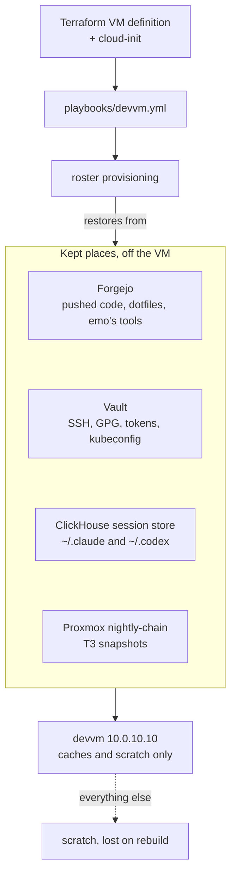

# Disposable devvm

Status: executing. Approved 2026-11-11 from a grilling session with Viktor;
built the same day by a workflow of eight workstreams with adversarial live
review (results below, under "Progress").

The devvm (10.0.10.10) should be deletable and rebuildable from code in about
an hour, losing only scratch. Today a rebuild means the playbook plus a
hand restore from the nightly `/home` copy, and anything outside `/home` is
lost (inventory 2026-11-11: T3 snapshots in `/var/backups`, a local Postgres,
an NFS export, undeclared packages, emo's watchers).

> [!IMPORTANT]
> Scratch includes work an agent has not pushed. Agents push finished work; in-progress work may be lost on a rebuild.

All three users are in scope: wizard, emo and ancamilea. Scratch is anything
not in a kept place.

## Kept places
- Code: Forgejo. Agents push finished work; in-progress work may be lost. No
  automatic backup refs.
- Agent state: ClickHouse session store, extended to ingest everything under
  ~/.claude and ~/.codex except credentials and caches (history.jsonl, plans,
  tasks, teams, todos, file-history, remote/, Codex sessions; raw transcripts,
  subagents and tool results are already there), plus a restore command that
  writes a user's ~/.claude back so `claude --resume` works.
- T3 threads: the existing nightly snapshot in /var/backups/t3-state is pulled
  off the VM by a new nightly-chain step on the Proxmox host; provisioning
  restores the newest on a rebuild.
- Memory: homelab memory (unchanged).
- Credentials: Vault under `workstation/<user>`, restored by provisioning (SSH
  keys, GPG keys, Git PATs, gh, rclone, gcloud, docker). Loose secrets in
  ~/code (keys.txt, tmp_id, git-crypt key copy) and meshcentral-data keys:
  checked against Vault, missing ones stored, local copies deleted.
- Dotfiles: provisioning runs chezmoi apply; the admin kubeconfig comes from
  Vault instead of GPG. wizard's user units (lobby-local, tmux,
  tmux-plugin-update) move into the dotfiles; the hourly infra git-pull cron
  is dropped. vault-token-renew is installed for every user by provisioning.
- No weekly "outside kept places" report.

## Scratch (lost on rebuild, nothing migrated)
All of wizard's data folders (reel-archive-countries, ha-london-recovered,
vault-audit-archive, actualbudget dumps, dab-downloader, ff, src/t3code,
immich-repro, rpi-london, 2023 mysql datadir), loose files and folders in
~/code, /var/lib/clipboard-store contents.

## Machine
- Now, ahead of the rest: remove the /home/wizard NFS export (rw to *),
  stop and disable nfs-server; record the removal in the playbook.
- Undeclared packages, binaries, units: fold into playbooks/devvm.yml if used,
  remove if not; --check stays a clean no-op. The clipboard-store writer is
  declared or removed.
- Local Postgres (finance, trading_dev): dropped, server removed.
- Docker containers tl-fallback and paperless-mcp: removed.
- The VM is defined in Terraform (disk, CPU, RAM, cloud-init that runs the
  playbook), pinned to 10.0.10.10. The live devvm is NOT replaced; the
  definition is used for drills.

## Unpushed work today
Reviewed repo by repo (terminal-lobby ~12 real commits + dirty worktrees,
infra 6 commits and dirty worktrees, interview-prep-app, Plotting-Your-Dream-Book,
stashes in 4 repos, insta2spotify and immich-repro dirty files, cloud with no
remote). dot_files' 158 are stale history, not work.

Done 2026-11-11. Pushed as branches, nothing merged and no master touched:
- terminal-lobby `wizard/pane-ownership` (3 commits plus the uncommitted
  claim work as one wip commit) and `wizard/inline-chip-art` (the
  uncommitted work as one wip commit). Both were rebuilt on the rewritten
  history, because their local copies sit on the pre-rewrite lineage, and
  pushing that would bring back the three plan docs purged on 2026-09-17
  and the old employer author address.
- infra `wizard/tripit-country-days-cron` (the worker-label fix is not on
  master), `wizard/immich-restore-runbook`, `wizard/ha-london-backup-upgrades`
  and `wizard/bb-stale` (the one untracked test, as a wip commit).
- interview-prep-app `wizard/render-generated-dsl` (2 commits from local master).
- agent-conductor `wizard/de-meta-rust-wip` (the demeta-baseline-check stash).
- cloud: new private Forgejo repo `viktor/cloud`, master pushed.

Judged scratch and left in place: the other terminal-lobby branches (their
only unique commits are the purged docs, or already on master by subject),
its stash and agent-delegation's glossary edit (both on master already), infra
`wizard/ebooks-calibre-trusted` (on master), Plotting-Your-Dream-Book (per-user
beads and gitleaks hook drift), the broker-sync stash (landed on master as the
HTML table fallback), the finance stash (a 2023 experiment), insta2spotify
(3050 deletions of node_modules files that were tracked by mistake),
immich-repro/src (a sparse upstream checkout plus 10 files byte-identical to
upstream v3.3.5), and two orphaned T3 checkouts of the dissolved monorepo root
under ~/.t3/worktrees/code (no edits since checkout).

## emo (changed without asking him first)
- Retire: panel115-watch, camera-stream-watch, led_report, vermont-mon,
  valia-backup-cleanup (when done), printer-price watcher, PAI-issue watcher,
  userspace Tailscale.
- intercom-watch becomes a ha-sofia automation (check, ISAPI reboot via
  rest_command after ~15 min offline, push to emo); ha-sofia's address joins
  the Vermont allowlist (OPNsense alias + rpi-sofia netmap). Verify the B4
  accepts the ISAPI reboot first.
- Hand tools go into his vermont-device-configs repo, cloned by provisioning.

Done 2026-11-11: the eight jobs above are stopped and archived in
`retired/2026-11-11/` of ebarzin/vermont-device-configs (valia-backup-cleanup's
last run did not report done, so its copy in ~/bin stays). His tools are in
that repo's `bin/`, ~/bin links to them, and his roster row clones the repo to
~/code/vermont-device-configs. intercom-watch stays on the devvm: the B4 has no
HTTP service (ports 80 and 443 refuse, checked 2026-11-11 without a reboot), so
a ha-sofia rest_command cannot send it the ISAPI reboot, and ha-sofia was not
added to the Vermont allowlist. Its script and units are in the same repo,
and so is the x86 Hikvision SDK it needs (vendor/hikvision-sdk/lib; the NAS
copy the docs named does not exist). On a rebuilt box provisioning step 4b runs
the repo's devvm-setup.sh as emo, which puts back the ~/bin links, the SDK and
the watchdog's user units and enables its timer; linger is turned on for him.

## Also
- HA London backs up through HA network storage to a new NFS export on the
  Proxmox host (/srv/nfs/ha-london-backup), covered by nfs-mirror and offsite.

## Proof and retirement
- Throwaway drill: build a second VM from the Terraform definition (different
  address, no Vermont checks), log in as each user, check work, agent state,
  T3 threads and credentials come back, delete it. Repeat every few months.
- The nightly devvm-home backup stays until the drill passes, then shrinks and
  retires.

Drilled 2026-11-11 (fifth drill, after every workstream landed): a box built
from master came up in 56 minutes with every user's credentials, repos,
dotfiles, `~/.claude`, T3 threads and user units back, but four MAJOR gaps
remain (no terraform, emo's agent instructions, emo's shell setup,
`~/.claude.json`), so it did not pass cleanly and the devvm-home backup
stays (`docs/runbooks/devvm-drill.md`, drill log).

## Open questions

- The B4 intercom does not accept the ISAPI reboot over HTTP: it has no HTTP
  listener, and ISAPI reaches it only tunnelled through the x86-only vendor
  SDK on port 8000 (checked 2026-11-11). The fallback for intercom-watch is
  still open: keep it on the devvm (today), or run the SDK reboot from an x86
  host other than the devvm.
- HA network storage over the tunnel to London has not been tried; a mount
  across the WAN can stall. Tried 2026-11-11: an NFS mount over the tunnel wrote a 257 MB
  backup in about 75 s with matching checksums (`docs/architecture/london-site.md`,
  "Backups").
- The ClickHouse store's size growth once file-history and remote/ are
  ingested is not measured yet.
- Which local SSH keys already match the copies in Vault was not checked.
- wizard's login shell runs a hand-built `~/go/bin/sops` 3.12.1, not the
  pinned 3.9.4 that CI and every other user run. A rebuild drops it, since
  the home backup skips `~/go`. Whether to retire it now, or move the pin
  and CI to 3.12.x, is open.

## Progress (2026-11-11)

- All eight workstreams landed: session store, T3 snapshot, credentials and
  dotfiles, machine drift (playbook `--check` on the live box is a no-op),
  emo's jobs, HA London backup, the Terraform VM module, the unpushed-work
  review.
- Rebuild drill (devvm-drill5, VM 9105): rebuilt from code in 56 minutes.
  Credentials, repos, dotfiles, `settings.json`, `history.jsonl`, `claude
  --resume`, T3 threads (wizard 2,342 of 2,342 before the snapshot, emo 7 of 7)
  and user units came back. It did not pass cleanly, so the devvm-home backup
  stays. Open MAJOR gaps: terraform is not installed by the playbook; emo's
  agent-repo clone is owned by root on first boot; emo's shell dotfiles have no
  kept place; `~/.claude.json` (project trust, user-scope MCP servers) is not
  restored; MCP server secrets have no kept place; chezmoi applies before the
  `~/.claude` restore; the dotfiles repo is behind the live home; the
  MeshCentral sessionKey is still loose. Steps: `docs/runbooks/devvm-drill.md`.
- Round 2, MeshCentral: the cluster server in `stacks/meshcentral` was the
  live user of the loose `~/meshcentral-data` copy (same sessionKey, certs
  and database keys). Its sessionKey now comes from Vault
  `secret/meshcentral` through ESO and was replaced with a new key; the
  devvm folder is deleted (`docs/runbooks/devvm-credentials.md`). Review
  then showed the copy's `meshcentral.db` login-cookie key still opened an
  admin session, so the init container now rotates the database keys once
  per `DB_KEY_GENERATION` label, first run 2026-11-11, and
  `devvm-home-backup` keeps its generations root-only. The certificate
  private keys are not re-keyed. A second review found MeshCentral's own
  nightly zips were plain and readable by the host's uid 1000 (emo), so the
  rotated keys would have flowed back into a readable store that night:
  since 2026-11-12 the zips are AES-encrypted with a Vault password, and
  `pve-host.yml --tags backup-perms` makes `/srv/nfs/meshcentral`,
  `/mnt/backup/meshcentral` and `/mnt/backup/vzdump` root-only. The `/srv/nfs`
  export still admits any LAN client as root; that is outside this plan.
- Round 2, terraform: the playbook now installs the `scripts/tg` toolchain
  at the live system-wide versions (terraform 1.15.4-1, vault 2.0.1-1,
  terragrunt 0.77.20, sops 3.9.4), and `scripts/devvm-bootstrap` installs
  the same vault version, read from the playbook, so the playbook does not
  fail on a downgrade; not yet drilled.
- Round 2, claude-state: `~/.claude.json` is kept in the session store as a
  reduced copy (project trust, user-scope MCP servers, the onboarding flags)
  and restored, merged into one provisioning wrote first; MCP server secrets
  have a kept place in Vault `secret/workstation/<user>/mcp`
  (`homelab claude-sessions mcp-secrets`), filled back by provisioning step
  4a2 (`docs/architecture/claude-session-store.md`).
- Round 2, claude-state review fixes: fill runs once per user and box
  (marker `mcp-filled/<user>`), re-reads a file that changed under it, and
  names entries Vault keeps that the file lacks. The ingest warns when a
  live MCP secret is new or changed since the last capture (alert
  `ClaudeSessionsMCPSecretsUncaptured`). Provisioning step 4a3 installs uv
  and the phpipam MCP venv the restored config starts. wizard's
  `google_workspace` OAuth files are in `secret/workstation/wizard/files`.
  A mount-namespace check with those programs and files hidden got
  calendars back through the restored config.
- Open, needs Viktor: the ha-sofia ha-mcp add-on's secret URL path was
  committed in a round-1 test (c114c7f07, replaced by a fake value in
  a81d0584a). That commit is on Forgejo and on the public GitHub mirror
  `ViktorBarzin/infra`, so the value is exposed. The endpoint is a LAN
  address (192.168.1.8:9583), so using it needs LAN access. Not rotated
  yet: regenerating the path changes the add-on on ha-sofia. After a
  rotation, update wizard's and emo's `~/.codex/config.toml` and
  `secret/openclaw` `ha_sofia_mcp_url`, then run `mcp-secrets capture`
  again for both users. Rewriting history does not help, because mirrors
  and caches already hold the commit.
- intercom-watch stays on the devvm (declared, survives a rebuild): the B4 has
  no HTTP listener, so a ha-sofia ISAPI reboot cannot reach it.
- Incident during the run: wizard's admin Vault token reached auth.log and Loki
  through `sudo VAULT_TOKEN=...` and `--preserve-env` lines that snoopy logs.
  Rotated 14:25 UTC, old token revoked 14:27; no token in Loki is still valid
  (checked 14 days). The runbooks now read the token inside sudo
  (`docs/agents/secrets.md`).
- Round 2, log masking: the devvm's promtail masks secret-shaped values in
  every job before shipping (`scripts/devvm-promtail.yaml`, live 22:57 UTC,
  checked by logging a fake token: it reached Loki as `[REDACTED]`). The
  older token lines are under Loki delete request `60b1d8a8`.
- Round 2, provisioning: wizard's dotfiles brought up to the live home
  (tmux-resurrect and continuum, the memory MCP and old `~/.claude` copies
  gone; chezmoi keeps only links under `~/.claude` on the devvm); the
  dotfiles apply never writes a regular file under `~/.claude` or `~/.codex`,
  so the session store's copies win; emo has `ebarzin/dotfiles` and keeps
  `docker` (`extra_groups`); his agent-instruction fetch no longer ends up
  owned by root; and a rebuilt box gets Forgejo's host key, the iOS rig units
  (live address only), one early skills update, and no failed hourly run
  before the infra clone (`docs/runbooks/devvm-credentials.md`).
