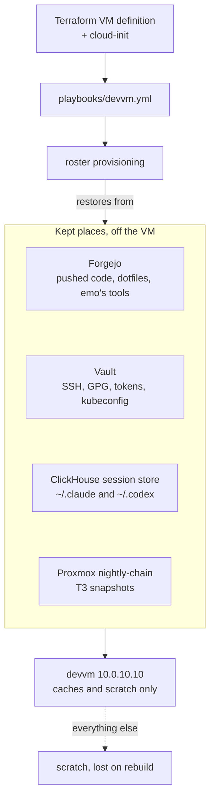

# Disposable devvm

Status: approved 2026-11-11, from a grilling session with Viktor. Nothing built yet.

The devvm (10.0.10.10) should be deletable and rebuildable from code in about
an hour, losing only scratch. Today a rebuild means the playbook plus a
hand restore from the nightly `/home` copy, and anything outside `/home` is
lost (inventory 2026-11-11: T3 snapshots in `/var/backups`, a local Postgres,
an NFS export, undeclared packages, emo's watchers).

> [!IMPORTANT]
> Scratch includes work an agent has not pushed. Agents push finished work; in-progress work may be lost on a rebuild.

All three users are in scope: wizard, emo and ancamilea. Scratch is anything
not in a kept place.

## Kept places
- Code: Forgejo. Agents push finished work; in-progress work may be lost. No
  automatic backup refs.
- Agent state: ClickHouse session store, extended to ingest everything under
  ~/.claude and ~/.codex except credentials and caches (history.jsonl, plans,
  tasks, teams, todos, file-history, remote/, Codex sessions; raw transcripts,
  subagents and tool results are already there), plus a restore command that
  writes a user's ~/.claude back so `claude --resume` works.
- T3 threads: the existing nightly snapshot in /var/backups/t3-state is pulled
  off the VM by a new nightly-chain step on the Proxmox host; provisioning
  restores the newest on a rebuild.
- Memory: homelab memory (unchanged).
- Credentials: Vault under `workstation/<user>`, restored by provisioning (SSH
  keys, GPG keys, Git PATs, gh, rclone, gcloud, docker). Loose secrets in
  ~/code (keys.txt, tmp_id, git-crypt key copy) and meshcentral-data keys:
  checked against Vault, missing ones stored, local copies deleted.
- Dotfiles: provisioning runs chezmoi apply; the admin kubeconfig comes from
  Vault instead of GPG. wizard's user units (lobby-local, tmux,
  tmux-plugin-update) move into the dotfiles; the hourly infra git-pull cron
  is dropped. vault-token-renew is installed for every user by provisioning.
- No weekly "outside kept places" report.

## Scratch (lost on rebuild, nothing migrated)
All of wizard's data folders (reel-archive-countries, ha-london-recovered,
vault-audit-archive, actualbudget dumps, dab-downloader, ff, src/t3code,
immich-repro, rpi-london, 2023 mysql datadir), loose files and folders in
~/code, /var/lib/clipboard-store contents.

## Machine
- Now, ahead of the rest: remove the /home/wizard NFS export (rw to *),
  stop and disable nfs-server; record the removal in the playbook.
- Undeclared packages, binaries, units: fold into playbooks/devvm.yml if used,
  remove if not; --check stays a clean no-op. The clipboard-store writer is
  declared or removed.
- Local Postgres (finance, trading_dev): dropped, server removed.
- Docker containers tl-fallback and paperless-mcp: removed.
- The VM is defined in Terraform (disk, CPU, RAM, cloud-init that runs the
  playbook), pinned to 10.0.10.10. The live devvm is NOT replaced; the
  definition is used for drills.

## Unpushed work today
Reviewed repo by repo (terminal-lobby ~12 real commits + dirty worktrees,
infra 6 commits and dirty worktrees, interview-prep-app, Plotting-Your-Dream-Book,
stashes in 4 repos, insta2spotify and immich-repro dirty files, cloud with no
remote). dot_files' 158 are stale history, not work.

## emo (changed without asking him first)
- Retire: panel115-watch, camera-stream-watch, led_report, vermont-mon,
  valia-backup-cleanup (when done), printer-price watcher, PAI-issue watcher,
  userspace Tailscale.
- intercom-watch becomes a ha-sofia automation (check, ISAPI reboot via
  rest_command after ~15 min offline, push to emo); ha-sofia's address joins
  the Vermont allowlist (OPNsense alias + rpi-sofia netmap). Verify the B4
  accepts the ISAPI reboot first.
- Hand tools go into his vermont-device-configs repo, cloned by provisioning.

Done 2026-11-11: the eight jobs above are stopped and archived in
`retired/2026-11-11/` of ebarzin/vermont-device-configs (valia-backup-cleanup's
last run did not report done, so its copy in ~/bin stays). His tools are in
that repo's `bin/`, ~/bin links to them, and his roster row clones the repo to
~/code/vermont-device-configs. intercom-watch stays on the devvm: the B4 has no
HTTP service (ports 80 and 443 refuse, checked 2026-11-11 without a reboot), so
a ha-sofia rest_command cannot send it the ISAPI reboot, and ha-sofia was not
added to the Vermont allowlist. Its script and units are in the same repo.

## Also
- HA London backs up through HA network storage to a new NFS export on the
  Proxmox host (/srv/nfs/ha-london-backup), covered by nfs-mirror and offsite.

## Proof and retirement
- Throwaway drill: build a second VM from the Terraform definition (different
  address, no Vermont checks), log in as each user, check work, agent state,
  T3 threads and credentials come back, delete it. Repeat every few months.
- The nightly devvm-home backup stays until the drill passes, then shrinks and
  retires.

## Open questions

- The B4 intercom does not accept the ISAPI reboot over HTTP: it has no HTTP
  listener, and ISAPI reaches it only tunnelled through the x86-only vendor
  SDK on port 8000 (checked 2026-11-11). The fallback for intercom-watch is
  still open: keep it on the devvm (today), or run the SDK reboot from an x86
  host other than the devvm.
- HA network storage over the tunnel to London has not been tried; a mount
  across the WAN can stall.
- The ClickHouse store's size growth once file-history and remote/ are
  ingested is not measured yet.
- Which local SSH keys already match the copies in Vault was not checked.
