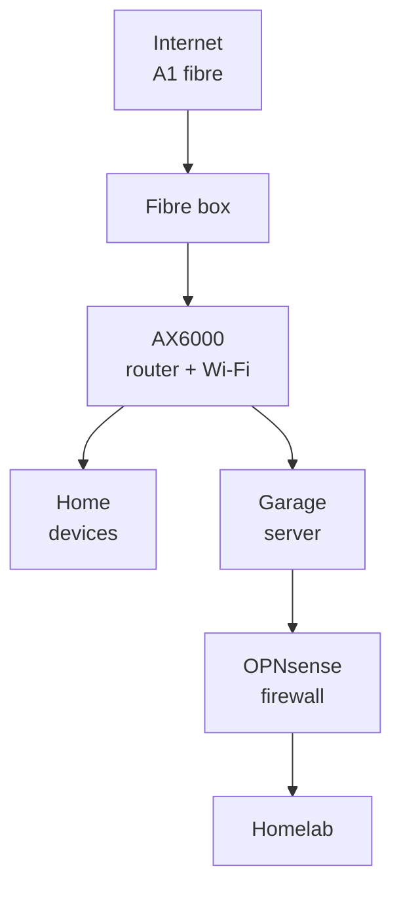
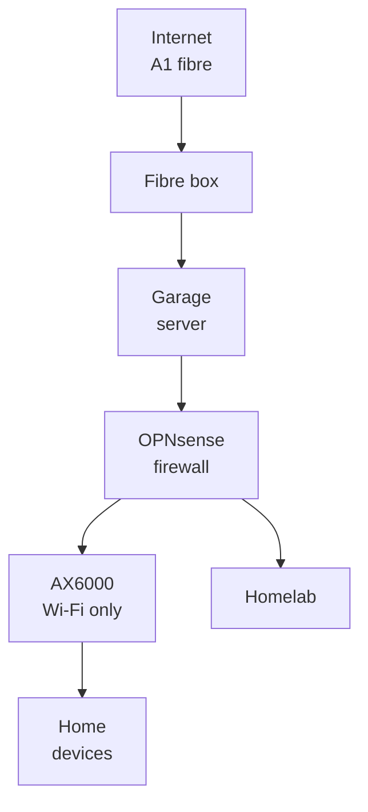
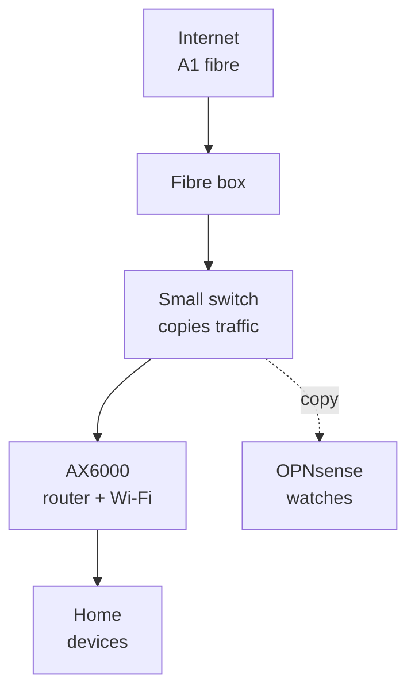

# Sofia network: today, and with OPNsense in front

Status: proposal for Viktor and emo to discuss. Nothing has changed yet. Facts were read on 2026-11-11 from the AX6000 (read-only), the firewall and the repo; open questions are at the end.

## In one sentence

Today the TP-Link AX6000 is the front door for the house and the homelab sits behind it; the proposal makes the OPNsense firewall the front door for everything, and the AX6000 keeps doing what the household notices most: Wi-Fi.

```stats
51 | devices with a reserved address on the home network
28 | port forwards on the AX6000 today
0 | home devices checked for attacks today
5 min | to put the AX6000 back if the server fails
```

## Today



- Everything from the internet passes the AX6000 first. Traffic for the homelab is then forwarded a second time by OPNsense (two layers of address translation).
- OPNsense checks the homelab's traffic for attacks and blocks attackers. **Home devices never pass through it**, so nothing checks them.
- The AX6000's own protection (HomeCare antivirus and intrusion prevention) is switched off, and its firewall switch reads off.

## Proposed: OPNsense becomes the front door



- The fibre box's cable moves to one of the two cables that already run to the garage, and lands on a free port of the server.
- The AX6000 switches to its built-in **Access Point mode**: Wi-Fi only, same network names and passwords, so phones and laptops reconnect on their own.
- OPNsense takes over handing out addresses (the 51 reservations move across unchanged), the port forwards (one layer instead of two), and checks every device's traffic for attacks.

## Alternative: keep the AX6000 as the router, copy its traffic

If running the house through the garage server feels too risky, a copy of the internet traffic can go to the firewall instead, and the AX6000 stays exactly as it is.



- A small managed switch with a mirror port goes between the fibre box and the AX6000 (they sit next to each other). The copy reaches the server over the cable that today runs from the AX6000 to the server's first port; the server keeps its second path.
- If the server is down, nothing changes for the house: the AX6000 still routes everything.
- The copy is taken after the AX6000's address translation, so an alert says "the house talked to a malware server", not which device. The home devices already ask OPNsense for names (the AX6000 hands out 192.168.1.2 for DNS), so matching the DNS log by time usually names the device.
- It watches but cannot block a home device. Blocking still needs the front-door setup.
- Cost: one small managed switch with port mirroring, roughly 25 to 40 EUR (needs Viktor's OK; everything else is free).

## What the household would notice

| | Stays the same | Changes |
|---|---|---|
| Wi-Fi | names, passwords, coverage, both extenders | nothing |
| Devices | every reserved address | nothing |
| Internet | speed, the public address (A1 confirmed it stays) | about 15 minutes offline on the night of the switch |
| TP-Link app | Wi-Fi settings | no internet or device settings any more |
| Speed rules (QoS, now set to 300/180) | | move to OPNsense |
| Parental controls | none are set up today | not available on the AX6000 |
| Guest Wi-Fi | still exists | in access point mode the AX6000 puts guests on the same network as the house, and OPNsense cannot tell them apart. Keeping guests apart (needed) means the garage MR200's Wi-Fi on its own network, or a Wi-Fi access point that supports VLANs (paid) |
| Port forwards | emo can still change them | in OPNsense, with emo's own login, instead of the TP-Link page |

## If something breaks

> [!IMPORTANT]
> With this change, the home's internet depends on the garage server. Each failure has a fallback.

| What fails | Home internet down for | What to do |
|---|---|---|
| OPNsense update or restart | 1 to 2 minutes | nothing, it comes back |
| Server restart | about 5 to 10 minutes (to be measured) | nothing |
| Server broken | until the fallback, about 5 minutes of work | move the fibre cable back to the AX6000 and load its saved settings file |
| Power cut | the fibre box and the AX6000 are on battery, so today the internet survives a cut. With the front door, internet lasts until the server's UPS shuts it down cleanly (at about 20 minutes of battery left) | the same fallback if it lasts long |

The fallback gets tested once on the night of the switch, so we know the AX6000 returns to normal from its saved settings. The existing watcher on the Raspberry Pi keeps emailing emo when the internet or the server drops.

## Other options we looked at

| Option | What it gives | What it costs |
|---|---|---|
| Separate checked Wi-Fi for chosen devices | the household is untouched | the AX6000 can't put a Wi-Fi network on its own VLAN; needs another access point |
| Copy the internet traffic to the firewall | sees everything | can't tell which device, can't block anything |
| DNS only | free, nothing moves | sees names, not traffic; encrypted DNS slips past it |

## Answered (Viktor, 2026-11-11)

- The A1 fibre box sits next to the AX6000; the cables to the garage start there.
- The fibre box and the AX6000 are on battery backup.
- emo keeps changing port forwards himself, with an OPNsense login.
- Guests must stay apart from the home network.
- The MR200 in the garage broadcasts Wi-Fi.
- The switch-over date is decided later, with emo.

## Still open

1. Front door (blocks and checks every device, house depends on the server) or the copy (watches only, the house is unaffected if the server fails)?
2. With the front door: guest Wi-Fi on the MR200's garage Wi-Fi, or a VLAN-capable access point?
3. With the copy: OK to buy the small switch?

## Open questions for Viktor

- OPNsense currently lets everything in from the home-network side (a rule carried over from pfSense); any home device can reach every homelab network. Viktor's call on 2026-11-11: leave it as is for now.
- Does A1 tie the address to the router's network card (MAC)? The AX6000 already uses a copied one, which OPNsense would copy again.
