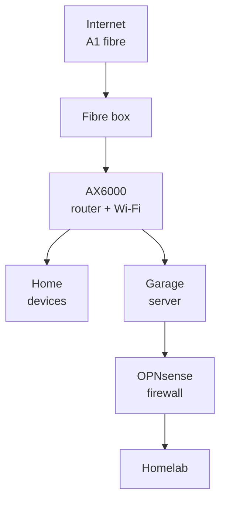
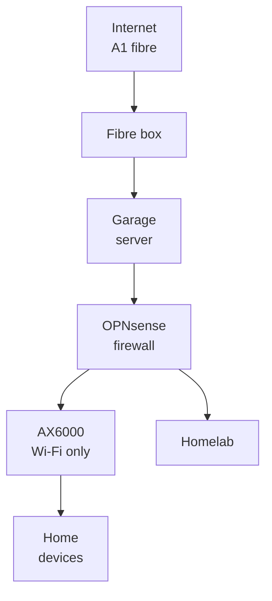

# Sofia network: today, and with OPNsense in front

Status: proposal for Viktor and emo to discuss. Nothing has changed yet. Facts were read on 2026-11-11 from the AX6000 (read-only), the firewall and the repo; open questions are at the end.

## In one sentence

Today the TP-Link AX6000 is the front door for the house and the homelab sits behind it; the proposal makes the OPNsense firewall the front door for everything, and the AX6000 keeps doing what the household notices most: Wi-Fi.

```stats
51 | devices with a reserved address on the home network
28 | port forwards on the AX6000 today
0 | home devices checked for attacks today
5 min | to put the AX6000 back if the server fails
```

## Today



- Everything from the internet passes the AX6000 first. Traffic for the homelab is then forwarded a second time by OPNsense (two layers of address translation).
- OPNsense checks the homelab's traffic for attacks and blocks attackers. **Home devices never pass through it**, so nothing checks them.
- The AX6000's own protection (HomeCare antivirus and intrusion prevention) is switched off, and its firewall switch reads off.

## Proposed: OPNsense becomes the front door



- The fibre box's cable moves to one of the two cables that already run to the garage, and lands on a free port of the server.
- The AX6000 switches to its built-in **Access Point mode**: Wi-Fi only, same network names and passwords, so phones and laptops reconnect on their own.
- OPNsense takes over handing out addresses (the 51 reservations move across unchanged), the port forwards (one layer instead of two), and checks every device's traffic for attacks.

## What the household would notice

| | Stays the same | Changes |
|---|---|---|
| Wi-Fi | names, passwords, coverage, both extenders | nothing |
| Devices | every reserved address | nothing |
| Internet | speed, the public address (A1 confirmed it stays) | about 15 minutes offline on the night of the switch |
| TP-Link app | Wi-Fi settings | no internet or device settings any more |
| Speed rules (QoS, now set to 300/180) | | move to OPNsense |
| Parental controls | none are set up today | not available on the AX6000 |
| Guest Wi-Fi | still exists | no longer kept apart from the home network by the AX6000; OPNsense can do that instead |
| Port forwards | | changed in OPNsense instead of the TP-Link page |

## If something breaks

> [!IMPORTANT]
> With this change, the home's internet depends on the garage server. Each failure has a fallback.

| What fails | Home internet down for | What to do |
|---|---|---|
| OPNsense update or restart | 1 to 2 minutes | nothing, it comes back |
| Server restart | about 5 to 10 minutes (to be measured) | nothing |
| Server broken | until the fallback, about 5 minutes of work | move the fibre cable back to the AX6000 and load its saved settings file |
| Power cut | the UPS and inverter carry the server; when the battery runs low it shuts down cleanly | the same fallback if it lasts long |

The fallback gets tested once on the night of the switch, so we know the AX6000 returns to normal from its saved settings. The existing watcher on the Raspberry Pi keeps emailing emo when the internet or the server drops.

## Other options we looked at

| Option | What it gives | What it costs |
|---|---|---|
| Separate checked Wi-Fi for chosen devices | the household is untouched | the AX6000 can't put a Wi-Fi network on its own VLAN; needs another access point |
| Copy the internet traffic to the firewall | sees everything | can't tell which device, can't block anything |
| DNS only | free, nothing moves | sees names, not traffic; encrypted DNS slips past it |

## Questions for emo

1. Where is the A1 fibre box, and can its cable reach one of the two cables to the garage?
2. Are the fibre box and the AX6000 on battery backup?
3. Does anyone rely on guest Wi-Fi being kept apart from the home network, or on the speed rules?
4. Do you want to keep changing port forwards yourself (you would get an OPNsense login)?
5. Does the MR200 in the garage broadcast Wi-Fi?
6. Which night suits a 15-minute switch, with you near the router?

## Open questions for Viktor

- OPNsense currently lets everything in from the home-network side (a rule carried over from pfSense). The proposal replaces it; until then any home device can reach every homelab network.
- Does A1 tie the address to the router's network card (MAC)? The AX6000 already uses a copied one, which OPNsense would copy again.
