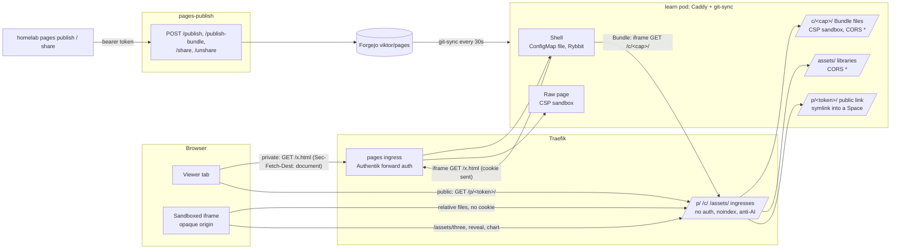

# Pages rich content: sandboxed pages, bundles for everyone, public links

- Date: 2026-11-12
- Status: done (Viktor approved the decisions in a grilling session the same day; built and verified the same day, see "Rollout status")
- Related: ADR-0042 (`docs/adr/0042-pages-run-sandboxed-on-the-shared-origin.md`), `stacks/pages-publish`, `stacks/learn`, Forgejo `viktor/pages` (`tools/render.py`), ADR-0031 (per-host forward auth), ADR-0041 (Rybbit)

## Why

Agents on the devvm published visual work to claude.ai Artifacts, and those links did not open for emo. Artifacts are now denied for every devvm user through the org managed settings. pages.viktorbarzin.me has to take over: three.js viewers, slide decks, diagrams, images and charts. Today the only way to publish one is to squeeze it through markdown. On 2026-11-04 emo's agent did exactly that with a 2.8 MB three.js page, and a 4.5 MB one OOM-killed the publish service the next day (infra#165).

## Decisions taken in the grilling session

1. Every page runs under a CSP `sandbox`, so page scripts get an opaque origin and cannot read cookies or other Spaces. `/assets` is exempt.
2. Every user can publish a Bundle with their normal publish token, scoped to their own Space. `homelab pages publish <file.md|file.html|dir>`.
3. Media stays in git: images and short clips, at most 10 MB per file and 25 MB per publish. The pod gets enough memory for that.
4. Pinned copies of three.js, reveal.js and a chart library under `/assets`. Pages may still use CDNs.
5. Decks: a markdown deck mode (`deck: true`, slides split on `---`, vendored reveal.js, print to PDF) and free-form HTML deck Bundles.
6. Charts: a fenced chart block in markdown, free-form JS with the vendored library, or static images.
7. Public links: `pages.viktorbarzin.me/p/<128-bit random>/` on the same host, no Authentik and no Turnstile, noindex plus the anti-AI headers, sandboxed like everything else. A link lives until revoked. Anyone with a publish token may create one for their own pages. Rybbit stays on public pages as on private ones.
8. Stable page identity: the same source name from the same user updates one page and keeps its public link.
9. ADR-0042: pages run under a CSP sandbox on the shared origin, and public access is by unguessable link instead of a separate content origin.

## What the code and the browser showed (2026-11-12)

These were measured before writing the design, and three of them change how decision 1 can be built.

| Finding | Evidence | Consequence |
|---|---|---|
| A sandboxed document sends **no** SameSite=Lax cookie on any subresource request: CSS, images, scripts, `fetch` with `credentials: "include"`. The document's own navigation does carry it, including an iframe navigation made by an unsandboxed parent. | Local test server, Chromium (T3 preview): `Sec-Fetch-Site: cross-site` and an empty `Cookie` on `/style.css`, `/img.png`, `/s.js` and both fetches, from a top-level `CSP: sandbox` page and from a sandboxed iframe alike. | Behind Authentik every relative image, script or data file of a sandboxed page is answered with a 302 to the login page. |
| The pages Authentik cookie is `authentik_proxy_e37f6815`, `HttpOnly; SameSite=Lax; Secure; Path=/`, host-only. | `curl -D -` on `https://pages.viktorbarzin.me/` | No domain-wide cookie to change, and SameSite=None would still fail in Safari and Firefox, which block or partition third-party cookies. |
| Traefik's `csp-headers` middleware **replaces** a backend's `Content-Security-Policy`. | Vaultwarden sets its own CSP; through Traefik only `frame-ancestors 'self' *.viktorbarzin.me viktorbarzin.me` arrives. | A `sandbox` header set in Caddy never reaches the browser unless the pages ingresses drop the shared CSP middleware. |
| The Rybbit script dies in a sandboxed document. | `script.js` calls `localStorage.getItem("disable-rybbit")` outside any `try`, which throws `SecurityError`; Rybbit's preflight for `Origin: null` answers 404. | Rybbit cannot run inside a sandboxed page. |
| `localStorage`, `sessionStorage` and `document.cookie` throw `SecurityError`; module scripts and `fetch` to the same host become cross-origin requests and need `Access-Control-Allow-Origin`. | Same local test. | Vendored ES modules under `/assets` need CORS headers. |
| The publish bug is real: `publisher.publish` writes the markdown to a fresh `tempfile.TemporaryDirectory()`, so `plan-source` is a new `/tmp/tmpXXXX/<slug>.md` each time and `render.existing_page_for_source` never matches. | `publisher.py` `publish()`, `render.py` `main()`; emo has three copies of the adapter page (2026-11-04, 11-05, 11-09). | Fixed by keying identity on the source name (below). |

## Design

### Request paths



### The shell and the sandboxed frame

Because a sandboxed page cannot use the login cookie for its own files and cannot run Rybbit, every page a person opens is served as two documents on the **same URL**:

- **The shell.** A browser navigation (`Sec-Fetch-Dest: document`) to a page path (`*.html`, `*/` or an extensionless path) gets one fixed file from the Caddy ConfigMap, not from git. It carries the Rybbit script, a full-viewport `<iframe sandbox>` and about 40 lines of our own JS. Nobody's page content runs in it. It is served with `Cache-Control: no-store` and `Vary: Sec-Fetch-Dest`, and it refuses to nest (if `window.top !== window` it shows a link instead of framing itself again).
- **The raw page.** Every other request for the same URL (the iframe navigation has `Sec-Fetch-Dest: iframe`) is served from git as today, plus `Content-Security-Policy: sandbox allow-scripts allow-forms allow-modals allow-popups allow-popups-to-escape-sandbox allow-downloads allow-pointer-lock allow-top-navigation-by-user-activation` and `Vary: Sec-Fetch-Dest`. The iframe navigation is made by the unsandboxed shell, so it carries the Authentik cookie and the existing per-identity routing decides what it sees.

The shell sets `iframe.src` from `location.pathname + location.search + location.hash`, so deep links and `#anchors` survive. It reads the page title by fetching the first 8 KB of the raw page with a `Range` header and setting `document.title` from `<title>` as text. `?raw` and reveal's `?print-pdf` skip the shell and serve the raw page at the top level, which is how a deck prints to PDF (Chromium prints only the visible part of an iframe). A browser that sends no `Sec-Fetch-Dest` gets the raw page directly: still sandboxed, just without Rybbit.

Sandbox flags, and why each one is there:

| Flag | Why |
|---|---|
| `allow-scripts` | three.js, reveal.js, charts, mermaid |
| `allow-popups`, `allow-popups-to-escape-sandbox` | `target=_blank` links to other sites should open normally. A popup onto pages itself gets its own sandbox header from Caddy, so escaping gives it nothing. |
| `allow-top-navigation-by-user-activation` | A clicked link can leave the frame. Rendered pages mark links to other pages `target="_top"`. |
| `allow-modals` | `window.print()` in reveal's print view, `alert` in agent-written pages |
| `allow-downloads`, `allow-forms`, `allow-pointer-lock` | Data downloads, client-side forms, 3D viewers that capture the mouse |

`allow-same-origin` is never set, so `localStorage`, `IndexedDB` and `document.cookie` throw, and a page's `fetch` of another Space goes out without the cookie and gets the login redirect.

### Bundles: the Bundle URL

A **Bundle** with more than one file (a directory) loads its own images, scripts and data by relative URL, and inside the sandbox those requests carry no cookie. So the files of each multi-file Bundle are also served at an unguessable **Bundle URL**, `/c/<cap>/`, where `<cap>` is 128 random bits in hex:

- `c/<cap>` in `viktor/pages` is a symlink to `../<space>/<name>`. The files stay in their Space; only the symlink moves.
- The Bundle directory holds a marker `.pages-bundle.json` written by the publish service: `{cap, source, title, status, date}`. Users cannot write it, because Bundle paths may not start with `.`.
- The shell, which runs as the real origin with the cookie, fetches `/<bundle>/.pages-bundle.json` and frames `/c/<cap>/<rest of path>`.
- `/c/` has its own ingress with `auth = "none"`, `search_noindex` and anti-AI. Caddy serves it with the sandbox header and `Access-Control-Allow-Origin: *`, answers 404 for any dotfile, and accepts only a 32-hex first segment.
- The cap rotates on every publish of that Bundle, so an old Bundle URL stops working the next time the Bundle is published.

**Trade-off, stated plainly:** anyone who holds a Bundle URL can read that one Bundle without signing in. The URL appears only inside the gated shell's frame; a viewer can still get it with "open frame in new tab". Single-file pages (markdown or one HTML file) have no Bundle URL and stay strictly behind Authentik. The alternatives were worse: a domain-wide SameSite=None cookie fails in Safari and Firefox, inlining every file into one HTML page breaks agent-written `fetch("data.json")`, and short-lived signed URLs need a new service that serves every page.

### Public links

- `homelab pages share <page>` (or `publish --public`) asks `POST /share`, which creates `p/<token>` as a symlink into the page's Space. A single page gets `p/<token>/index.html → ../../<space>/<file>.html`. A Bundle gets `p/<token> → ../<space>/<name>`. The token is 128 random bits.
- `/p/` has its own ingress: `auth = "none"`, `turnstile = false`, `search_noindex = true`, anti-AI on. Caddy gives it the same shell (with Rybbit) and the same sandbox, with root pinned to `p/`, dotfiles refused and CORS `*`. A public Bundle is framed at `/p/<token>/` itself, so the public never sees the Bundle URL.
- `homelab pages unshare <page>` removes every link to that page. A republish keeps the link because the symlink names the page, and decision 8 keeps the page's name.
- A link may only point at a page in the caller's own Space or in `shared/`.

### Publishing

One request shape for every kind of content, all with the user's normal token:

| Input to `homelab pages publish` | Request | Stored as |
|---|---|---|
| `doc.md` | `POST /publish` (unchanged body) | `<space>/<date>-<slug>.html` |
| `page.html` | `POST /publish-bundle` with one file | `<space>/<date>-<slug>.html`, with `plan-*` meta added for the index |
| `dir/` | `POST /publish-bundle` with every file | `<space>/<date>-<slug>/`, plus `c/<cap>` and the marker. An `index.md` without an `index.html` is rendered into `index.html` with the normal renderer. |

Common rules:

- **Identity is the source name** (the file or directory name the CLI sends), per user and Space. The renderer gets `--source-name <name>`; a page or Bundle whose `plan-source` (or marker `source`) has that basename is reused, so the date and URL never change. Legacy pages written through the service carry `/tmp/tmpXXXX/<slug>.md`, whose basename is the source name, so they are adopted on their next publish instead of duplicated.
- **Limits:** at most 10 MiB per file, 25 MiB per publish (decoded), 200 files, 3 path levels. Allowed extensions are text and web files (`html css js mjs json csv txt md svg map wasm`), images (`png jpg jpeg gif webp avif ico`), 3D models (`glb gltf bin stl obj mtl`), fonts (`woff woff2`) and short clips (`mp4 webm mp3 ogg`). Anything else is a 400 before the clone is touched.
- The legacy per-directory Bundle tokens keep working unchanged for the Showcase CI.
- Memory: the pod goes from 256 Mi to 768 Mi. A 25 MiB publish arrives as about 34 MB of base64 JSON and is held about three times while decoded. `/publish-bundle` gets a `Content-Length` cap of 40 MiB.

### Rendering

- **Assets:** `assets/three/` (three.js module build plus OrbitControls, GLTFLoader, STLLoader), `assets/reveal/` (reveal.js dist plus a theme), `assets/chart.umd.min.js` (Chart.js 4), each pinned and named with its version in `assets/VERSIONS.md`. `/assets/` gets a public ingress and `Access-Control-Allow-Origin: *`, because module scripts from an opaque origin are CORS requests.
- **Deck mode:** front matter `deck: true` renders each `---`-separated slide with the same markdown extensions into a reveal.js page. A "PDF" link opens `?print-pdf` at the top level.
- **Chart block:** a fenced ```` ```chart ```` block holds a Chart.js config as JSON. The renderer validates it, embeds it as `<script type="application/json">` with `</` escaped, and loads Chart.js only on pages that use it. Invalid JSON fails the publish with a 400 naming the block.
- Rendered pages drop the in-page Rybbit tag (the shell carries it) and mark links to other pages `target="_top"`. The Space index also lists Bundles, from their markers.

### Existing pages

Measured over all 590 files in `viktor/pages`:

| What | Pages | With the sandbox |
|---|---|---|
| Top-level markdown pages using only `/assets` | about 280 | Work. `/assets` is public now. |
| Scripts that touch `localStorage` | `wizard/composer/*` (5), `paladin-video`, `shenzhen-sights`, `pe-summit-trip` (+`casino`), `shared/2026-10-09-sofia-tv-internet-options`, `anca/index` | Throw unless wrapped in `try`; their saved state stops persisting. |
| Same-host `fetch` | `showcase/homelab` (data.json), `anca` (/prep/api and a service worker), `pe-summit-trip/tunnel-view-sunsets` | Need CORS on the target; the service worker cannot register. |
| Pages loading relative files from a sibling directory | `2026-09-11-live-display-upscale`, `2026-09-24-orchestrator-bake-off`, `2026-09-24-text-composer-redesign`, `2026-09-27-text-view-t3-pass`, `paladin-sources.html` | Images break: a single page has no Bundle URL. |
| Legacy subdirectory Bundles in `wizard/` (`composer`, `f1-tv-redesign`, `grand-canyon-sights`, `yosemite-sights`, `shenzhen-sights`, `yangshuo-bike`, `reels`, `paladin-sources`, `learn-pwa`, `agent-panel`, ...) | 15 directories | Work once each gets a marker and a `c/` symlink, which the migration commit adds. |

Plan for them:

- The public carve-outs (`/prep`, `/pe-summit-trip`, `/vietnam`, `/homelab`) keep their own Caddy handles and ingresses and are **not** sandboxed in this change. They are Viktor's own apps, three of them store state or register a service worker, and the Showcase is generated by CI. Folding them in is a separate change.
- The five top-level pages that load sibling files, and the `wizard/images/` directory they use, are listed in a Caddy **legacy exemption**: served as before, unsandboxed and without the shell. All are in `wizard/` and were written by Viktor's sessions. Republishing one as a Bundle removes it from the list.
- Every other page gets the shell and the sandbox.

## Rollout order

1. `viktor/pages`: renderer changes (with tests), vendored assets, markers and `c/` symlinks for the legacy Bundles. Pushed first: the service calls `render.py` from the clone, and the new `--source-name` flag must exist before the service sends it.
2. infra: `ingress_factory` gains `skip_default_csp`; `stacks/learn` gets the Caddyfile, the shell and the `/assets`, `/c`, `/p` ingresses; `stacks/pages-publish` gets the API, limits and memory; `cli/` gets `publish <md|html|dir> [--public]`, `share`, `unshare`.
3. Before landing, rehearse the Caddyfile in a local `caddy:2.11.9-alpine` against a copy of the repo with spoofed `X-Authentik-Username` and `Sec-Fetch-Dest` headers, because `caddy validate` only checks syntax.
4. Apply `learn` and `pages-publish` from the main checkout, then watch the image build through the Woodpecker deploy to the rollout.
5. Verify live with the **pages capability demo** (`shared/<date>-pages-demo/`, with a public link): the sandbox in action, a three.js model, a markdown deck and an HTML deck, charts in all three forms, an image and a short clip from the Bundle, mermaid, callouts, stats tiles and its own public link.

## Verification

- A sandboxed page's `fetch("/emo/...")` and `fetch("/wizard/...")` get no data (302 to Authentik, unreadable from the opaque origin).
- `/p/<token>/` opens in a signed-out browser; after `unshare` it returns 404.
- Republishing the same source name updates the same URL, and the public link keeps working.
- The shell's Rybbit sends a pageview for a private and a public page.
- Every existing page in the table above behaves as stated.

## Rollout status (2026-11-12)

| Step | State |
|---|---|
| `viktor/pages`: renderer, vendored assets, legacy markers | landed (ec57519, 002ec22, b94ec4e) |
| infra: Caddyfile, shell, ingresses, publish API, CLI | landed (9156632e6, 7cac1f2cf); CI pipeline #3781 was killed, so `learn` and `pages-publish` were applied from the main checkout |
| CLI v0.38.0 on the devvm, org instructions, emo's instructions | deployed by `t3-provision-users` (emo: `ebarzin/agents` e671f84) |
| Pages capability demo | `https://pages.viktorbarzin.me/shared/2026-11-12-pages-demo/`, public link `https://pages.viktorbarzin.me/p/17f7c0aea6a8d3dc9204a24ec732482f/` |

Verified live: the public link opens signed out with the shell, Rybbit (`/_t/r/track` 200) and the page in the frame; from inside, `document.cookie`, `localStorage` and reading the shell throw `SecurityError`, `fetch` of `/wizard/`, `/emo/` and `/shared/` is blocked, and the Bundle's own `data.json` loads. The three.js model, both charts drawn in the browser, the SVG chart, the WebP image, the MP4 clip, mermaid, callouts and stat tiles all render. Republishing the demo and the deck kept their URLs and public links. A public link went from 200 to 404 within 30 s of `unshare`. `/c/../`, `/c/%2e%2e/`, `/p/<tok>/../../` and `/assets/../` with a forged `X-Authentik-Username` all land on the Authentik redirect. Not verified in a browser: a private page signed in as a user, because the browser profile on the devvm has no Authentik session; the private paths were checked inside the learn pod with the identity header instead.

## Open questions

- Whether the Bundle URL trade-off is acceptable for every Space, or whether some Spaces want short-lived signed URLs later.
- When to fold the four public carve-outs into the sandbox, and whether their state should move to `/prep/api`-style services.
- Session replay in Rybbit now records the shell, not the page inside the frame, so replays of pages show an empty frame.
