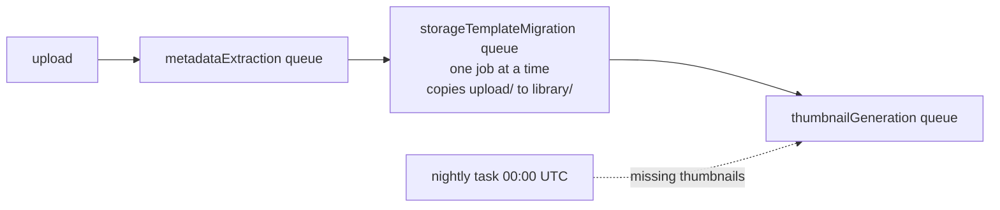

# Immich uploads waited hours for thumbnails: NFS 4.2 copies stopped returning

- Date: 2026-11-02
- Status: fixed 2026-11-02 (see "What shipped")
- Affected: every Immich upload from 2026-10-23 07:59 UTC to 2026-11-02 ~23:30 UTC

## Summary

From 2026-10-23 every new upload showed a blank tile until Immich's midnight
"missing thumbnails" task, 3 to 21 hours later. On 2026-11-02 the worker also
stopped processing jobs entirely, and 1,312 uploads that day got no thumbnail at
all.

Two faults stacked:

1. **A copy over NFS 4.2 that never returns.** The Proxmox host booted kernel
   7.0.14-25 on 2026-10-23 at 09:14 local time. From then on, `copy_file_range`
   on its NFS 4.2 exports writes all the data and then blocks forever. Immich
   moves each upload from `upload/` to `library/` (storage template). Those are
   two mounts, so the move is a copy, and the copy hung. The storage-template
   queue runs one job at a time, so one hung move held every later upload.
2. **The worker's job thread died without the pod noticing.** At 00:01 UTC on
   2026-11-02 the worker lost its Postgres connection and logged `microservices
   worker error`. The job thread stopped, the main process kept running, and
   the pod stayed `Running` with no Redis connections for 22 hours. The worker
   had no liveness probe by design (it serves no HTTP).

## How an upload becomes a thumbnail (v3.3.5)

The thumbnail job is queued by the storage-template job's completion handler
(`JobService.onDone`, case `StorageTemplateMigrationSingle`). While that step
hangs, nothing downstream runs; the nightly task reaches the thumbnail queue
directly, which is why thumbnails still appeared at midnight.

## Timeline (UTC)

| time | event |
|---|---|
| 10-21 11:07 | Kernel 7.0.14-25 installed on the Proxmox host (not yet booted) |
| 10-22 08:20 | Immich v3.3.3 to v3.3.5. Moves keep working through 21:02 |
| 10-23 ~06:14 | Proxmox host reboots into 7.0.14-25 |
| 10-23 07:59 | IMG_2044.HEIC uploaded. Its move copies the file and never returns |
| 10-23 to 11-01 | Uploads get metadata within 1 s, thumbnails only at the next 00:00 run |
| 11-02 00:01 | Worker loses Postgres connection, job thread dies, pod stays Running |
| 11-02 00:42 | Redis restarts; the dead worker never reconnects (0 connections) |
| 11-02 ~02:30 | Last `No microservices worker is connected` warning from the api pods |
| 11-02 22:49 | Worker restarted. Metadata backlog drains in minutes; the next move (IMG_2036.HEIC) hangs the same way |
| 11-02 | Diagnosed, fixed with NFS 4.1 mounts, probe and freshness alert added |

Upload-to-thumbnail delay by upload day, from `asset.createdAt` and the
thumbnail's `asset_file.createdAt`:

| upload day | uploads | metadata after (p50) | thumbnail after metadata (p50) |
|---|---|---|---|
| 10-20 | 2,583 | 0.2 s | 3 s |
| 10-21 | 169 | 0.2 s | 2 s |
| 10-23 | 54 | 0.5 s | 57,467 s |
| 10-27 | 324 | 0.2 s | 76,985 s |
| 11-01 | 11 | 0.6 s | 20,055 s |
| 11-02 | 1,312 | never | never |

## How the copy hang was pinned down

- The hung job held the Postgres advisory lock, and its connection sat `idle`,
  so the wait was not in Postgres.
- The destination file existed at full size, and the worker process still had
  both the source (read) and destination (write) open.
- `/proc/51/task/*/wchan` showed one `libuv-worker` thread in
  `handle_async_copy`: the NFS client waiting for the server's completion
  callback for an asynchronous server-side COPY.
- A 3 MB `fs.copyFileSync` from inside the pod hung for the full 30 s timeout,
  both across mounts and within one mount, with all bytes written each time.
- The same copy over a temporary `nfsvers=4.1` mount on the same node
  finished in 67 ms with identical content.
- `/proc/fs/nfsd/clients/*/info` on the Proxmox host shows `callback state: UP`
  for all five k8s nodes, so the callback channel itself is up.

The timing points at the kernel update: the host booted 7.0.14-25 about 1h45m
before the first hung move, and moves had worked on v3.3.5 the previous
afternoon.

## What shipped

- `modules/kubernetes/nfs_volume`: new `nfs_version` variable, default `"4"`
  (unchanged for every other stack).
- `stacks/immich`: the six photo volumes mount with `nfsvers=4.1`. NFS 4.1 has
  no COPY operation, so the client copies the bytes itself.
- `stacks/immich`: liveness probe on `immich-worker`, failing when the pod has
  no established TCP connection to port 6379. A live worker holds about 60.
- `stacks/immich`: `immich-thumbnail-freshness` CronJob every 10 minutes,
  pushing the count and age of uploads from the last 6 hours that are over 15
  minutes old without a thumbnail.
- Alerts `ImmichThumbnailsLagging` and `ImmichThumbnailFreshnessStale`.
- 2026-11-03: `nfs_volume` defaults to `nfsvers=4.1` for every stack, and the
  `nfs-pve`, `nfs-truenas` and `verify-nfs` StorageClasses match. The Synology
  volume keeps 4.2. Before the change, a scan of every node found no other
  thread waiting in `handle_async_copy`. Running pods keep their current mount
  version until they restart. 4.1 does not support user extended attributes;
  no workload is known to rely on them over NFS.
- 2026-11-03: one dynamically provisioned volume, `learn/prep-sync-data`
  (`pvc-92defc43-...`), is not in Terraform, so CI could not update it. Its
  `mountOptions` were patched to `nfsvers=4.1` by hand to match the `nfs-pve`
  StorageClass it was provisioned from.

## Why no alert fired

| signal | what it watches | why it stayed quiet |
|---|---|---|
| `ImmichNoJobWorker` (Loki) | api pods' "No microservices worker" warning | the warning stopped about 2.5 h after the worker died; hung moves never trigger it |
| `ImmichThumbnailReconcileStale` and related | the nightly reconciler ran | it ran fine; its 24 h grace window is longer than the midnight catch-up |
| HTTP error alerts | 4xx/5xx rates | a missing thumbnail renders as a blank tile, not an error spike |

`ImmichThumbnailsLagging` measures the outcome directly, so it fires whichever
component fails.

## Open questions

- Which change in 7.0.14-25 stops the COPY completion from reaching the client
  is not known. It could be a regression in nfsd's async copy, or something in
  how the callback travels through the NAT at 192.168.1.2. The previous kernel,
  7.0.14-19, is still installed; booting it would confirm, but that means
  rebooting the whole host.
- Pods started before 2026-11-03 still hold 4.2 mounts until they restart, so a
  `copy_file_range` in one of them can still hang until then. A node scan on
  2026-11-03 found none waiting.
- Why the worker's job thread died on a dropped Postgres connection instead of
  reconnecting is an upstream Immich question. The liveness probe limits the
  outage to about 7 minutes either way.
