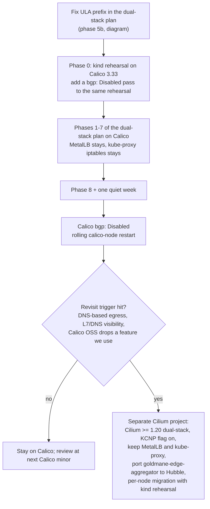

# CNI alternatives before the dual-stack conversion

Research note, 2026-11-02. Read-only investigation: nothing was changed in the
cluster, on the nodes or in the repo apart from this file. It answers one
question: should the cluster leave Calico, and if so, should the dual-stack
conversion (`docs/plans/2026-11-02-cluster-dual-stack.md`, draft v2, on branch
worktree `.worktrees/cluster-dual-stack`) ride on that migration instead of
being added to Calico in place?

It builds on
[2026-08-31-cluster-dual-stack-ipv6.md](2026-08-31-cluster-dual-stack-ipv6.md)
(Kubernetes, Calico and MetalLB feasibility for dual-stack) and does not repeat
that work.

Every claim carries one of three labels:

- **[measured]** read on the live system today (`kubectl get`/`top`, read-only
  SSH to k8s-node1, `grep` over this repo).
- **[source]** read in upstream documentation, release notes or source code,
  with a link in [Sources](#sources). Versions are pinned where it matters:
  Cilium v1.20.4, Calico v3.33 docs, Antrea v2.7.
- **[inferred]** reasoning from the above, not observed directly.

## Verdict

**Stay on Calico, and do the dual-stack conversion on Calico as planned.** Do
not combine it with a CNI migration. If we ever move to Cilium, do it later, as
its own project, once dual-stack has been stable for a while and a concrete
need (DNS-based egress, L7 visibility) asks for it.

Four facts carry most of the weight:

1. **Cilium cannot replace MetalLB for the services that matter most here.**
   Cilium's L2 announcement docs list as a limitation: "The feature is
   incompatible with the `externalTrafficPolicy: Local` on services as it may
   cause service IPs to be announced on nodes without pods causing traffic
   drops." [source] Traefik (`10.0.20.203`) and 8 other LoadBalancer Services
   run ETP Local [measured], and CrowdSec depends on the client IP that ETP
   Local preserves. So MetalLB stays whichever CNI we pick, and one of the main
   consolidation gains of Cilium does not apply to us. (Cilium added IPv6 NDP
   to L2 announcements in v1.19.0, so this is the remaining gap, not IPv6.)
   [source] The same page also says "The feature does not support announcing
   one IP for more than one service" (`Documentation/network/l2-announcements.rst:87`
   on `main`), and `svc/traefik` and `svc/traefik-udp` share `10.0.20.203` for
   HTTP/3, which is a second reason on its own. [source, measured]
2. **Almost all of the dual-stack plan is CNI-independent.** Of its eight
   phases, only phase 3 ("Calico: add the IPv6 pool") is Calico-specific. The
   one-way control-plane step (ServiceCIDR), kubelet `--node-ip`, kube-proxy,
   MetalLB, pfSense, node addressing and DNS are the same work under any CNI.
   [source, inferred] Riding dual-stack on a migration removes one rolling
   `calico-node` restart and adds six drain-and-reboot cycles, a new pod CIDR,
   and a combination Cilium's own guide says is untested: "Currently, Cilium
   migration has not been tested with: BGP-based routing; Changing IP families
   (e.g. from IPv4 to IPv6)". [source]
3. **Our Calico-specific policy surface is small, and it works today.** There
   are no user-defined Calico tiers: the six tiers are `default`, the two
   built-in ClusterNetworkPolicy tiers, the operator's `calico-system` tier and
   two leftovers from the old AdminNetworkPolicy API. [measured, source] What
   we wrote ourselves is 4 ClusterNetworkPolicies, 8 Kubernetes
   NetworkPolicies, 2 Calico NetworkPolicies, 1 Log-then-Allow
   GlobalNetworkPolicy and 2 policies that exist only to open holes in the
   operator's tier. [measured] Cilium supports ClusterNetworkPolicy only since
   v1.20.0, behind a flag that is off by default, and v1.20.0 also fixed a bug
   where `matchExpressions` in ClusterNetworkPolicy were ignored, which is what
   all four of ours use. [source] During a Cilium migration, policy enforcement
   is set to `never` [source], so the devvm Lobby deny that broke once already
   (infra#123) would be unenforced for migrated pods. [inferred]
4. **Observability would need porting, not just swapping.** Goldmane feeds the
   first-party `goldmane-edge-aggregator` (4,731 lines of Go, a 169-line
   Goldmane adapter), its CNPG table `goldmane_edges`, a daily digest and the
   east-west Grafana dashboard. [measured] Hubble has an equivalent gRPC
   `Observer.GetFlows` API with workload, namespace, verdict and
   allowed-by/denied-by policy fields [source], so a port is realistic, but it
   is new work that buys no capability we have asked for. [inferred]

What Cilium would genuinely add for us: DNS-based egress policy (`toFQDNs`),
which Calico OSS does not offer [source], and Hubble's L7 and DNS visibility.
`wa-bot-egress` allows 80 Meta CIDRs by hand [measured], which a single FQDN
rule would describe better. That is the trigger worth watching (see
[Revisit triggers](#revisit-triggers)).

Calico changes worth making while we are in there are small; see
[Calico changes worth making](#calico-changes-worth-making). The most useful
is turning BGP off: BIRD runs and gates calico-node readiness, yet there are no
BGP peers and every inter-node pod route is programmed by Felix. [measured]

## Measured starting state

Values that differ from the brief are marked.

| | Value | How verified |
|---|---|---|
| Kubernetes | v1.35.10, kubeadm, 1 control plane + 5 workers | brief, `kubectl get nodes` |
| Kernels | 6.8.0 (node1, node4, node5), 7.0.0 (master, node2, node3) | `kubectl get nodes` nodeInfo |
| Node memory | master 16 GiB; node1 48 GiB; node2-5 32 GiB. In use 38-50% per node | `kubectl top nodes` |
| Workload size | 162 namespaces (brief: ~130), 158 PVCs, 383 pods (51 hostNetwork), 2 CNPG clusters | `kubectl get` counts |
| Calico | Installation: VXLANCrossSubnet pool `10.10.0.0/16`, blockSize 26, natOutgoing, `bgp: Enabled`, `linuxDataplane: Iptables`, `hostPorts: Enabled` | `kubectl get installation default` |
| Felix | `bpfEnabled: false`, `nftablesMode: Disabled`, `programClusterRoutes: EnabledIPIPOnly` | `felixconfiguration default` |
| Inter-node pod routes | `10.10.x.y/26 via 10.0.20.10N dev ens18 proto 80 onlink` on node1: direct routes on the shared VLAN, programmed by Felix (proto 80), none by BIRD. `vxlan.calico` exists but same-subnet traffic is not encapsulated | `ip route` over SSH on k8s-node1 |
| BGP | BIRD runs (`CALICO_NETWORKING_BACKEND=bird`), readiness probe includes `--bird-ready`, zero BGPPeers | DaemonSet spec, `kubectl get bgppeers` |
| hostPort pods (non-hostNetwork) | none | pod specs |
| LoadBalancer Services | 20; 9 with ETP Local (traefik, traefik-udp, technitium-dns, coturn, frigate-rtsp, kms, rustdesk, wireguard, chrome-media); 9 share `10.0.20.200` with ETP Cluster | `kubectl get svc -A` |
| Pod CIDR references in the repo | 31 files mention `10.10.0.0/16`, including the Traefik real-ip and CrowdSec bouncer plugins, Traefik middleware, Technitium dynamic updates and the pfSense Tailscale config | `grep -rl` |

### Memory used by the networking stack today

| Component | Pods | Memory (sum) |
|---|---|---|
| calico-node | 6 | 857 Mi (128-158 Mi each) |
| csi-node-driver | 6 | 207 Mi |
| calico-typha | 3 | 159 Mi |
| calico-kube-controllers | 1 | 137 Mi |
| calico-apiserver | 2 | 112 Mi |
| goldmane + whisker | 2 | 193 Mi |
| tigera-operator | 1 | 259 Mi |
| **Calico total** | | **1,924 Mi** |
| kube-proxy | 6 | 240 Mi |
| MetalLB (controller + 6 speakers) | 7 | 404 Mi |

All [measured] with `kubectl top` at one moment on 2026-11-02, so treat them as
a snapshot, not a peak. Per worker, the DaemonSets (calico-node, csi-node-driver,
kube-proxy, MetalLB speaker) come to roughly 230-300 Mi.

### Policy objects, by who owns them

| Kind | Count | Ours | Notes |
|---|---|---|---|
| Calico Tier | 6 | 0 | `default`, `kube-admin`, `kube-baseline` (built-in, hold ClusterNetworkPolicy), `calico-system` (operator, since 3.33), `adminnetworkpolicy` + `baselineadminnetworkpolicy` (135 days old, from the ANP API Calico 3.32 stopped enforcing) |
| ClusterNetworkPolicy (`policy.networking.k8s.io/v1alpha2`) | 4 | 4 | devvm Lobby denies, tier Admin, `matchExpressions` In/NotIn on namespace names (`stacks/terminal/devvm_lobby_anp.tf`) |
| Kubernetes NetworkPolicy | 8 | 8 | portable to any CNI as-is |
| Calico GlobalNetworkPolicy | 2 | 1 | `wave1-egress-observe-tier34` (egress `Log` then `Allow`, tier 3/4 namespaces); `calico-system.node-local-dns` is the operator's |
| Calico NetworkPolicy | 10 | 4 | `bastion-egress`, `wa-bot-egress` (CIDR allowlists with explicit Deny); `allow-prometheus-kube-controllers-metrics` and `allow-traefik-whisker` exist only because of the operator's `calico-system` tier; the other 6 are the operator's |

[measured] with `kubectl get` on each kind.

## Candidates

### Comparison

| | Calico 3.33 (stay) | Cilium 1.20 | Antrea 2.7 | Kube-OVN 1.16 | kube-router 2.12 | Flannel 0.28 |
|---|---|---|---|---|---|---|
| Dual-stack | Yes; adding IPv6 to a running cluster is mechanically supported by the operator, docs say "only for new clusters" [source] | Yes [source]; from Calico only via migration, which is "not tested" with IP family changes [source] | Yes (`antrea-ipam.md`, `traffic-encryption.md` describe dual-stack clusters) [source] | Yes ("DualStack IP Support", README) [source] | Yes, since v2.0 [source] | Yes (`EnableIPv6`) [source] |
| kube-proxy replacement | eBPF dataplane [source] | Yes, eBPF; switching on a running cluster "will break existing service connections" [source] | AntreaProxy `proxyAll` [source] | Yes (OVN LB) [inferred] | IPVS proxy with DSR [source] | No |
| LB IP announcement | No MetalLB equivalent with ETP Local; new L2 responder supports ETP Cluster only [source] | L2 announcements (ARP + NDP since 1.19), "incompatible with `externalTrafficPolicy: Local`" [source]; BGP control plane | ServiceExternalIP on L2, node failover via memberlist [source] | Works with MetalLB (MetalLB compatibility table) [source] | BGP and its own LoadBalancer IP allocator, no L2 announcement found [source] | None |
| ClusterNetworkPolicy (upstream v1alpha2) | Yes, since 3.32, tier Admin/Baseline map to Calico tiers [source] | Since 1.20.0, flag off by default; `matchExpressions` bug fixed in 1.20.0 [source] | Since 2.7, alpha feature gate, off by default [source] | Experimental [source] | No | No |
| Own tiers / ordered policy | Calico tiers, `order`, Log action, staged policies [source] | Ordered rules and tiers internally since 1.19 [source]; user-facing via ClusterNetworkPolicy; audit mode instead of Log [source] | Antrea-native tiers, ACNP [source] | No [inferred] | No | No |
| DNS-based egress | Not in OSS (no `domains` field in the OSS policy reference) [source] | `toFQDNs` [source] | FQDN rules in Antrea-native policy [source] | No [inferred] | No | No |
| Flow observability | Goldmane gRPC + Whisker UI (in use) [measured] | Hubble (relay, UI, `Observer.GetFlows`) [source] | Flow exporter (`network-flow-visibility.md`) [inferred from the docs index] | No built-in UI [inferred] | No | No |
| Per-node footprint | Measured above: ~170-200 Mi for calico-node + csi-node-driver | Agent plus a standalone Envoy DaemonSet, default for new installs [source]; not measured here, see [open questions](#open-questions) | not measured | ovs-ovn requests 200 Mi, limit 1,000 Mi; kube-ovn-cni 100 Mi / 1 Gi [source] | not measured | small [inferred] |
| Live migration from Calico | n/a | Documented per-node dual-overlay procedure [source] | Documented, cluster-wide: delete old CNI, install Antrea, restart all pods in place; verified against Calico v3.26 [source] | Not documented here | Not documented here | Not documented here |
| Governance, licence | Tigera-led, Apache-2.0 [source] | CNCF Graduated (2023-10-11), Apache-2.0, eBPF code GPL-2.0/BSD-2-Clause [source] | CNCF Sandbox (2021-04-28), Apache-2.0 [source] | CNCF Sandbox (2021-01-26), Apache-2.0 [source] | Apache-2.0 [source] | Apache-2.0 [source] |
| Release cadence | Minors 2025-10-22, 2026-04-30, 2026-10-01 [measured] | Minors 2025-07-29, 2026-02-04, 2026-07-29; three minors patched the same day [measured] | 2.5-2.7 patched 2026-08-15 [measured] | weekly patches [measured] | 2.12.0 on 2026-11-02 [measured] | 0.28.10 on 2026-10-08 [measured] |

Release dates read from each project's GitHub releases. "not measured" means
I did not find a primary-source figure for a cluster of this size.

### Staying on Calico

What we already have covers what the dual-stack plan needs. The 2026-08-31
research worked through the IPv6 pool, `nodeAddressAutodetectionV6` and the
operator's pool controller; nothing in Calico 3.33 changes that analysis. The
3.33 IPv6 guide still says "The following tasks are only for new clusters"
[source], so phase 0 (the kind rehearsal) remains the place where the
post-install path is validated.

Options inside Calico:

- **eBPF dataplane.** Replaces kube-proxy, "preserves external client source IP
  addresses all the way to the pod" and supports DSR [source]. Switching an
  existing cluster is a supported operator change (`linuxDataplane: BPF`, plus
  the `kubernetes-services-endpoint` ConfigMap and disabling kube-proxy), but
  the guide says "Connections over a VXLAN overlay do not survive", non-TCP
  flows "are treated as new", and switching DSR on "can disrupt in-progress
  connections". IPv6 is supported in eBPF mode. [source] For us the gain is
  client IPs on the 9 ETP Cluster Services that share `10.0.20.200`. Traefik
  already has real client IPs through ETP Local. [measured, inferred]
- **nftables dataplane.** Generally available since 3.31 [source]. It requires
  kube-proxy in nftables mode too ("your cluster's kube-proxy must also be in
  nftables mode") [source]. We have no measured iptables performance problem
  it would solve. [inferred]
- **L2 reachability without BGP** (`localSubnetL2Reachability`, in the 3.33
  docs). It answers ARP/NDP for LoadBalancer VIPs, but "Only
  `externalTrafficPolicy: Cluster` is supported", and a VIP is reassigned only
  when the owning `Node` object is deleted. [source] It does not replace MetalLB
  for Traefik.
- **Turning BGP off.** See below.

### Cilium

Cilium is the only alternative worth a full evaluation. It is CNCF Graduated,
on a six-month minor cadence with three supported minors, and its feature list
overlaps ours more than any other candidate. Our kernels (6.8, 7.0) are well
above its 5.10 minimum. [source, measured]

Fit against what we run:

| Need | Cilium 1.20 | Fit |
|---|---|---|
| Dual-stack pods and Services | Supported; cluster-pool IPAM takes IPv4 and IPv6 lists [source] | Good |
| Public IPv6 VIPs via NDP with ETP Local | L2 announcements do NDP but are incompatible with ETP Local [source]; keep MetalLB, which lists Cilium as compatible [source] | MetalLB stays |
| Real client IP for Traefik, incl. QUIC | ETP Local is "generally supported through the eBPF implementation" [source]; DSR also keeps client IPs for ETP Cluster, but Hybrid mode SNATs UDP: "DSR is performed for TCP and SNAT for UDP connections" [source] | Same as today with ETP Local |
| Shared VIP (traefik + traefik-udp) | LB IPAM sharing key, if LB IPAM were used [source]; with MetalLB kept, unchanged | Same as today |
| ClusterNetworkPolicy (4 objects) | Supported since 1.20.0, `k8sClusterNetworkPolicy.enabled=true`, CRD installed separately [source] | Works, young |
| Calico NetworkPolicy with nets + Deny (2) | `CiliumNetworkPolicy` `toCIDR` with default deny on selection [inferred] | Straight translation |
| `Log` then `Allow` egress observation (1 GNP) | No Log action; Hubble shows all flows, `policyAuditMode` gives `AUDIT` verdicts, and rules can carry a `log` value surfaced in `policy_log` [source] | Different mechanism, same goal |
| Goldmane flow trail | Hubble `Observer.GetFlows` with workloads, namespace, verdict, `egress_allowed_by`/`egress_denied_by` [source] | Port the 169-line adapter and the edge projection |
| NodeLocal DNSCache | Not checked in this note | Open question |
| hostPorts | No non-hostNetwork pod uses hostPort today [measured] | Not needed |

### Antrea

Antrea has the richest policy model after Calico (native tiers, ACNP,
ClusterNetworkPolicy behind an alpha gate since 2.7) and its own L2
ServiceExternalIP. [source] Two things rule it out here. Its documented
migration from Calico is cluster-wide: delete the old CNI, install Antrea, then
a migrator DaemonSet "will restart all non hostNetwork Pods in the cluster
in-place", and "During the migration process, no Kubernetes resources should
be created or deleted". [source] That is a whole-cluster outage window with
Renovate, CronJobs and CNPG all running. Its observability (IPFIX flow export)
would also need a new pipeline. [inferred]

### Kube-OVN

Kube-OVN brings OVN/OVS: a central OVN database plus an `ovs-ovn` DaemonSet
that requests 200 Mi and may use up to 1,000 Mi per node by its chart
defaults [source]. That is a larger and less familiar control plane than
Calico on a host already short of memory. MetalLB lists it as compatible. [source] Not a fit.

### kube-router

kube-router does routing (BGP), an IPVS service proxy with DSR, and standard
Kubernetes NetworkPolicy only. Dual-stack has been "feature complete" since
v2.0.0. [source] It has no tiers, no ClusterNetworkPolicy and no flow
observability, so we would lose the devvm Lobby policies and Goldmane. Not a fit.

### Flannel

Flannel provides connectivity only, with no NetworkPolicy. Pairing it with
Calico for policy (Canal) keeps Calico anyway. Not a fit.

### Anything newer

I found nothing newer in late 2026 that is credible as a primary CNI for this
cluster. `kube-network-policies`, the SIG Network reference implementation,
appears on the network-policy-api implementations page for ClusterNetworkPolicy
[source], but it is a policy engine, not a CNI. The movement worth noting is
inside the two leaders: Calico 3.33 makes netkit the default BPF attach type
in eBPF mode [source], and Cilium 1.19-1.20 added ordered policy, tiers and
ClusterNetworkPolicy [source], which narrows the policy gap with Calico.

## What a Cilium migration would look like here

This section answers question 2 for completeness. It is not the recommendation.

### The documented procedure

Cilium's guide ("Migrating a cluster to Cilium", v1.20.4) [source]:

1. Install Cilium in secondary mode with a distinct pod CIDR (cluster-pool
   IPAM), a distinct overlay port (the example uses VXLAN 8473),
   `cni.customConf: true`, `policyEnforcementMode: "never"`,
   `bpf.hostLegacyRouting: true`.
2. Create a `CiliumNodeConfig` that turns Cilium CNI on only for nodes labelled
   `io.cilium.migration/cilium-default=true`.
3. Per node: cordon, drain ("not strictly required, but it is recommended.
   Otherwise pods will encounter a brief interruption while the node is
   rebooted"), label, restart the Cilium agent on the node, reboot, validate,
   uncordon.
4. After all nodes: make Cilium primary, enforce policy, delete the
   `CiliumNodeConfig`, delete the old CNI, optionally a second rolling reboot.

During the migration both overlays run and "the Linux routing table takes care
of separating traffic", so Calico pods and Cilium pods can reach each other.
[source] The guide documents no rollback. [source]

### What it would mean on this cluster

| Item | Cost here |
|---|---|
| Node cycles | 6 drain + reboot cycles, then possibly 6 more. Drains already report "Insufficient memory" (brief), so this is the same pressure as a rolling kernel update, twice. [inferred] |
| Control plane node | k8s-master runs pods too; draining it is the riskiest step, as in every node cycle [inferred] |
| New pod CIDR | Required by the procedure [source]. 31 repo files reference `10.10.0.0/16`, including Traefik's real-ip and CrowdSec plugins, so both ranges must be trusted during the migration and the old one removed afterwards [measured, inferred] |
| Routing mode | Our Calico uses direct routes between nodes on the shared VLAN [measured]. The guide lists "BGP-based routing" as untested [source]; our routes are Felix-programmed, not BGP, so I expect this to work, but it is untested by upstream [inferred] |
| Policy during migration | Cilium enforcement is `never` until the end [source]. Migrated pods lose the devvm Lobby denies, `bastion-egress` and `wa-bot-egress` until then [inferred] |
| kube-proxy | Keep it during and after the migration; adding kube-proxy replacement later "will break existing service connections" [source] |
| MetalLB | Keep as is [source] |
| Stateful workloads | 158 PVCs on Proxmox CSI and 2 CNPG clusters move with each drain, as in any node cycle [measured, inferred] |
| Rollback | Not documented [source]. While Calico is still installed, un-labelling a node and rebooting it should return it to Calico [inferred, untested] |
| Observability | Port `goldmane-edge-aggregator` to Hubble; replace Whisker with Hubble UI behind Authentik [measured, inferred] |
| Policy translation | 8 Kubernetes NetworkPolicies unchanged; 4 ClusterNetworkPolicies unchanged once the flag and CRD are on (needs ≥ 1.20.0); 2 Calico NetworkPolicies rewritten as CiliumNetworkPolicy; the wave1 GNP replaced by Hubble/audit mode; 2 calico-system hole-punch policies deleted with Calico [measured, source, inferred] |

### Folding dual-stack into it

Two orderings exist, and both leave phases 1, 2, 4, 5, 6 and 7 of the
dual-stack plan unchanged:

- **Migrate IPv4-only, then enable IPv6 in Cilium.** Changing `ipv6.enabled`
  and adding an IPv6 cluster-pool list restarts the agents; existing pods pick
  up IPv6 when they restart. [inferred; the cluster-pool docs only say not to
  change existing list entries, and new ones may be added [source]]
- **Migrate straight to dual-stack Cilium.** This is the "changing IP families"
  case the guide calls untested. [source]

Neither ordering removes the one-way control-plane step. It changes what
phase 3 says, and it adds the whole migration in front of it. [inferred]

## Calico changes worth making

| Change | Why | When | Disruption |
|---|---|---|---|
| Turn BGP off (`calicoNetwork.bgp: Disabled`) | Calico: "When Felix is programming cluster routes, BGP is not required for internal cluster routing" and "If you use only VXLAN pools, BGP networking is not required" [source]. We have zero peers and Felix-programmed routes [measured]. Removes BIRD and the `--bird-ready` gate behind the 2026-05-25 CSI cascade (memory #8926) [inferred] | After dual-stack lands, as its own change, rehearsed in the same kind cluster | Rolling calico-node restart [inferred] |
| Fix the ULA prefix in the dual-stack plan | Phase 5b sets kube-proxy `clusterCIDR` to `fd62:f088:7d06:10::/56`, and the data-path diagram says the same, while the Addressing table and phase 3 use `fd62:f088:7d06:100::/56`. The plan itself explains that `:10::/56` masks to `::/56` | Before phase 0 | None |
| Leave the eBPF dataplane for later | Gains client IPs on ETP Cluster Services; costs VXLAN-overlay connections, a kube-proxy removal and a dataplane change on top of dual-stack [source]. Worth its own note if a Service on `10.0.20.200` needs real client IPs | Separate project, if at all | All nodes, connection resets |
| Leave nftables for later | Needs kube-proxy nftables too [source]; no measured need | Not planned | All nodes |
| Leave `localSubnetL2Reachability` off | ETP Cluster only [source]; MetalLB stays | Not planned | n/a |

## Recommended path

### Revisit triggers

- Wave 2 egress enforcement wants names rather than CIDR lists (the
  `wa-bot-egress` Meta ranges are the first example). Calico OSS has no
  DNS-based policy; Cilium does. [source, measured]
- Calico OSS removes or changes something we rely on, as 3.32 did with
  AdminNetworkPolicy and 3.33 did with the `calico-system` tier. [measured]
- We want L7 or DNS-level flow visibility that Goldmane does not provide. ADR-0014
  names Retina as the fallback for that on Calico, which is a smaller step than a
  CNI change. [source]

## Open questions

1. **Cilium's memory on this cluster.** I found no current primary-source figure
   for a cluster with ~380 pods. Cilium's scalability report is from a
   2020-era, much larger test (438 Mi average agent memory at up to 50,000
   pods), and the agent sizes its BPF maps at 0.25% of node memory by default.
   [source] A kind install would measure it; this note did not run one.
2. **Does Calico eBPF mode keep Goldmane flow logs equal to iptables mode?**
   Not checked. It matters only if eBPF is considered later.
3. **Do any of the 9 ETP Cluster Services on `10.0.20.200` need real client
   IPs?** (forgejo-ssh, headscale, postgresql-lb, xray, shadowsocks and others.)
   If yes, that is the case for Calico eBPF with DSR, not for a CNI change.
4. **Can the two leftover tiers (`adminnetworkpolicy`,
   `baselineadminnetworkpolicy`) be deleted?** Calico 3.33 blocks deletion of
   built-in tiers in CRD mode [source]; whether these count as built-in was not
   checked. They hold no policies we use. [measured]
5. **Does `bgp: Disabled` through the operator also drop the `--bird-ready`
   readiness check and the BIRD process?** Expected from the docs, to confirm
   in the rehearsal. [inferred]
6. **Cilium and NodeLocal DNSCache.** Not checked; relevant only if Cilium is
   revisited.

## Sources

Live state (2026-11-02): `kubectl get installation default`,
`felixconfiguration default`, `bgpconfigurations`, `bgppeers`, `tiers`,
`globalnetworkpolicies`, `networkpolicies` (Calico and Kubernetes),
`clusternetworkpolicies`, `svc -A`, `pods -A`, `kubectl top`; `ip route` and
`ip -d link show vxlan.calico` over SSH on k8s-node1; `grep -rl 10.10.0.0/16`
over this repo; `~/code/goldmane-edge-aggregator` line counts.

Repo files: `stacks/calico/main.tf`, `stacks/calico/tiers.tf`,
`stacks/terminal/devvm_lobby_anp.tf`, `stacks/wa-bot/main.tf`,
`stacks/bastion/main.tf`, `docs/adr/0014-service-identity-and-east-west-observability.md`,
`docs/architecture/networking.md`, `docs/plans/2026-11-02-cluster-dual-stack.md`
(worktree `cluster-dual-stack`).

Cilium (v1.20.4 unless noted):

- [Migrating a cluster to Cilium](https://docs.cilium.io/en/stable/installation/k8s-install-migration/) ([source](https://github.com/cilium/cilium/blob/v1.20.4/Documentation/installation/k8s-install-migration.rst))
- [L2 announcements](https://docs.cilium.io/en/stable/network/l2-announcements/) ([source](https://github.com/cilium/cilium/blob/v1.20.4/Documentation/network/l2-announcements.rst)); IPv6 responder: [`bpf/lib/l2_responder.h`](https://github.com/cilium/cilium/blob/v1.20.4/bpf/lib/l2_responder.h), [cilium#39648](https://github.com/cilium/cilium/pull/39648)
- [Kubernetes without kube-proxy](https://docs.cilium.io/en/stable/network/kubernetes/kubeproxy-free/)
- [LB IPAM](https://docs.cilium.io/en/stable/network/lb-ipam/)
- [NetworkPolicy and ClusterNetworkPolicy](https://github.com/cilium/cilium/blob/v1.20.4/Documentation/network/kubernetes/policy.rst)
- [Cluster-pool IPAM](https://github.com/cilium/cilium/blob/v1.20.4/Documentation/network/concepts/ipam/cluster-pool.rst)
- [System requirements](https://github.com/cilium/cilium/blob/v1.20.4/Documentation/operations/system_requirements.rst)
- [Helm values](https://github.com/cilium/cilium/blob/v1.20.4/install/kubernetes/cilium/values.yaml) (`envoy.enabled`, `l2announcements`, `kubeProxyReplacement`)
- [Hubble `flow.proto`](https://github.com/cilium/cilium/blob/v1.20.4/api/v1/flow/flow.proto), [`observer.proto`](https://github.com/cilium/cilium/blob/v1.20.4/api/v1/observer/observer.proto)
- Changelogs: [v1.19.0](https://github.com/cilium/cilium/blob/v1.19.0/CHANGELOG.md) (L2 IPv6, ordered policy, tiers), [v1.20.0](https://github.com/cilium/cilium/blob/v1.20.0/CHANGELOG.md) (KCNP, cilium#42338; matchExpressions fix, cilium#46253)
- [Scalability report](https://docs.cilium.io/en/stable/operations/performance/scalability/report/)
- [CNCF: Cilium](https://www.cncf.io/projects/cilium/)

Calico (v3.33 docs, from [tigera/docs](https://github.com/tigera/docs/tree/main/calico_versioned_docs/version-3.33)):

- [Enabling the eBPF data plane](https://docs.tigera.io/calico/latest/operations/ebpf/enabling-ebpf)
- [eBPF value summary](https://github.com/tigera/docs/blob/main/calico_versioned_docs/version-3.33/_includes/content/_ebpf-value.mdx)
- [nftables data plane](https://github.com/tigera/docs/blob/main/calico_versioned_docs/version-3.33/getting-started/kubernetes/nftables.mdx); GA in [3.31 release notes](https://github.com/tigera/docs/blob/main/calico_versioned_docs/version-3.31/release-notes/index.mdx)
- [L2 reachability for pods and services without BGP](https://github.com/tigera/docs/blob/main/calico_versioned_docs/version-3.33/networking/configuring/local-subnet-l2-reachability.mdx)
- [Overlay networking (VXLAN, cross-subnet, BGP not required)](https://github.com/tigera/docs/blob/main/calico_versioned_docs/version-3.33/networking/configuring/vxlan-ipip.mdx)
- [Configure dual stack or IPv6 only](https://github.com/tigera/docs/blob/main/calico_versioned_docs/version-3.33/networking/ipam/ipv6.mdx)
- [LoadBalancer IP address management](https://github.com/tigera/docs/blob/main/calico_versioned_docs/version-3.33/networking/ipam/service-loadbalancer.mdx)
- [Tiered policy](https://github.com/tigera/docs/blob/main/calico_versioned_docs/version-3.33/network-policy/policy-tiers/tiered-policy.mdx)
- [NetworkPolicy reference](https://github.com/tigera/docs/blob/main/calico_versioned_docs/version-3.33/reference/resources/networkpolicy.mdx)
- [3.33 release notes](https://github.com/tigera/docs/blob/main/calico_versioned_docs/version-3.33/release-notes/index.mdx)
- [projectcalico/calico releases](https://github.com/projectcalico/calico/releases)

Others:

- [network-policy-api implementations](https://network-policy-api.sigs.k8s.io/implementations/)
- [MetalLB network addon compatibility](https://metallb.universe.tf/installation/network-addons/), [MetalLB with Calico](https://metallb.universe.tf/configuration/calico/)
- Antrea: [migrate to Antrea](https://github.com/antrea-io/antrea/blob/main/docs/migrate-to-antrea.md), [Service LoadBalancer](https://github.com/antrea-io/antrea/blob/main/docs/service-loadbalancer.md), [ClusterNetworkPolicy](https://github.com/antrea-io/antrea/blob/main/docs/cluster-network-policy.md), [AntreaProxy](https://github.com/antrea-io/antrea/blob/main/docs/antrea-proxy.md), [CNCF: Antrea](https://www.cncf.io/projects/antrea/)
- Kube-OVN: [chart values v1.16.17](https://github.com/kubeovn/kube-ovn/blob/v1.16.17/charts/kube-ovn/values.yaml), [CNCF: Kube-OVN](https://www.cncf.io/projects/kube-ovn/)
- kube-router: [README](https://github.com/cloudnativelabs/kube-router/blob/master/README.md), [IPv6 / dual-stack](https://github.com/cloudnativelabs/kube-router/blob/master/docs/ipv6.md)
- Flannel: [configuration](https://github.com/flannel-io/flannel/blob/master/Documentation/configuration.md)
