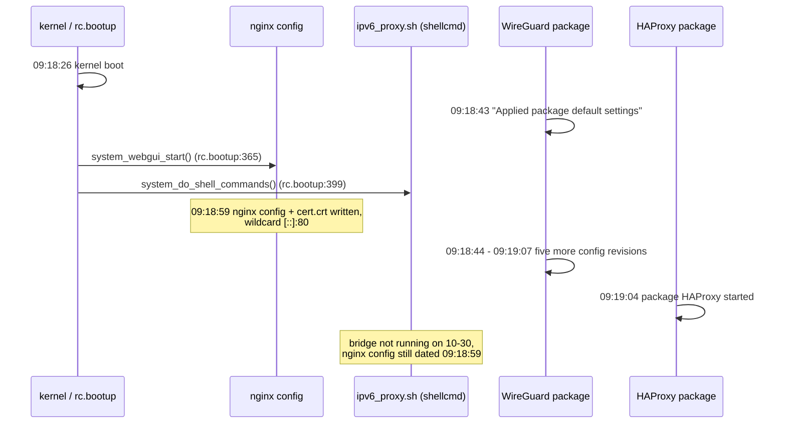
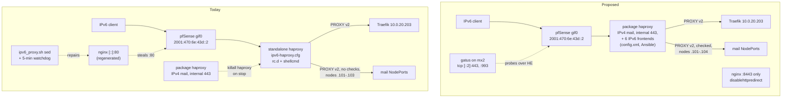

# Reliable public IPv6 ingress

Research note, 2026-11-02. Read-only investigation: nothing was changed on
pfSense, the cluster or DNS.

**Status (2026-11-02, later the same day):** phases 1-3 of the plan below are
done. The webConfigurator redirect is off, mx2's gatus probes the tunnel
address over IPv6, and the six IPv6 frontends run in the pfSense HAProxy
package (`playbooks/pfsense-haproxy.yml`); the standalone bridge, its boot
hook, watchdog and alerts are gone. Phase 4, the cold-start reboot test, is
waiting for a maintenance window Viktor picks. It builds on
[2026-08-31-cluster-dual-stack-ipv6.md](2026-08-31-cluster-dual-stack-ipv6.md)
and does not repeat its feasibility work; it updates only what changed or what
turned out to be wrong.

Every claim carries one of three labels:

- **[measured]** read on the live system today (pfSense over SSH read-only,
  `kubectl get`, `homelab logs query`, `homelab metrics query`, `dig`, `curl`).
- **[source]** read in the upstream code or vendor documentation, with a
  file and line or a URL.
- **[inferred]** reasoning from the above, not observed directly.

## Verdict

**Keep IPv6 termination on pfSense, but make it part of the pfSense HAProxy
package we already run, and remove the one setting that keeps colliding with
it.** Converting the cluster to dual-stack does not take pfSense out of the IPv6
path, so it does not address the failures we have had.

The recommendation, in three steps:

1. **Turn on "Disable webConfigurator redirect rule"**
   (`system/webgui/disablehttpredirect` in config.xml). In pfSense's own nginx
   generator, that redirect server block is the only place nginx listens on
   port 80. With the key set, no regeneration (boot, package re-sync,
   certificate change, GUI save) can put a `[::]:80` listener back.
   [source]
2. **Move the six IPv6 frontends into the pfSense HAProxy package**, declared in
   `scripts/pfsense-haproxy-bootstrap.php` next to the mail and internal-443
   frontends, and run that script from an Ansible playbook with `--check`. This
   removes the standalone HAProxy, its rc.d script, the boot `<shellcmd>`, the
   nginx `sed` patch and the 5-minute watchdog. [source, inferred]
3. **Add a real external IPv6 probe**: enable IPv6 on mx2's Oracle VCN and add
   gatus edge checks against the literal tunnel address. This replaces the
   watchdog's alerting with a check that also covers the HE tunnel and
   pfSense routing, which nothing tests today. [source, inferred]

Three facts carry most of the weight:

1. **The port-80 collision has a config-level off switch.** pfSense 2.7.2
   writes `listen 80; listen [::]:80;` only inside the HTTP-to-HTTPS redirect
   block, and skips the block when `disablehttpredirect` is set
   (`src/etc/inc/system.inc:2011-2023` on `RELENG_2_7_2`, unchanged at
   `:2295-2302` on `master`). The GUI's own listeners use port 8443 only.
   [source]
2. **The standalone bridge has more than one way to stop, and a boot-only start
   covers none of them after boot.** Besides the nginx regeneration, the
   package's rc script runs `killall haproxy` on stop
   (`/usr/local/etc/rc.d/haproxy.sh:22,59` on the box), which also kills the
   standalone bridge, and pfSense's `restart_service()` calls that stop. The
   package's own process is restarted by the package; the standalone one is
   not. [measured, source]
3. **The IPv6 path carries real people, mostly Viktor.** Over the 20 days the
   bridge was up (2026-10-03 to 10-22), the 28 bridged hostnames received on
   average 2,074 non-crawler IPv6 requests a day, 2.5% of their external
   traffic, plus 25,412 a day from Meta's crawler. For Immich the IPv6 share was
   8.1%, almost all from Meta's corporate network, Viktor's Hyperoptic prefix
   and a Starlink client. Port 25 received no IPv6 connections at all.
   [measured]

### Corrections to existing docs and memories

| Where | What it says | What I found |
|---|---|---|
| `docs/architecture/networking.md` (IPv6 Ingress gotcha, 2026-11-02), commit `238198f9`, memories #16552 and #16799 | The WireGuard re-sync regenerated nginx "about an hour after boot" | It happened **during boot**. `kern.boottime` is `Fri Oct 23 09:18:26 2026` local time; the WireGuard config revisions are 09:18:43 to 09:19:07, `cert.crt` and the nginx config 09:18:59, the package HAProxy started 09:19:04. All within 41 seconds of kernel start. The "hour" came from reading the boot time in UTC and the file times in local time (EEST, UTC+3 on that date). [measured] |
| `docs/research/2026-08-31-cluster-dual-stack-ipv6.md`, "0.34% of requests" | Non-crawler IPv6 is 0.34% of traffic | The query counted every IPv6 `ClientHost` in Traefik's log. Traefik logs the original client for Cloudflare-proxied hosts as well (today: `terminal`, `nextcloud` and `t3view`, whose AAAA are Cloudflare's, log `2a01:4b00:ab23:1200::/64` clients). So the figure describes IPv6 clients site-wide, not traffic over the bridge. The bridge-only figure is in [Traffic](#traffic-over-the-bridge). [measured] |
| `docs/architecture/dns.md`, record table | 26 non-proxied AAAA (2026-09-04) | 28 names resolve AAAA `2001:470:6e:43d::2` today: 26 Ingresses annotated `non-proxied`, plus `ssh` and `terminal-api`. [measured] |
| `docs/runbooks/mailserver-opnsense-haproxy.md`, bootstrap comments | Mail frontends listen on `10.0.20.1:{25,465,587,993}` | The package writes `bind :25` (and so on), which HAProxy documents as "all IPv4 addresses of the system". The bootstrap passes `'10.0.20.1'` as the `extaddr` key, which is not a key the package knows, so the address comes out empty. Harmless today, but it is why the IPv4 and IPv6 mail binds never collide. [measured, source] |
| Standalone bridge config vs package pools | (not documented) | The standalone mail backends list nodes .101-.103 with no health checks. The package pools list .101-.104 with checks on the non-PROXY ports. The two have drifted. [measured] |

---

## Measured current state

| Component | Value | How verified |
|---|---|---|
| pfSense | 2.7.2-RELEASE, FreeBSD 14.0 | `/etc/version`, `uname -r` |
| HAProxy package | `pfSense-pkg-haproxy-devel-0.63_2`, HAProxy `2.9-dev6`, `+PROMEX +TPROXY -QUIC` | `pkg info`, `haproxy -vv` |
| HE tunnel | `gif0`, `tunnel inet 192.168.1.2 --> 216.66.86.122` (`tserv1.prg1.he.net`, Prague), MTU 1280, `2001:470:6e:43d::2/128`, default route via `::1` | `ifconfig gif0`, `netstat -rn -f inet6`, PTR |
| Routed /64 | `2001:470:6f:43d::/64` on `vtnet1` (VLAN 10), pfSense `::1`; VLAN 20 (`vtnet2`) has link-local only | `ifconfig` |
| Standalone bridge | one `haproxy` process, PID 25957, started 2026-11-02 09:01:22, binds `[2001:470:6e:43d::2]:{443,80,25,465,587,993}` | `sockstat -6 -l`, `ps` |
| Package HAProxy | PID 34020 since 2026-10-23 09:19:04; binds `*:{25,465,587,993,2525}` IPv4 and `10.0.20.1:443`, `10.0.10.1:443` | `sockstat -4 -l`, `/var/etc/haproxy/haproxy.cfg` |
| nginx (webConfigurator) | `*:8443`, `*:80` IPv4; `[2001:470:6f:43d::1]:8443` and `:80` IPv6 (patched by `ipv6_proxy.sh` this morning); `<disablehttpredirect>` absent | `sockstat`, `/var/etc/nginx-webConfigurator.conf`, config.xml `<webgui>` |
| pf rules on `gif0` | pass TCP 80, 443, 25, 465, 587, 993 and UDP 51821 to `::2`, selected ICMPv6, block the rest | `pfctl -sr` |
| Watchdog | `ipv6_bridge_up = 1`, last run 151 s before the query | `homelab metrics query` |
| Files on the box only | `/usr/local/etc/ipv6-haproxy.cfg` and `/usr/local/etc/rc.d/ipv6proxy` are not in git; the playbook deploys only the two scripts | `git ls-files`, `playbooks/pfsense-ipv6-bridge.yml` |
| AAAA records | 28 names → `2001:470:6e:43d::2`; MX priority 1 `mail.viktorbarzin.me` has that AAAA | `dig @1.1.1.1` |
| End to end today | HTTPS via `--resolve` to the tunnel address: 200 in 0.07 s; SMTP banner on 25 and 587; 465 and 993 accept TCP | `curl`, socket test from the devvm (hairpins on pfSense, does not cross HE) |

### What happened on 2026-10-23

What is certain [measured]: everything above fell within 41 seconds of kernel
start; the nginx config was not modified again until this morning, so
`ipv6_proxy.sh`'s `sed` either ran before the 09:18:59 write or did not run; the
bridge was not running when checked on 2026-10-30 (memory #16552).

What is not recoverable: which writer produced the 09:18:59 file and whether the
bridge failed to bind or was started and then killed. pfSense's system log has
rotated, and pfSense syslog is not shipped to Loki (memory #16552). Both
candidate mechanisms are covered by the recommendation, so I stopped there.

One related open point. HAProxy sets `SO_REUSEADDR` and `SO_REUSEPORT_LB` on
every listener (`src/sock_inet.c:369-388` at `v2.9-dev6`), and FreeBSD normally
lets a specific-address bind coexist with another socket's wildcard bind when
that option is set. The 2026-08-16 outage was still a bind conflict by every
symptom recorded (nginx answering `[tunnel]:80`, bridge down). I did not find
the kernel-level reason. It does not change the recommendation, because with
the redirect disabled nothing else listens on those ports.

### Traffic over the bridge

Traefik access logs for the 28 bridged hostnames, per day, averaged over the
bridge-up window (2026-10-03 to 10-22, 20 days) and the bridge-down window
(2026-10-24 to 11-01, 9 days). Clients classified by prefix; whois from RIPE and
ARIN. [measured]

| Client class | Prefix | Bridge up, req/day | Bridge down, req/day |
|---|---|---:|---:|
| External IPv4 | any public IPv4 | 81,515 | 50,180 |
| Internal IPv4 | 10/8, 192.168/16, hairpin | 32,653 | 43,201 |
| Meta crawler | `2a03:2880::/29` (IE-FACEBOOK) | 25,412 | 0 |
| Meta corporate network | `2620:10d:c000::/40` (FACEBOOK-CORP) | 518 | 0 |
| Viktor's London home | `2a01:4b00:ab23:1200::/56` (Hyperoptic) | 372 | 0 |
| Starlink | `2605:59c0::/28` (SPACEX-STARLINK) | 114 | 0 |
| Other IPv6 | everything else, incl. Vivacom BG | 1,070 | 0 to 4 |
| Own IPv6 | ULA `fdfe:…`, HE `2001:470:6x:43d::` | 62 | 0 |

Non-crawler IPv6 is 2,074 requests a day, 2.5% of external requests to these
hosts. The Meta crawler mostly fetches `forgejo` (108,878 of the 125,582 IPv6
requests in the week to 10-22).

Immich alone, same windows [measured]:

| | External IPv4 | Meta corp | Hyperoptic | Starlink | Other IPv6 |
|---|---:|---:|---:|---:|---:|
| Bridge up, avg/day | 5,319 | 359 | 82 | 16 | 14 |
| 2026-10-20 | 17,106 | 1,954 | 21 | 0 | 0 |
| 2026-10-21 | 7,948 | 4,983 | 29 | 0 | 149 |
| Bridge down, avg/day | 7,591 | 0 | 0 | 0 | 0 |

IPv6 was 471 requests a day, 8.1% of Immich's external traffic, and up to about
5,000 a day on heavy days (memory #16552's "~5k/day" is the peak, not the
average). The Meta corporate traffic is most likely Viktor at work, the
Hyperoptic prefix is his London home (memory #6608 records the Flint 2 WAN
`2a01:4b00:ab23:1200::/64`), and the Starlink client also appears on `ha-london`
and `ha-sofia`, so it is probably one of the household's devices. These
attributions are [inferred].

Mail over IPv6, 2026-10-15 to 10-22 [measured]: postscreen (port 25) logged
**0** IPv6 `CONNECT`s against 216,756 IPv4. Submission (587) saw 12 IPv6
connects and SMTPS (465) 47; the sampled lines are connects that never
authenticated. The reason inbound IPv6 SMTP carries nothing is not established
(see [Open questions](#open-questions)).

**What a broken bridge costs a dual-stack client** [inferred]. With the bridge
down, `[tunnel]:443` refuses and pfSense's nginx answers `[tunnel]:80` with a
301 to `:8443`. Happy Eyeballs (RFC 8305) tries IPv6 first and falls back to
IPv4 after the refusal, so each new HTTPS connection pays roughly one extra
round trip over the HE path before it succeeds. Viktor saw Immich iOS thumbnails
speed up once the bridge came back. That is consistent with this mechanism, but
I did not measure per-connection timing on the phone, so treat the link as a
hypothesis.

---

## How today's bridge fails

| Failure mode | Trigger | Covered at boot? | Covered after boot? | Source |
|---|---|---|---|---|
| nginx takes `[::]:80` | any webConfigurator restart: boot, package re-sync, cert or GUI change | raced (2026-10-23) | watchdog, within 5 min | `system.inc:2011-2023`; incident above |
| Standalone killed by package stop | `haproxy.sh stop` → `killall haproxy`; called by `restart_service()` and package reinstall | no | watchdog, within 5 min | `haproxy.sh:22,59`; `/etc/inc/service-utils.inc:150-158` |
| Guard bug in the boot script | config drift on the box | no | watchdog | 2026-07-18 outage, memory #11214 |
| One frontend cannot bind | any of the above | all six frontends down | all six down until repaired | `src/haproxy.c:3420-3425` (`v2.9-dev6`) |
| Config only on the box | rebuild or restore from config.xml | `ipv6-haproxy.cfg` and rc.d are not in the nightly config.xml backup or in git | — | `git ls-files` |
| HE tunnel or pf routing broken | HE outage, WAN IPv4 change, rule change | no probe | no probe | gatus on mx2 is IPv4-only (`stacks/backup-mx/main.tf`: VCN `cidr_blocks` IPv4, route `0.0.0.0/0` only) |

The watchdog added today repairs the first three within 5 minutes and alerts on
the fourth. It does so by re-running a `sed` against a generated file, and it
cannot see the last row.

---

## Options

| Option | Moving parts removed | New moving parts | Survives nginx regen / reboot / package restart | Managed as code | Effort | Risk and blast radius | What IPv6 clients get |
|---|---|---|---|---|---|---|---|
| **A. Keep bridge + watchdog** (today) | none | none | regen and package restart: repaired within 5 min; reboot: raced, then repaired | scripts and cron via Ansible + PHP; `ipv6-haproxy.cfg` and rc.d on the box only | none | up to 5 min IPv6 outage per event; IPv6 web and mail share fate | h2, real client IP, short outages |
| **B. Disable redirect only** | nginx `sed` patch (no longer needed), watchdog's nginx check | one config.xml key | regen: yes; reboot: yes; package restart: **no**, still needs the watchdog | key via the existing PHP configurator | about 1 hour | low; pfSense stops answering plain HTTP on port 80 on every interface (no consumer found in the repo) | same as A, fewer outages |
| **C. Package frontends + disable redirect** (recommended) | standalone `haproxy`, `ipv6-haproxy.cfg`, rc.d `ipv6proxy`, boot `<shellcmd>`, `ipv6_proxy.sh`, watchdog + cron + pushgateway job | 6 frontends + 1 pool in config.xml; one external probe | regen: yes; reboot: package starts it; package restart: restarts its own process | config.xml via PHP, run by Ansible with `--check` | half a day incl. testing | one process now carries IPv4 mail, internal 443 and IPv6; a **cold-start** bind failure would stop all of them (a reload failure keeps the old process) | same as A, plus health-checked mail pools across 4 nodes |
| **D. Cluster dual-stack** | web 443/80 frontends only | HE /48, VLAN 20 prefix + RA, node addresses, Calico v6 pool, one-way apiserver/CM flags, kube-proxy, MetalLB v6 pool, Traefik dual-stack Service, pf rules to the VIP, policy and monitoring twins | web no longer depends on pfSense nginx; mail still needs A or C | Terraform + kubeadm config; pfSense side still config.xml | days, plus a test cluster | high; control-plane step does not roll back (08-31 note, section A) | HTTP/3 over IPv6, real IP natively |
| **E. Drop origin-direct AAAA** (F2 in the 08-31 note) | the whole IPv6 ingress path for these names | none | n/a | Terraform (`ingress_factory`) | 1 to 2 hours | low and reversible within DNS TTL; 28 names change | IPv4 only; no IPv6 attempt, so no fallback delay |
| **F. IPv6 front on mx2** | pfSense bridge and HE tunnel from the ingress path | OCI IPv6, a proxy on mx2, a path from mx2 to `10.0.20.203` | independent of pfSense | Terraform + cloud-init | 1 to 2 days | puts web ingress on a 954 MB box whose priority tenant is mail; adds a Frankfurt hop for London users | h2, real IP via PROXY v2 |

Not in the table: **NAT64 on pfSense** (pf `af-to`). I did not verify that
pfSense 2.7.2's pf supports it, and stateful NAT64 (RFC 6146) replaces the
client source with an IPv4 pool address, which loses the real client IP that
PROXY v2 preserves today. **Making these hosts Cloudflare-proxied** is ruled out
per host by `docs/architecture/dns.md` → "Which names stay grey, and why":
body size (`immich` 413 at 104,857,600 bytes, `forgejo` 183 MB pushes, `files`,
`send`), protocol (`mail` as MX, `ssh` raw TLS), CDN terms for media, recovery
paths (`traefik`, `ci`), and open questions on long-held requests (`ha-*`,
`headscale`, `openclaw`, `qbittorrent`).

### B. Disable the webConfigurator redirect [source]

- The setting is System > Advanced > Admin Access > "Disable webConfigurator
  redirect rule" (`src/usr/local/www/system_advanced_admin.php:134-140`). Saving
  it calls `config_set_path('system/webgui/disablehttpredirect', true)` and
  restarts the GUI (`src/usr/local/pfSense/include/www/system_advanced_admin.inc:180-191`).
- `system_generate_nginx_config()` emits the GUI server with
  `listen {$nginx_port} ssl http2; listen [::]:{$nginx_port} ssl http2;`
  (`system.inc:1874-1875`) and the redirect server with `listen 80; listen [::]:80;`
  only when `protocol == https` and `disablehttpredirect` is not set
  (`system.inc:2011-2023`). Every caller goes through this function, including
  `system_webgui_start()` at boot (`system.inc:1633-1690`), so the setting holds
  for every regeneration.
- The GUI cannot be bound to a specific address: the generator writes port-only
  `listen` lines and has no address input. The `[::]:8443` wildcard stays, which
  does not touch any bridged port.
- One residual path: packages can inject extra nginx `server` blocks through
  `plugin_nginx` (`system.inc:2025-2034`). None of our installed packages
  listens on a bridged port today [measured: `sockstat`].
- Side effect: `http://10.0.20.1` and `http://pfsense…` stop redirecting. A
  repo-wide search found no client that uses pfSense on port 80. WAN port 80 is
  a NAT `rdr` to Traefik and is unaffected, because `rdr` happens before any
  local socket [inferred from pf's processing order].

### C. Move the IPv6 frontends into the package

What the package supports, read from the installed code on the box:

| Need | Supported? | Where |
|---|---|---|
| IPv6 bind address | yes: an `extaddr = custom` with an IPv6 literal passes `is_ipaddr()` and becomes `bind 2001:470:6e:43d::2:443`; HAProxy takes the port as the number after the last colon | `haproxy.inc:526-545`, `:1833`; HAProxy `configuration.txt:5066-5072` |
| `mode tcp` | yes, `type = tcp` (already used for mail) | `pfsense-haproxy-bootstrap.php` |
| PROXY v2 to backends | yes, `send-proxy-v2` in the server `advanced` field (already used) | live `haproxy.cfg` |
| Mail pools with health checks on non-PROXY ports | already exist and can be reused as-is | live `haproxy.cfg` |
| Traefik :443 pool, no check | already exists (`webgui_traefik_443`) | live `haproxy.cfg` |
| Traefik :80 pool | new, same shape as the :443 one | — |
| Graceful reload | `haproxy -c` on a test copy, then `-x /tmp/haproxy.socket -sf <old pids>` | `haproxy.inc:1352-1384`, `:2565-2582` |
| Starts at boot | registered service `haproxy` with `haproxy.sh`, started by pfSense's package start-up | config.xml `<service>`, `haproxy.sh` |

What changes in failure behaviour [source]:

- **Reload.** If the new process cannot bind, HAProxy signals the old process
  to resume (`SIGTTIN`) and exits, so the previous config keeps serving
  (`src/haproxy.c:3389-3425`). A bad change degrades to "stale", not "down".
- **Cold start.** With no old process, the same failure exits and takes every
  frontend in the package with it: IPv4 mail and internal 443 as well as IPv6.
  Today a cold-start failure takes only IPv6. This is the main cost of option C.
  Mitigations:
  1. Disabling the redirect removes the only conflict ever observed.
  2. Adding `transparent` to the IPv6 binds (`extaddr_advanced`) would let the
     bind succeed even if the tunnel address is not configured yet. HAProxy
     sets `IPV6_BINDANY` for foreign binds on FreeBSD
     (`src/sock_inet.c:255-265`), and this build has `+TPROXY`. HAProxy's
     manual describes the keyword in Linux terms (`configuration.txt:15689`),
     so test this on pfSense before relying on it.
  3. gatus on mx2 already pages on "wan direct: mail 993" over IPv4, so a
     shared-process outage would be noticed within about 3 minutes.
- **`killall haproxy`** stops mattering: the only HAProxy left is the package's
  own, which the package restarts.
- **Backups.** The whole IPv6 config lands in config.xml, which the nightly
  `daily-backup` copies off the box.

What this does not change: no QUIC over IPv6 (`-QUIC` in this build), so the
false `alt-svc` advertisement from the 08-31 note remains. If that is wanted,
the IPv6 web pool can target a second Traefik entrypoint without `http3`
(memory #11833); that is independent of this work.

### D. Cluster dual-stack, re-assessed

The 08-31 feasibility work still stands. What matters for this question:

- **pfSense stays in the IPv6 data path** [source, inferred]. The 6in4 tunnel
  terminates on `gif0`, pfSense holds the default route and the pf rules
  (`pfctl -sr` above), and the tunnel's local endpoint is `192.168.1.2` behind
  the Archer AX6000. Dual-stack removes the HAProxy hop for web; it does not
  remove pfSense, the tunnel or the double NAT.
- **NDP needs a prefix on VLAN 20** [source, inferred]. MetalLB L2 answers NDP
  for IPv6 VIPs (metallb.io layer-2 concepts), so the VIP must be on-link in
  VLAN 20's prefix. The routed `/64` is already VLAN 10's, so this still needs
  the free HE `/48`, as the 08-31 note concluded. Carving addresses out of the
  tunnel's own `2001:470:6e:43d::/64` would probably route, since HE delivers
  that prefix down the point-to-point tunnel, but it is not a supported layout
  and I would not build on it.
- **Mail keeps the bridge.** Postfix and Dovecot get real client IPs from PROXY
  v2 today. Native IPv6 with `externalTrafficPolicy: Local` could replace that,
  but only by redesigning the mail Services and listeners. Until then mail
  needs option A or C anyway.
- **Real IPs and CrowdSec** are already correct over IPv6 through PROXY v2
  (08-31 note, section E), so dual-stack adds nothing there.

Count of moving parts: dual-stack removes two frontends and adds roughly ten
components across pfSense, the nodes, Calico, the control plane, MetalLB,
Traefik and monitoring. For a 2.5% traffic share whose failures came from
pfSense's own nginx, that trade goes the wrong way for reliability.

### Native IPv6 at Sofia

A1 Bulgaria does not offer native IPv6 on the Sofia line. Viktor phoned A1 on
2026-09-23 and they confirmed it (memory #13777); the previous A1 connection did
have a native `/56`. So the HE 6in4 tunnel stays, whatever we choose here.

Known about the tunnel [measured]: Prague tunnel server, MTU 1280, 6in4 behind a
double NAT (pfSense WAN `192.168.1.2` → AX6000 → `176.12.22.76`). Earlier
issues on it: London WireGuard MTU, Apple push until an MSS clamp, GB
geolocation (memory #13783).

Unknown: how often the tunnel itself is down. No probe crosses it, and I found
no HE endpoint updater in the repo or in pfSense's config.xml, so a change of
the public IPv4 would likely break the tunnel until it is updated at HE
[inferred].

### E. Drop the AAAA records

What we keep: every name stays reachable over IPv4; Cloudflare-proxied names
keep IPv6 through Cloudflare. What we lose [measured, inferred]:

- 2,074 non-crawler IPv6 requests a day move to IPv4. No client was seen that
  had IPv6 and no IPv4.
- Real-IPv6 visibility in Traefik and CrowdSec for these names (they would log
  the client's IPv4).
- IPv6 mail. In the 8 days measured, port 25 received no IPv6 connections, so
  the practical loss is small.
- The Cloudflare zone shrinks by 28 records (the 08-31 note counts this as a
  side benefit against the 200-record cap).

This is the right fallback if option C turns out to be unreliable in practice.
It is a DNS change in `ingress_factory`, reversible within the record TTL.

### Monitoring

Today nothing tests IPv6 from outside. The watchdog checks binds on the box;
the devvm's IPv6 (`2001:470:6f:43d::/64`) reaches the tunnel address inside
pfSense without crossing HE; uptime-kuma and the cluster are IPv4-only; gatus on
mx2 is IPv4-only because the OCI VCN has no IPv6 [measured].

Cheapest permanent probe: **gatus on mx2 over IPv6** [source, inferred].

- OCI lets you enable IPv6 on an existing VCN, with an Oracle-allocated `/56`,
  `/64` subnets, a `::/0` route to the internet gateway and an IPv6 address on
  the VNIC. It cannot be disabled afterwards
  ([OCI IPv6 addresses](https://docs.oracle.com/en-us/iaas/Content/Network/Concepts/ipv6.htm)).
  That page does not state a price; confirm on the OCI price list before
  applying, per the zero-cost rule.
- gatus's `client.network: ip6` applies to ICMP only (gatus README, client
  configuration), and Go's dialer falls back to IPv4 when given a name, so an
  `https://immich…` check would stay green with IPv6 broken. Probe the literal
  address instead: `tcp://[2001:470:6e:43d::2]:443` and `:993` with
  `[CONNECTED] == true`, in the `edge` group that already pages Slack. A ping
  check would not do: pfSense answers ICMPv6 while the bridge is down
  (`networking.md`, symptoms).
- Optional, inside pfSense: HAProxy's built-in Prometheus exporter is compiled
  in (`+PROMEX`), so a package stats frontend could expose per-frontend state to
  Prometheus without a script. Worth it only if the external probe proves too
  coarse.

---

## Recommended data path

## Phased plan

Each phase is independently useful and revertible. pfSense changes are
state-changing on a live network device, so each needs Viktor's go-ahead and a
`presence claim host:pfsense`.

1. **Disable the redirect** (option B). Add `system/webgui/disablehttpredirect`
   to `playbooks/files/pfsense-ipv6-bridge-config.php`, run the playbook with
   `--check --diff`, then apply. Verify: `/var/etc/nginx-webConfigurator.conf`
   has no `listen 80` / `listen [::]:80`; `sockstat -l | grep nginx` shows only
   8443; restart the webConfigurator once and confirm the bridge stays bound
   and `IPv6IngressBridgeSelfHealed` does not fire. Keep the watchdog for now.
   Revert: delete the key.
2. **External IPv6 probe.** Enable IPv6 on the `backup-mx` VCN, subnet, route
   table and VNIC in `stacks/backup-mx`, after confirming it is free and reading
   the plan for any replacement of the VCN or instance. Add the two literal
   `tcp://[…]` checks to the gatus `edge` group. Verify: probe green; then stop
   the bridge briefly in a maintenance window and watch it go red within about
   3 minutes. Doing this before phase 3 means phase 3 is observed from outside.
3. **Move IPv6 into the package** (option C). Extend
   `scripts/pfsense-haproxy-bootstrap.php` with six IPv6 frontends (custom
   address `2001:470:6e:43d::2`, `type tcp`), a `traefik_80` pool, and reuse of
   `webgui_traefik_443` and the four mail pools. Fix the mail frontends to use
   `extaddr = custom` while there. Give the script a `--check` mode and a
   playbook in the style of `pfsense-tailscale.yml`. Cut-over order: stop the
   standalone bridge, apply the package config, confirm with `sockstat -6 -l`
   that the package process holds all six ports, run the gatus probes and a
   `curl --resolve` per host class. Then remove the boot `<shellcmd>`, the
   watchdog cron entry, `ipv6_proxy.sh`, `ipv6_proxy_watchdog.sh`,
   `ipv6-haproxy.cfg` and `rc.d/ipv6proxy`, and retire the
   `IPv6IngressBridge*` alerts in favour of the gatus edge alerts. Revert: rerun
   the old playbook and `service ipv6proxy onestart`; the files stay in git
   history.
4. **Prove a cold start.** In a maintenance window, reboot pfSense and confirm
   IPv4 mail, internal 443 and all six IPv6 frontends come up without help.
   Optionally test `transparent` on the IPv6 binds with the tunnel interface
   down, to close the boot-ordering gap.
5. **Docs.** Update `networking.md` (IPv6 Ingress), the mail runbook, `dns.md`
   (28 AAAA) and memories #16552 and #16799 (boot timing).

If phase 3 or 4 shows the shared process is fragile in a way the probe cannot
cover, fall back to option E rather than back to the standalone bridge.

## Open questions

1. **Why did a specific-address bind lose to nginx's wildcard?** HAProxy sets
   `SO_REUSEADDR`, which on FreeBSD normally permits it. Not needed for the
   recommendation, but it would tell us whether anything else could collide.
2. **Which writer produced the nginx config at 09:18:59 on 10-23**, and did the
   bridge fail to bind or get killed? The logs that would say have rotated.
   Shipping pfSense's system log to Loki (memory #6715 recommends it) would
   answer the next one.
3. **Does `transparent` (IPV6_BINDANY) work for HAProxy binds on pfSense 2.7.2?**
   The source suggests yes; untested.
4. **Is OCI IPv6 free, and does enabling it on `backup-mx` replace any
   resource?** The OCI page states neither; check the price list and the
   Terraform plan.
5. **Why does port 25 receive no IPv6 mail?** pf passes it and the banner
   answers from the devvm. Candidates are HE filtering port 25 on the tunnel
   or sender policy; I did not verify either.
6. **How reliable is the HE tunnel itself, and what updates HE if the public
   IPv4 changes?** Nothing measures the first, and I found nothing doing the
   second.
7. **Does a failed Happy Eyeballs attempt explain the slow Immich thumbnails?**
   A timed comparison on the phone with the bridge up and down would settle it.

## Sources

pfSense (GitHub `pfsense/pfsense`):

- [`RELENG_2_7_2/src/etc/inc/system.inc`](https://github.com/pfsense/pfsense/blob/RELENG_2_7_2/src/etc/inc/system.inc), lines 1633-1690 (`system_webgui_start`), 1874-1875 and 1907-1908 (GUI listeners), 2011-2023 (redirect block), 2025-2034 (`plugin_nginx`)
- [`master/src/etc/inc/system.inc`](https://github.com/pfsense/pfsense/blob/master/src/etc/inc/system.inc), lines 2155, 2190, 2295-2302
- [`RELENG_2_7_2/src/usr/local/www/system_advanced_admin.php`](https://github.com/pfsense/pfsense/blob/RELENG_2_7_2/src/usr/local/www/system_advanced_admin.php), lines 134-140
- [`RELENG_2_7_2/src/usr/local/pfSense/include/www/system_advanced_admin.inc`](https://github.com/pfsense/pfsense/blob/RELENG_2_7_2/src/usr/local/pfSense/include/www/system_advanced_admin.inc), lines 180-191
- [`RELENG_2_7_2/src/etc/rc.bootup`](https://github.com/pfsense/pfsense/blob/RELENG_2_7_2/src/etc/rc.bootup), lines 365, 399, 458-462

pfSense HAProxy package, as installed on the box (`pfSense-pkg-haproxy-devel-0.63_2`, read-only):

- `/usr/local/pkg/haproxy/haproxy.inc`: 526-545 (address filter), 583-660 (rc script template, `killall haproxy` at 651), 1352-1384 (`haproxy_check_and_run`), 1833 (bind line), 2503-2612 (`haproxy_check_run`, `-x … -sf`)
- `/usr/local/pkg/haproxy/haproxy_utils.inc`: 146-154 (`haproxy_interface_ip`)
- `/usr/local/etc/rc.d/haproxy.sh`: 22, 59
- `/etc/inc/service-utils.inc`: 119-171 (`stop_service`, `restart_service`)

HAProxy (GitHub `haproxy/haproxy`, tag `v2.9-dev6`, matching the build on the box):

- [`src/haproxy.c`](https://github.com/haproxy/haproxy/blob/v2.9-dev6/src/haproxy.c), lines 3389-3425
- [`src/sock_inet.c`](https://github.com/haproxy/haproxy/blob/v2.9-dev6/src/sock_inet.c), lines 167-265, 369-388
- [`doc/configuration.txt`](https://github.com/haproxy/haproxy/blob/v2.9-dev6/doc/configuration.txt), lines 5015-5072 (bind address and port), 15689-15699 (`transparent`)

Other:

- [RFC 8305, Happy Eyeballs Version 2](https://www.rfc-editor.org/rfc/rfc8305)
- [RFC 6146, Stateful NAT64](https://www.rfc-editor.org/rfc/rfc6146)
- [MetalLB in layer 2 mode](https://metallb.io/concepts/layer2/)
- [OCI: IPv6 addresses](https://docs.oracle.com/en-us/iaas/Content/Network/Concepts/ipv6.htm)
- [gatus README, client configuration](https://github.com/TwiN/gatus#client-configuration)

This repo:

- `docs/research/2026-08-31-cluster-dual-stack-ipv6.md`
- `docs/architecture/networking.md` → "IPv6 Ingress (HE Tunnel + HAProxy Bridge)"
- `docs/architecture/dns.md` → "Which names stay grey, and why"
- `docs/runbooks/mailserver-opnsense-haproxy.md`, `scripts/pfsense-haproxy-bootstrap.php`
- `scripts/pfsense-ipv6-proxy.sh`, `scripts/pfsense-ipv6-proxy-watchdog.sh`, `playbooks/pfsense-ipv6-bridge.yml`, `playbooks/files/pfsense-ipv6-bridge-config.php`
- `stacks/backup-mx/main.tf`, `stacks/backup-mx/cloud-init.yaml.tftpl`
- Memories #11214, #11833, #13777, #13783, #16552, #16799, #6608, #6715

Live measurements were taken read-only on 2026-11-02 with SSH to pfSense
(`sockstat`, `ifconfig`, `pfctl -sr`, `ls`, `ps`, reading config and package
files), `kubectl get`, `dig @1.1.1.1`, `curl --resolve`, `whois`,
`homelab logs query` over `{namespace="traefik"}` and `{namespace="mailserver"}`,
and `homelab metrics query`.
