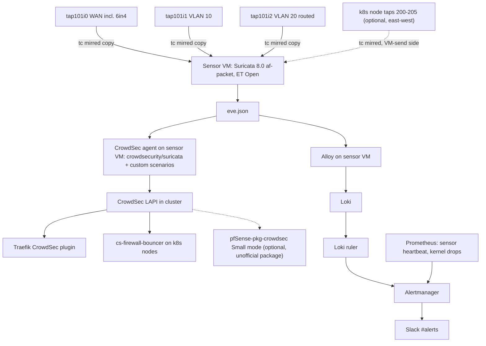

# Network IDS and NSM options for the homelab

Research note, 2026-11-03. Read-only investigation: nothing was changed on
pfSense, the Proxmox host or the cluster. It answers two questions: which
open-source network intrusion detection / network security monitoring tools fit
this homelab, and where the sensor should run.

Labels used below:

- [measured] read on the live system today (read-only `qm config`, tap byte
  counters in `/sys/class/net`, `kubectl get`), or given as verified context
  for this task.
- [source] read in upstream documentation, release pages, source code or the
  CrowdSec hub, linked inline and in [Sources](#sources).
- [inferred] reasoning from the above, not observed directly.

## Summary

Recommendation: run Suricata 8.0.x on a small dedicated Linux sensor VM, fed
by Proxmox host-side `tc mirred` copies of the pfSense taps for WAN, VLAN 10
and VLAN 20, and retire the WAN-only Snort 2 instance on pfSense after a
parallel run. Suricata is the only candidate with an official CrowdSec hub
collection (`crowdsecurity/suricata`), it decodes 6in4 on the WAN leg, and its
EVE JSON goes straight into Loki through Alloy. Ship EVE to Loki for the Slack
pages, and let a CrowdSec agent on the sensor tail `eve.json` so that alerts
become bans in the existing LAPI. Two gaps need custom work: the hub scenario
bans the alert's source IP only, so outbound C2 hits need our own scenario,
and the hub whitelist does not cover our IPv6 prefixes. Add Zeek later on the
same VM if we want protocol logs and JA4. The heavyweight suites (Security
Onion, Malcolm, Arkime, Wazuh) would each bring a second search stack and
need 24 GB of RAM or more, which the host does not have to spare.

## What we measured today

| Item | Value |
|---|---|
| pfSense NICs | net0 `vmbr0` untagged (WAN), net1 `vmbr1` tag 10, net2 `vmbr1` tag 20, net3 `vmbr0` tag 30; all `firewall=1`, so each tap hangs off its own `fwbr101iN` bridge [measured] |
| Bridges | `vmbr0` and `vmbr1` are VLAN-aware Linux bridges, no Open vSwitch; `vmbr1` has no physical ports [measured] |
| VLAN 20 members | pfSense plus VMs 200 to 205 (k8s nodes) and 220, all on the same host, so node-to-node traffic never leaves `vmbr1` [measured] |
| Average rate over ~11.7 days of uptime | `tap101i0` (WAN) 106.8 Mbps, `tap101i1` (VLAN 10) 1.7 Mbps, `tap101i2` (VLAN 20) 112.5 Mbps [measured] |
| East-west on VLAN 20 | k8s node taps transmitted 10.7 TB in total, of which 1.6 TB went to pfSense, so roughly 9 TB (about 70 Mbps average) stayed node-to-node [measured, subtraction inferred] |
| Calico IP pools | IPv4 and IPv6 pools both `vxlanMode: CrossSubnet`, `ipipMode: Never`; all nodes are in 10.0.20.0/24 [measured] |

One small docs-vs-live mismatch: the task brief places `tap101i3` (VLAN 30) on
`vmbr1`; the VM config has it on `vmbr0` tag 30. It does not affect this
note because VLAN 30 is out of scope.

Peak rates are unknown; the figures above are averages from byte counters.

## Comparison

| Candidate | Role | Detects that others do not | Cost at our volume | IPv6 / 6in4 | Latest release | Licence | CrowdSec integration | Loki integration |
|---|---|---|---|---|---|---|---|---|
| Suricata 8.0 (sensor VM) | Signature IDS plus protocol logs (EVE `alert`, `dns`, `tls`, `flow`, `anomaly`) | Signature hits from ET Open; JA3/JA4 TLS fields in EVE ([config](https://github.com/OISF/suricata/blob/main/suricata.yaml.in)); decodes VXLAN, Geneve, Teredo | No vendor RAM-per-Gbps figure found. Default memcaps are small (flow 128 MiB, stream reassembly 256 MiB in the shipped `suricata.yaml.in`). Our aggregate is about 220 Mbps average [measured]; a 4 vCPU, 4 GB VM is a reasonable start to measure against [inferred] | Decodes IPv6-in-IPv4 (protocol 41) as a tunnel ([decode-ipv4.c](https://github.com/OISF/suricata/blob/main/src/decode-ipv4.c)) | 8.0.8, 2026-10-29 ([releases](https://github.com/OISF/suricata/releases)) | GPL-2.0 | Official: `crowdsecurity/suricata` collection, parser reads EVE (`type: suricata-evelogs`) or fast.log ([hub](https://app.crowdsec.net/hub/author/crowdsecurity/collections/suricata)) | EVE JSON file, Alloy `loki.source.file` [inferred: standard Alloy usage] |
| Suricata on pfSense (package) | Same engine, GUI-managed | Same as above, but per pfSense interface | Runs inside the 4 GB firewall VM, one instance per interface [inferred]; Netgate lists only "SSD/HDD strongly recommended" ([package list](https://docs.netgate.com/pfsense/en/latest/packages/list.html)) | Same engine. Not tested on `gif0`; a sensor avoids `gif0` entirely | On CE 2.7.2 the package pulls engine 7.0.8 ([RELENG_2_7_2 Makefile](https://github.com/pfsense/FreeBSD-ports/blob/RELENG_2_7_2/security/suricata/Makefile)); the 7.0 branch is end of life since 2026-07-07 ([EOL policy](https://suricata.io/our-story/eol-policy/)) | GPL-2.0 engine, Apache-2.0 package | Same hub parser, but the package hard-codes the EVE syslog identity to `suricata` ([template](https://github.com/pfsense/FreeBSD-ports/blob/RELENG_2_7_2/security/pfSense-pkg-suricata/files/usr/local/pkg/suricata/suricata_yaml_template.inc)) while the hub parser filters on `program == 'suricata-evelogs'`, so it needs a custom parser or relabel | EVE to syslog, then pfSense remote syslog to Alloy 10.0.20.208 |
| Snort 3 | Signature IDS, OpenAppID | OpenAppID application detection ([downloads](https://www.snort.org/downloads)) | Not measured; no sizing source found | Not verified in this pass | 3.12.4.0, 2026-10-21 ([releases](https://github.com/snort3/snort3/releases)) | GPL-2.0 | No hub collection (hub index search found none) | JSON alert output exists [unverified in this pass] |
| Snort 2 on pfSense (today) | Signature IDS | Nothing the others lack | Already running | Fails to decode IPv6 on `gif0`, decodes 6in4 on WAN [measured] | 2.9.20; `pfSense-pkg-snort` still depends on `snort>=2.9.20` ([Makefile](https://github.com/pfsense/FreeBSD-ports/blob/RELENG_2_7_2/security/pfSense-pkg-snort/Makefile)). Snort 3 is in the ports tree (3.1.71.0 on the 2.7.2 branch) but has no pfSense GUI package | GPL-2.0 | No hub collection | Local file / syslog that nothing reads today [measured] |
| Zeek | NSM logs (`conn`, `dns`, `ssl`, `x509`, `files`, `weird`, `notice`, `intel`, `tunnel`) | Behaviour and metadata rather than signatures: intel matching ([intel framework](https://docs.zeek.org/en/master/frameworks/intel.html)), notice framework, JA4+ via the FoxIO package ([ja4/zeek](https://github.com/FoxIO-LLC/ja4/tree/main/zeek)), HASSH | No sizing figure found in the Zeek docs; AF_PACKET multi-worker is supported ([cluster setup](https://docs.zeek.org/en/master/cluster-setup.html)). Log volume into Loki is the larger cost [inferred] | `Tunnel::IP` covers IP-in-IP such as 6to4/6in4, and a `tunnel.log` records it ([tunnels/main.zeek](https://github.com/zeek/zeek/blob/master/scripts/base/frameworks/tunnels/main.zeek)) | 9.0.1 LTS, 2026-10-26 ([get-zeek](https://zeek.org/get-zeek/)) | BSD-style ([COPYING](https://github.com/zeek/zeek/blob/master/COPYING)); JA4 is BSD-3, the rest of JA4+ is FoxIO License 1.1 (non-commercial internal use allowed, not OSI open source) ([licensing](https://github.com/FoxIO-LLC/ja4#licensing)) | No hub collection; a custom parser for `notice.log` / `intel.log` would be needed | JSON logs ([log formats](https://docs.zeek.org/en/master/log-formats.html)) via Alloy |
| Security Onion | Full NSM distribution (Suricata, Zeek, Elastic stack, SOC UI) | Case management, PCAP, hunting UI | Standalone minimum 24 GB RAM, 4 cores, 200 GB; 32 GB or more suggested for any real traffic ([hardware](https://docs.securityonion.net/en/3/main/hardware/)) | Via bundled Suricata/Zeek | 3.4.0, 2026-11-02 (the 2.4 line last shipped 2.4.211 on 2026-04-07) ([releases](https://github.com/Security-Onion-Solutions/securityonion/releases)) | Elastic License 2.0 ([LICENSE](https://github.com/Security-Onion-Solutions/securityonion/blob/HEAD/LICENSE)) | None; would be a parallel SIEM | Its own Elastic store, a second log stack |
| Malcolm (CISA) | Full NSM suite (Zeek, Suricata, Arkime, OpenSearch) | ICS protocol parsers, Arkime PCAP UI | Minimum 8 cores and 24 GB RAM, 16 cores and 32 GB recommended ([requirements](https://cisagov.github.io/Malcolm/docs/system-requirements.html)) | Via bundled engines | v26.10.0, 2026-10-29 ([releases](https://github.com/cisagov/Malcolm/releases)) | Apache-2.0 | None | Its own OpenSearch, a second log stack |
| Arkime | Full packet capture and session search | Retained PCAP for forensics; JA4+ ([FoxIO](https://github.com/FoxIO-LLC/ja4)) | Capture nodes 64 to 96 GB RAM; 1 Gbps is about 11 TB of PCAP per day uncompressed ([FAQ](https://arkime.com/faq)); at ~220 Mbps that is roughly 2.4 TB per day [inferred] | Not checked | v6.9.1, 2026-10-22 ([releases](https://github.com/arkime/arkime/releases)) | Apache-2.0 | None; it does not generate detections itself | Needs OpenSearch/Elasticsearch |
| ntopng (pfSense package) | Traffic visibility, flow analytics | Per-host traffic accounting and top talkers | Package on CE 2.7.2 is 0.8.13 with ntopng 5.6 ([Makefile](https://github.com/pfsense/FreeBSD-ports/blob/RELENG_2_7_2/net/pfSense-pkg-ntopng/Makefile)); Netgate notes "Requires SSD/HDD" | Not checked | Upstream 7.0, 2026-09-22 ([releases](https://github.com/ntop/ntopng/releases)) | GPL-3.0 (Community); behaviour alerts need Enterprise L ([alerts](https://www.ntop.org/guides/ntopng/basic_concepts/alerts.html)) | None | Community recipients include Slack, syslog and webhook ([endpoints](https://www.ntop.org/guides/ntopng/user_interface/shared/alerts/available_endpoints.html)) |
| pfBlockerNG | IP reputation aliases, GeoIP, DNSBL via Unbound | Blocks known-bad IPs and domains at the edge before any IDS sees them | Runs on pfSense; not measured | Not checked | On the 2.7.2 branch both `pfBlockerNG` and `pfBlockerNG-devel` are 3.2.0; on `devel` they are 3.2.15 and 3.2.16 ([2.7.2](https://github.com/pfsense/FreeBSD-ports/tree/RELENG_2_7_2/net), [devel](https://github.com/pfsense/FreeBSD-ports/tree/devel/net)) | Apache-2.0 package [unverified] | Overlaps CrowdSec blocklists; the CrowdSec package README says it replaces a Blocklist Mirror "without requiring pfBlockerNG" ([README](https://github.com/crowdsecurity/pfSense-pkg-crowdsec)) | pfSense syslog |
| CrowdSec on pfSense (`pfSense-pkg-crowdsec`) | Enforcement (and optional log processing) on the firewall | Edge enforcement for every VLAN and for IPv6 on `gif0` | Small mode is remediation only against an existing LAPI ([README](https://github.com/crowdsecurity/pfSense-pkg-crowdsec)) | Separate pf tables `crowdsec_blacklists` and `crowdsec6_blacklists` ([install guide](https://docs.crowdsec.net/docs/getting_started/install_crowdsec_pfsense/)) | v0.1.8-1.8.2-38, 2026-11-03, with a `freebsd-14-amd64` bundle ([releases](https://github.com/crowdsecurity/pfSense-pkg-crowdsec/releases)) | Not stated on GitHub | Maintained by CrowdSec, but "not installed from the official repositories yet"; installed from a release archive | n/a |
| Wazuh | Host IDS and SIEM | File integrity, host log rules | All-in-one: 4 vCPU, 8 GiB, 50 GB for 1 to 25 agents ([quickstart](https://documentation.wazuh.com/current/quickstart.html)) | n/a, not a NIDS | v4.14.9, 2026-10-15; 5.0.0 in RC ([releases](https://github.com/wazuh/wazuh/releases)) | GPL-2.0, engine AGPL-3.0 ([LICENSE](https://github.com/wazuh/wazuh/blob/HEAD/LICENSE)) | None | Ships its own indexer, a parallel SIEM |
| Falco | Kubernetes runtime (syscalls) | Shell in container, sensitive file reads, outbound connections to miner pool ports ([rules](https://github.com/falcosecurity/rules/blob/main/rules/falco_rules.yaml)) | DaemonSet per node; not measured | n/a | 0.45.2, 2026-10-29 ([releases](https://github.com/falcosecurity/falco/releases)) | Apache-2.0 | None | Falcosidekick has Loki, Slack and Alertmanager outputs ([README](https://github.com/falcosecurity/falcosidekick)) |
| Tetragon | Kubernetes runtime (eBPF) with in-kernel enforcement | Process exec, syscalls, network and file I/O per workload ([overview](https://tetragon.io/docs/overview/)) | DaemonSet per node; no overhead figure published on the overview page | n/a | v1.8.0, 2026-10-30 ([releases](https://github.com/cilium/tetragon/releases)) | Apache-2.0 | None | JSON events [unverified in this pass] |
| Calico Goldmane / Whisker (running) | East-west flow metadata | Who talks to whom, allow/deny and policy trace, per workload | Already running; ~60 min ring buffer plus the `goldmane_edges` Postgres trail (`docs/runbooks/goldmane-flow-trail.md`) | Dual-stack pools [measured] | Running | Apache-2.0 | None | Edge set in Postgres, daily Slack digest |

What Goldmane covers and what it does not: it answers "which workload talked
to which, on what port, allowed or denied", which is the east-west visibility
question. It does not inspect payloads or match signatures, so it cannot say a
flow looked like an exploit or a C2 beacon. That is the part a network IDS
adds.

## Free rulesets

| Ruleset | Engine | Cost and terms |
|---|---|---|
| ET Open | Suricata (a `suricata-8.0` tree exists and was updated 2026-11-03), Snort 2.9 | Free, no account ([rules.emergingthreats.net/open](https://rules.emergingthreats.net/open/)) |
| Talos Community | Snort 2.9 and Snort 3 | Free, GPLv2, updated daily, a subset of the subscriber set ([rule set FAQ](https://www.snort.org/faq/what-are-the-differences-in-the-rule-sets)) |
| Talos Registered | Snort 2.9 and Snort 3 | Free but needs a snort.org account; 30 days behind the subscriber set ([FAQ](https://www.snort.org/faq/what-are-the-differences-in-the-rule-sets)) |
| abuse.ch Feodo Tracker | Suricata and Snort | Free download, no key shown; the page currently says the datasets are empty ([blocklist](https://feodotracker.abuse.ch/blocklist/)) |

Talos rules are written for Snort; using them in Suricata is possible for
some rules but not something this note verified. ET Open is the main free
Suricata ruleset.

## Sensor placement

| | (a) On pfSense (packages) | (b) Sensor VM fed by host-side mirror of pfSense taps | (c) Per-node in-cluster sensors |
|---|---|---|---|
| What it sees | Per pfSense interface. WAN is post-NAT outbound (source 192.168.1.2) and pre-DNAT inbound; LAN interfaces show inside hosts [inferred] | Every frame to and from pfSense on the mirrored taps: WAN (incl. 6in4 as protocol 41), VLAN 10, VLAN 20. Inside-host attribution from the VLAN 10/20 legs [inferred] | Each node's own traffic incl. pod-to-pod across nodes; nothing on VLAN 10 or the WAN leg [inferred] |
| VLAN 20 east-west | Not seen; node-to-node frames are switched in `vmbr1` and never reach pfSense [measured topology] | Not seen from `tap101i2` alone. Adding a mirror of each k8s node tap (ingress side only, i.e. frames the VM sends) covers it once per frame, about +70 Mbps average [measured, inferred] | Seen, at per-node cost |
| Performance at our volume | Shares 8 vCPU and 4 GB with routing; ~2.7 GB reclaimable [measured]. Three interface instances each load the full ruleset [inferred] | Host has 44 cores; `tc` cloning costs host CPU and no pfSense resources. Sensor needs its own RAM (estimate 4 GB) [inferred] | Per-node CPU and RAM on six nodes, multiplying ruleset memory [inferred] |
| Engine version | Suricata 7.0.8 on CE 2.7.2, branch EOL; Snort 2.9.20 | Any current release (8.0.8) from OISF packages | Any current release |
| Failure blast radius | A hang or OOM on the firewall VM affects routing for everything. Passive mode limits this to resource pressure, but the pressure is on the edge | Passive copy. A sensor crash loses detection only; traffic is unaffected. A mistaken `tc` rule (for example `redirect` instead of `mirror`) on the host could black-hole a pfSense interface ([tc-mirred](https://man7.org/linux/man-pages/man8/tc-mirred.8.html)) | A crash affects only that node's sensor; a misconfigured DaemonSet in host network touches every node |
| Persistence | pfSense config | Taps are recreated on every VM start, so the `tc` rules must be re-applied by a Proxmox hookscript on VM 101 and on the sensor VM (`qm set --hookscript`, [qm docs](https://pve.proxmox.com/pve-docs/qm.1.html)) [inferred] | Helm/Terraform |
| Fit with "detections feed CrowdSec" | Needs a custom syslog parser (identity is fixed to `suricata`) | Agent tails `eve.json` with the hub's `suricata-evelogs` label, no custom parser | Same as (b), per node |

How the mirror works. Linux bridges have no native port mirroring; Proxmox
users either switch to Open vSwitch mirrors or use `tc` with the `mirred`
action ([Proxmox forum](https://forum.proxmox.com/threads/port-mirroring.115865/),
community source). `tc-mirred` copies (`mirror`) or moves (`redirect`) packets
to a target device; an ingress filter on a `clsact` qdisc copies frames the VM
sends, and an egress filter copies frames the VM receives
([man page](https://man7.org/linux/man-pages/man8/tc-mirred.8.html)). The
target is the host-side tap of a capture NIC on the sensor VM, one per mirrored
pfSense tap so Suricata's `in_iface` still says which leg an alert came from.
Frames on the pfSense taps are untagged, because VLAN tags are added and
removed at the `fwpr`/`vmbr1` port [inferred from the `fwbr` layout]. One
forum report describes a `tc` mirror that only delivered broadcast frames
([thread](https://forum.proxmox.com/threads/linux-bridge-port-mirror-using-tc-only-receiving-broadcast-traffic.47395)),
so the first rollout step is to confirm unicast arrives.

Why the pfSense taps miss node-to-node traffic: a tap carries only frames
addressed to or sent by that VM. Pod-to-pod traffic between nodes uses the
node MACs on VLAN 20, and with `vxlanMode: CrossSubnet` and all nodes in one
subnet it is routed unencapsulated between nodes [measured config; behaviour
inferred from the mode name]. The bridge forwards it between node taps
directly. To see it, mirror the node taps (VMs 200 to 205); mirroring only
their ingress side counts each east-west frame once instead of twice.

Recommendation: (b). It is the only placement that runs a supported Suricata
branch without upgrading pfSense, keeps the IDS off the firewall's failure
path, and sees all three legs including 6in4. Node-tap mirroring for
east-west is an optional second step (see open questions).

## Recommended architecture

Mapped to Viktor's decisions:

1. Detections feed CrowdSec bans. The hub collection `crowdsecurity/suricata`
   bans on a single severity 1 TCP alert, or on more than two distinct
   severity 2 TCP signatures within a 20 s leak window, grouped by
   `source_ip` ([scenario YAML](https://github.com/crowdsecurity/hub/blob/master/scenarios/crowdsecurity/suricata-alerts.yaml)).
   The hub page says it was tested with Suricata 6 and that EVE is the
   preferred input ([hub](https://app.crowdsec.net/hub/author/crowdsecurity/collections/suricata)).
   Three adjustments:
   - Whitelist our own IPv6. The default `crowdsecurity/whitelists` covers
     `::1` and the IPv4 private ranges only
     ([whitelists.yaml](https://github.com/crowdsecurity/hub/blob/master/parsers/s02-enrich/crowdsecurity/whitelists.yaml)),
     so an alert sourced from our Hurricane Electric prefix or the cluster ULA
     `fd62:f088:7d06:100::/56` would ban ourselves.
   - Outbound C2. When an inside host triggers a rule, `src_ip` is usually
     the inside host, which the whitelist drops, so no ban results. A custom
     scenario that bans `dest_ip` for malware/C2 categories is needed if we
     want those IPs blocked [inferred].
   - UDP. Both hub scenarios filter `proto == 'TCP'`, so DNS and QUIC alerts
     never ban.

   Enforcement today is the Traefik plugin and the node nftables bouncer.
   The bouncer matches on source address only (payload offset 12 for IPv4,
   8 for IPv6, [nftables_context.go](https://github.com/crowdsecurity/cs-firewall-bouncer/blob/main/pkg/nftables/nftables_context.go))
   on the `input` and `forward` hooks
   ([default config](https://github.com/crowdsecurity/cs-firewall-bouncer/blob/main/config/crowdsec-firewall-bouncer.yaml)),
   so a banned C2 IP would have its replies dropped at the nodes but VLAN 10
   hosts would not be covered [inferred]. `pfSense-pkg-crowdsec` in Small
   mode would enforce at the edge for every VLAN and for IPv6, at the cost of
   running a package outside the official pfSense repository.
2. Coverage WAN + VLAN 10 + VLAN 20. The three pfSense tap mirrors cover all
   routed traffic on those legs. Node-to-node traffic on VLAN 20 needs the
   optional node-tap mirrors.
3. Slack pages, through the existing Loki ruler to Alertmanager to `#alerts`
   path (`docs/architecture/monitoring.md`):
   - Outbound C2/malware: Loki rule on EVE alerts whose `src_ip` is inside and
     whose signature category is malware or C2.
   - High-severity inbound: Loki rule on `alert.severity == 1` with an
     outside `src_ip`.
   - Silent pipeline: Suricata writes EVE `stats` events on a fixed interval
     by default; an `absent_over_time` Loki rule on `event_type="stats"`
     catches a dead sensor or dead shipper, and a rule on
     `capture.kernel_drops` growth catches an overloaded one [inferred].

A sensor VM fits the RAM budget: about 4 GB against roughly 44 GB available
[measured host, inferred sensor size], compared with 24 to 32 GB for Security
Onion or Malcolm.

## What we would give up, and risks

- Inline IPS. A mirrored sensor cannot drop packets; blocking happens only
  after CrowdSec acts, seconds later. This matches the decision to ban rather
  than drop inline.
- GUI management. Rules, thresholds and suppression move from the pfSense
  GUI to files on the sensor VM (`suricata-update`), which is one more VM to
  patch.
- Duplicate alerts. Downloads cross both the WAN and VLAN 20 legs, so one
  flow can alert twice (once post-NAT, once with the inside address). The
  CrowdSec scenario counts distinct signatures, so ban logic is unaffected,
  but Loki rules should de-duplicate on `flow_id` or `in_iface` [inferred].
- Blind spots that stay blind. HTTPS payloads and the Cloudflare tunnel are
  opaque to any network IDS; L7 stays with CrowdSec AppSec in Traefik. On the
  WAN leg, outbound traffic is already NATed to 192.168.1.2.
- Host-level `tc` rules live outside pfSense and outside Kubernetes. They
  must be codified (hookscript plus wherever the PVE host config is managed)
  or a VM restart silently stops the mirror. The silent-pipeline page is
  the backstop.
- Hub content age. The Suricata collection was tested with Suricata 6; field
  names have been stable in EVE, but this needs a check on 8.0 before
  relying on it.
- Loki volume. Full EVE (`flow`, `dns`, `tls`) or Zeek `conn.log` at about
  220 Mbps could be large; start with `alert`, `anomaly`, `stats` and
  `dns`, and measure.

## Open questions

1. Peak throughput. Only 11-day averages are known. A short read of tap
   counters at peak would confirm the sensor size.
2. Is node-to-node VLAN 20 inspection worth about +70 Mbps average of mirror
   traffic? Much of it is likely storage and cluster-internal traffic
   [inferred, not measured by protocol]. A BPF filter or Suricata's
   `encryption-handling: bypass` can cut the cost.
3. Where should the host `tc` rules and hookscripts be codified? This note
   did not check whether the PVE host is managed by Ansible or by the
   Terraform Proxmox provider.
4. Suricata RAM with ET Open on 8.0. No primary-source figure was found; it
   needs measuring on the sensor VM.
5. pfSense upgrade path. CE 2.7.2 is in the older releases group and 2.8.0
   is listed as unsupported ([releases](https://docs.netgate.com/pfsense/en/latest/releases/index.html)).
   Which Suricata engine the 2.8.1 / 2.9.0 package repository ships was not
   verified (the `devel` ports tree carries 8.0.4). An upgrade would make
   option (a) viable again on a supported engine, but it would not change the
   failure-path argument.
6. `pfSense-pkg-crowdsec` on CE 2.7.2. The release ships a `freebsd-14-amd64`
   bundle; this note did not verify that it installs cleanly on 2.7.2, and
   the install guide lists no supported pfSense versions. Netgate states that
   packages from other repositories are unsupported
   ([packages](https://docs.netgate.com/pfsense/en/latest/packages/index.html)).
7. Suricata EVE `src_ip` direction for alerts on server responses (for
   example a C2 reply) was not verified against the 8.0 docs; it decides
   whether the hub scenario already bans some C2 servers.
8. Snort 3 IPv6/6in4 handling and JSON output were not verified; Snort 3 is
   not recommended here mainly because there is no pfSense package and no
   CrowdSec hub collection.
9. pfBlockerNG versus CrowdSec blocklists: whether pfBlockerNG adds anything
   once the CrowdSec pfSense bouncer is in place was not evaluated.

## Sources

- Suricata releases: https://github.com/OISF/suricata/releases
- Suricata EOL policy: https://suricata.io/our-story/eol-policy/
- Suricata default config: https://github.com/OISF/suricata/blob/main/suricata.yaml.in
- Suricata IPv4 decoder (protocol 41 tunnel): https://github.com/OISF/suricata/blob/main/src/decode-ipv4.c
- Suricata high-performance config: https://docs.suricata.io/en/latest/performance/high-performance-config.html
- pfSense package list: https://docs.netgate.com/pfsense/en/latest/packages/list.html
- pfSense packages overview: https://docs.netgate.com/pfsense/en/latest/packages/index.html
- pfSense releases: https://docs.netgate.com/pfsense/en/latest/releases/index.html
- pfSense ports, 2.7.2 branch: https://github.com/pfsense/FreeBSD-ports/tree/RELENG_2_7_2
- pfSense ports, devel branch: https://github.com/pfsense/FreeBSD-ports/tree/devel
- pfSense Suricata EVE template: https://github.com/pfsense/FreeBSD-ports/blob/RELENG_2_7_2/security/pfSense-pkg-suricata/files/usr/local/pkg/suricata/suricata_yaml_template.inc
- pfBlockerNG docs: https://docs.netgate.com/pfsense/en/latest/packages/pfblocker.html
- Snort 3 releases: https://github.com/snort3/snort3/releases
- Snort downloads: https://www.snort.org/downloads
- Snort rule set differences: https://www.snort.org/faq/what-are-the-differences-in-the-rule-sets
- Snort EOL table: https://www.snort.org/eol
- Zeek releases: https://github.com/zeek/zeek/releases
- Zeek LTS and cadence: https://zeek.org/get-zeek/
- Zeek tunnels framework: https://github.com/zeek/zeek/blob/master/scripts/base/frameworks/tunnels/main.zeek
- Zeek docs (cluster setup, intel, log formats): https://docs.zeek.org/en/master/
- FoxIO JA4+ and licensing: https://github.com/FoxIO-LLC/ja4
- Security Onion hardware: https://docs.securityonion.net/en/3/main/hardware/
- Security Onion releases: https://github.com/Security-Onion-Solutions/securityonion/releases
- Malcolm system requirements: https://cisagov.github.io/Malcolm/docs/system-requirements.html
- Malcolm releases: https://github.com/cisagov/Malcolm/releases
- Arkime FAQ: https://arkime.com/faq
- Arkime releases: https://github.com/arkime/arkime/releases
- ntopng releases: https://github.com/ntop/ntopng/releases
- ntopng alerts and endpoints: https://www.ntop.org/guides/ntopng/basic_concepts/alerts.html, https://www.ntop.org/guides/ntopng/user_interface/shared/alerts/available_endpoints.html
- Wazuh quickstart: https://documentation.wazuh.com/current/quickstart.html
- Wazuh releases and licence: https://github.com/wazuh/wazuh
- Falco releases: https://github.com/falcosecurity/falco/releases
- Falco rules: https://github.com/falcosecurity/rules
- Falcosidekick outputs: https://github.com/falcosecurity/falcosidekick
- Tetragon overview: https://tetragon.io/docs/overview/
- Tetragon releases: https://github.com/cilium/tetragon/releases
- CrowdSec hub Suricata collection: https://app.crowdsec.net/hub/author/crowdsecurity/collections/suricata
- CrowdSec hub source (parsers, scenarios, whitelists): https://github.com/crowdsecurity/hub
- CrowdSec Loki datasource: https://docs.crowdsec.net/docs/next/log_processor/data_sources/loki/
- CrowdSec pfSense install guide: https://docs.crowdsec.net/docs/getting_started/install_crowdsec_pfsense/
- pfSense-pkg-crowdsec: https://github.com/crowdsecurity/pfSense-pkg-crowdsec
- cs-firewall-bouncer: https://github.com/crowdsecurity/cs-firewall-bouncer
- ET Open rules: https://rules.emergingthreats.net/open/
- abuse.ch Feodo Tracker: https://feodotracker.abuse.ch/blocklist/
- tc-mirred man page: https://man7.org/linux/man-pages/man8/tc-mirred.8.html
- Proxmox qm (hookscript option): https://pve.proxmox.com/pve-docs/qm.1.html
- Proxmox forum, port mirroring (community): https://forum.proxmox.com/threads/port-mirroring.115865/
- Proxmox forum, tc mirror broadcast-only report (community): https://forum.proxmox.com/threads/linux-bridge-port-mirror-using-tc-only-receiving-broadcast-traffic.47395
- In repo: `docs/runbooks/goldmane-flow-trail.md`, `docs/architecture/monitoring.md`
