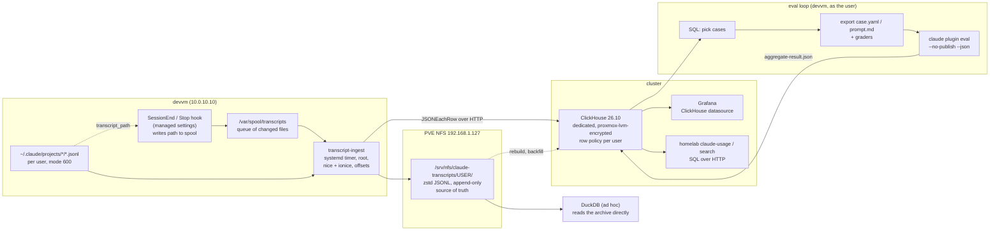

# A long-term store for Claude Code session transcripts

Research note, 2026-11-07. Read-only investigation: nothing was changed in the
cluster, on the devvm or in the repo apart from this file. It answers one
question: what should hold every Claude Code transcript from the devvm, with no
retention limit, so that we can (1) full-text search past sessions, (2) run
SQL-style analytics over turns, tool calls, errors, cost and tokens, and
(3) pick cases from real sessions and turn them into evals. Viktor asked
specifically why ClickHouse and not something else, so ClickHouse is treated
as the hypothesis to test, not the starting answer.

It builds on two earlier documents and does not repeat them:
[ADR-0025](../adr/0025-claude-session-telemetry.md) (OTel events to Loki and
Prometheus, `homelab claude-usage` over transcripts on disk) and
[2026-09-25-single-view-of-ai-sessions.md](2026-09-25-single-view-of-ai-sessions.md)
(LLM proxy research, parked; LiteLLM can log per session only if traffic goes
through it).

Every claim carries one of three labels:

- **[measured]** read on the live system today (`kubectl get`, `claude --help`,
  this repo, one named transcript file), or measured earlier today and passed
  in with the research brief.
- **[source]** read in upstream documentation, release notes or source, with a
  link in [Sources](#sources). Versions are pinned where it matters:
  ClickHouse 26.10, Langfuse v3/v4 sizing docs, DuckDB stable docs,
  PostgreSQL 18, Claude Code 2.1.319.
- **[inferred]** reasoning from the above, not observed directly.

## Verdict

**ClickHouse holds up, with two conditions.** Use a dedicated single-node
ClickHouse in the cluster as the query store, and keep a compressed copy of the
raw JSONL files on NFS as the source of truth, so the database can be dropped
and rebuilt from the archive whenever the schema changes. Run evals with the
`claude plugin eval` runner that ships in Claude Code, fed by cases selected
with SQL. Do not adopt Langfuse for this now.

Five facts carry most of the weight:

1. **We already run ClickHouse, and the version we pin has the features this
   needs.** The rybbit stack runs `clickhouse/clickhouse-server:26.10.3.7`
   with a Terraform-managed deployment, a Prometheus endpoint and a
   `ClickHouseDown` alert [measured]. The JSON type has been production-ready
   since 25.3 [source], text (inverted) indexes exist from 26.2 [source], and
   ClickHouse announced full-text search as generally available on
   2026-03-10 [source]. A second instance is a copy of a pattern we already
   operate, not a new technology. That puts it on rung 2 of the reuse ladder
   (wire into what runs), close to rung 1.
2. **The volume is small for ClickHouse and awkward for the shared Postgres.**
   Box-wide transcripts grow by about 7.6 GB a month raw [measured], about
   92 GB a year [inferred]. zstd shrinks one sample 5.7x [measured], so about
   16 GB a year compressed [inferred]. ClickHouse compresses per column
   across rows. Postgres compresses each large value on its own with pglz or
   lz4 through TOAST [source], and the active cluster `pg-cluster-v18` is a
   40 Gi volume with a 4 Gi memory limit shared by many apps [measured]. A
   year of transcripts plus trigram or tsvector indexes would be a large share
   of that volume, written twice because of the streaming replica [inferred].
3. **A text index changes the search experience at "forever" scale.** DuckDB
   over Parquet needs no server and handles the analytics well, but its
   full-text index does not update when the table changes and must be rebuilt
   [source]. Without the index, every search is a scan over the whole archive
   on NFS, which grows by about 16 GB a year [inferred]. ClickHouse keeps its
   text index current as parts are written [source].
4. **Per-user access control is available in the database.** Transcripts are
   mode 600 per user and hold tool output, including Vault reads [measured].
   ClickHouse row policies filter rows per user or role and deny by default
   once any policy exists on a table [source]. Loki, by contrast, is a single
   anonymous tenant here (ADR-0025) [measured].
5. **The eval runner already exists, and none of the candidate stores
   provides one that fits.** Claude Code 2.1.319 has `claude plugin eval`:
   cases as `case.yaml` or `prompt.md` with graders, a with/without-plugin
   baseline arm, an LLM judge (default Haiku), `--json` results and a cost
   ceiling [measured]. Langfuse experiments call a model through an "LLM
   connection" with a prompt [source], which does not replay an agent session
   with its tools. The store's job for evals is to find cases and keep
   results, which is SQL.

What would change the verdict: if Viktor does not want another stateful pod,
DuckDB over the NFS archive is a working fallback for analytics and evals, at
the cost of slow or batch-indexed search. If an annotation UI for humans
reviewing sessions becomes the main need, Langfuse becomes worth its cost, and
it can be fed from the same archive later.

## What the data looks like

- Transcripts live at `~/.claude/projects/<project-slug>/<session-uuid>.jsonl`,
  one JSON record per line [measured]. Record types seen: `user` (includes
  `tool_result` blocks, the bulk), `assistant` (text, `tool_use`, thinking),
  `attachment`, `system`, `api-request`, `api-request-blob`,
  `api-request-shape`, `cost-state`, `file-history-snapshot`, `last-prompt`,
  `mode`, `permission-mode` [measured]. A small sample from 2026-10-23 also
  has an `atis-latch` type [measured], so the set of types changes between
  versions and the schema must accept unknown types.
- Assistant records carry `sessionId`, `uuid`, `parentUuid`, `isSidechain`,
  `cwd`, `gitBranch`, `version`, `entrypoint`, `requestedModel`, `effort`,
  `timestamp`, and a `message.usage` object with input, output, cache-creation
  (5 minute and 1 hour) and cache-read tokens [measured]. There is no commit
  SHA, only the branch name [measured].
- One 22 MB transcript split as `user` 9.5 MB (557 rows), `attachment`
  6.2 MB, `assistant` 3.8 MB, `api-request*` about 2.3 MB; zstd took it to
  3.9 MB (5.7x) [measured].
- Single lines are large. In a 622 KB, 90-line sample the three longest lines
  were 87.5 KB, 120 KB and 131 KB [measured]. A large tool result can be much
  bigger [inferred].
- wizard writes about 5.8 GB a month and the whole box about 7.6 GB a month
  [measured]. Since today `cleanupPeriodDays: 36500` keeps them all on the
  devvm root disk: 223 GB, 87 GB free, shared with etcd [measured]. At the
  current rate that is about 11 months until the disk fills [inferred].

## Comparison

Storage figures assume about 92 GB a year raw and 5.7x zstd [inferred from the
measured rate and ratio]. Ops cost is for this cluster.

| Candidate | Full-text search | Analytics | Eval workflow | Ops cost here | Storage per year | Reuse | Licence |
|---|---|---|---|---|---|---|---|
| **ClickHouse 26.10, single node** | Text index, GA since March 2026; token match, no BM25 ranking, phrases not accelerated [source] | Strong: SQL, JSON type, columnar scans [source] | Select cases with SQL, store `claude plugin eval` JSON results in a table [inferred] | One more pod copying the rybbit pattern; encrypted PVC; upgrades need care across major versions [measured] | About 16 GB plus text index overhead (not measured) [inferred] | Rung 2: already run in rybbit [measured] | Apache 2.0 |
| **Postgres on CNPG** (`pg-cluster-v18`) | `tsvector` (each value under 1 MB [source]) or `pg_trgm`; BM25 needs ParadeDB `pg_search` as a CNPG extension image [source] | Good for row lookups; slower for wide scans over tens of millions of rows [inferred] | Same SQL selection [inferred] | No new pod, but grows the shared production cluster and its replica and backups [measured, inferred] | Larger than zstd: per-value pglz/lz4 TOAST plus GIN indexes [source, inferred] | Rung 1 [measured] | PostgreSQL; `pg_search` AGPL-3.0 [source] |
| **DuckDB over zstd Parquet on NFS** | Scan with `ILIKE`/regex, or an FTS index (BM25) that must be rebuilt after changes [source] | Strong for one analyst at a time [inferred] | Good: query files directly, export cases [inferred] | No server. Single writer; no always-on endpoint for Grafana [inferred] | About 16 GB [inferred] | Rung 3 (a library, no service) | MIT |
| **Loki** (already runs) | LogQL line filters; prompt text only as a label filter (ADR-0025) [measured] | Weak for this shape; no joins [inferred] | Poor [inferred] | Runs today, but 30-day retention and a single tenant [measured]; default 256 KB line limit, not overridden here [source, measured] | Not a fit for "forever" | Rung 1 [measured] | AGPL-3.0 |
| **OpenSearch** | Strong, BM25, highlighting [source] | Aggregations; SQL plugin is secondary [inferred] | Weak [inferred] | JVM service, heavy for one consumer [inferred] | Source plus inverted index, larger than compressed raw [inferred] | Rung 3, new service | Apache 2.0 |
| **Meilisearch / Typesense** | Strong typo-tolerant search [source] | None to speak of [inferred] | None [inferred] | New service; Typesense works best when the index fits in RAM [source] | Index larger than input [inferred] | Rung 3, new service | MIT core (Meilisearch EE is BUSL) / GPL-3.0 [source] |
| **Langfuse v3/v4 self-hosted** | Trace search in the UI [inferred] | Dashboards over its own model; raw SQL only through its ClickHouse [inferred] | Datasets, experiments, LLM-as-judge, annotation in the MIT core [source]; experiments are prompt plus model, not agent replay [source] | Web, worker, Postgres, Redis, ClickHouse (8 GiB minimum) and S3 storage [source]; no S3 store runs here [measured] and MinIO's repository is archived [source] | Its ClickHouse plus a blob copy [inferred] | Rung 3 | MIT core, `/ee` commercial [source] |
| **Arize Phoenix** | Trace search [inferred] | Limited beyond SQLite/Postgres scale by Arize's own docs [source] | Datasets and experiments [source] | One pod plus Postgres [source] | Postgres [inferred] | Rung 3 | Elastic License 2.0 [source] |

### Why not Postgres, which we already run

This is the strongest alternative, and at this volume it would work. Tens of
millions of rows a year is ordinary for Postgres [inferred]. Three things tip
it:

- The shared cluster is the wrong place for a write-heavy, ever-growing,
  low-priority dataset. `pg-cluster-v18` has 40 Gi volumes, a 4 Gi memory limit
  and a streaming replica [measured], and it backs many production apps. A
  bulk backfill or a heavy analytical query competes with them for the same
  buffers and disk [inferred].
- Compression. TOAST compresses each value on its own [source], so the
  repeated JSON keys and boilerplate across records are stored again in every
  row. A columnar store compresses those across rows [source].
- Full-text search options either have limits for this data (`tsvector` must
  be under 1 MB per value [source], and tool output can exceed it [inferred])
  or need a custom extension image (`pg_search`, AGPL-3.0, published as a CNPG
  extension image [source]) on the shared cluster.

A docs-versus-live finding from this check: the brief named the CNPG image as
`16-pgvector0.8.0`. That is the old `pg-cluster`, which reports "Unable to
create required cluster objects". The active cluster is `pg-cluster-v18` on
`cnpg-postgis-pgvector:18-pgvector0.8.7-20261019` [measured].

### Why not DuckDB, which needs no server

DuckDB is the right tool for one-off analysis and would cover requirements (2)
and (3) on its own. It falls short on (1): its FTS index does not follow table
changes and must be rebuilt [source], and without it a search reads the whole
archive [inferred]. It also gives no query endpoint that Grafana or a small
web page could call [inferred]. The recommended design keeps it useful anyway:
the NFS archive is plain zstd JSONL, which DuckDB reads directly.

### Why not Loki

Loki holds the OTel events, not transcripts, with 30-day retention and no
per-user access control (ADR-0025) [measured]. Keeping transcripts forever would
mean a separate retention class, lines over the 256 KB default [source], and
LogQL for analytics that are joins in SQL [inferred].

### Why not Langfuse

Langfuse is the closest product to "evals over traces", and its core is MIT
with datasets, experiments and LLM-as-judge included [source]. It is not the
right store here:

- It brings five components, and its sizing page asks for 2 CPU and 4 GiB each
  for web, worker and Postgres, 1.5 GiB for Redis and 8 GiB for ClickHouse
  [source]. That includes its own ClickHouse, so choosing Langfuse means running
  ClickHouse anyway.
- It needs S3-compatible blob storage [source]. None runs in the cluster today:
  Loki uses the filesystem backend and no MinIO, Garage, SeaweedFS or RustFS
  stack exists [measured]. MinIO went into maintenance mode in December 2025,
  stopped publishing community images in October 2025, and its repository was
  archived in 2026 [source]. Garage (AGPL-3.0) or SeaweedFS (Apache 2.0) would
  be a new service [source].
- Getting transcripts in uses a Stop hook: Langfuse's own plugin, or the
  community `claude-code-langfuse-tracing` project, which can also backfill old
  transcripts as backdated traces [source]. That is a second ingestion path to
  maintain.
- Its experiments run a prompt against a model connection [source]. Replaying a
  Claude Code session means running the agent with its tools, skills and
  hooks, which `claude plugin eval` does [measured].

Phoenix has a similar fit with a heavier licence (ELv2) and, by Arize's own
architecture page, scale limits on its SQLite or Postgres storage [source].

### Should the new store share rybbit's ClickHouse?

No. rybbit's instance has a 1 Gi unencrypted `proxmox-lvm` volume capped at
5 Gi by the autoresizer, a 1.2 GB memory limit, and system logs turned off to
reduce disk writes [measured]. Transcripts are sensitive and belong on
`proxmox-lvm-encrypted` (docs/agents/storage-backup.md) [measured]. A separate
deployment also keeps the rybbit upgrade path independent [inferred]. Both
should use the same image pin so that one upgrade procedure covers both
[inferred].

## Recommended architecture



Components and where each sits on the reuse ladder:

| Component | Rung | Note |
|---|---|---|
| Raw archive on PVE NFS | 1 | Existing NFS, picked up by `nfs-mirror` and the offsite sync [measured] |
| ClickHouse | 2 | Same image and Terraform pattern as `stacks/rybbit` [measured] |
| Grafana datasource | 2 | Grafana runs already; ClickHouse plugin needed [inferred] |
| Ingest timer | 4, small | A short script; the record parsing in `cli/cmd_claude_usage.go` (492 lines, Go) is reusable [measured] |
| Eval runner | 3 | `claude plugin eval` in Claude Code 2.1.319 [measured] |

## Ingestion sketch

Goals: no full-disk scans on the devvm (the disk is shared with etcd and the
scan-guard blocks broad walks) [measured], no resident daemon (the reason
ADR-0025 rejected a tailing process) [measured], and incremental reads, since
transcripts are append-only and sessions can be resumed days later [inferred].

1. **Trigger.** A `SessionEnd` hook, plus `Stop` for long-lived sessions, in
   the org managed settings. Hook input includes `transcript_path` [source].
   The hook writes that path into a spool directory and exits. It does no
   parsing, so it adds almost nothing to the turn [inferred].
2. **Ingest.** A systemd timer every 15 minutes, declared in
   `playbooks/devvm.yml`, runs as root under `nice` and `ionice -c3`. For each
   spooled path it keeps `(inode, byte offset)` in a small state file, reads
   only the new bytes, and:
   - appends them, zstd-compressed, to the user's archive directory on NFS
     (one zstd frame per batch, so the file stays a valid concatenated stream);
   - parses each line, adds `os_user` from the file owner, and inserts batches
     into ClickHouse over HTTP as `JSONEachRow`.
   Malformed or partial final lines wait for the next run [inferred].
3. **Backfill.** One run walks each user's projects directory once, at a
   quiet hour, to load what exists today. History older than 30 days may
   survive only in the 14 `devvm-home-backup` generations on the PVE host
   (memory #17150) [measured]; loading from there runs on the PVE side and
   reads nothing on the devvm.
4. **Rebuild.** Because the archive is complete, a schema change is: create
   the new tables, re-read the archive, swap [inferred].

Schema sketch (ClickHouse):

```sql
-- every line, nothing lost
CREATE TABLE claude.lines (
  os_user      LowCardinality(String),
  session_id   String,
  uuid         String,
  parent_uuid  String,
  type         LowCardinality(String),
  ts           DateTime64(3),
  project      LowCardinality(String),
  cwd          String,
  git_branch   String,
  version      LowCardinality(String),
  is_sidechain Bool,
  text         String CODEC(ZSTD(3)),   -- prompt, reply, tool output as text
  raw          String CODEC(ZSTD(3)),   -- the original line, for rebuilds
  INDEX text_idx text TYPE text(tokenizer = 'splitByNonAlpha', preprocessor = lower(text))
) ENGINE = ReplacingMergeTree
ORDER BY (os_user, session_id, ts, uuid);

-- derived with materialized views: tool_calls (name, input, is_error,
-- latency from tool_use to tool_result), usage (model, effort, token
-- counts by kind), eval_runs (case, arm, score, judge verdicts)

CREATE ROW POLICY own_rows ON claude.* USING os_user = currentUser() TO ALL EXCEPT admin;
```

Keeping `raw` as a plain String rather than the JSON type is deliberate: the
record types change between Claude Code versions [measured], and the JSON
type's per-path subcolumns cost storage that this data does not need for its
long tail [source, inferred]. Fields that analytics use often are lifted into
typed columns or materialized views.

## Eval workflow

1. Pick cases with SQL, for example sessions where a skill fired and the user
   then corrected the agent, or tool calls that errored.
2. Export each case to `evals/<case>/prompt.md` or `case.yaml` with graders,
   under the plugin or skills directory being changed.
3. Run `claude plugin eval <plugin> --no-publish --json results.json`, with
   `--ablation with-without` for a baseline arm and `--max-cost-usd` as a
   ceiling [measured]. `--no-publish` matters: by default the HTML report is
   published to claude.ai [measured], which Viktor's rules rule out.
4. Insert `aggregate-result.json` into `claude.eval_runs`, keyed by the git SHA
   of the skill under test, so scores compare across changes [inferred].

Each run is a full `claude` child on the caller's own credential, and
concurrent runs share one rate limit [measured]. That is existing subscription
use, not new spend, but it consumes the same quota as interactive work
[inferred].

## Open questions

- **Text index size.** No measurement yet of the text index overhead on this
  data. A trial load of one month into a scratch ClickHouse would settle it,
  along with real compression per column.
- **Secrets at rest.** The NFS archive sits on an unencrypted ext4 volume and
  is mirrored to the Synology offsite [measured]. `devvm-home-backup` already
  copies `~/.claude` the same way in plaintext [measured], so this does not
  create a new exposure class, but a forever archive widens it. Options: age
  encryption per user file before it leaves the devvm, or a redaction pass
  (gitleaks is already used by `cli/secretguard.go`) [measured]. ADR-0025
  rejected regex scrubbing of prompts; it may still be acceptable for the
  archive. This is Viktor's decision.
- **Who reads what.** Row policies need one ClickHouse user per OS user and a
  way to hand each person their credentials (Vault). Should admins see
  everyone's transcripts, as `sudo homelab claude-usage` does today?
- **Local retention.** Once the archive is verified, should `cleanupPeriodDays`
  go back to a finite value (for example 90 days) to protect the devvm disk?
  At 7.6 GB a month the disk fills in about 11 months [inferred].
- **Replay fidelity.** Transcripts record `gitBranch` but no commit SHA
  [measured]. Rebuilding the repo state for a replay needs the commit at the
  session's timestamp, which is a guess when a branch moved during the session
  [inferred].
- **Cluster agents.** Agents that run the harness in the cluster (for example
  claude-agent-service) write transcripts inside pods, not on the devvm. They
  are out of scope for the devvm timer and would need their own path, or the
  OTel content switches noted in the 2026-09-25 research.
- **Not verified here:** the exact ClickHouse release where text indexes left
  beta (the docs say "available from 26.2", the GA post is dated 2026-03-10);
  Langfuse sizing numbers come from the docs page labelled v4; the Phoenix and
  Typesense licence summaries were taken from secondary pages and not from
  their LICENSE files.

## Sources

- ClickHouse: [Full-text search GA announcement (2026-03-10)](https://clickhouse.com/blog/full-text-search-ga-release),
  [text indexes reference](https://clickhouse.com/docs/reference/engines/table-engines/mergetree-family/textindexes),
  [observability schema design: text index from 26.2](https://clickhouse.com/docs/guides/use-cases/observability/build-your-own/schema-design),
  [skip index examples](https://clickhouse.com/docs/concepts/features/performance/skip-indexes/skipping-indexes-examples),
  [JSON data type](https://clickhouse.com/docs/reference/data-types/newjson),
  [25.3 release: JSON production-ready](https://clickhouse.com/blog/clickhouse-release-25-03),
  [CREATE ROW POLICY](https://clickhouse.com/docs/sql-reference/statements/create/row-policy).
- PostgreSQL 18: [text search limitations (tsvector under 1 MB)](https://www.postgresql.org/docs/current/textsearch-limitations.html),
  [TOAST](https://www.postgresql.org/docs/current/storage-toast.html).
- ParadeDB: [pg_search on PGXN (licence, preload below PG17)](https://pgxn.org/dist/pg_search/pg_search/README.html),
  [ParadeDB Dockerfiles and CNPG extension image](https://pgxn.org/dist/pg_search/0.25.1/docker/README.html).
- DuckDB: [full-text search extension](https://duckdb.org/docs/stable/core_extensions/full_text_search.html).
- Loki: [limits_config, `max_line_size`](https://grafana.com/docs/loki/latest/configure/#limits_config).
- Langfuse: [sizing and scaling](https://langfuse.com/self-hosting/scaling),
  [open source handbook (MIT core, `/ee`)](https://langfuse.com/handbook/chapters/open-source.md),
  [Claude Code integration](https://langfuse.com/integrations/other/claude-code),
  [clarifications FAQ (self-hosted features)](https://langfuse.com/resources/engineering/clarifications),
  [claude-code-langfuse-tracing](https://awesome.ecosyste.ms/projects/github.com%2Fkaiser-data%2Fclaude-code-langfuse-tracing).
- Phoenix: [self-hosting architecture](https://www.arize.com/docs/phoenix/self-hosting/architecture.md).
- MinIO status: [It's FOSS](https://itsfoss.com/news/minio-moves-away-from-open-source.md),
  [vonng, "MinIO is dead, long live MinIO"](https://blog.vonng.com/en/db/minio-resurrect/).
- Garage: [repository](https://github.com/deuxfleurs-org/garage); SeaweedFS and
  Garage comparison: [glukhov.org](https://glukhov.org/data-infrastructure/object-storage/self-hosted-s3-alternatives/).
- Meilisearch: [comparison with Typesense](https://www.meilisearch.com/docs/resources/comparisons/typesense.md).
- Claude Code: [hooks reference (`transcript_path` in hook input)](https://code.claude.com/docs/en/hooks);
  `claude plugin eval --help` on the installed 2.1.319.
- This repo: `stacks/rybbit/main.tf`, `stacks/dbaas/modules/dbaas/main.tf`,
  `stacks/monitoring/modules/monitoring/loki.yaml`,
  `docs/agents/storage-backup.md`, `cli/cmd_claude_usage.go`,
  `cli/secretguard.go`, ADR-0025, and the 2026-09-25 research note.
