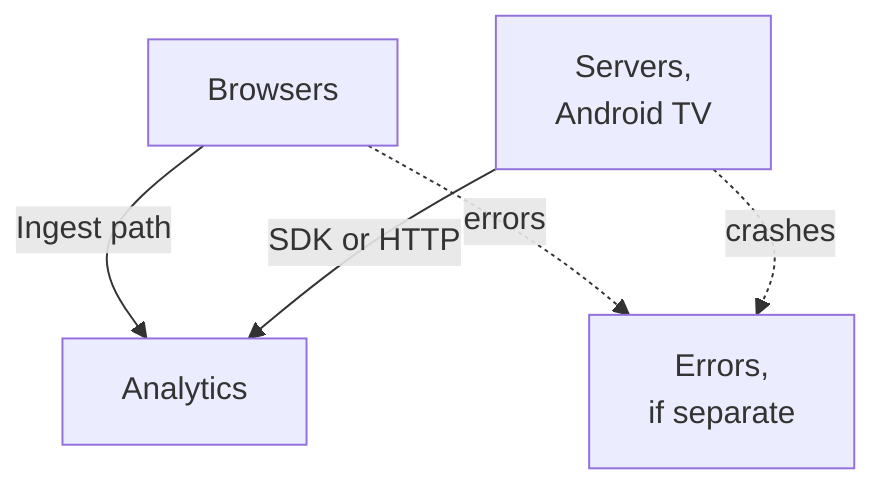

# Product analytics platforms: comparison

Researched 2026-11-09. Status: research, decision pending.

We want one analytics pipeline across everything we serve, in place of the per-app mechanisms in use today. This page compares the self-hostable candidates against the requirements settled in the 2026-11-09 interview, covering both product analytics and error tracking. It ends with the combinations worth choosing between, and the questions this research could not settle.

Primary sources (docs, tagged source, release notes) back every claim below. Two independent reviewers checked the analytics claims against source. Anything unverified is marked.

## Where we are today

| Mechanism | App | What it measures | Status |
|---|---|---|---|
| Rybbit v2.9.2 (`stacks/rybbit`) | intended for all sites | pageviews, events | Deployed, never configured: 119 test events from April 2026, no sites in use. Missing the Redis dependency v2.9 added, and logs a timeout every minute |
| Viewing tables in tv's Postgres (tv ADR-0014) | tv | who watched what, watch time, habits | Live; product features (Habits, admin viewing page) run on it |
| `TLEVENT` lines in Loki (terminal-lobby ADR-0006) | terminal-lobby | ~40 feature-usage events | Live, 30-day retention |
| OTel traces and breadcrumbs (tripit ADR-0032) | tripit | latency, errors, usage by route | Live |
| Loki recording rules into Prometheus | Immich share links | opens, visitors, countries | Live |
| Blog GA / Open Web Analytics | blog | nothing | Commented out |

## Requirements

| # | Settled answer |
|---|---|
| Q1 | Product events per Person (funnels, retention, cohorts), web traffic, and session replay |
| Q2 | Any visitor may be measured; consent is assumed on visit (no notice, Q15) |
| Q3 | Clients: web apps, backend servers (Python, Go, Bun/Node), native Android and Android TV |
| Q4 | Full rollout, not a pilot |
| Q5, Q16 | Every first-party app and static site; third-party apps we host get pageviews only |
| Q6 | Ops telemetry stays in Prometheus, Loki and OTel. Product events go to the new platform. tv's viewing tables stay as app data |
| Q7 | A new tripit ADR supersedes ADR-0032's rejection of behavioural analytics |
| Q8 | app-kit ships the SDK on by default |
| Q9 | Events kept forever, replays for 90 days |
| Q10 | Browsers send to an **Ingest path** on each app's own host |
| Q11, Q17 | Replay masks password fields only |
| Q12 | Up to 16 GiB of memory |
| Q13 | One **Person** across all apps, keyed by Authentik `sub`, anonymous events merged on sign-in |
| Q14 | Analytics read in the platform's own UI |
| Q18 | SDK in app code for first-party apps |
| Q19 | Event names are `noun.past_verb` |
| Q20 | UI access for Viktor and infra admins |
| Q21 | Events and replays in the offsite 3-2-1 backup |
| Q22 | Events from non-production hosts are dropped |
| Q23 | Rybbit is removed if another platform wins |
| Q24, Q25 | Third-party apps get the script from an in-repo Traefik plugin, on by default with a denylist |
| Q27 | Error and crash tracking is in scope, compared both built in and as a separate tool |

## Measured volume

Taken from Traefik access logs and Loki on 2026-11-09.

- Browser page requests with assets and API calls filtered out: about 21,000 a day across all hosts. This is an upper bound, since polling endpoints and scanners that send a browser user agent are still included. The top hosts are tv (7,900), Anubis challenges (5,300), Forgejo (2,300), terminal-lobby (2,000) and Nextcloud (1,100).
- terminal-lobby `TLEVENT` events: 7,000 to 15,000 a week.
- Estimate for the whole rollout: 200,000 to 800,000 events a month. tv's own product events are not counted yet, so this figure is a rough guide.

```stats
~21,000 | browser page requests a day (upper bound)
7,000 to 15,000 | terminal-lobby events a week
200k to 800k | estimated events a month
48.9 GiB | free memory on the Proxmox host
```

## Candidates

Dropped after the first pass:

| Tool | Why it was dropped |
|---|---|
| Plausible CE | Leaves out funnels and journeys, has no per-person identity and no replay |
| Matomo | Funnels, cohorts, flows and replay are paid plugins |
| OpenPanel | v3 images are supporter-only ($20/month). The public release is 2.3.0 from 2026-08-18, and the Kotlin SDK is not published |
| Countly Lite | Non-commercial licence, MongoDB backend, and its sources disagree on which features are free |
| OpenReplay CE | Built around replay, with no server SDKs found; its free edition caps sessions |
| Aptabase, Trench, Highlight.io, June | No user identifiers, dormant, or shut down |
| Jitsu, RudderStack, Snowplow | Collection only, or licence-restricted; funnels and replay would be ours to build |

Shortlist: PostHog, Rybbit, Umami and Swetrix, plus Sentry, GlitchTip and Bugsink for errors.

### Analytics, against the requirements

| Requirement | PostHog hobby | Rybbit 2.9.2 | Umami 3.4.1 | Swetrix CE 5.5.3 |
|---|---|---|---|---|
| Licence | MIT outside `ee/` | AGPL-3.0 | MIT | AGPL-3.0 |
| Funnels | per Person | per session (`count(DISTINCT session_id)`) | per session | yes, basis unverified |
| Retention, cohorts | yes, yes | retention yes; segments instead of cohorts | yes, but sessions rotate monthly | no retention or cohort report |
| One Person across apps (Q13) | yes: one project with an `app` property | yes, if every first-party app shares one site (ingest accepts any hostname) | no: identity is per website | unverified |
| Anonymous to Person merge | yes, full merge | yes, last 30 days, same site | forward only, no backfill | yes, mechanism unverified |
| Web traffic | yes | yes | yes | yes |
| Replay, 90 days (Q9) | yes, but retention is locked to 30 days without a paid entitlement | yes, but the 30-day TTL is fixed in the table definition and changing it needs an `ALTER` | yes, no automatic purge | yes, retention settable to 30d, 90d, 1y or 5y |
| Replay masking, passwords only (Q17) | configurable | configurable through script attributes | configurable mask level | unverified |
| Browser SDK | yes | yes | yes | yes |
| Python, Go, Node SDKs | all three | HTTP API only; `@rybbit/node` is broken (#1353) | HTTP API and `@umami/node` | unverified |
| Native Android | yes, minSdk 23, with replay; Android TV untested | none; HTTP API, with an ingest key shipped in the APK | none | none |
| First-party proxy (Q10) | documented | documented, plus a per-site toggle | documented | unverified |
| Built-in errors | yes, every client type | browser only | none | browser only, no alerts |
| Dashboard login | social login only | email and password only | email and password, with 2FA | OIDC, so Authentik works directly |
| Projects | one project per instance | many sites | many websites | many projects |
| Self-host support | "officially unsupported"; Helm chart sunset | docker-compose; already in Terraform here | Docker image; third-party Helm chart | docker-compose |
| Services and memory | 47 services, 4 vCPU and 16 GB | 2 images plus ClickHouse, Postgres and Redis; about 560 MiB measured | 1 image on Postgres (ClickHouse optional) | 2 images plus ClickHouse, Redis and S3 |
| Scale guidance | "unlikely to scale past a couple 100ks events" without tuning | none stated | none stated | none stated |

### Error tracking, against the requirements

| Requirement | Sentry self-hosted 26.10.1 | GlitchTip 6.2.6 | Bugsink 2.6.3 | PostHog built in |
|---|---|---|---|---|
| Licence | FSL-1.1, allows internal use; each release becomes Apache 2.0 after 2 years | MIT | PolyForm Shield (not OSI) | MIT outside `ee/` |
| SDKs | Sentry SDKs for every client we run | accepts the Sentry SDKs | accepts the Sentry SDKs | PostHog SDKs |
| Android crashes, ProGuard mappings | yes, plus NDK and ANR | yes, plus minidumps | ProGuard deobfuscation not found | yes; NDK and ANR unverified |
| Replay linked to errors | yes (full profile only) | no | no | yes |
| Release health | yes | no (#206) | no | unverified |
| Dashboard login | SAML, so Authentik works as the IdP | OIDC | none | social login only |
| Services and memory | 53 services, 4 CPU and 16 GB plus swap; the errors-only profile is 28 services, about 7 GB | one app on Postgres, 512 MB | one app and a worker | inside the PostHog stack |
| Kubernetes | community chart only | official Helm chart | Helm work in progress | none |

## Combinations worth choosing between



Browsers cover first-party apps (SDK in code) and third-party apps (script injected by the Traefik plugin).

| | A. PostHog on a VM | B. Rybbit and GlitchTip | C. Umami and GlitchTip | D. Swetrix and GlitchTip |
|---|---|---|---|---|
| Where it runs | a Proxmox VM running PostHog's own compose (16 GiB of the host's 48.9 GiB free) | Kubernetes, extending the existing Rybbit stack | Kubernetes, on the shared Postgres | Kubernetes, adds S3-compatible storage |
| Memory | about 16 GB | about 3 GB | about 2 GB | unverified, likely 3 to 4 GB |
| Person across apps | yes | yes, with first-party apps on one shared site | no | unverified |
| Funnels per Person | yes | no, per session | no, per session | unverified |
| 90-day replay | no, 30 days | yes, through a managed `ALTER` | yes, with our own purge | yes |
| Android and backends | native SDKs | hand-written HTTP clients for events; Sentry SDKs for errors | hand-written HTTP for events | unverified SDKs |
| Errors | built in | GlitchTip, using the Sentry SDKs | GlitchTip | GlitchTip |
| Upkeep | upstream ships rolling images and changes its compose; self-hosting is unsupported | two small apps in Terraform; we maintain thin clients for Android and backends | smallest | newest codebase on the list |

Two other combinations were considered and left out. PostHog with Sentry duplicates replay and errors, and would need more than 32 GB. Rybbit with Sentry's errors-only profile costs about 7 GB more than GlitchTip and still has no replay on errors.

## How to try them before deciding

Official public demos, all answering on 2026-11-09:

- Rybbit: <https://demo.rybbit.com/81>
- Umami: <https://cloud.umami.is/share/LGazGOecbDtaIwDr/umami.is>
- Swetrix: <https://swetrix.com/demo>
- Sentry: <https://sandbox.sentry.io/>
- PostHog, GlitchTip and Bugsink have no public sandbox.

## Open questions

- Whether PostHog hobby copes with 200,000 to 800,000 events a month on 16 GB. Its docs warn at "a couple 100ks", and it publishes no hard limit.
- Whether any analytics SDK behaves correctly on Android TV. None of them document it.
- Swetrix's funnel basis, SDK coverage and footprint.
- Whether PostHog's replay TTL could be raised in ClickHouse directly, and whether an upgrade would reset it.
- tv's own product-event volume, which is not part of the estimate above.

## Sources

Two detailed reports sit behind this page, [2026-11-09-product-analytics-sources.md](2026-11-09-product-analytics-sources.md) and [2026-11-09-error-tracking-sources.md](2026-11-09-error-tracking-sources.md). They contain per-tool citations to project docs, GitHub source at the tagged release, and release notes: PostHog `posthog/api/project.py` and `organization.py` for the project limit, and `verify_team_session_recording_retention_period` for the replay lock; Rybbit v2.9.2 `getFunnel.ts`, `identifyService.ts` and `schema/core.ts`; Umami v3.4.1 `src/app/api/send/route.ts`; Swetrix `docs/selfhosting/configuring.mdx`; posthog.com/docs/self-host and its disclaimer page; Sentry `develop.sentry.dev/self-hosted`; GlitchTip v6.2.6 source.
