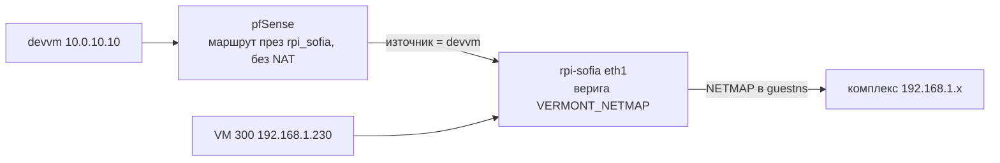

# Камери, NVR и домофон

Съставено 2026-08-16 от историята на сесиите (07-26 → 08-16, 20+ сесии).

## Първо това: двете мрежи са с еднакъв адресен обхват

Мрежата на **комплекса** и **домашната** мрежа са и двете `192.168.1.0/24`.
Това е причината за голяма част от объркването около камерите — един и същ
адрес значи различно устройство според това откъде питаш.

- Двата рутера на `192.168.1.1` са различни устройства: комплексът е с MAC
  `08:19:a6…`, домът е AX6000 с MAC `28:ee:52…`. Няма proxy ARP между тях.
- Публичните адреси също се различават: комплексът излиза през **2.56.52.209**,
  домът през **176.12.22.76**.
- Затова достъпът до устройствата в комплекса минава през **netns `guestns`**
  на rpi-sofia — отделен namespace именно заради застъпването.

Преди да се обяснява защо нещо „не отговаря", първо се проверява от коя от двете
мрежи се пита.

### Втори адрес на комплекса: 10.77.1.0/24 (от 17.10.2026)

Цялата мрежа на комплекса има и незастъпващ се адрес: `10.77.1.x` е
устройството `192.168.1.x` в комплекса, на всички портове. Пример: NVR-ът е
`10.77.1.150`, панелът е `10.77.1.115`. Ползват го VM 300 (там е iVMS-4200)
и devvm. Клъстерът няма достъп от 19.10.2026, когато iVMS в клъстера беше
спрян.



| Къде | Какво | Кой го управлява |
|---|---|---|
| pfSense | gateway `rpi_sofia` = 192.168.1.10 на WAN, без мониторинг; маршрут `10.77.1.0/24` през него | `playbooks/pfsense-vermont-alias.yml` |
| pfSense | outbound NAT: без NAT от `vermont_complex_clients` (само devvm от 19.10.2026) към `10.77.1.0/24`; floating block за всеки друг източник | същият |
| rpi-sofia, host | маршрут `10.77.1.0/24 via 10.200.1.2 dev veth-host`; `nat PREROUTING -d 10.77.1.0/24 -j ACCEPT` (първо правило) | `playbooks/rpi-sofia-netmap.yml` |
| rpi-sofia, host | `FORWARD -i eth1 -o veth-host -d 10.77.1.0/24 -j VERMONT_NETMAP` (първо правило); веригата пуска изброените източници, останалите DROP | същият |
| rpi-sofia, host | обратен маршрут за devvm през 192.168.1.2 | същият |
| rpi-sofia, guestns | `nat PREROUTING -i veth-guest -d 10.77.1.0/24 -j NETMAP --to 192.168.1.0/24` (първо правило) | същият |
| VM 300 | постоянен маршрут `route -p add 10.77.1.0 mask 255.255.255.0 192.168.1.10` (пътят на iVMS) | на ръка |

- Скрипт: `/usr/local/sbin/vermont-netmap.sh start|stop|status`, генериран от
  playbook-а. Service: `vermont-netmap.service`, закачен за
  `camera-net.service` (After, Requires, PartOf). Не се редактира на Pi-то, а в
  `playbooks/files/rpi-sofia/`.
- Списъкът с позволени източници е на две места, които трябва да съвпадат:
  `$CLIENTS` в `playbooks/files/pfsense-vermont-alias-config.php` и
  `vermont_allowed_sources` в `playbooks/rpi-sofia-netmap.yml`.
- Без NAT, защото автоматичното правило на pfSense за собствения му WAN адрес
  („let out anything from firewall host itself") праща трафика към TP-Link-а,
  а не към Pi-то.
- Правилата на Pi-то трябва да са **първи**. Старите DNAT правила в
  `camera_net_setup2.sh` проверяват само порта, не и адреса, така че добавени
  след тях, `10.77.1.115:8000` би стигнал до NVR-а.
- Резервни копия на правилата: `/home/pi/netbackup-20261017-netmap/` (преди
  първата промяна) и `/home/pi/netbackup-<дата>-ansible/` при всяко прилагане
  на playbook-а.
- Disabled gateway-ят `4g_router` в pfSense сочеше 192.168.1.10 (сега Pi-то) и
  е изтрит заедно с маршрута си 34.117.118.44/32; 4G рутерът е на .7.
- `.117` не слуша на порт 8000 и по директния път; в iVMS се добавя през ISAPI
  на порт 80. На своя адрес връща 301, на чужд `Host` отговаря 200; това е
  същото устройство.
- Пътят от комплекса през Pi-то към интернет (`camera_net_setup2.sh`, FORWARD
  ACCEPT) е нарочен и не е пипан; дали нещо в комплекса го ползва, още не е
  измерено.
- iVMS е с нова, собствена база. Backup-ът на Стопанка (02.09.2026) не се
  възстановява там, защото iVMS може да запише старите списъци с хора върху
  панелите.

### iVMS-4200 в клъстера (17.10.2026 – 19.10.2026, спрян)

Спрян на 19.10.2026: Emil избра iVMS на VM 300 през RDP (по-бърз, с файлове и
clipboard), а две бази iVMS могат да пращат различни хора и карти към едни и
същи устройства. `stacks/ivms` е изтрит (последният commit с него е
`ec0ecbdd3`), последното дневно копие е в `/srv/nfs/ivms-backup/`. Записът по-долу
остава за историята и за наученото.


- Адрес: `https://ivms.viktorbarzin.me` (Authentik, Home Server Admins). При
  първо отваряне iVMS се събужда за една-две минути; първият старт след
  инсталация отнема повече, защото инсталира програмата.
- Заспива след 30 минути без отворен прозорец или 2 часа без мишка и
  клавиатура. Отварянето на адреса го събужда отново.
- Данните (база, настройки) са на криптиран PVC, с дневно копие в
  `/srv/nfs/ivms-backup/` (14 поколения).
- Колелото на мишката сменя стойността на падащ списък под Wine. Проверявай
  настройките след промени; „Auto-Upgrade Device" стои на Disable.
- Код: `stacks/ivms/` (рецептата за инсталиране е в `app/`),
  `modules/kubernetes/wine_app/`, `images/wine-app/`.

Състояние след настройката на 17.10.2026:

| | |
|---|---|
| Super user | `admin`, паролата и отговорите на въпросите са в Vault `secret/emo/ivms-admin` |
| Входни панели | `.111`-`.116` като `10.77.1.111`-`.116`, порт 8000, `admin` с паролата от `secret/emo/vermont-panels` (и за `.115`) |
| Терминал `.117` | `10.77.1.117`, порт 80 (ISAPI), `admin` с паролата от `secret/emo/vermont-intercom-admin`; iVMS я оценява като Weak |
| Хора | 95, взети от устройствата с „Get from Device“; нищо не е пращано обратно |
| Access групи | няма |

И седемте устройства са Online през клъстера. Базата оцелява при рестарт на
пода (проверено: вход, 95 души, 7 устройства).

Списъците по устройства (ISAPI `UserInfo/Search`, 17.10.2026): 95 различни
номера, 63 са на всичките 7 устройства, 32 само на част от тях, а 40 от
общите имат различен брой карти или лица на различните устройства. Таблицата
по хора съдържа лични данни и не е в репото; генерира се наново от
устройствата със същото търсене.

Какво научихме при настройката:

- Прозорецът за добавяне на устройство помни потребителя и паролата от
  предишното. Преди да пишеш, изчисти полето (Ctrl+A), иначе текстът се
  добавя към стария и устройството отчита неуспешни входове.
- „Get from Device“ → „By Employee ID“ взема само номера от първото поле.
  За няколко души пусни го по веднъж за всеки номер.
- „Apply Changes to Device“ праща само промените в access групите. Проба:
  `TEST-IVMS` без карта и лице, група само с вратата на `.111`; на панела се
  появи точно този човек, нищо друго не се промени на никое устройство.
- Изтриване на човек в iVMS **не** го маха от устройство, на което вече е
  пратен. Пробният човек беше изтрит от `.111` с
  `PUT /ISAPI/AccessControl/UserInfo/Delete` по номер. При махане на човек
  трябва да се маха и от устройствата.
- „Apply All to Device“ не е пробван. Преди първата употреба направи копие на
  хората, картите и лицата от устройствата.
- За отстраняване на проблеми без Authentik:
  `kubectl -n ivms port-forward deploy/ivms 6080` и
  `http://127.0.0.1:6080/vnc.html`.

### iVMS-4200 на VM 300 (от 19.10.2026)

Втори, самостоятелен iVMS-4200 3.14.1.4 на Windows VM 300 (`192.168.1.230`,
`C:\Program Files (x86)\iVMS-4200 Site`). Базата му е отделна от тази в
клъстера. Snapshot-ове преди инсталацията: `pre-ivms-20261017` и
`pre-ivms-install-20261019`.

| | |
|---|---|
| Super user | `admin`, паролата и отговорите на въпросите са в Vault `secret/emo/ivms-vm300-admin` |
| Входни панели | `.111`-`.116` като `10.77.1.111`-`.116`, порт 8000, `admin` с паролата от `secret/emo/vermont-panels` (и за `.115`) |
| Терминал `.117` | `10.77.1.117`, порт 80 (ISAPI), `admin` с паролата от `secret/emo/vermont-intercom-admin` |
| NVR `.150` | `10.77.1.150`, порт 8000, `admin` с паролата от `secret/emo/vermont-panels`; групата му има 55 ресурса (Camera 01-20 и каналите на панелите) |
| Камери поотделно | не са добавени; NVR-ът с `admin` дава гледане, запис и настройки |
| Хора | 96: Get All от `.111` (83), после 12 номера с „By Employee ID“ (`999` от `.112`, `1000` от `.115`, останалите от `.116`), плюс `PIN01` от `.117`; отпечатъците на `100` и `26` са внесени от `.117` |
| Access групи | няма |

И осемте устройства са Online. Нищо не е пращано към устройствата („Apply“ не
е натискан).

Какво се установи при настройката:

- NVR-ът приема `admin` с общата парола на панелите (`secret/emo/vermont-panels`).
  Записите по-долу, според които за NVR-а има само `owners` (Viewer), са от
  преди това.
- `secret/emo/vermont-panel-115` е остаряла: с нея `.115` отчете неуспешен вход
  и излезе Offline. `.115` е с общата парола на панелите.
- Всички 21 камери HWI-T240H (`.51`-`.63`, `.74`-`.81`), включително `.52` и
  `.53`, отговарят на ISAPI с `admin`. От 23.10.2026 паролата им е `password` в
  `secret/emo/vermont-cameras` (преди беше `password_old` в
  `secret/emo/vermont-intercom-admin`).
- „Get from Device“ (Get All) от един панел отнема десетки минути заради
  лицата, а процентът в „Synchronizing…“ расте бавно. Кръстчето на този
  прозорец спира тегленето и показва отчета до момента.
- Get All от втори панел не обогатява вече внесените хора: за всеки, чиято
  карта вече е в базата, iVMS връща „The card number already exists“ и не
  пипа записа (.112: 61 такива от 76). Затова след първия панел се теглят
  само липсващите номера с „By Employee ID“, по около минута на номер.
  Следствие: картите и лицата в iVMS са такива, каквито са на устройството,
  от което човекът е внесен. Те не са обединени от всички устройства (при 40
  души броят им се различава между устройствата).
- Кои номера липсват се вижда от устройствата (ISAPI `UserInfo/Search`,
  19.10.2026): `.111` 83, `.112` 76, `.113` 80, `.114` 73, `.115` 75,
  `.116` 91, `.117` 66, общо 95 различни. Извън `.111` са 12 номера: 11 са на
  `.116`, а `1000` е само на `.115`.
- Смяната на устройство в „Select Device“ връща режима на Get All.

### Достъп по входовете, промени от 19.10.2026

Решение на emo: еднакъв достъп за всички живущи на шестте панела с лицево
разпознаване (`.111`-`.116`). Направено е само с добавяне през ISAPI. Списъкът с
имената, дневникът на всяко добавяне и списъците на панелите отпреди промяната са
в частното хранилище `ebarzin/vermont-device-configs`, папка `access-19102026/`.

| Промяна | Устройство |
|---|---|
| 5 лица, копирани от `.111` (хората ги имаха на всички панели освен Вход 1) | `.116` |
| 3 записа на апартаменти с по 3 карти, врата 1 | `.115`, `.116` |
| изтрити отпечатъците на 4 души, които не са ги ползвали от май 2024 или изобщо | `.117` |
| нов потребител `PIN01` „Код задна врата“, вход само с код (`purePwdVerifyEnable`); кодът е в Vault `secret/emo/vermont-backdoor-pin` | `.117` |

Отпечатъци на `.117` остават само за `100` (INSTALLER, 2) и `26` (1). Справката
от журнала на терминала (8 047 събития от 17.05.2024): с пръст са влизали само
`100` (85 пъти, последно 20.07.2026), `26` (15) и `9` (7, последно 29.07.2024).

Кодове на `.117` (потвърдено на място на 20.10.2026): общ код на `PIN01` „Код задна
врата“ (в Vault `secret/emo/vermont-backdoor-pin`) и личен 6-цифрен код на `00000168`.
Набира се кодът и `#` (долу вляво); камбанката долу вдясно е звънец. В журнала успешен
вход с код е събитие `181` с номера на човека, а непознат код е `151` без номер. С
лични кодове журналът показва кой е влязъл; с общия се вижда само „Код задна врата“.
През 2025 г. `100` (INSTALLER) е влизал с код 115 пъти.

Какво се научи за кода:

- Кодът на човек се пази в полето `localPassword` на `UserInfo` и се чете обратно
  (празно означава, че няма код).
- `UserInfo/Record` и `UserInfo/Modify` с поле `password` (и `purePwdVerifyEnable`)
  връщат OK, но не записват нищо. Работещият път е страницата на терминала: в iVMS
  Device Management, зъбчето на Terminal 117 (Remote Configuration), Person Management,
  човекът, поле PIN, Save. Запис на `localPassword` през ISAPI не е пробван.
- „Dismiss Code“ в Door Parameters е `unlockPassword` (код за спиране на аларма), не код
  за врата. Запис на кодовете на вратата през ISAPI с обикновен текст връща
  `badXmlContent`.
- Отпечатък се снема от разстояние: `POST /ISAPI/AccessControl/CaptureFingerPrint`
  (чака пръст около 10 s, иначе `errorFingerID`), после `POST` (не `PUT`)
  `/ISAPI/AccessControl/FingerPrint/SetUp?format=json`; успех е
  `cardReaderRecvStatus` 1. Така е добавен отпечатъкът на `00000168` (качество 85).

Оставени нарочно както са: акаунтите на Стопанка (8), служебните карти
`S1`-`S4` и `DVOR1`-`DVOR3` (врата 2), `999` и `1000`.

**Неизравнени: 11 души без снимка.** Номерата `00000201`, `00000203`-`00000206`,
`00000208`, `00000209`, `00000214`-`00000217` влизат с лице само през 2-3 входа и
нямат карти. Панелите пазят за тях модел без снимка: FDSearch не дава `faceURL`,
`/LOCALS/face/<номер>.jpg` връща 404, SDK `NET_DVR_FACE_DATA_SEARCH` връща
`statusCode` 3, а журналите нямат кадри. В iVMS са с Face 0. Изходът е нова снимка
от всеки, качена с `FDSetUp` на шестте панела; временна мярка са карти.

**Защо няма access групи в iVMS.** Групите са само запис в iVMS, докато не се
натисне Apply; тогава iVMS записва хората от групата по устройствата. Устройствата
и сега работят сами: график „All-Day Authorized“, врата 1 за всички, врата 2 за
няколко служебни карти. Създаването им е отложено (решение на emo, 19.10.2026),
защото iVMS няма лице за горните 11 души и Apply на група с тях може да изпрати
запис без лице и да изтрие модела, с който влизат сега (не е проверено). Това
би ги оставило без достъп, защото нямат и карти. Групите имат смисъл, след като
тези 11 имат снимки или карти. Ако се създадат, Apply трябва да е по една врата, със
сравнение на устройството след всяка.

Какво се научи по пътя:

- Входните панели (`DS-KD9203-E6`) взимат само първия номер от `EmployeeNoList` в
  `UserInfo/Search` и `CardInfo/Search`. Питай по един номер.
- `faceURL` от FDSearch сочи `192.168.1.x`; през NETMAP адресът се сменя на
  `10.77.1.x`. FDSearch с филтър `FPID` връща само номера; без филтър връща и `faceURL`.
- Лице се качва с `PUT /ISAPI/Intelligent/FDLib/FDSetUp?format=json`, multipart с
  части `FaceDataRecord` (JSON `faceLibType=blackFD`, `FDID=1`, `FPID`) и `img` (JPEG).
- `.117` отговаря 401 `badAuthorization`, ако digest nonce се използва повторно:
  нов `HTTPDigestAuth` за всяка заявка, иначе се трупат неуспешни входове.
- iVMS „By Employee ID“ за човек, който вече е в базата: отпечатъците се добавят
  дори когато картите дадат „The card number already exists“ (INSTALLER получи 2
  пръста, лицето и картите останаха).
- „By Employee ID“ не обновява името на човек, който вече е в базата. Имената се сменят
  с Person, Edit, Name, OK. Понякога първият внос оставя Fingerprint 0, а вторият
  донася пръста, затова колоната се проверява след всеки внос.
- Edit и Delete на човек в iVMS не променят устройствата, защото няма групи и Apply
  (проверено на 20.10.2026 по броя и имената на 7-те устройства).
- `FDSetUp` през ISAPI записва на панела само модела на лицето, без снимка. FDSearch
  не дава `faceURL`, а iVMS не може да изтегли снимката. В iVMS снимката се слага с
  Add Face, Upload, от файл. Изходните снимки са в частното хранилище.
- Сливане на двама души в един номер: лицето се качва от снимка с `FDSetUp` под новия
  номер, а пръстът се чете с `FingerPrintUpload`, трие се от стария номер (иначе
  терминалът връща статус 5) и се записва под новия. Старият номер се трие с
  `UserInfo/Delete`, което маха и лицето му. Подробностите за 20.10.2026 са в частното
  хранилище, `access-20102026/`.
- Име на панел се сменя с `PUT UserInfo/Modify` само с `employeeNo` и `name`; другите
  полета остават същите.

### Смяна на admin паролата на панелите, .117 и NVR-а (21.10.2026)

На 21.10.2026 паролата на `admin` е сменена на .111–.116, .117 и NVR .150. Причината:
в журнала на NVR-а има входове като `admin` от външни адреси, а NVR-ът е достъпен
отвън на порт 8000. Порт 8000 остава отворен, защото живущите гледат камерите през
него с `owners`. Рутерът .1 е на доставчика и не се променя от нас.

- Новата парола е в `password` на `secret/emo/vermont-panels` и
  `secret/emo/vermont-intercom-admin`. Старите са в `password_old` на същите места.
- `owners` на NVR-а не е сменян. Апартаментните монитори и камерите са с друга
  парола и не са част от тази смяна.
- Смяна: `PUT /ISAPI/Security/users/1` с `password`, `loginPassword` (текущата) и
  `userLevel`. Работи еднакво на панелите, на .117 и на NVR-а (порт 81).
- Последователност, която пази канала в NVR-а: първо паролата в
  `InputProxy/channels/<N>` на NVR-а (`<password>` след `<userName>`), после смяна на
  панела. Ако се смени първо панелът, NVR-ът опитва със старата парола и ONVIF на
  панела се заключва. Така стана с .116: ONVIF отказваше и новата, и старата парола
  25 минути, а повторното задаване не помогна. Рестартът на .116 изчисти
  заключването, а каналът се свърза около 10 минути след рестарта.
- Апартаментните монитори пазят старата парола на панелите в config.cfg (същото поле в
  24 от 27). Проверено на .134: картината и отключването от .114 и .116 работят с новата
  парола, включително след два рестарта на монитора. Полето не се обновява и не е
  нужно. След рестарт мониторът за няколко минути показва двоен списък с камери, после
  остават шестте. Проверка на 21.10.2026 следобед: 26 монитора пазят в полето старата
  парола на панелите, `.104`, `.133` и `.145` пазят там собствената си парола, никой не
  пази новата; `.121` не се чете (друга парола).
- Полето вероятно е `Registration Password` на монитора (не е доказано байт по байт).
  В iVMS: мониторът се добавя с паролата от `secret/emo/intercom-b4` (без Synchronize
  Time и без Import to Group), после зъбчето → Network → Group Network Settings.
  Там са Registration Password, Main Station IP `192.168.1.116`, Room No. и бутон Save.
  Паролата се показва празна, защото устройството не я връща. Save на тази страница
  с празно поле вероятно ще изтрие записаната стойност, затова без нужда не се
  натиска. Проверено на `.134` на 21.10.2026 без запис; `.134` остава добавен в iVMS
  като `Monitor 134`.
- Регистрираните в главния `.116` се виждат в неговия уеб интерфейс (iVMS → зъбчето на
  Panel 116 → Device → Device Management, филтър Status). На 21.10.2026: 34 записа,
  33 Online. Offline е `.147` (стая 407, Q13433314). `.104` и `.145` изобщо липсват в
  списъка; това са два от трите монитора, които пазят в полето собствената си парола,
  а не старата на панелите. Третият, `.133`, е регистриран и Online, вероятно защото
  е регистриран преди полето да се промени. В списъка има и `.107` и `.135`, които
  липсват в инвентара по-долу. ISAPI на `.116` не дава този списък
  (`DeviceManagement/Search` връща `notSupport`).
- В iVMS паролата се сменя от Maintenance and Management → Device → молив → Password →
  Edit, после Refresh. .117 мина от Weak на Strong.
- Записът за промените е в частното хранилище, `access-20102026/promeni-20102026.md`.

### Backup на iVMS на VM 300

- Автоматичен backup на iVMS: всеки ден в 00:00 в `C:\ivms-backup`, без срок на
  изтриване (меню ≡ → System → Auto Backup). Промяна на часа важи от следващия ден.
  Restore („View“ в същия прозорец) избира файл само от тази папка.
- Ръчно копие от 19.10.2026: `Vermont_19102026.zip` (6.3 MB, sha256
  `91bf845f…7fce14`) до архива на Стопанка на NAS-а
  (`Поддръжка Vermont/2026/Stopanka - handover/IVMS backup/`). Съдържа папката
  `UserData` без логовете, копирана при затворен клиент и работещ сървър, и
  `PROCHETI-ME.txt` с начина за restore. Зареждане на чиста инсталация не е
  проверено. Пробата под Wine на devvm е отказана (решение на emo, 20.10.2026):
  iVMS остава само на VM 300, а възстановяване се прави там, от snapshot или в
  нова Windows машина.
- Сървърът на iVMS (`*.S`) остава да работи и след Exit на клиента, а WatchDog го
  рестартира. Нормално спиране под Windows: първо `taskkill /f /im WatchDog.exe`,
  после `taskkill` без `/f` за сървърите (редът от `git show ec0ecbdd3:stacks/ivms/app/pre-stop.sh`).
  Shadow copy (VSS) на VM 300 върна „Access is denied“ и не създаде копие.
- Snapshot `pre-ivms-backup-20261019` на VM 300 е направен преди тези стъпки.

## Устройства

### Домофон — DS-KH6320-WTE1/EU

| | |
|---|---|
| Адрес | `192.168.1.134`, статичен |
| Gateway | `192.168.1.1` (рутерът на **комплекса**) |
| DNS | 8.8.8.8 / 8.8.4.4 |
| Firmware | V2.2.108 (build 250718) |
| Сериен | Q13432772 |
| Достъп | през `guestns` на rpi-sofia |

- `HttpPort=80` се обявява от устройството, но реално не слуша на него.
  Конфигурацията се чете по Hikvision SDK, не по HTTP.
- Мрежовата конфигурация е прочетена директно от устройството по SDK — това е
  източникът на данните горе.

**Поправка на по-ранен запис:** твърдението, че „Hik-Connect връща грешен
localIp 192.168.1.201", се оказа невярно. Не се използва като изходна точка.

### NVR (Вермонт)

`192.168.1.150`, в мрежата на комплекса, достъпен през rpi-sofia.

От 19.10.2026: `admin` влиза с паролата от `secret/emo/vermont-panels`
(Vaultwarden „Вермонт вх.домофони, NVR, access“ също сочи `.150:81`). `owners` (Viewer)
остава в Vaultwarden като отделен акаунт с малко права.

Паролата на регистратора **вече не се държи в чист вид** — файлът `.nvrpw`,
който я пазеше така, е премахнат. Кредитите се вземат от Vaultwarden.

### Гаражна камера

| | |
|---|---|
| Адрес | `http://10.0.30.70` (https също работи) |
| Потребител | `admin` |
| Парола | Vaultwarden, айтем **„Garage camera hik vision"** (има и custom field `verification code`) |
| Канал | `IPC-T241H-C(GA0142523)-camera` |

Достъп от лаптоп през тунел:

```sh
ssh -L 8080:10.0.30.70:80 emo@devvm.viktorbarzin.lan
# после: http://localhost:8080
```

Надписът долу вдясно в интерфейса е **името на канала**, не съобщение за грешка.

**Проверено и отхвърлено:** тунелът не обърква камерата. Тествано с подменен
`Host: localhost:8080` хедър — записът минава нормално.

## Hik-Connect отдалечено — защо не работи и какви са опциите

`192.168.1.10` е частен адрес в домашната LAN. Не минава през тунела, така че
при 4G връзката умира. Днес **никой възел в tailnet-а не рекламира маршрут** към
`192.168.1.0/24` или `10.0.20.0/24` — `approved_routes` е празно за всички възли.

Три пътя, нито един още не приложен:

1. **WireGuard peer на телефона** — WG сървърът в клъстера е на
   `10.0.20.200:51820`. Peer с `AllowedIPs = 192.168.1.10/32` прави Hik-Connect
   работещ отвсякъде без промяна в приложението. Работи дори когато телефонът е
   в друга `192.168.1.x` мрежа.
2. **rpi-sofia в tailnet-а** — Hik-Connect сочи неговия `100.64.0.x` адрес
   вместо `192.168.1.10`.
3. **Subnet маршрут** (`192.168.1.0/24` през Pi-а) — иска одобрение от Виктор,
   защото `approved_routes` се управлява централно.

Вариант 3 е и по-чуплив: домашната мрежа и повечето чужди WiFi са също
`192.168.1.0/24`, тоест сблъсък на адреси.

**Странична находка:** `docs/architecture/vpn.md` твърди, че от VPN се пинга
`10.0.20.100` и има пълен достъп до homelab мрежата. Това е остаряло — няма
subnet router. Заслужава поправка в infra репото.

## Наблюдение — какво следи какво (проверено 19.08.2026)

### Вътрешният монитор В4 (.134) — пазачът е върнат на 19.08.2026

**Кое поле показва истината.** Облакът връща две несъгласуващи се полета за едно
и също устройство:

| Поле | Какво е | Ползвай ли се |
|---|---|---|
| `deviceInfos[].status` | **1 = online, 2 = offline** — това вижда приложението | **ДА** |
| `deviceInfos[].offlineTime` | кога е изпаднал последно (UTC) | да, за диагностика |
| `statusInfos[].globalStatus` | стоеше `1` цели 9 дни, докато приложението пишеше Offline | **НЕ** |

Това сляпо петно струва скъпо: пробата от 03.08 четеше `globalStatus`, затова на
11.08 отчетохме „8 дни, 0 изпадания" и демонтирахме пазача — **ден след като
домофонът реално беше изпаднал** (10.08 05:02). Стоя офлайн 9 дни, без нищо да
го забележи.

**Как се проверява ръчно:**

```sh
HC_STATE=~/.local/state/intercom/hikconnect.json \
HC_SERIAL=Q13432772 HC_USER=... HC_PASS=... ~/bin/intercom-cloud.py
# CLOUD_ONLINE=1 -> вижда се в приложението
```

Акаунтът е Vaultwarden, **по id `ed0d3563-cad7-4e75-b94f-ad3312cf060b`** —
търсенето по име `hik-connect.com` гърми с „More than one result", защото има и
`ieu.hik-connect.com` (на vbarzin).

**Пазачът (devvm, systemd --user):** `intercom-watch.timer` на 5 мин →
`~/bin/intercom-watch.py`. Три поредни офлайн проверки (~15 мин) → рестарт по
SDK; минимум 1 час между рестартите, максимум 4 на ден; при **недостъпен облак
НЕ рестартира** (грешката е наша, не на устройството). Дневник —
`~/.local/state/intercom/watch.log` (НЕ journald: emo не е в група `adm` и не би
могъл да го чете, а пазач, който пише където никой не гледа, е същият тих отказ).
Състояние — `~/.local/state/intercom/watch.json`.

Всичко е на devvm нарочно: рестартът минава през Hikvision SDK, който е само за
x86. Ако devvm е долу, няма лечение независимо къде се взима решението — старото
разделяне „Pi решава, devvm изпълнява" добавяше механика без устойчивост.

**Пътят до устройството:** devvm → `ssh -L 18134:10.200.1.2:8134` → rpi-sofia →
`intercom-sdk-proxy.service` (socat в `guestns`) → `192.168.1.134:8000`. Тунелът
се вдига само за рестарта. Паролата за SDK е във **Vault: `secret/emo/intercom-b4`**.

```sh
# ръчен рестарт (доказан 03.08 и 19.08)
ssh -f -N -L 18134:10.200.1.2:8134 pi@192.168.1.10
HIK_PASSWORD=$(homelab vault kv get secret/emo/intercom-b4 --field password) \
  ~/bin/hikreboot.py --host 127.0.0.1 --port 18134 --user admin \
  --sdk-dir ~/hikvision-sdk/lib --login-only   # махни --login-only за истински рестарт
```

Устройството се вдига за ~35 s. Доказателство, че рестартът е станал: смяна на
BootTime по SADP (`sadp-scan.py --model DS-KH6320`).

**Открито на 19.08 и още неразрешено — двата крака са в един и същ адресен
обхват.** Домофонът има кабелен крак `192.168.1.134` (мрежата на комплекса) и
WiFi крак `192.168.1.201` (гост-мрежата на дома) — **и двата в `192.168.1.0/24`**.
Маршрутът по подразбиране може да е само един и се решава при стартиране. Преди
рестарта облакът излизаше през дома (`176.12.22.76`); след рестарта на 19.08 —
през линията на комплекса (`2.56.52.209`), която е зад CGNAT. Тоест рестартът
връща връзката, но не решава кой крак ще спечели. Това е вероятната причина
изпадането на 10.08 да е трайно: рестартът на рутера събаря WiFi крака, а
устройството не се превключва обратно само.

### Входните панели на комплекса (.111-.116) — следят се

`entrance-panels-watch.timer` на rpi-sofia, на 30 мин: SADP към петте монтирани
панела + празното гнездо `.115`, засича самопроизволни рестарти, публикува по
MQTT към HA (`binary_sensor.vkhoden_panel_1XX_v_mrezhata` и трите сензора към
всеки). Дневникът е `sudo journalctl -u entrance-panels-watch`.

```sh
ssh pi@192.168.1.10 'sudo journalctl -u entrance-panels-watch --since today'
```

**Отказ, който вече се е случил веднъж (поправен 19.08.2026):** скриптът вземаше
MQTT паролата от `/etc/intercom-watchdog.conf` — файл, собственост на В4
watchdog-а. Демонтажът на 11.08 го шредна, `mqtt_pub` връща 0 при празен
`MQTT_HOST`, тоест **отказът беше напълно тих**: SADP пробите продължиха да
работят и да пишат в журнала, но в HA шестте панела висяха `unavailable` **8 дни**
(`expire_after: 5400`), а числовите сензори показваха замразени стойности от
11.08 (напр. .111 uptime 722 h срещу истинските 907 h). Поправка: собствен
`/etc/entrance-panels-watch.conf` (600, MQTT кредити копирани от работещия
`/etc/nvr-channels.env`) + предупреждение в журнала при празен `MQTT_HOST`.
Поука за всеки следващ демонтаж: провери кой ДРУГ чете конфигурацията, преди да
я изтриеш.

### NVR-ът на комплекса — следи се

`nvr-channels.timer` на 10 мин → `sensor.rpi_sofia_vermont_nvr_kanali`
(собствен `/etc/nvr-channels.env`, затова демонтажът не го засегна). От 03.09.2026
**25 живи от 27**: долу остават само камерите `.52` и `.53`. Канал 28 не е
камера и не се брои.

Към 23.10.2026 сензорът показва **27 от 27** (`dolu=0`). `.52` и `.53` работят
нормално и не липсват. Двете са минали и през смяната на паролата заедно с
останалите камери.

Към 19.10.2026 `.52` и `.53` отново отговарят на ISAPI, тоест камерите са живи
(`.53` е върната на 30.09.2026, виж по-долу).

`.115` беше върнат от сервиза на 02.09.2026 (стартиран 20:38:58), а канал 25 се
вдигна на 03.09.2026 след смяна на протокола на канала - виж „Канал 25 след
сервиза" по-долу.

### Камера 01 (`.51`, канал 1) се откача от NVR-а (диагноза 22.10.2026)

Камерата работи и записва, но връзката ѝ с NVR-а прекъсва многократно на ден.
От всички канали само този го прави.

| Проверка | Резултат |
|---|---|
| Канал 1 в NVR-а | `online=true`, `chanDetectResult=connect`, HWI-T240H, V5.7.12 build 220819 |
| Записи | има всеки ден (по движение), най-старият запис на канала е от 03.10.2026 (дискът е пълен и се презаписва по квота) |
| Картина | кадър 2560x1440, остър, часът е верен |
| `Exception/ipcDisconnect` за 15–22.10 | **73 от общо 75** са на D1; D12 и D26 имат по един |
| Сензорът на rpi-sofia (проба на 10 мин) | хваща D1 долу на 01.10, 03.10, 17.10, 18.10, 20.10; преди 01.10 канал 1 не е хващан долу |
| Uptime на камерата | рестарт на 21.10 в 16:44; прекъсвания има и след него (22.10 02:40, 13:21, 15:54), без рестарт |
| Ping от devvm, 100 пакета | 0% загуба, същото като при `.54` |
| CPU, памет, връзка по ISAPI | същите като при `.54` (и двете съобщават 10 Mb half duplex, тоест това не ги различава) |

Извод (вероятно, не е доказано): камерата е жива и не рестартира при повечето
прекъсвания. Проблемът е във връзката ѝ: кабел, конектор или порт на суича.
Прекъсванията се появяват на 01.10, ден след работата по кабела на `.53` на
30.09, когато за кратко падаха и `.57`-`.60`. Следващата стъпка е на място: да
се огледат конекторът на `.51` и пач кабелът ѝ в суича, по метода за `.53`.

Повторна проверка 25.10.2026 (журнал на NVR-а 19.10–25.10, 15:49):

| Проверка | Резултат |
|---|---|
| `ipcDisconnect` по канали | D1: **83**; D4: 4, D26: 1 (и двете `User Or Password error` при смяната на паролите); D12, D13: по 1 |
| D1 по дни | 19.10: 23, 20.10: 7, 21.10: 6, 22.10: 6, 23.10: 11, 24.10: 17, 25.10: 13 (до 15:49) |
| Вид на прекъсването | 81 от 83 са `Data Overtime -- Lost syn for 20s`: каналът е вързан, но данните спират за 20 s |
| По часове | всяко време на денонощието, най-много между 9 и 15 ч. |
| Uptime на `.51` | 346 375 s, тоест без рестарт от 21.10; прекъсванията не са рестарти на камерата |
| Настройки на потоците | 101: 2560x1440 H.264 VBR 6144 kbps, 102: 640x480 1024 kbps, същите като при `.54`, `.55`, `.56`, `.58` |
| Ping с 1400 B, 300 пакета по 0.2 s, паралелно | `.51`, `.54`, `.55`: по 0% загуба, средно 42–49 ms; от devvm трите не се различават |

Изводът от 22.10 остава: проблемът е в линията до `.51`, не в настройките или в
самата камера. Ping от devvm не я различава, защото прекъсванията са епизоди по
20 s, а пътят през rpi-sofia доминира латентността. Следващата стъпка остава
огледът на място.

Бележки от проверката:

- От 23.10.2026 камерите са на `password` от `secret/emo/vermont-cameras` (виж
  следващия раздел). Дотогава бяха на `password_old` от
  `secret/emo/vermont-intercom-admin`, която апартаментните монитори още ползват.
  Пет грешни опита поред носят риск от заключване, затова при 401 се спира веднага.
- В журнала на NVR-а часовете са местни, макар да завършват на `Z`.
- Акаунти по камерите (22.10.2026, и 21-те): само `admin` (Administrator). ONVIF
  потребители няма; на `.51` ONVIF е изключен (`System/Network/Integrate`).
  NVR-ът се свързва като `admin` по протокол HIKVISION. Редът при смяна на паролата
  е в следващия раздел (първо камерата, веднага след нея каналът).
- Журналът пази само около 5 дни (най-старият запис е от 17.10). Търсенето
  връща до 2000 записа на заявка, затова броенето по канали се прави с
  `metaId` `log.std-cgi.com/Exception`, не с целия журнал.
- В същия журнал продължават неуспешните входове като `admin` отвън: 560 за
  седмицата, предимно от `103.163.220.x` и `170.130.116.x`, включително след
  смяната на паролата.

### Камери 17 и 18, часът в картината, качество на панелите (25.10.2026)

Камери 17 (`.77`) и 18 (`.78`): каналите са `connect`, нито едно `ipcDisconnect`
за 19.10–25.10, uptime 25 дни (и двете от 30.09), V5.7.20, кадърът е 2560x1440 и
остър. Потоците са като на останалите камери.

Часът в картината. В 17:51 местно време 7 от 21-те камери (`.51`, `.54`, `.55`,
`.56`, `.76`, `.77`, `.78`) имат часовник 15:51, тоест UTC, и го изписват в
картината. Останалите 14 и NVR-ът са на 17:51. Всички камери са с часова зона
`CST+0:00:00DST01:00:00,...` (UTC с лятно часово време) и NTP `time.windows.com`
през 1440 мин; NVR-ът е с `CST-2:00:00...`. Вероятно (не е доказано): NVR-ът
сверява часа на камерите с местното време, а NTP на камерата го връща на UTC по
нейната зона, и камерата показва този, който е сверил последен. На 22.10 часът на
`.51` е бил верен. Поправката е часовата зона на камерите да стане като на NVR-а.
Записите в NVR-а се търсят по часовника на NVR-а, така че разликата е само в
надписа върху картината.

Шестте входни панела (DS-KD9203-E6 V3.5.1), прочетени през NVR-а и директно:

| Канал | Панел | Основен поток | Кадри/s | Втори поток |
|---|---|---|---|---|
| 21 | `.111` Сграда А | 1920x1080 H.264 VBR 2048 | **12** | 1280x720, 512 |
| 22 | `.112` Сграда Б | 1920x1080 H.264 VBR 2048 | 25 | 1280x720, 512 |
| 23 | `.113` Сграда В | **1280x720** H.264 VBR 2048 | 25 | 1280x720, 512 |
| 24 | `.114` Сграда Г | **1280x720** | 25 | 1280x720, 512 |
| 25 | `.115` Вход 2 | **1280x720** | 25 | 1280x720, 512 |
| 26 | `.116` Вход 1 | **1280x720** | 25 | 1280x720, **2048** |

Настройките на картината (`Image/channels/1`: яркост, контраст, ден/нощ `auto`
ниво 4 и т.н.) са байт по байт еднакви на шестте. На кадрите в 17:53 петте са
вече черно-бели, а `Вход 1` е още цветен; при еднакви настройки това идва от
уличното осветление пред него.

Отказите с 401 от `.112` и `.113` на 25.10 идваха от скрипта: един и същ обект
`requests.auth.HTTPDigestAuth` беше ползван първо за друг хост (NVR-а или друг
панел) и после за панела. Той праща на панела предварително изчислен digest с
nonce от другия хост, а панелът го брои за грешен вход. Всеки опит с нов обект за
всеки хост минава. Правилото: отделен `HTTPDigestAuth` за всяко устройство, особено
при панелите, които заключват след няколко грешни входа.

### Изравняване на часа и на потоците на панелите (25.10.2026)

Направено по молба на Emil, по едно устройство с проверка след всяко. Копия на
предишните настройки са в `Claude shared/vermont-2026-10-25-backup/` на NAS-а.

Часова зона на камерите. И 21-те са на `CST-2:00:00DST01:00:00,M3.5.0/02:00:00,M10.5.0/03:00:00`
(същата като на NVR-а), NTP остава `time.windows.com`. Шест (`.61`, `.63`, `.74`,
`.75`, `.79`, `.80`) вече бяха на нея. При камерите, чийто часовник беше нагласен
на местно време със зона UTC, новата зона го изнася 2 часа напред. `.52` и `.53` се
свериха сами за секунди, `.57`-`.60`, `.62` и `.81` не, и при тях часът е сложен с
`PUT /ISAPI/System/time` с `timeMode` `manual` и точното време, веднага след това
обратно `NTP`. Проверено след всяка камера: часовникът в рамките на 5 s от
реалния, uptime без рестарт, каналът в NVR-а `connect`, кадър с верния час в
надписа. `.63` и панелите изписват датата като `MM-DD-YYYY`, останалите камери
като `DD-MM-YYYY`; това не е пипано.

Потоци на панелите. Основният поток на всички е 1920x1080, H.264, VBR 2048, 25
кадъра/s; вторият е 1280x720, VBR 512 (на `.116` беше 2048). Промяната е направена в
NVR-а (`PUT /ISAPI/Streaming/channels/<канал>01` и `02` на порт 81), който я
прилага на панела. След всяка: стойностите в NVR-а и в панела, кодекът H.264,
каналът `connect`, реалният поток по RTSP през NVR-а 1920x1080 при 25 кадъра/s.
Веднага след промяната панелът отказва вход около 30 s, затова се чете след пауза.
Изключение е `.111` (Сграда А): NVR-ът и панелът показват 25, повторен `PUT`
директно в панела връща `OK`, но енкодерът продължава на 12 кадъра/s (83 ms между
кадрите и директно от панела). По решение на Emil е рестартиран в 18:35 с
`PUT /ISAPI/System/reboot`: изчезна от мрежата за 44 s, ISAPI тръгна след още 19 s,
след рестарта енкодерът дава 25 кадъра/s (40 ms между кадрите), `deviceIndex` е
същият (1), часовата зона е запазена, каналът в NVR-а е `connect`. Тоест смяната на
кадрите/s на този модел панел влиза в сила чак след рестарт, а резолюцията веднага.

След промените: в журнала на NVR-а няма прекъсвания от 17:10 до 18:20, HA дава
кадър от 27-те камерни ентита на Вермонт.

### Смяна на паролата на камерите (23.10.2026, и 21-те)

Състояние: и 21-те камери (`.51`–`.63`, `.74`–`.81`) са на `password` от
`secret/emo/vermont-cameras` (същата стойност като `password_alnum`, само букви
и цифри). `.54` е сменена в 15:52, останалите една по една между 16:10 и 16:44,
камера 01 последна. Проверено в 16:45: всички канали са онлайн, старата парола
дава 401 на всяка камера, `owners` взима снимка от всеки канал, HA дава кадър от
всичките 31 камери на Вермонт. Колоната Encryption в списъка с канали на NVR-а
(в ISAPI `InputProxy/channels/status` > `SecurityStatus`) беше `Weak` за всички
камери преди смяната. След нея е `strong` и на 27-те канала. Полето `password_hash_unusable` пази варианта със `#`, който не работи
(виж по-долу). Апартаментните монитори не са пипани и са на `password_old` от
`secret/emo/vermont-intercom-admin`.

Скриптът за ротацията беше в scratchpad на сесията (Python Playwright, по една
камера, с проверка след всяка и автоматично връщане при отклонение). Капани,
хванати по пътя:

- Playwright sync API обработва събитията (например отговор на заявка) само
  докато тече негово извикване. Чакане с `time.sleep` не вижда отговора на NVR-а,
  който идва след 3–15 s. Чака се с `page.wait_for_timeout`.
- Полетата за парола в NVR формата понякога не се изчистват с `fill("")` и новият
  текст се добавя към стария. NVR-ът показва `Passwords do not match`. Работи
  Ctrl+A, Backspace, въвеждане и проверка на дължината.
- Скриптовете в `~/bin` на emo (`vermont-snapshot.sh`, `vermont-inventar-*`) четат
  паролата по клас: камери от `vermont-cameras`, монитори от `password_old` на
  `vermont-intercom-admin`, `.117` и панелите от паролата на панелите.

Работещият начин е през уеб интерфейсите, не с ръчни ISAPI заявки:

1. Камерата: `http://10.77.1.5x` > Configuration > System > User Management >
   `admin` > Modify (стара, нова, потвърждение).
2. Веднага след това NVR-ът: `http://10.77.1.150:81` > Configuration > Camera
   Management > ред на камерата > Edit (Password, Confirm). При разлика от 6 s
   каналът се върна онлайн за 2 s.
3. Home Assistant: презареждане на интеграцията `hikvision_next` (config entry
   `01KB2CM47KE67BYH3N0JQMKRDC`). Камера, чийто канал е падал, остава
   `unavailable` в HA до презареждането, дори след като каналът се върне.

И двата интерфейса се управляват от devvm с Python Playwright (headless), като
паролите се четат от Vault вътре в скрипта.

Какво установихме по пътя:

- `PUT /ISAPI/ContentMgmt/InputProxy/channels/N` с некриптирани `userName` и
  `password` връща 403 за пароли със специални знаци. Уеб интерфейсът ги праща
  криптирани (`?security=1&iv=...`, AES с ключ от сесията) и получава 200.
  Разшифровка в самата страница (`seajs.require('utils').decodeAES(hex,
  WebSDK.szAESKey, iv)` и base64) потвърди, че се праща точно въведеното.
- Парола със `#` (`VermontCam#2026`, полето `password`) не работи, макар да
  отговаря на правилата на Hikvision (8–16 знака, поне два вида). NVR-ът и
  камерата я приемат поотделно, камерата я приема и по HTTP, но връзката
  NVR → камера по порт 8000 остава `errorUserNameOrPasswd`. Каналът беше долу
  13 минути (15:25–15:38). Заключване на камерата е изключено: след връщане на
  старата парола каналът тръгна за 5 s.
- Парола само от букви и цифри мина от първия опит.
- Журналът на камерата (`/ISAPI/ContentMgmt/logSearch` на `.54`) не връща
  записи, затова неуспешните входове се виждат само от NVR-а.

Отворен въпрос: дали проблемът е точно в `#`, или във всеки специален знак по
протокола HIKVISION на порт 8000. Не намерихме документиран случай.

### Камерите, добавени в монитора В4 (23.10.2026)

Мониторът `.134` няма HTTP, но приема ISAPI заявки, пренесени през SDK на порт 8000
(`NET_DVR_STDXMLConfig`, същото, което ползва iVMS). Път: devvm →
`ssh -L 18134:10.200.1.2:8134 pi@192.168.1.10` → `intercom-sdk-proxy` → `.134:8000`,
с паролата от `secret/emo/intercom-b4`. SDK командата за IP канали (1062) не се
поддържа (грешка 23), но `GET /ISAPI/ContentMgmt/InputProxy/channels` работи.

В монитора има камери на комплекса, които приложението Hik-Connect показва като
канали на устройството „Домофони" (`Q13432772`). На 23.10.2026 списъкът беше:

| Канал | Име | Адрес |
|---|---|---|
| 1 | Двор 1 | `.63` |
| 2 | Пътека В | `.61` |
| 3 | Фоаие В | `.81` |
| 4 | Гараж В -1 | `.75` |
| 5 | Гараж В -2 | `.74` |
| 6 | Вход Гаражи | `.60` |
| 7 | Изход Гаражи | `.76` |
| 8 | SGRADA B | `.112` (входният панел) — изтрит на 23.10.2026 |

Всички са с протокол HIKVISION, порт 554, потребител `admin`. Канал 8 пазеше стара
парола на панела `.112`. Emil го откри като причина картината на „Сграда Б" да липсва
в приложението, и той беше изтрит. Вероятният механизъм (не е доказан): мониторът
опитва `.112` с грешната парола, панелът заключва адреса на монитора и тогава
мониторът не може да покаже и нормалния изглед на „Сграда Б". Каналите 1–7 пазеха
старата парола на камерите и след ротацията на 23.10 получиха новата с
`PUT /ISAPI/ContentMgmt/InputProxy/channels/<N>` (паролата се праща некриптирана
през SDK и се приема, отговор `OK`).

Преди смяна на парола на камера или панел: проверете и списъците с камери на
вътрешните монитори, защото там се пазят копия на паролите.

#### Камерите минаха на H.265 и мониторът спря да ги показва (23.10.2026)

След смяната на паролите и 21-те камери се оказаха на H.265 и за двата потока. В
снимката на конфигурациите от 30.09.2026 (`<ip>/Streaming_channels.xml` в
`vermont-device-configs`) всички са на H.264. Мониторите DS-KH6320 не декодират
H.265 и показват грешка за неподдържан поток. Тя прилича на грешка с паролата.
Причината е потвърдена по-късно същата вечер. NVR-ът пази собствени настройки на
кодирането за всеки канал (`/ISAPI/Streaming/channels/<канал>01` и `<канал>02` на
порт 81) и ги прилага върху камерата. В снимката от 30.09 те са H.264 и
6144 kbps за основния поток. След редакцията на каналите заради паролата и
21-те канала на камерите (1-20 и 27) бяха на H.265 с наполовина по-нисък
битрейт: 6144 → 3072 kbps (на канали 3 и 4 → 1024), а за втория поток 1024 → 512.
Каналите на входните панели (21-26) не бяха засегнати.

Първата поправка (`PUT` на `/ISAPI/Streaming/channels/101` и `/102` в самата
камера с `videoCodecType` `H.264`, проверена от Emil на монитора) върна кодека, но
остави основния поток на ниския битрейт. Промяна на битрейта само в камерата не се
задържа: на `.52` NVR-ът върна своята стойност веднага.

Трайната поправка е в NVR-а: `GET`, после `PUT` на `Streaming/channels/<канал>01`
и `<канал>02` със стойностите от 30.09 за `videoCodecType`, `vbrUpperCap` и
`GovLength`. NVR-ът сам прилага това върху камерата. Направено канал по канал, с
проверка на NVR-а, на камерата, на RTSP с `owners` и на канала онлайн; HA дава кадър
от 31 камери. Изключение е `GovLength`: NVR-ът отговаря `OK` на 25 и 50, но
пази 40 и с времето налага 40 и на камерата. 40 кадъра при 20 fps е пълен кадър
на всеки 2 s вместо на 1,25 s. Оставено е така.

След всяка редакция на канал в NVR-а проверявайте кодирането на канала в самия
NVR, не само в камерата. Сравнението със снимката е най-бързият начин:
`~/vermont-device-configs/192.168.1.150/Streaming_channels.xml`.

Мониторите на съседите, прегледани само с четене на 23.10.2026: само `.103`
(апартамент А3 според картата на инвентара) има добавени камери на комплекса:
14 камери на порт 8000 с `admin` и старата парола. По решение на Emil паролата
им е обновена същия ден: за всеки канал `GET`, смяна само на `<password>`, `PUT`
и повторно четене със сравнение на останалите полета. И 14-те върнаха `OK`, без
промяна в другите полета. Останалите 26 монитора нямат добавени камери. `.107` и `.135` не бяха в този преглед и са проверени на 24.10.2026: също нямат добавени камери, тоест общо 30 монитора, от които само `.103` и `.134` гледат камери. `.121` влиза с
`password_old` от `secret/emo/vermont-panels`, останалите 25 с `password_old` от
`secret/emo/vermont-intercom-admin`.

#### Облачна връзка (EZVIZ / Hik-Connect) на входните панели (24.10.2026)

`GET /ISAPI/System/Network/EZVIZ` на всеки панел, през `guestns` на rpi-sofia:

| Панел | `enabled` | `bindStatus` | Бележка |
|---|---|---|---|
| `.111`, `.113`, `.114`, `.115` | false | unbind | |
| `.112` (Сграда Б) | true → **false** | unbind | изключен на 24.10.2026 по решение на Emil |
| `.116` (Вход 1, главен) | true → **false** | bind → **unbind** | беше вързан към `jzla***@jaz.bg`; облакът е изключен и панелът е разкачен от акаунта на 24.10.2026 по решение на Emil |

`.112` беше регистриран в облака, но без собственик. Кодът му за потвърждение
беше изведен в сесия на 23.10.2026, а със сериен номер и код устройство без
собственик може да се добави във всеки акаунт. След изключването Emil вижда
сграда Б през монитора си, както преди: той стига до панелите по вътрешната
мрежа.

`.116` е в чужд акаунт. В акаунта на Emil в Hik-Connect има само мониторът му
(Q13432772). Чий е акаунтът на `.116`, не се вижда от устройството. Преди да се
пипа, трябва да се разбере кой го ползва (управител, фирмата, инсталирала
системата, или живущ). Emil предполага, че това е Христо Друмев, който е
инсталирал системата.

Пълна проверка на 24.10.2026, само с четене (`System/Network/EZVIZ`; мониторите
по SDK през временни релета, махнати след това):

| Устройства | Облак | Регистриран | Вързан |
|---|---|---|---|
| 21 камери | изключен на 24.10.2026 (преди: включен) | преди: 10 да, 11 не | свободни |
| NVR `.150` | включен | да | не съобщава |
| Контрол на достъп `.117` | включен | да | **да** |
| Панел `.116` | включен | да | **да**, не към акаунта на Emil |
| Панели `.111`-`.115` | изключен | не | не |
| 30 монитора (`.107` и `.135` проверени отделно) | включен на всички | да | `.134` към акаунта на Emil; фърмуер V2.1.x на останалите не съобщава |

Собствениците, видени на 24.10.2026 в приложението на Emil чрез ръчно добавяне
по сериен номер (без да се въвежда код): NVR `.150` (AC7592591) и `.117`
(FD0126903) са в акаунт `3590****28`; `.116` (K70165724) е в `jzla***@jaz.bg`;
и 10-те регистрирани камери искат код, тоест са свободни. Облакът на 21-те
камери е изключен същия ден по решение на Emil, по една камера, с проверка на
канала в NVR-а, кодека и снимката с `owners`. Бутонът "Unbind Device" в този
екран отвързва устройството от чуждия акаунт и не се натиска без решение.

Журналът на `.116` (`AcsEvent`, 60 дни до 24.10.2026) не показва отдалечена
употреба: няма отдалечено отваряне (major 3, minor 1024), всички отдалечени
входове (minor 112) са от адреси в комплекса (`.134` до 21.10 11:12, когато
паролата на панелите беше сменена, и `192.168.1.2`, тоест rpi-sofia), а 145-те
отключвания отговарят на 110 разпознати лица и 27 карти плюс няколко други.
Дали облачните сесии изобщо влизат в този журнал, не е проверено.

След изключването на облака на `.116` (24.10.2026, 12:57): каналът му в NVR-а
(26) е онлайн, RTSP през NVR-а дава H.264 1280x720 и снимката е на живо.
Включването е обратната промяна на `enabled` в `System/Network/EZVIZ`.

Разкачане от чужд акаунт без телефон в мрежата на комплекса (направено на
`.116` на 24.10.2026). Командата е в уеб интерфейса на панела:
`PUT /ISAPI/System/Network/EZVIZ/unbind?format=json` с тяло
`{"EZVIZUnbind":{"password":"<admin паролата>"}}`. Панелът трябва да е
регистриран в облака, иначе отговаря `Device Error`. Докато облакът е изключен,
`GET` връща празен `verificationCode`, а включване с празен код дава
`Invalid Content`. Затова последователността е: включване с нов код за
потвърждение (за `.116` е в `secret/emo/vermont-panels`, поле
`verification_code_116`), изчакване на `registerStatus` `true` (5 s), unbind,
изключване. Облакът беше включен около 10 секунди. След това каналът в NVR-а е
онлайн и снимката работи.

Устройствата не съобщават към кой акаунт са вързани. Hik-Connect показва на
всеки акаунт само неговите устройства. Чужд акаунт може да се установи само
от собственика му, или като опитът за добавяне на устройството отговори, че
то вече е добавено (без име на акаунта).

Сграда Б липсваше в приложението до 23.10.2026 и се появи, след като от монитора
`.134` беше изтрит каналът "SGRADA B", настроен със старата парола на панелите.
Най-вероятното обяснение е, че мониторът е опитвал вход с грешната парола и
`.112` е блокирал адреса му (7 опита, 30 минути). Журналът на `.112` не връща
записи, затова това не е потвърдено.

#### Проверка на всички пароли (24.10.2026)

Всяка записана парола е пробвана на живо срещу всяко устройство:

| Устройства | Потребител | Парола | Резултат |
|---|---|---|---|
| 21 камери | `admin` | `secret/emo/vermont-cameras` `password` | 21/21 |
| 21 камери | `owners` | Vaultwarden „ha-sofia.viktorbarzin.me“ | 21/21 |
| NVR `.150` | `admin`, `owners` | `vermont-panels` `password`; owners както горе | OK |
| `.117` | `admin` | `vermont-intercom-admin` `password` (= `vermont-panels` `password`) | OK |
| 6 панела | `admin` | `vermont-panels` `password` | 6/6 |
| 30 монитора | `admin` | `vermont-intercom-admin` `password_old`; `.121` с `vermont-panels` `password_old`; `.134` и в `intercom-b4` | 30/30 |

Бележките (`note`) в трите пътя във Vault са обновени същия ден.

Записите във Vaultwarden от 24.10.2026, всеки с паролата си, сверена с Vault:

| Запис | Устройства | Източник във Vault |
|---|---|---|
| „Вермонт вх.домофони, NVR, access“ | 6 панела, NVR `.150` (`admin`), `.117` | `vermont-panels` `password` |
| „Вермонт камери“ | 21 камери (`admin`) | `vermont-cameras` `password` |
| „Вермонт вътр. домофони“ | 30 монитора (`.121` е изключение, виж бележката в записа) | `vermont-intercom-admin` `password_old` |
| „Вермонт owners (само гледане)“ | `owners` на NVR `.150` и 21-те камери | същата като „ha-sofia.viktorbarzin.me“ (id `80cdc750`), двойник; при смяна се коригират двата |

Старите „Вермонт панели (admin)“ и „Вермонт монитори (admin)“ (преди
„Вермонт камери и монитори (admin)“) Emil изтри същия ден. Вторият
междувременно беше получил паролата на панелите, която мониторите не приемат. `homelab vault put` създава записи, но не преименува. Докато `bw` на
devvm е 2024.12.0, създаването дава 422 (infra#145, #146). Работи с
`bw` 2026.10.0, сложен в `~/.local/bw2026` и подаден чрез `PATH`.

#### Мониторът `.134` и паролата на главната станция (24.10.2026)

Журналът `AcsEvent` на `.116` показва, че мониторът `.134` (единственият с
фърмуер V2.2.108) е влизал в панела автоматично на около 3 минути, 465 пъти на
ден, до 21.10.2026 11:12. Това е точно смяната на паролата на панелите, тоест
мониторът пази старата парола на `admin` на `.116`. Останалите 27 монитора не
влизат в панела. Emil провери на 24.10.2026, че картината на живо от „Вход 1“ и
отключването работят и от монитора, и от приложението. Затова е оставено без
действие. Ако мониторът покаже стар списък с панели или „Вход 1“ офлайн,
поправката е паролата на основната станция в екрана на монитора.

Системният журнал на панелите (`/ISAPI/ContentMgmt/logSearch`) иска час с часова
зона (`2026-10-24T00:00:00+03:00`). Без зона отговаря `timeFormatError`, а със `Z`
връща малко записи. Неуспешните входове не се записват там.

#### Потребител `owners` на камерите (23.10.2026)

Целта е съседите да добавят камера в монитора си, без да им трябва паролата на
`admin`. По решение на Emil на всичките 21 камери има потребител `owners` със
същата парола като `owners` на NVR-а (Vaultwarden „ha-sofia.viktorbarzin.me“,
12 знака, един специален знак, без `#`). Когато паролата на `owners` се сменя на
NVR-а, трябва да се смени и на камерите.

Правата са същите като на `owners` в NVR-а, проверено с `GET
/ISAPI/Security/UserPermission`:

| | NVR `owners` (Viewer) | Камера `owners` (Viewer) |
|---|---|---|
| Гледане на живо, записи, журнал/състояние | да | да |
| Запис, PTZ, настройки, рестарт, ъпгрейд, канали | не | не |

Как е направено, по една камера:

1. `POST /ISAPI/Security/users` с `id` 2, `userName`, `password`, `userLevel`
   `Viewer` и `loginPassword` (паролата на `admin`).
2. Новият потребител започва с всички права `false`. `PUT
   /ISAPI/Security/UserPermission/2` вдига `preview`, `playBack` и
   `logOrStateCheck`, включително за канал 1.
3. Проверки: снимка с `owners` (`Streaming/channels/101/picture`), вход през SDK
   на порт 8000 (така влизат мониторите DS-KH6320), `PUT` с `owners` връща 403,
   `admin` работи, каналът в NVR-а е онлайн.

И 21-те минаха всички проверки. Кодекът и паролата на `admin` не са пипани.

Мониторите са прехвърлени на `owners` същата вечер, по един канал: `GET` на
`InputProxy/channels/<id>`, смяна само на `<userName>` и `<password>`, `PUT`,
повторно четене със сравнение на останалите полета, после
`InputProxy/channels/status`.

| Монитор | Канали | Порт към камерата | Резултат |
|---|---|---|---|
| `.134` (В4, Emil) | 7 | 554 | всички онлайн; Emil потвърди картина на екрана |
| `.103` (А3) | 14 | 8000 | всички онлайн; на екрана не е проверено |

Никой монитор вече не пази паролата на `admin` на камерите. Журналът на камерата
(`ContentMgmt/logSearch`) не върна записи, така че входовете на мониторите не
може да се видят оттам. Помощните скриптове на SDK (`hikreboot.py`) правят
`chdir` в `~/hikvision-sdk/lib`, затова файл, записан с относителен път, отива
там.

## Пълен инвентар на мрежата на комплекса (SADP, 20.08.2026)

Един SADP кръг от `guestns` изброява **54 устройства**. SADP не иска
автентикация, така че този списък е достъпен и без admin пароли:

```sh
ssh pi@192.168.1.10 'sudo ip netns exec guestns /usr/local/bin/sadp-scan.py --src 192.168.1.2 --timeout 15'
```

| Клас | Модел | Брой | Адреси |
|---|---|---|---|
| Вътрешни апартаментни монитори | DS-KH6320-WTE1/EU | 28 | .101-.106, .109, .110, .121-.125, .127, .131-.134, .136-.141, .143-.146 |
| Камери | HWI-T240H | 19 | .51, .54-.63, .74-.81 |
| Входни панели | DS-KD9203-E6 | 6 | .111-.114, .116; .115 е върнат от сервиз на 02.09.2026 |
| Контрол на достъп | DS-K1T805MBFWX | 1 | .117 |
| Регистратор | DS-7632NXI-K2 | 1 | .150 |

Сметката на NVR-а излиза точно: 27 канала = 19 камери + 2 паднали камери
(.52, .53) + 6 гнезда за входни панели. Канал 28 не е камера (виж по-горе).

`.117` не е бил описван досега — това е терминал за контрол на достъп
(четец на карти/пръстов отпечатък), отделно устройство, не канал в NVR-а.

### Портовете се различават по клас — от тях зависи методът за backup

Проверено на живо (20.08.2026), по един представител от клас:

| Устройство | Отворени портове | Как се стига до конфигурацията |
|---|---|---|
| NVR .150 | **81**, 554, 8000 | ISAPI на порт **81**, не 80 · SDK |
| Панел .111 | 80, 443, 554, 8000 | ISAPI · SDK |
| Камера .51 | 80, 443, 554, 8000 | ISAPI · SDK |
| Контрол на достъп .117 | 80, 443 | **само ISAPI** — няма порт 8000 |
| Монитори .101, .134 | 554, 8000 | **само SDK** — HTTP услуга изобщо липсва |

Тоест нито един от двата протокола не покрива целия парк сам: ISAPI изпуска
28-те монитора, SDK изпуска терминала за контрол на достъп. Пълно покритие иска
и двата.

`/ISAPI/System/configurationData` връща 401, а не 404, на всяко устройство с
HTTP — тоест пътят за пълен export съществува навсякъде и опира само до права.

### Инструментът за SDK export

`~/bin/hikconfig.py` на devvm (написан и проверен на живо 20.08.2026)
вика `NET_DVR_GetConfigFile_V30` — същото, което web интерфейсът предлага като
„Export configuration file". Символите `NET_DVR_GetConfigFile_V30` и
`NET_DVR_SetConfigFile_V30` ги има в `~/hikvision-sdk/lib/libhcnetsdk.so`,
проверено с `nm -D`. Пътят е същият като при `hikreboot.py`: devvm → тунел към
rpi-sofia → устройството, защото SDK-то е само за x86.

Какво остава да се провери, когато има с какво: дали `owners` (userLevel
Viewer) изобщо получава `configurationData` — при Hikvision export-ът обикновено
е admin-only, но това не е потвърдено тук. Отделно, по-новите firmware искат
парола за самия конфиг файл при export и същата при import; тя не е admin
паролата и трябва да се избере и запише.

### Доказано на живо (20.08.2026) — SDK export работи

Тествано срещу нашия собствен монитор `.134` през вече съществуващия
`intercom-sdk-proxy.service`, тоест без да е пипано чуждо устройство:

```sh
ssh -f -N -L 18134:10.200.1.2:8134 pi@192.168.1.10
HIK_PASSWORD=$(homelab vault kv get secret/emo/intercom-b4 --field password) \
  ~/bin/hikconfig.py --host 127.0.0.1 --port 18134 --user admin \
  --sdk-dir ~/hikvision-sdk/lib --out b4-134.cfg
```

Резултат: **262 144 байта (точно 256 KiB)**, и два последователни export-а дават
един и същ sha256. Тоест файлът е детерминистичен — може да се пази само при
промяна, а git върши работа като хранилище.

Какво има вътре: нула четими низа, ентропия 2.14 бита/байт. Файлът е обфускиран,
не криптиран — 98.2% от него е един повтарящ се 4-байтов блок (`738b5544`),
което е XOR-нато нулево запълване. Реалното съдържание е около 4-5 KB и се свива
до **~1.5 KB с gzip**. За целия парк от 54 устройства това е под 100 KB
компресирано, тоест мястото не е ограничение при никаква честота на снимане.

Понеже обфускацията не е криптография, файловете се третират като чувствителни —
съдържат настройките на устройството, а при апартаментните монитори това са
настройките на съседа.

Какво това НЕ доказва: тествано е с `admin` на нашето устройство. За NVR-а
същото извикване не минава — виж следващата секция; за камерите и панелите
още не е мерено.

### Какво може `owners` (Viewer) — измерено 20.08.2026

Пълният конфиг export е admin-only, както се очакваше, но отделните ISAPI
ресурси до голяма степен не са. Срещу NVR-а `.150:81`:

| Ресурс | `owners` | Какво носи |
|---|---|---|
| `System/configurationData` | **403** с `owners` | пълният блоб; с admin иска `?secretkey=` — виж по-долу |
| `ContentMgmt/InputProxy/channels` | 200 · 21 KB | 28 канала: адрес, име, модел, протокол |
| `Event/triggers` | 200 · 154 KB | **338 правила** за събития и детекция |
| `Streaming/channels` | 200 · 43 KB | **48 потока**: резолюция, битрейт, кодек |
| `ContentMgmt/record/tracks` | 200 · 140 KB | 28 записа: разписание, презапис |
| `System/capabilities` | 200 · 14 KB | какво устройството поддържа |
| `System/Holidays` | 200 · 13 KB | 32 празника (влизат в разписанията) |
| `Security/adminAccesses` | 200 · 1.4 KB | 6 протокола за достъп |
| `System/Network/{interfaces,ddns,UPnP,mailing}` | 200 | мрежа, DDNS, известяване по поща |
| `System/{deviceInfo,time,time/ntpServers,IO/outputs}` | 200 | инвентар и часовник |
| `Security/users` | 200 · 0.6 KB | **само собствения акаунт** — виж ограничението |
| `System/Network/{ipFilter,ports}`, `Event/schedules` | 403 | остават за admin |

**19 от 25 ресурса се свалят с акаунт, който има само права за гледане.**
387 KB четим XML, който се свива до 15 KB — тоест ежедневна снимка на целия
парк не струва нищо откъм място.

Инструментът е `~/bin/hik-isapi-backup.sh`:

```sh
~/bin/hik-isapi-backup.sh --host 127.0.0.1 --port 18151 --user owners \
  --vault-item 80cdc750-0fab-4e7a-9957-6cb22c60e3c3 --out ~/backups/nvr-150
```

Пътищата, които устройството не поддържа, връщат 404 и се прескачат, така че
един и същ списък работи за NVR, камери и панели.

**Двете ограничения, които admin ще вдигне.** `Security/users` връща само
акаунта, с който се пита — тоест списъкът с потребители в backup-а е непълен.
И в свалените файлове няма нито една истинска парола (проверено: само булеви
флагове от `capabilities`), тоест при възстановяване паролите на камерите в
`InputProxy` ще трябва да се въведат наново. Това е ограничение на backup-а, не
дефект — но трябва да се знае предварително, за да не изненада при нужда.

### SDK export от NVR-а — не минава

`NET_DVR_GetConfigFile_V30` срещу `.150:8000` с `owners`: логинът е ОК, но
тегленето връща **код 23 (устройството не поддържа тази функция)**. Дали това е
липса на права, замаскирана като „не се поддържа", или NVR-ът с firmware
V4.83 наистина е минал изцяло на ISAPI за export, не може да се различи без
admin парола. На монитора `.134` същото извикване работи, тоест самият метод е
наред.

Практическото следствие: **методът зависи от класа устройство** — виж таблицата
в следващата секция.

### Окончателно: кой клас с кой креденшъл (20.08.2026)

Паролата, която emo даде за апартаментните домофони, се оказа по-широко валидна
от очакваното — работи и за камерите, и за модула за контрол на достъпа.
Единственият клас, който я отхвърля, са входните панели.

| Клас | Брой | Креденшъл | Метод | Свалено |
|---|---|---|---|---|
| Апартаментни монитори | 28 | `admin` (Vault) | SDK | пълен конфиг, 256 KiB — работи на 27 от 28 |
| Камери HWI-T240H | 19 | `admin` (Vault) | ISAPI | 17 ресурса, 30 KB |
| Контрол на достъп `.117` | 1 | `admin` (Vault) | ISAPI | 11 ресурса |
| NVR `.150` | 1 | `owners` (Viewer) | ISAPI | 19 от 25 ресурса |
| Входни панели `.111-.116` | 5 | **липсва** | — | 0 от 25 — всичко **401**, виж по-долу |

**49 от 54 устройства имат работещ креденшъл.** Липсва само този за петте входни
панела — най-вероятно инсталаторската парола, която и по-рано не е била налична
(виж записа за наблюдението на панелите по-горе; там SADP върши работа именно
защото не иска автентикация).

Разликата в правата личи добре: камерата дава и `System/Network/ipFilter`, който
NVR-ът отказва на `owners`. Тоест на NVR-а не липсва ресурсът, а нивото на
акаунта — с admin парола и там ще се свалят и останалите шест.

Какво остава неизмерено: SDK export от камера (`NET_DVR_GetConfigFile_V30` на
`.51:8000`) и дали `AccessControl/{UserInfo,CardInfo}/Search` теглят самите
записи на 108-те карти, а не само броячите.

### Модулът за контрол на достъпа `.117` — „VERMONT BACKDOOR"

Това е задният вход. С `admin` се свалят 11 ресурса, нито един отказан, и сред
тях са броячите на достъпа: **66 потребителя** (36 с карта, 6 с пръстов
отпечатък) и **108 карти**.

Тези списъци са и най-скъпото за възстановяване в целия парк — при загуба на
устройството 108 карти се въвеждат наново на ръка. Броячите се четат, а от 21.08.2026 и
самите записи — виж секцията за картите по-долу. Ако се теглят, това е първото, което трябва да влезе
в редовния backup — и същевременно най-чувствителното, защото са лични данни на
живущите.

### Пълният конфиг файл иска парола ЗА ФАЙЛА (открито 21.08.2026)

`/ISAPI/System/configurationData` не отказва — иска параметър. С admin акаунт
отговаря **400** с `subStatusCode: cfgFileSecretKeyError`, тоест липсва отделната
парола за самия файл:

```sh
curl --digest -u admin:... \
  'http://<устройство>/ISAPI/System/configurationData?secretkey=<ключ>'
```

С ключа: камера HWI-T240H дава **804 224 байта**, модулът за достъп
DS-K1T805MBFWX — **131 072**. NVR-ът с `owners` остава 403; там пречат правата,
не липсващ параметър.

Ключът е **произволен** — проверено с 6- и 13-знакови проби, и двете 200.
Устройството просто шифрова файла с него и иска същия при Import. Затова се
ползва свой 16-знаков ключ от Vault `secret/emo/vermont-cfg-secretkey`, а не
админ паролата: така backup-ите остават четими и след смяна на паролата на
устройствата. Загуби ли се ключът, всички `configurationData.cfg` стават
неизползваеми, макар файловете да изглеждат наред.

Изходът е детерминистичен — два поредни export-а дават един и същ sha256.

**Как беше пропуснато това по-рано.** Пълният export бе пробван само с `owners`
срещу NVR-а, върна 403 и оттам бе заключено „admin-only", след което пътят изпадна
от `hik-isapi-backup.sh` и не беше препробван с admin на другите класове. Поуката
е двойна: 403 от акаунт с малки права не значи „устройството не го поддържа"; и
**400 е малформирана заявка, не отказ** — `subStatusCode` казва точно какво липсва,
ако човек го прочете.

Резултат: устройствата с пълен образ станаха **47 от 54** вместо 27.

### Картите за достъп — извадени (21.08.2026)

`AccessControl/UserInfo/Search` и `CardInfo/Search` работят с админ акаунта и
дават пълните списъци — не само броячите:

```sh
~/bin/hik-acs-records.sh 20117 <папка>   # users.json + cards.json
```

**66 потребителя** (име, `employeeNo`, стая, етаж, права за врати, график,
валидност; паролите за отваряне са празни при всички) и **108 карти**
(`cardNo` от 10 цифри, тип, `employeeNo` за връзката). Заявката е четяща, макар
да минава по POST. Списъците се пазят в четим вид, въпреки че шифрованият образ
вероятно също ги носи — това не е доказано с възстановяване, а картите са
най-скъпото за възстановяване в парка.

Форматът на заявката е `{"<Ресурс>SearchCond":{"searchID":…,"searchResultPosition":…,
"maxResults":30}}` и се дърпа на страници до изчерпване.

**Отпечатъците също са свалени** — виж следващата секция. Лицево разпознаване
устройството не поддържа (`notSupport`), въпреки че `numOfFace` е попълнено с 6;
това поле заблуждава.

### Пръстовите отпечатъци — свалени (21.08.2026, по решение на emo)

Четенето минава през `FingerPrintUpload` — въпреки името, това е посоката
устройство → клиент. Форматът е капризен и се намери от трети опит:

```json
POST /ISAPI/AccessControl/FingerPrintUpload?format=json
{"FingerPrintCond":{"searchID":"bk","employeeNo":"3",
                    "enableCardReader":[1],"fingerPrintID":1}}
```

| Вариант | Отговор |
|---|---|
| `fingerPrintID` като **число** | **200** — работи |
| `fingerPrintID` като списък `[1]` | 400 `badJsonContent` |
| `cardNo` вместо `employeeNo` | 400 `MessageParametersLack` |
| `FingerPrintDownload` | 400 `MessageParametersLack` |

Отговорът е `FingerPrintInfo.FingerPrintList[]` с `fingerData` — шаблон в base64,
512 байта. `FingerPrintCfg/capabilities` обявява до 10 пръста на човек и 2 четеца,
затова инструментът обхожда ID 1..10 и спира щом събере толкова, колкото
`numOfFP` обявява за този човек.

Свалени: **7 шаблона от 6 души**, всичките проверено различни. Инструментът е
`~/bin/hik-acs-fingerprints.sh <порт> <users.json> <папка>`.

Съхраняват се в `192.168.1.117/fingerprints/` — отделно от останалата
конфигурация нарочно, за да може папката да се изтрие цялата, ако решението се
преразгледа. Това са математически шаблони, не изображения на пръсти, но остават
биометрия: карта се преиздава, пръст не се сменя.

### Входните панели — изключено със сигурност (21.08.2026)

Проверени и двата протокола с наличната парола, вместо да се съди по аналогия:

| Път | Отговор | Какво значи |
|---|---|---|
| ISAPI `System/deviceInfo` | **401** `badAuthorization` | паролата е грешна |
| ISAPI `Security/users` | **401** `badAuthorization` | същото |
| SDK, порт 8000 | код 1, „невалидна парола" | същото |
| Без никакви креденшъли | 401 | за сравнение — същият отговор |

**Поправка на по-ранен запис в този файл:** отказът беше описан като 403 („няма
права"). Реално е **401** и разликата има значение — 403 значи „познавам акаунта,
но не му е позволено", а 401 значи „не те познавам". Тоест при панелите не липсват
права на познат акаунт, а самият креденшъл е друг. Няма нищо за отключване с
по-силен акаунт; трябва правилната парола.

Какво все пак е записано за тях, без автентикация:

- **SADP** — адрес, модел `DS-KD9203-E6`, firmware `V3.5.1 build 250818`, MAC,
  сериен номер, време на последно стартиране. При подмяна това стига, за да се
  поръча същото и да се сравни версията.
- **От NVR-а** — как са включени: канали 21-24 и 26 сочат `.111`-`.114` и `.116`,
  канал 25 сочи `.115` (до 02.09.2026 празно гнездо, панелът беше на сервиз). Видеото им в регистратора се възстановява;
  вътрешната им настройка (кой звънец до кой апартамент, релетата на вратите,
  времената) не.
- **Наблюдение** — `entrance-panels-watch` на 30 минути, точно защото SADP е
  единственото, което отговаря без парола.

Официалният път за забравена парола минава през SADP: генерира се файл, изпраща се
на Hikvision или дилъра, връща се ключ за отключване. Това е промяна по устройство
на комплекса и иска решение, не е част от четенето.

### Канал 25 след сервиза - двете разлики, които го държаха долу (03.09.2026)

Панелът `.115` се върна от сервиза на 02.09.2026 с ДВЕ разлики спрямо другите
пет, и всяка сама по себе си стигаше да го държи офлайн в регистратора.

**Разлика 1: паролата.** Сервизът беше сложил своя парола. Тя работи по ISAPI и
в уеб интерфейса, но ONVIF я отхвърля с `ter:NotAuthorized` - и старата обща
парола също, тоест ONVIF акаунтът беше в неизправно състояние, а не просто с
друга парола. `/ISAPI/Security/users` показва само `admin` и на двата панела, а
ONVIF потребителите не се управляват по ISAPI на този модел (`notSupport`).
Лекува се просто: паролата на устройството се връща на общата за панелите
(`secret/emo/vermont-panels`) и ONVIF веднага започва да я приема.

```sh
PUT /ISAPI/Security/users/1
<User><id>1</id><userName>admin</userName>
<password>НОВАТА</password><loginPassword>ТЕКУЩАТА</loginPassword>
<userLevel>Administrator</userLevel></User>
```

Фърмуерът иска и трите допълнителни полета; без `loginPassword` връща
`MessageParametersLack: loginPassword`, без `userLevel` - същото за `userLevel`.

**Разлика 2: кодекът.** След поправянето на паролата каналът пак не се вдигаше,
но вече с ГОВОРЕЩ признак в статуса: `chanDetectResult=ipcStreamTypeNotSupport`
(работещият канал 26 дава `connect`). Причината: `.115` се върна с **H.265**, а
`.116` и останалите са на **H.264**, който регистраторът приема по ONVIF.

```sh
GET /ISAPI/Streaming/channels        # сравни videoCodecType на 101 и 102
PUT /ISAPI/Streaming/channels/101    # същият XML, H.265 -> H.264
PUT /ISAPI/Streaming/channels/102
```

След смяната на кодека каналът се вдигна за секунди и сега е **точно като
другите пет**: `ONVIF`, порт 80, потребител `admin`, научени модел и сериен
номер, потоци 2501/2502, `chanDetectResult=connect`. Снимка от регистратора и
кадър през `camera.ds_7632nxi_..._2501` в HA - и двете живи.

ПОУКА ЗА СЛЕДВАЩ ПЪТ: `chanDetectResult` в
`/ISAPI/ContentMgmt/InputProxy/channels/status` казва ЗАЩО каналът е долу и се
чете за секунда. Прочети него, преди да строиш хипотези за парола или квота -
на мен ми отне два грешни извода, защото не го погледнах веднага.

### Имена и адреси на входните панели (03.09.2026)

Имената живеят на четири нива и не си говорят: в самото устройство
(`/ISAPI/System/deviceInfo` → `deviceName`), в канала на регистратора
(`InputProxy` → `name`), в ентитата на Home Assistant, които наследяват името на
канала, и в заглавията на картичките на таблото „Видеонаблюдение".

Изходното състояние е снето преди всяка промяна на NAS-а:
`Emo shared/Claude shared/vermont-domofoni-imena-2026-09-03/backup-preди-промени/`.

**Кирилицата минава по целия път.** Проверено на `.115`: панелът прие
`<deviceName>Вход 2</deviceName>` (минимално тяло само с това поле),
регистраторът прие кирилско `<name>` на канал 25, а след reload на
`hikvision_next` ентитото показва `Вход 2` без изкривяване.

ГОТЧА: `PUT /ISAPI/ContentMgmt/InputProxy/channels/25` върна `403 Invalid
Operation`, но името реално се приложи и каналът остана online с непокътнати
`model`/`serialNumber`. При вече свързан канал 403 на този PUT не значи, че
нищо не е станало - чети обратно, преди да заключиш.

**Номерата на устройствата.** `deviceIndex` в `/ISAPI/VideoIntercom/deviceId`
различава панелите в рамките на една сграда и вход; 0 е главният, останалите са
подчинени. Заварено беше `.111` и `.112` с еднакъв номер 1 и празно място на 2.
На 03.09.2026 `.112` е сменен на 2, тоест сега редицата е:

| Панел | Роля | deviceIndex |
|---|---|---|
| `.116` | Вход 1 (порта) | 0 |
| `.111` | Сграда А | 1 |
| `.112` | Сграда Б | 2 |
| `.113` | Сграда В | 3 |
| `.114` | Сграда Г | 4 |
| `.115` | Вход 2 (порта) | 5 |

Целият комплекс е адресиран като ЕДНА сграда с ЕДИН вход, а сградата е закодирана
в номера за набиране: 1xx = А, 2xx = Б, 3xx = В, 4xx = Г, последните две цифри са
апартаментът, а етажът е в отделно поле (проверено: `V4 Emil Barzin` → номер
`304`, етаж 2). Затова всеки панел може да звъни на всеки апартамент - точно
каквото комплексът иска - и затова смяната на `deviceIndex` не пипа
маршрутизирането.

**Достъпът обаче не е равен.** 95 различни записа на хора, от които само 66 са и
на шестте панела: липсват 4 на `.116`, 12 на `.111`, 15 на `.113`, 19 на `.112`,
20 на `.115` и 22 на `.114`. Част от липсите изглеждат нарочни (бригади), затова
изравняването иска преглед, а не сляпо копиране.

### Записът на канал 25 - какво е изключено (03.09.2026)

Каналът дава живо видео от първата минута, но за записа още няма присъда, а два
привлекателни отговора вече са изключени:

- **Квотата не е причината.** Регистраторът е в режим `quota`
  (`/ISAPI/ContentMgmt/Storage` -> `workMode=quota`), но в iVMS-4200
  (`Remote Configuration` -> `Storage`) `Max. Record Capacity` и
  `Picture Capacity` са **0 GB за всичките 28 канала**. Нула тук значи „без
  ограничение", не „забранено" - дискът е пълен, презаписва се, а всички други
  канали записват. По ISAPI квотата не се чете на този модел
  (`Storage/quota`, `record/quota` -> `notSupport`), само през iVMS.
- **Ръчният запис не става за проба.**
  `PUT /ISAPI/ContentMgmt/record/control/manual/start|stop/tracks/<track>` връща
  `OK`, но не оставя намираем клип нито на 25, нито на работещия 26.

Конфигурацията е сверена: графикът на 2501 съвпада с 2601 (разлика само
`PostRecordTimeSeconds` 60 срещу 30), тригерът `VMD-25` носи връзка `record-25`,
детекцията на панела е включена с еднакъв grid и чувствителност.

Остава числото: за 3.5 часа наблюдение канал 25 има нула записа, но и канал 24
стои на нула в същия прозорец, докато 26 прави 11-18. За 24 часа панелите правят
42 (кан.21), 20 (22), 35 (23), **2 (24)** и 76 (26) - тоест панел с два записа на
денонощие е нормален и нулата за няколко часа не отличава дефект от тих вход.
Валидната проверка е денонощен прозорец с `POST /ISAPI/ContentMgmt/search` и
позитивна контрола върху канал, за който се знае, че записва.

### Защо панелите записват по-рядко от камерите: VCA Mode

Открито 03.09.2026 в уеб интерфейса на регистратора
(`http://192.168.1.150:81` -> `Configuration` -> `Event` -> `Basic Event` ->
`Motion Detection`, избор на канал отгоре):

| | камерите HWI-T240H | входните панели DS-KD9203 |
|---|---|---|
| `VCA Mode` | **By NVR** | **By Camera** |
| `Enable Dynamic Analysis for Motion` | има, включено | липсва |
| `Detection Target` | Human + Vehicle | липсва |
| област | цял кадър | нарисувана решетка |

При камерите анализът е в РЕГИСТРАТОРА и той филтрира по цел, тоест записва при
човек или кола. При панелите анализът е в САМОТО УСТРОЙСТВО - панелът праща голо
събитие „движение", а регистраторът само го приема, без филтър по цел. Оттук
идва и разликата в броя записи между двата класа.

Това е еднакво за шестте панела, тоест обяснява класовата разлика, не разлика
между отделни канали. Каналите 25 и 26 бяха сравнени един до друг в трите таба
(`Area Settings`, `Arming Schedule`, `Linkage Action`) - идентични.

ПРОВЕРКАТА ЗА ЗАПИС, когато потрябва пак (денонощен прозорец, с позитивна
контрола върху канал, за който се знае, че записва):

```sh
POST http://192.168.1.10:8080/ISAPI/ContentMgmt/search
# trackID 2501 (кан.25), 2401 (кан.24, тих вход) и 2601 (кан.26, оживен)
# за един и същ прозорец; numOfMatches е отговорът
```

### Регистрацията на панелите в главната станция (решено 03.09.2026)

**Мониторът показва главната станция плюс подчинените, РЕГИСТРИРАНИ в нея.**
Това е механизмът, който липсваше в диагнозата цял ден: списъкът на екрана не се
строи от мрежата, а следва регистрациите в `.116`.

Заварено състояние: от шестте панела в главната станция бяха регистрирани само
`.113` (номер 3) и `.115` (номер 5). `.111`, `.112` и `.114` изобщо не
фигурираха, а се показваха на мониторите от стар кеш - затова години наред
списъкът изглеждаше произволен и ту един, ту друг вход липсваше.

ПРИЧИНАТА, установена от emo в iVMS-4200: в `Session Settings` на всеки
нерегистриран панел липсваше или паролата за регистрация, или адресът на
главната станция. След попълването и трите се регистрираха веднага.

Процедурата, която работи (Hikvision я описва като „Method 2"; на този фърмуер
екранът се казва **Video Intercom Network**, не „Session Settings"):

1. В iVMS-4200 добави панела: адрес, порт `8000`, `admin` + паролата от
   `secret/emo/vermont-panels`.
2. `Remote Configuration` → `Video Intercom` → `Call Parameters` →
   **`Video Intercom Network`**. Четирите задължителни полета, както са на
   работещите панели:

   | Поле | Стойност |
   |---|---|
   | Registration Password | паролата от `secret/emo/vermont-panels` |
   | Main Door Station IP | `192.168.1.116` |
   | Main Station IP | `192.168.1.116` |
   | Private Server IP | `0.0.0.0` |

   `Enable Protocol 1.0` стои включено. Запази.
3. Записът се появява в `Device Management` на главния и минава в `online` до
   десет минути. `Offline reason: Register fail` значи точно тези липсващи полета.

ДВЕ ПРАВИЛА ОТ HIKVISION, които обясняват старите симптоми:

- Смяна на номера или адреса на РЕГИСТРИРАН подчинен разваля регистрацията -
  първо се трие записът в главния, после се променя устройството, после се
  регистрира наново.
- Два подчинени с ЕДИН номер се записват без грешка, но вторият никога не се
  показва. Точно това е било с `.111` и `.112`, и двата с номер 1.

Крайно състояние: `.116` = 0 (главна), `.111` = 1, `.112` = 2, `.113` = 3,
`.114` = 4, `.115` = 5; и шестте с кирилски имена и с живи канали в регистратора.

МРЕЖОВА ЗАБЕЛЕЖКА: iVMS-4200 трябва да е в мрежата на комплекса. От домашната
LAN не става - двете мрежи ползват един и същ обхват `192.168.1.x`, тоест
`192.168.1.116` от къщи сочи съвсем друго устройство.

### Кой образ е наистина криптиран

| Файл | Път | Ентропия | Какво значи |
|---|---|---|---|
| `configurationData.cfg` | ISAPI + `secretkey` | 8.00 | истински криптиран |
| `config.cfg` (монитори) | Hikvision SDK | 2.14 | само обфускиран |

Тоест ISAPI образите са защитени от ключа, а тези на мониторите — не. И двата
вида се третират като чувствителни, но само за първия загубата на ключа е
фатална.

### Първата снимка е направена — 20.08.2026

**48 от 54 устройства**, качени в частното хранилище
`forgejo.viktorbarzin.me/ebarzin/vermont-device-configs` (проверено: без
автентикация връща 404). 8.8 MB на диска, 86 KB в git — export-ите са
детерминистични, затова следващите снимки ще добавят само реалните промени.

Инструментът е `~/bin/vermont-snapshot.sh <карта.tsv> <папка>`; картата на целите
(`targets.tsv`, локален порт → адрес → протокол → клас) се пази в самото
хранилище. Пътят до устройствата:

```sh
ssh pi@192.168.1.10 sudo /tmp/relays-all.sh   # 49 релета в guestns
ssh -f -N vermont-all                         # 49 тунела, профил в ~/.ssh/config
~/bin/vermont-snapshot.sh targets.tsv <папка>
ssh pi@192.168.1.10 sudo /tmp/relays-all.sh stop
pkill -f 'ssh -f -N vermont-all'
```

Релетата са ad-hoc в `/tmp` на Pi-а и не преживяват рестарт — за редовен backup
това трябва да стане systemd услуга.

**Шестте устройства извън снимката:**

- Петте входни панела — отхвърлят наличните креденшъли (403 на всичко).
- Мониторът `.121` — отговаря, но SDK логинът връща код 1, невалидна парола.
  Не е офлайн: паролата му е сменена на място, за разлика от другите 27.

### Мрежовият път до целия парк — направено (17.10.2026)

Предложението за едно 1:1 NAT изображение вместо реле за всяко устройство е
изпълнено с `10.77.1.0/24`; виж „Втори адрес на комплекса" в началото. Старите
релета (`intercom-sdk-proxy.service`, `/tmp/relays-all.sh`) продължават да
работят и не са пипани.

## Известен модел на отказ

AX6000 се рестартира в понеделник около **05:00**. Историческото забиване на
домофона по това време съвпада с този рестарт — при един случай reset-ът не
сработи заради поднапрежение. Ако забиванията спрат след смяната на адаптера,
това потвърждава връзката.

**Данни от 19.08.2026:** рестартът в понеделник продължава да се вижда —
`sensor.alarma_nivo_nvr_vermont` мина amber → red → amber в понеделник 17.08
между 05:00 и 05:07, тоест пътят до мрежата на комплекса се къса за ~7 мин.
В4 обаче **не се е рестартирал от 03.08.2026 14:45** (BootTime от SDK теста
тогава), значи е преживял два такива понеделника без забиване. Това подкрепя
хипотезата за адаптера, но не я доказва: след 11.08 няма наблюдение, което да
хване забиване БЕЗ рестарт.

## Отворени въпроси

- Кой от трите пътя за Hik-Connect да се приложи — чака решение.
- ~~Кой крак да носи облака~~ — **решено от emo на 19.08.2026: оставяме както е.**
  Тоест двата крака стоят, облакът излиза през който спечели при стартиране
  (в момента кабелната линия на комплекса, `2.56.52.209`), а нестабилността се
  поема от пазача: изпадне ли от Hik-Connect, рестартът идва до ~15 мин. Не
  пипаме нито адресацията на домашната мрежа, нито WiFi крака на устройството.
  Ако някога се върне въпросът, вариантите са описани по-долу в „Двата крака в
  един обхват"; предпоставката от 03.08, че зад CGNAT домофонът не се вижда
  отвън, **не е потвърдена** — на 19.08 устройството е видимо в приложението
  именно през комплексната линия.
- **Седмичният рестарт на AX6000** в понеделник 05:00 — **изключен от emo**
  (19.08.2026). Тоест конкретният спусък е махнат, но принципът остава: всяко
  прекъсване на линията, която носи облака, може да събори крака без връщане.
- Дали забиването в понеделник 05:00 наистина е отпаднало след смяната на
  адаптера — нужни са няколко седмици наблюдение. Забележка: между 11.08 и 19.08
  нямаше наблюдение, така че „нямаше инциденти" за този период не значи нищо.

## Пълна диагностика на мрежата на комплекса — 29.08.2026

Пълен обход: SADP + ping sweep + ARP проби от `guestns`, ISAPI срещу NVR-а,
recorder базата на ha-sofia за 30-дневна история.
Отчет: https://pages.viktorbarzin.me/2026-08-29-vermont-network-diag.html

### Състояние

Всичките **54 Hikvision устройства** отговарят — 19 камери, 28 апартаментни
монитора, 5 входни панела, терминалът за достъп `.117`, NVR-ът. Измерено с по 20
пакета към всяко: **0% загуба навсякъде**. Кабелите до видеонаблюдението са наред.

### Двете липсващи камери НЕ са паднали заедно

Досегашното предположение беше, че `.52` и `.53` са паднали заедно и си струва да
се търси общо захранване или switch, преди да се приемат за две отделни повреди.
Записите на NVR-а го **опровергават**:

| Канал | Адрес | Последен запис |
|---|---|---|
| 3 | `.53` | няма нито един от 01.06.2026 — над 3 месеца |
| 2 | `.52` | 17.07.2026, 17:13:33–17:14:23 — 43 дни |

Разликата е над месец, тоест **две независими повреди**. Съседите `.51` и `.54`
работят с 0% загуба, значи switch-ът им е жив. Търсенето е по самите камери и
техните индивидуални кабели.

Проверява се така:

```sh
# trackID = <канал>01 за главния поток
curl -s --digest -u "owners:$PW" --max-time 30 -X POST \
  -H "Content-Type: application/xml" --data @search.xml \
  "http://192.168.1.10:8080/ISAPI/ContentMgmt/search"
```

### Рутер Б (`.202`) — беше изключен, върнат същата вечер

Единствената находка от типа „изключен кабел". ARP след изчистване на кеша дава
`INCOMPLETE` — няма отговор дори на ниво L2; ping 100% загуба; TCP 80/443
затворени.

**Разрешено 29.08.2026, 20:20** — emo намери изключения кабел и го върна.
Повторната проверка дава `REACHABLE`, MAC `5c:e9:31:fd:d5:91` (TP-Link), порт 80
отворен, реле 8082 → HTTP 200, и 10 от 10 успешни проби за минута. Връзката държи.

Остава отворено: порт **8899** (Solarman логърът) е затворен на `.202`, докато на
`.203` и `.204` е отворен — инверторите на А и Б още не са достъпни за
мониторинг. Липсва port forward на рутер Б, или логърът им не работи. За emo не е
спешно: той следи своята система през рутер В, а А и Б са на други собственици.

**„Не пингва" не е диагноза за тези рутери.** Рутери В (`.203`), Г (`.204`) и Б
(`.202`) не отговарят на ping дори когато работят напълно, защото TP-Link блокира
ICMP на WAN интерфейса — но дават нормален ARP MAC и имат отворени портове
(`.203`: 80/8080/8899; `.204`: 80/8899; `.202`: 80). Питай ARP и TCP, не ICMP.
Само `INCOMPLETE` ARP означава реално отсъствие от сегмента.

Локализация: рутер Г виси на **същия** switch Г и работи, значи switch Г е
захранен и кабел В1 (В↔Г) пренася трафик. Остава кабел **Г2** (Б↔Г) изключен,
или рутер Б без ток. Различават се по лампичката на порта в switch Г.

Следствие: инверторите AFORE-А и AFORE-Б са в обща мрежа `192.168.0.x` зад рутер
Б, който взима интернет именно през WAN `.202` — тези две системи са без
отдалечен мониторинг. Производството на ток не зависи от това.

### Цветовете на опашката на камерите HWI-T240H (проверено 30.09.2026)

Камерите не ползват стандартните цветове на мрежов кабел. При `.53`, на която
emo смени конектора, подредбата съвпада едно към едно с таблицата на Hikvision
за **Pro серията**:

| Пин | Цвят |
|---|---|
| 1 | оранжев |
| 2 | жълт |
| 3 | зелен |
| 4 | лилав |
| 5 | сив |
| 6 | син |
| 7 | кафяв |
| 8 | бял |

Номерацията е с контактите към теб и езичето надолу, пин 1 е най-левият.
Публикуваната таблица за Value серията е РАЗЛИЧНА (1 бял, 2 кафяв, 3 зелен,
4 син, 5 лилав, 6 оранжев, 7 жълт, 8 сив) - не я ползвай за тези камери.

PoE минава по всичките четири двойки, тоест и осемте жила трябва да са верни,
не само 1-2-3-6. При съмнение за друга ревизия: срежи, остави 5-10 см на
женската страна, включи познат пач кабел в нея и звънни всяко жило срещу
осемте на пача - това дава подредбата на конкретното устройство.

Поводът: на 30.09.2026 камера `.53` беше върната към живот със смяна на
конектора след корозия. Появи се веднага по ARP и на четирите порта, канал 3 в
регистратора се вдигна, а в Home Assistant ентитито се появи чак след
презареждане на `hikvision_next` - интеграцията създава канал само ако го вижда
жив при зареждане.

### Как е вързана соларната мрежа (схема от emo, 27.09.2026)

Четири еднакви острова, по един на сграда. Във всеки: инвертор AFORE с WiFi
донгъл на `192.168.0.100`, който виси на рутера на сградата; рутерът е в режим
router с DHCP и LAN `192.168.0.1`, а **WAN кракът му влиза във видео switch-а на
сградата**, тоест соларните рутери са част от мрежата на видеонаблюдението и се
виждат на `192.168.1.201`-`.204`.

| Сграда | Рутер | WAN | Донгъл |
|---|---|---|---|
| А | Archer C80 | `192.168.1.201` | `192.168.0.100` |
| Б | TL-WR820N v2 | `192.168.1.202` | `192.168.0.100` |
| В | TL-WR841N v14 | `192.168.1.203` | `192.168.0.100` |
| Г | TL-WR841N v14 | `192.168.1.204` | `192.168.0.100` |

Всеки рутер препраща външен порт **8899 по TCP и UDP** към `192.168.0.100:8899`,
откъдето Solarman чете. Адресите от `.101` нагоре са за динамични клиенти.
Островите са зад NAT и не се виждат един друг.

Видео кабелите между сградите по схемата: А↔Б (розетки Б1/А1), Б↔Г (Г1/Б1) и
В↔Г (Г1/В1). Апартамент В4 влиза в switch-а на сграда В с два кабела (4.1 и 4.2);
там е и rpi-sofia, което държи `192.168.1.2` откъм комплексната мрежа и
`192.168.1.10` откъм домашната зад AX6000.

Схемата е на NAS: `Claude shared/vermont-solarna-mreja-shema-2026-09-27.png`.

Съответствие с измереното на 27.09.2026: и четирите WAN адреса отговарят,
порт 8899 отговаря и на четирите, а `.202` беше прочетен отвътре и потвърждава
препращането и резервацията. Едно разминаване: на `.202` DHCP пулът започва от
`.100`, не от `.101`, както е по схемата - адресът се пази от резервацията, а не
от границата на пула. Резервациите на `.201`, `.203` и `.204` не са проверени от
мен, защото тези два фирмуера не дават конфигурацията по API.

### Рутерите на соларите: фабричното `admin` не се маха (26.09.2026)

На `.204` (TP-Link TL-WR841N v14) фабричната парола `admin` влиза успоредно с
потребителската. Проверявано е по криптирания логин на самото устройство след
всяка от четирите промени:

| Промяна | `admin` след нея |
|---|---|
| Смяна на паролата от уеб интерфейса | влиза |
| Фабричен ресет | влиза |
| Ресет и възстановяване на настройките | влиза |
| Обновяване до `TL-WR841N(EU)_V14_260303` | влиза |

В браузъра на emo същата парола дава „Password is incorrect", а по API минава с
`ret=0`. Разликата остава необяснена. Уеб входът на този фирмуер е само с парола,
няма поле за потребител; по API потребителят е `admin`.

Работещата потребителска парола е в Bitwarden („Вермонт рутер сграда Г (солар)")
и във Vault `secret/emo/vermont-solar-routers`, ключ `g`.

Това, което реално затваря достъпа, е **Remote Management, ограничен до
`192.168.1.2`**: всеки друг адрес от мрежата на комплекса получава 403, а релето
през rpi-sofia (`192.168.1.10:8084`) минава, защото guestns маскира всеки пакет
като `192.168.1.2`. Ограничението оцеля обновяването на фирмуера, проверено с
временен адрес `192.168.1.240` в guestns.

`.203` получи същото ограничение на 26.09.2026 (emo го сложи от интерфейса).
Проверено от временен адрес `192.168.1.240` в guestns: и трите рутера отговарят с
403 на чужд адрес и с 200 на `192.168.1.2`. Същия ден emo обнови и `.203` до
`Build 260303`, тоест двата WR841N са на един билд; ограничението и паролата
`Admin3` оцеляха флашването, а фабричната `admin` влиза и там. Тя остава валидна
на двата WR841N и няма откъде да бъде подадена освен през rpi-sofia.

**Четене на конфигурацията по API на `Build 260303`:** логинът работи (клиент
`scratchpad/wr841/wr841.py`), но данните не се четат. Отговаря само
`IGD_DEV_INFO`; всяка друга таблица връща 500 по `/cgi_gdpr` и `71111` по `/cgi?`.
Опитано и отхвърлено на 26.09.2026: act кодове 1/5, със и без атрибути, с чужд
`Referer` и с този на съответната страница, заявки на партиди като самите страници,
нов логин преди всяка заявка, натрупващ се `seq`. Две неща, които СА решени и си
струва да се пазят: act кодът стои на първия ред на криптираното тяло, не в URL-а
(`8\r\n[/cgi/login#...]`), а подписът винаги носи `key=` и `iv=`, дори след логин,
иначе идва 500 с празно тяло. За конфигурацията на тези два рутера за момента се
ползва браузър през релетата 8083/8084. На `.202` (WR820N) същото API дава всичко. `.202` е с по-нов фирмуер
(SPA, `tpEncrypt.new.js`, `/cgi/getParm` връща `00005`), тоест този метод на логин
не важи за него и паролата му остава непроверена.

Отворено: препращането **8899 към 192.168.0.100** на `.204` е затворено, докато
рутерът е на бюрото на emo. Иска проверка, след като се върне в сграда Г, иначе
мониторингът на соларната система остава без връзка.

### Рутер Б (`.202`) е друг модел, с друг логин (26.09.2026)

`.202` е **TL-WR820N v2 (EU)**, не WR841N. Затова методът за `.203`/`.204` не важи
тук: `/cgi/getParm` и `/cgi_gdpr` отговарят с `00005`, а `$.su.encryptor` в този
уеб интерфейс изобщо не съществува, тоест няма RSA+AES обвивка.

Работещият път е класическата TP-Link TDDP схема:

1. `POST /?code=7&asyn=0` без сесия връща 401 с редове
   `[код, състояние, брой опити, encrypt(32 знака), salt(255 знака)]`.
2. `auth_key = securityEncode(парола, "RDpbLfCPsJZ7fiv", ALPHA)`, където ALPHA е
   постоянната 218-знакова азбука на TP-Link.
3. `session_id = securityEncode(encrypt, auth_key, salt)` и всяка следваща заявка
   носи `&id=<session_id>`; `code` е командата (2 = четене, 1 = запис, 6 = рестарт).

Клиентът е в `~/.../scratchpad/r202/wr820n.py` на devvm. Блоковете, които вършат
работа: 0 устройство, 4 LAN, 5/6 локално управление, 7 отдалечено управление,
8 DHCP, 21 виртуални сървъри, 23/24 WAN, 28/29 време, 32/33 WiFi.

**Заглавката `Referer: http://192.168.1.202/` е задължителна** през релето
`192.168.1.10:8082`, иначе рутерът връща 403 за статичните файлове.

Разлика от `.204`: тук **фабричната парола `admin` не влиза** - опитана и
отказана след обновяването на фирмуера.

Фирмуерът се вдига на две стъпки, защото TP-Link не пуска новия върху стария:
`1.10.0 Build 211011` → `1.12.30 Build 250818` → `1.15.20 Build 260611`.
Последният е необратим. Конфигурацията оцеля и двете стъпки непокътната;
снимка преди и след е в NAS: `Claude shared/vermont-router-202-config-2026-09-26.txt`.

Часовникът беше с час назад, защото лятното време стоеше изключено (същото като
при монитора `.134`). Поправено на 26.09.2026 по API: запис в блок 28 с
`timeDST 1` и европейското правило - начало последната неделя на март 03:00,
край последната неделя на октомври 04:00 (`startNumWeek`/`endNumWeek` = 5 значи
„последната"). Фабричното правило беше американското, март 2-ра неделя до ноември
1-ва. След записа устройството показа 18:06:39 при 18:06:39 в София и се сверил по
NTP веднага (`sntpcSuccess` 1).

**Достъпът през релето от браузър** не работеше, докато проверката за `Referer`
беше включена. Този фирмуер връща 403 на всяка заявка, чийто `Referer` не сочи
към собствения му адрес, а браузърът през релето праща
`http://192.168.1.10:8082/`. Първата страница минава, защото тя тръгва без
`Referer`; всеки скрипт след нея пада и страницата стои на „Opening...".

Ключът не е в менюто, а само в данните: **блок 99, поле `referForbid`**. Стойност
`0` значи, че проверката работи, `1` я изключва, тоест смисълът е обърнат спрямо
името. Вдигнато на `1` на 26.09.2026 по решение на emo: след това и трите
варианта (без `Referer`, с адреса на рутера, с адреса на релето) връщат 200.
Това е защитата срещу CSRF; тук рискът е малък, защото зад LAN-а на този рутер
стои само соларният логър и от там никой не сърфира. Връща се с един запис на `0`.
`.203` и `.204` нямат нужда от това, техният фирмуер приема произволен `Referer`.

Остава: препращането 8899 сочи към `192.168.0.100`, който е първият адрес от DHCP
пула - работи само ако логърът хване точно него.

### Групови рестарти по BootTime

SADP връща времето на последно стартиране (колона 4). Устройства с една и съща
секунда сочат общо захранване:

| Момент | Устройства |
|---|---|
| 29.08, 19:12 | `.141` `.143` `.144` `.145` `.146` + `.114` — 6 наведнъж |
| 29.08, 18:12 | `.117` |
| 26.08, 18:31 | `.121`–`.125` `.127` + `.112` — 7 наведнъж |
| 12.07, 15:10/16:10 | ~16 устройства — базова група |

Два скана на 8 минути разстояние дадоха еднакви стойности, тоест епизодът е
приключил и няма рестарт цикъл. Така се различава еднократно събитие от
продължаващ проблем.

Камерите HWI-T240H нямат RTC и връщат `1970-01-01` — за тях признакът не работи.

### Два адреса с чужд MAC

`.201` отговаря с MAC-а на домофона `.134`, а `.6` — с MAC-а на монитора `.121`.
И двете са ARP flux: устройството има кабел във video мрежата и WiFi в друга
мрежа със същия обхват `192.168.1.0/24`, затова отговаря на ARP за WiFi адреса си
по кабелния интерфейс. Не е повреда.

**Следствие за напред:** рутер А е с статичен WAN точно на `.201`. Ако някога
бъде включен към комплексната мрежа, ще има истински конфликт с домофона —
адресът му трябва да се смени преди това.

### Ограничения на метода

- Video switch-овете са **неуправляеми**, нямат IP и не могат да се питат.
  Състоянието им се извежда косвено: отговаря ли устройство зад даден switch,
  значи switch-ът и кабелът до него работят. Достатъчно за локализиране на
  отсечка, но без статистика за грешки по портовете.
- Логът на NVR-а не е достъпен — `owners` е Viewer, `logSearch` връща
  `Invalid XML Content` независимо от формата. Историята се вади от записите на
  NVR-а и от recorder базата на ha-sofia.
- `homelab ha token` гърми за emo (няма RBAC за `openclaw/ha-tokens`), но
  `homelab ha ssh --instance sofia` работи и дава директен достъп до
  `sqlite3 -readonly /config/home-assistant_v2.db`.


## Масово падане на 11 канала — 28.08.2026, ~32 часа

**Падане: 28.08.2026 между 10:58 и 11:00. Възстановяване: 29.08 около
19:12–19:24.** Установено след факта, по записите на NVR-а.

Засегнати: `.61` `.62` `.63` `.74` `.75` `.78` `.79` `.80` `.81` (камери) и
`.113` `.114` (входни панели). Незасегнати: `.51` `.54`–`.60` `.76` `.77`
`.111` `.112` `.116`.

`.76` и `.77` са адресно **между** засегнатите `.75` и `.78`, но са работили —
адресите не следват физическото разположение, засегнатите не са непрекъснат
диапазон.

### Как се доказва такова събитие

Записът е **по движение, не непрекъснат**, затова липса на записи сама по себе си
не значи нищо. Доказателството е съвпадението между много канали:

1. Изтегли сегментите за няколко дни назад: POST `/ISAPI/ContentMgmt/search`,
   `trackID` = `<канал>01`, с пагинация през `searchResultPostion`.
2. Раздели каналите на „с нула записи в прозореца" и „със записи".
3. Ако първата група спира едновременно, а втората продължава — това е събитие,
   не съвпадение.

**Две готчи, които струват време:**

- `maxResults` над ~50 връща **празен резултат**, не грешка. Дръж го на 50.
- `searchID` трябва да е **валиден UUID** (8-4-4-4-12). Невалиден дава празен
  отговор, пак без грешка. И двете изглеждат като „няма записи".

### BootTime различава загуба на ток от загуба на мрежа

`.114` се е рестартирал в 19:12:46 (загубил е **захранване**), а `.113` е с
BootTime от 10.08 (загубил е само **мрежа**). Заедно с тях в 19:12 се вдигнаха и
пет апартаментни монитора — тоест събитието е засегнало и двете, което подсказва
активно устройство (PoE switch), а не издърпан кабел.

Камерите HWI-T240H нямат RTC и не участват в този признак.

### Home Assistant не вижда такова падане

Камерните ентита на `hikvision_next` стоят на `idle` през цялото прекъсване — нито
един преход към `unavailable` за двата дни. Интеграцията не създава статус на ниво
канал. **Единственият надежден източник е NVR-ът.**

Ако това трябва да се хваща навреме, наблюдението пита
`/ISAPI/ContentMgmt/InputProxy/channels/status` и вдига сигнал при спад в броя
online канали.

## Измерено 30.08.2026: четири канала офлайн, невидими за HA

Предупреждението в предишния раздел се сбъдна. При разчистване на Repairs списъка
на ha-sofia излезе, че **четири канала на NVR-а са офлайн** и нищо в Home
Assistant не го показва.

Проверката, от самия NVR (интеграцията `hikvision_next` държи адреса и кредитите
в `/config/.storage/core.config_entries`; NVR-ът се вижда на
`http://192.168.1.10:8080`, тоест през rpi-sofia, потребител `owners`):

```
GET /ISAPI/ContentMgmt/InputProxy/channels/status    (digest auth)
```

Резултат — 28 канала, от които офлайн:

| канал | адрес | какво е |
|---|---|---|
| 2 | 192.168.1.52 | „Пътека А" — единственият с картичка на таблото |
| 3 | 192.168.1.53 | няма ентита в HA, няма картичка |
| 25 | 192.168.1.115 | няма ентита в HA, няма картичка |
| 28 | 192.168.1.2 | няма ентита в HA, няма картичка |

**Таблицата е снимка от 30.08 и днес е с два реда по-малко.** Канал 25 (`.115`)
е шестият входен панел „Вход 2" и се вдигна на 03.09.2026 — виж „Канал 25 след
сервиза" по-горе; на 08.09 дава жив кадър през
`camera.…wcvu_2501`. Канал 28 (`.2`) не е камера, а самото rpi-sofia откъм
видео-мрежата, тоест никога няма да се вдигне. Реално офлайн остават **две**
камери: канали 2 и 3.

Потвърдено независимо с ping от мрежата на комплекса (`sudo ip netns exec guestns
ping` на rpi-sofia): четирите адреса мълчат, а работещите съседи `.51` и `.54`
отговарят. Тоест камерите са извън мрежата, не е проблем в самия NVR.

**Как се проявява в HA:** `hikvision_next` изобщо не създава ентита за канал,
който е бил офлайн при зареждане. Каналите 3, 25 и 28 нямат никаква следа. Канал
2 имаше остатъчен запис в регистъра (`camera.…_201`, `restored: true`), който
spook съобщаваше като `dead_entities` — единствената видима следа от четири
паднали камери, и точно тя се приемаше за козметика.

**Поука за реда на проверките:** „ентито е `unavailable`" и „каналът е офлайн" се
различават само от NVR-а. Питай статуса на каналите, преди да заключиш, че едно
ентито е боклук в регистъра — иначе изчистването на записа маха и последния знак,
че една камера не записва.

Наблюдението по броя online канали още не е направено.

> Бележка от 08.09.2026: сензорът `sensor.rpi_sofia_vermont_nvr_kanali` и
> картичката „NVR Vermont" вече го правят — виж „Броячът на канали СЪЩЕСТВУВА"
> най-долу. Ако този ред е имал предвид *известяване* при промяна на броя, а не
> самия брой, то тогава е още отворено; автоматизация по сензора не намерих.

## Core 2026.9 счупи `hikvision_next` — кръпка на място, 08.09.2026

При ъпдейта на ha-sofia от 2026.8.3 на **2026.9.1** нито една камера от NVR-а не
се вдигна. 25 ентита `camera.…`, 49 грешки при добавяне, таблото Видеонаблюдение
празно.

Причината е една деприкация, която не се държи като деприкация:

```
RuntimeError: Detected code that calls `device_registry.async_get_or_create`
with a deprecated `via_device` parameter; use `via_device_id` instead.
```

`hikvision_next` 1.1.1 подава `via_device=(DOMAIN, serial)` в `DeviceInfo`
(`hikvision_device.py:114`), за да върже камерите под NVR-а. В 2026.9 това е
деприкирано. За custom интеграции деприкациите обикновено са само warning, **но
не и тази**: извикването идва от core-а (`entity_platform`), не от самия
компонент, затова `report_usage` не намира кадър на интеграцията, пада в
`_report_usage_no_integration` и вдига RuntimeError. Тоест снизхождението към
custom компоненти не се прилага и добавянето на всяка камера се проваля.

**Това е капанът при предварителната проверка.** Търсенето на `via_device` в
custom компонентите намира употребата, но „деприкирано" не значи „безопасно" —
трябва да се проследи дали пътят на докладване може да вдигне. Frigate 5.15.6
минава живо точно защото пита `if "via_device_id" in DeviceInfo.__annotations__`
преди да избере името.

**Кръпката** е upstream PR
[#373](https://github.com/maciej-or/hikvision_next/pull/373) (към 08.09.2026 още
не е пусната; девет отворени issue-та за същото). Сложена е дословно на
ha-sofia:

- `hikvision_device.py` — `via_device` излиза от `DeviceInfo`; нов метод
  `_link_to_nvr()`, който търси NVR-а с `registry.async_get_device_by_identifier`
  и попълва `via_device_id`, а на по-стари ядра пада обратно на `via_device`.
- `__init__.py:83` — `device_entry.via_device_id` става `getattr(...)` и по двете
  имена.

```sh
# файловете се пишат с root, ssh потребителят vbarzin е в wheel:
rsync -e ssh --rsync-path="sudo rsync" <файл> ha-sofia:/config/custom_components/hikvision_next/
# бекъпите са до тях: *.bak-pre2026.9-<timestamp>
```

Иска **рестарт на HA**, не reload: модулът вече е зареден в паметта.

**HACS ще презапише кръпката** при следващия ъпдейт на `hikvision_next`. Ако след
такъв ъпдейт камерите изчезнат отново, това е причината — сложи я пак или провери
дали PR #373 вече е влязъл.

### Канал 2 „Пътека А" остана без нито един видим знак

Разделът по-горе (30.08.2026) предупреждава, че изчистването на остатъчния запис
маха последния знак, че една камера не записва. На 08.09.2026 това се случи
докрай:

| дата | какво остана да сочи, че канал 2 е паднал |
|---|---|
| до 30.08 | остатъчно ентито `camera.…_201` в регистъра, spook го съобщава |
| 30.08 07:41 | `hikvision_next` маха ентитото; остава счупена картичка „Пътека А" на таблото + spook repair за нея |
| 08.09 сутрин | картичката е премахната при разчистване на repairs → нищо не сочи, че канал 2 е офлайн |
| 08.09 следобед | **картичката е върната по решение на emo** — секция 17 на изгледа Home, между „Вход/изход тупик" и „Пътека А/Б", същото място |

Тоест счупената картичка се държи нарочно: тя рендва грешка и връща spook
repair-а `lovelace_unknown_entity_references_dashboard-videonabliudenie`, и точно
това е сигналът. Ако някой ден каналът се вдигне, `hikvision_next` пресъздава
`camera.…_201` и картичката проработва сама.

Каналът е офлайн поне от 09.08 (по-старото е извън обхвата на recorder-а).

### Канал 3 вече също има картичка — „Ниша А-Б" (08.09.2026)

Канал 3 нямаше нито ентито, нито картичка, тоест нищо не го показваше. По
искане на emo му е сложена картичка **„Ниша А-Б"**, секция 21 на изгледа Home,
веднага след „Сграда А". Сочи
`camera.ds_7632nxi_k21620230618ccrrac7592591wcvu_301`.

Този entity_id не е познат — каналът не е бил онлайн, откакто интеграцията е
настроена. Взет е от кода, не по аналогия: `camera.py:45,53` в
`hikvision_next` строи `entity_id = camera.<slugify(сериен_на_NVR + "_" +
stream_info.id)>`, а главният поток на канал 3 е `301`. Тоест ако камерата се
вдигне, `hikvision_next` създава точно това ентито и картичката проработва сама,
както и тази за канал 2.

Двете вече се появяват заедно в repair-а:

```
- camera.…wcvu_201  (deleted on 2026-08-30, was provided by hikvision_next)
- camera.…wcvu_301  (did you mean camera.…wcvu_2301?)
```

Разликата в текста е показателна: канал 2 има изтрит запис в регистъра, канал 3
никога не е имал.

### Броячът на канали СЪЩЕСТВУВА — не го предлагай наново (проверено 08.09.2026)

Два пъти в тази сесия записах, че наблюдението по броя online канали остава
ненаправено. **Грешно е.** emo го посочи; проверено живо:

| | |
|---|---|
| Сензор | `sensor.rpi_sofia_vermont_nvr_kanali` = `25`, атрибути `obshto=27`, `dolu=2`, `spisak_dolu=[{2, .52}, {3, .53}]`, `izkliucheni_kanali=[28]` |
| Източник | rpi-sofia пита `/ISAPI/ContentMgmt/InputProxy/channels/status` и публикува по MQTT discovery на `homeassistant/sensor/vermont_nvr_channels/{state,attr}`, на 10 минути |
| Картичка | Начало → Статус, `dashboard-barzini` `views[Статус]/sections/1/cards/3`, mushroom-template |
| Рендва сега | `Online` / `HDD: OK • Cams 25/27` |

Картичката чете сензора, а когато той е `unavailable`, пада обратно към брой по
HA ентита и слага звездичка — тоест разликата между двата източника е видима.
Сензорът брои 27 канала, а не 28, защото канал 28 (самото rpi-sofia) е изключен.

**Готча, която ме подведе:** `last_reported` на сензора стоеше отпреди 69 минути
при таймер на 10 минути, което изглежда като умрял публикуващ. Не е. HA не
пренаписва състояние при идентичен payload, тоест `last_reported` НЕ е пулс.
Истинските времена се четат по WS:

```json
{"type":"mqtt/device/debug_info","device_id":"<rpi-sofia>"}
```

който върна съобщения в 13:21:04 и 13:31:14 UTC — точно на 10 минути. Същото
обяснява и другите „застояли" rpi-sofia сензори: стойността просто не се е
променила.
