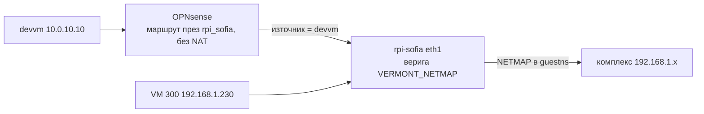

# Камери, NVR и домофон на комплекса Вермонт: инфраструктурата

Тук е само това, което репото управлява за комплекса: мрежовия път, VM 300,
архива на влизанията и наблюдението. Бележките за устройствата са в паметта на
emo (tag `vermont-emo`) и в `ebarzin/vermont-device-configs`. Репото е
публично, затова тук не се пише нищо за живущите.

## Двете мрежи са с еднакъв адресен обхват

Комплексът и домът са и двата `192.168.1.0/24`: един адрес е различно
устройство според това откъде питаш. Рутерът `.1` на комплекса е оптичният
терминал на доставчика, на дома е AX6000. До комплекса се стига през netns
**`guestns`** на rpi-sofia (`192.168.1.2` откъм комплекса, `192.168.1.10` откъм
дома). Мрежовата част на Pi-то е в `playbooks/rpi-sofia-netmap.yml`
(`camera_net_setup2.sh` с `camera-net.service`, релетата `intercom-sdk-proxy` и
`panel115-proxy`, ключът на add-on-а с tag `intercom_watch`, `vermont-netmap`);
файловете са в `playbooks/files/rpi-sofia/`, не се редактират на Pi-то.
Playbook-ът не рестартира `camera-net`: спирането му трие `guestns` и прекъсва
камерите, HA и инвертора. Рестартът е на ръка, в тих момент, с втори достъп
(`pi@192.168.1.16`): `sudo systemctl restart camera-net vermont-netmap`.

## Втори адрес на комплекса: 10.77.1.0/24

`10.77.1.x` е устройството `192.168.1.x` в комплекса, на всички портове
(NVR-ът е `10.77.1.150`). Ползват го VM 300 (iVMS-4200) и devvm. Клъстерът
стига само до `.111`–`.117` на порт 80, за „Архив на влизанията".



| Къде | Какво | Кой го управлява |
|---|---|---|
| OPNsense | gateway `rpi_sofia` = 192.168.1.10 на WAN, без мониторинг; маршрут `10.77.1.0/24` през него | `playbooks/files/opnsense/gateways.yml`, `routes.yml` |
| OPNsense | без NAT от `vermont_complex_clients` към `10.77.1.0/24`; floating block за всеки друг източник | `aliases.yml`, `nat_outbound.yml`, `filter.yml` |
| rpi-sofia, host | маршрут `10.77.1.0/24 via 10.200.1.2 dev veth-host`; `nat PREROUTING -d 10.77.1.0/24 -j ACCEPT` (първо) | `playbooks/rpi-sofia-netmap.yml` |
| rpi-sofia, host | `FORWARD -i eth1 -o veth-host -d 10.77.1.0/24 -j VERMONT_NETMAP` (първо); веригата пуска изброените източници, другите DROP | същият |
| rpi-sofia, host | обратен маршрут за devvm през 192.168.1.2 | същият |
| rpi-sofia, guestns | `nat PREROUTING -i veth-guest -d 10.77.1.0/24 -j NETMAP --to 192.168.1.0/24` (първо) | същият |
| VM 300 | `route -p add 10.77.1.0 mask 255.255.255.0 192.168.1.10` | на ръка |

- Скриптът `/usr/local/sbin/vermont-netmap.sh start|stop|status` и
  `vermont-netmap.service` (After, Requires, PartOf на `camera-net.service`) са
  от playbook-а.
- Позволените източници са на две места, които трябва да съвпадат: alias-ът
  `vermont_complex_clients` и `vermont_allowed_sources` в `rpi-sofia-netmap.yml`.
- OPNsense се променя само в YAML: `ansible-playbook -i playbooks/inventory.ini
  playbooks/opnsense.yml -e opnsense_allow_production=true --tags <област>`,
  първо с `--check --diff`. Старият `playbooks/pfsense-vermont-alias.yml` не се ползва.
- Без NAT, защото на pfSense правилото за собствения WAN адрес пращаше трафика
  към TP-Link-а, а не към Pi-то; OPNsense запази това.
- Правилата на Pi-то са **първи**: старите DNAT правила в `camera_net_setup2.sh`
  проверяват само порта и `10.77.1.115:8000` би стигнал до NVR-а.
- Копие на правилата: `/home/pi/netbackup-<дата>-ansible/` при всяко прилагане.

## VM 300: iVMS-4200

iVMS-4200 е на Windows VM 300 (`192.168.1.230`,
`C:\Program Files (x86)\iVMS-4200 Site`), с RDP за Emil. iVMS в клъстера
(ADR-0035) е спрян на 19.10.2026, защото две бази могат да пращат различни хора
към едни и същи устройства; `stacks/ivms` е изтрит при `ec0ecbdd3`.

- Super user: Vault `secret/emo/ivms-vm300-admin`.
- Backup: всеки ден в 00:00 в `C:\ivms-backup` (≡ → System → Auto Backup);
  Restore („View") чете само тази папка. Преди голяма промяна: snapshot на VM 300.
- Спиране: `taskkill /f /im WatchDog.exe`, после `taskkill` без `/f` за сървърите.

## Архив на влизанията

Панелите `.111`–`.116` и терминалът `.117` пазят събитията си в кръгов буфер:
около 2 седмици на `.116`, около 9 500 събития на панел, около 28 800 на
`.117`. По молба на Emil и с решение на Viktor (infra#176) те се копират веднъж
седмично в база и се пазят 2 години.

| | |
|---|---|
| Къде | база `vermont_access` в pg-cluster, таблица `acs_event`; стек `stacks/vermont-access` |
| Кога | CronJob `vermont-access/acs-archive`, понеделник 00:00 по София |
| Как | `files/acs_archive.py` чете `AcsEvent` по ISAPI с `admin` от `secret/emo/vermont-panels`, по 30 на страница |
| Пазене | 2 години, по-старото се трие при всяко пускане |
| Копия | като всяка база: дневен dump, огледало на sda, копие на Synology |
| Достъп | Vault `database/static-creds/pg-vermont-access` през политиката `projects-emo`; и администраторите |
| Аларми | `VermontAcsArchiveFailed`, `VermontAcsArchiveGap`, `VermontAcsArchiveStale` в Slack #alerts |

Ключът срещу дублиране е `sha256(устройство | JSON на събитието със сортирани
ключове | пореден номер сред еднаквите събития в тегленето)`: панелите не дават
`serialNo`, а по няколко събития са еднакви в една секунда. Всяко теглене
започва 3 дни преди най-новото събитие в архива; ако устройството вече не го
пази, значи е презаписало непрочетени събития и се отчита `vermont_acs_gap=1`.
Панелите пишат местно време без зона, `.117` със зона; първото се тълкува като
Europe/Sofia.

Капан: един `HTTPDigestAuth` за няколко страници праща стар nonce и панелът
връща 401, който изглежда като грешна парола и се брои за неуспешен вход.
Скриптът прави нов digest handshake за всяка заявка и спира при първия 401.

Справка от devvm (паролата се чете вътре в командата):

```sh
PGPASSWORD="$(vault read -field=password database/static-creds/pg-vermont-access)" \
  psql -h 10.0.20.200 -U vermont_access vermont_access -c "
    SET TIME ZONE 'Europe/Sofia';
    SELECT event_time, device, name, card_no, major, minor
    FROM acs_event WHERE card_no = '<номер на карта>' ORDER BY event_time DESC LIMIT 20"
```

Ръчно пускане: `kubectl -n vermont-access create job --from=cronjob/acs-archive acs-archive-manual`
(администратор). Emil го пуска от devvm с `python3 acs_archive.py run` и `PG*`,
`PANEL_PASSWORD` в средата; `load` зарежда копие от файл. Журналът на NVR-а не
е включен: иска достъп до `10.77.1.150:81`, който е затворен (infra#176).

## Наблюдение на достъпа отвън: vermont-reach

`vermont-reach` на rpi-sofia проверява на 5 минути дали видеосистемата се вижда
отвън и дали е здрава. Код: `playbooks/files/rpi-sofia/vermont_reach.py` (с
тестове), на Pi-то от `playbooks/rpi-sofia-monitors.yml`. Решения на Emil:
повреди на NVR-а да, опити за вход и движение не; известие и при оправяне.
Известията минават по MQTT `vermont-reach/notify` към автоматизацията
„Вермонт видеосистема: известия" в ha-sofia (iPhone на Emil и известията на HA).

| Проверка | Как | Сензор в HA |
|---|---|---|
| интернет на комплекса | долу, когато всеки познат път отвън е долу | `binary_sensor.rpi_sofia_vermont_internet_na_kompleksa` |
| NVR в мрежата / в Hik-Connect | `GET /ISAPI/System/Network/EZVIZ`, `registerStatus` | `binary_sensor.rpi_sofia_vermont_nvr_v_mrezhata`, `..._nvr_v_hik_connect` |
| задна врата `.117` | същото | `binary_sensor.rpi_sofia_vermont_zadna_vrata_v_mrezhata`, `..._v_hik_connect` |
| порт 8000 отвън | TCP без вход, от домашния интернет | `binary_sensor.rpi_sofia_vermont_port_8000_otvn` |
| диск | `GET /ISAPI/ContentMgmt/Storage`; `ok` и `idle` са наред | `sensor.rpi_sofia_vermont_nvr_disk` |
| камери, повреди в дневника | `InputProxy/channels/status` без канал 28; `logSearch` на `Exception` | само известия |

- Известие тръгва при две поредни лоши минавания; оправянето носи
  продължителността.
- Без интернет не се броят облакът и порт 8000; без NVR не се броят неговият
  облак, порт 8000, дискът и камерите. Една причина дава едно известие.
- От дневника отпадат `illlegealAccess`, `ezviz*` и изпаданията на камери; един
  вид повреда най-много веднъж на час.
- Прекъсване в 00:00-00:20 носи бележка за таксата: доставчикът спира в полунощ
  при неплатена такса.
- Сензорите стават `unavailable` след 20 минути; ако Pi-то падне, известие
  праща само автоматизацията за шлюза.

Товар: 4 малки ISAPI заявки към NVR-а, 1 към `.117`, една TCP връзка без запис
в дневника. Състояние: `/var/lib/vermont-reach/state.json` (изтриването само
рестартира броенето). Паролите идват от Vault при playbook-а
(`secret/emo/vermont-panels`, `secret/emo/vermont-intercom-admin`,
`secret/emo/rpi-sofia-mqtt`, `secret/emo/vermont-reach`) и са в `/etc/vermont-reach.env` и
`/etc/vermont-reach/mosquitto_pub` (600, root). Публичният адрес на
комплекса е във Vault `secret/emo/vermont-reach` (`public_host`), не в репото.

```sh
ssh pi@192.168.1.10 'sudo journalctl -u vermont-reach --since today'   # един ред на минаване
ssh pi@192.168.1.10 'sudo /usr/local/bin/vermont-reach --dry-run'       # без публикуване
ssh pi@192.168.1.10 'sudo /usr/local/bin/vermont-reach --test-notify'   # тестови известия
ssh pi@192.168.1.10 'sudo systemctl disable --now vermont-reach.timer'  # спиране
```

### Ръчна проверка: камерите се виждат през HA, но не и отвън

HA стига до NVR-а по LAN през rpi-sofia и не зависи от интернета на комплекса.

1. `10.77.1.150` порт 81 и 8000 отговарят: NVR-ът е жив.
2. `GET /ISAPI/System/Network/EZVIZ` на NVR-а и `.117`: `registerStatus false`
   с `networkUnreach` значи без интернет.
3. Публичният адрес (`vermont_public_host`) не отговаря на 8000.
4. Дневникът на NVR-а: ботовете пробват по няколко пъти на час, тишина от
   часове значи, че входящият трафик не стига; `ezvizOffline` дава часа.
5. Терминалът `192.168.1.1` зарежда страницата за вход по LAN.

Пинг от `guestns` към `8.8.8.8` минава през дома и не проверява комплекса.

## Пазачът на домофона `.134`: add-on local_intercom_watch

Local add-on `local_intercom_watch` на ha-sofia, код в `ha-addon/` на
`ebarzin/vermont-device-configs`, върти `bin/intercom-watch.py --loop 300`. Три
поредни офлайн проверки в Hik-Connect (~15 мин) дават рестарт по SDK; най-малко
1 час между рестартите, най-много 4 на ден; при недостъпен облак не рестартира.
Известие към `notify.mobile_app_emil_s_iphone`; опцията `dry_run` пропуска
самия рестарт.

- Слагане: `ha-addon/deploy.sh --live` (или `--dry-run`) от клонинга; попълва
  опциите от Vault и Vaultwarden, в хранилището тайни няма. HA backup-ът го пази.
- Дневник: Log на add-on-а или `sudo docker logs app_local_intercom_watch`;
  състояние `/data/state/watch.json`; при старт прави самопроверка без рестарт.
- Защо add-on: мониторът няма HTTP, приема ISAPI само през Hikvision SDK на
  порт 8000, а SDK-то е x86-64 glibc, което HA core (Alpine) не зарежда.
- Път: `ssh -L 18134:10.200.1.2:8134` → rpi-sofia → `intercom-sdk-proxy.service`
  (socat в `guestns`) → `192.168.1.134:8000`, вдига се само при нужда.
- Ключът (Vault `secret/emo/intercom-b4`, поле `ha_addon_ssh_key`) е ограничен
  на Pi-то до този тунел (`permitopen="10.200.1.2:8134"`) и `/usr/local/bin/b4-boottime`;
  слага ги `playbooks/rpi-sofia-netmap.yml`, tag `intercom_watch`. ha-sofia не е
  източник за `10.77.1.0/24`. SDK паролата е в същия Vault път.

## Таймерите на rpi-sofia и hikvision_next

- `entrance-panels-watch.timer` (30 мин): SADP към шестте панела без парола,
  MQTT към HA (`binary_sensor.vkhoden_panel_1XX_v_mrezhata`), конфиг
  `/etc/entrance-panels-watch.conf`, дневник `journalctl -u entrance-panels-watch`.
- `nvr-channels.timer` (10 мин): `InputProxy/channels/status` към
  `sensor.rpi_sofia_vermont_nvr_kanali` по MQTT discovery
  (`homeassistant/sensor/vermont_nvr_channels/{state,attr}`), конфиг
  `/etc/nvr-channels.env`; канал 28 е самото Pi-то и е изключен.
- И двата са сложени на ръка, не са в `rpi-sofia-monitors.yml`. Всеки има свой
  MQTT конфиг; `mqtt_pub` връща 0 при празен `MQTT_HOST`, затова преди да
  изтриеш конфиг на Pi-то, провери кой друг го чете.
- `hikvision_next` не показва паднал канал (ентитата стоят `idle`) и не създава
  ентито за канал, офлайн при зареждане: истината е `nvr_kanali`. След смяна на
  парола или върнат канал: reload. `last_reported` не е пулс; времената са в WS
  `mqtt/device/debug_info`.

## hikvision_next на ha-sofia: кръпката за Core 2026.9

От Core 2026.9 `hikvision_next` 1.1.1 не добавя камери (`RuntimeError` за
`via_device`). Кръпката е upstream PR
[#373](https://github.com/maciej-or/hikvision_next/pull/373), сложена дословно в
`hikvision_device.py` и `__init__.py`:

```sh
rsync -e ssh --rsync-path="sudo rsync" <файл> ha-sofia:/config/custom_components/hikvision_next/
```

Бекъпи: `*.bak-pre2026.9-<timestamp>`. Иска рестарт на HA, не reload. HACS я
презаписва при ъпдейт: ако камерите изчезнат, сложи я пак или провери PR #373.

## Инструментите на emo на devvm

Инструментите на emo са в `bin/` на `ebarzin/vermont-device-configs`
(`~/code/vermont-device-configs`). При ново вдигане на devvm:

1. `scripts/t3-provision-users.sh` връща SSH ключовете и `~/.ssh/config` от
   `secret/workstation/emo/files` (`docs/runbooks/devvm-credentials.md`) и
   клонира хранилището (`repos` в `scripts/workstation/roster.yaml`);
2. стъпка 4b пуска като emo `devvm-setup.sh`, който прави `~/bin/<инструмент>`
   и копира SDK-то от `vendor/hikvision-sdk/lib` в `~/hikvision-sdk/lib`.

Проверка: `~/bin/hikreboot.py` сочи към хранилището, `~/hikvision-sdk/lib/libhcnetsdk.so` съществува.

## Къде са паролите

| Устройства | Vault | Vaultwarden |
|---|---|---|
| панели `.111`-`.116`, `.117`, NVR `.150` | `secret/emo/vermont-panels` | „Вермонт вх.домофони, NVR, access" |
| камери | `secret/emo/vermont-cameras` | „Вермонт камери" |
| апартаментни монитори | `secret/emo/vermont-intercom-admin` | „Вермонт вътр. домофони" |
| `.134` (SDK, ключ на add-on-а) | `secret/emo/intercom-b4` | |
| `owners` на NVR-а и камерите | | „Вермонт owners (само гледане)" |
| iVMS, ключ за конфигурации, соларни рутери, MQTT, публичен адрес | `secret/emo/ivms-vm300-admin`, `vermont-cfg-secretkey`, `vermont-solar-routers`, `rpi-sofia-mqtt`, `vermont-reach` | |
