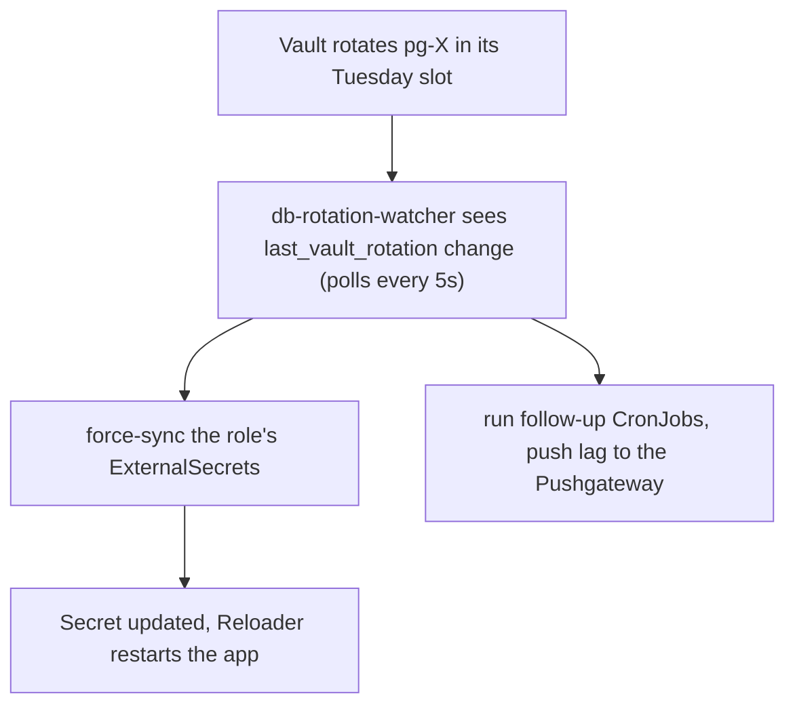

# Runbook: Vault database credential rotation

How the weekly rotation of app database passwords works since 2026-10-30, how
to add a role, how to check a Tuesday went well, and what to do when an alert
fires.

Related: [docs/agents/secrets.md](../agents/secrets.md) (ESO, Reloader, the
file-mount pattern), post-mortem
[2026-07-03-woodpecker-pg-credential-rotation.md](../post-mortems/2026-07-03-woodpecker-pg-credential-rotation.md).

## How it works

Every app database login is a Vault **static role** (`database/static-roles/*`,
32 roles: 9 MySQL, 23 Postgres). Vault changes the user's password in place.
Apps get it through an ExternalSecret on the `vault-database` store
(`remoteRef.key = static-creds/<role>`), and Reloader restarts the pod when the
Secret changes.

The gap this design closes: Postgres stops accepting the old password the
moment Vault rotates it, and External Secrets (ESO) polls every 15 minutes. On
2026-10-30 Vault rotated `pg-linkwarden` 25s after ESO's poll, and linkwarden
failed to log in until the next poll 15 minutes later. A 30-day Loki
measurement before the change found 11 of 31 roles with auth failures after
rotation, the longest being technitium at 232 minutes every week.



Four pieces:

1. **Tuesday slots.** Every role has `rotation_schedule = "<m> 10 * * TUE"` and
   `rotation_window = 3600`. Roles that one app reads share a minute, so the
   app restarts once (Grafana and its five Postgres datasources at 10:02). The
   slot table is in `stacks/vault/main.tf`, "Static role rotation slots".
   `pg-tasks` lives in `stacks/vault/app_db_roles.tf`.
2. **MySQL dual password.** The nine MySQL roles rotate with
   `ALTER USER ... RETAIN CURRENT PASSWORD`, so the previous password keeps
   working until the following rotation. MySQL apps see no window at all.
   Postgres has no equivalent.
3. **The watcher.** CronJob `vault/db-rotation-watcher`
   (`stacks/vault/db_rotation_watcher.tf`, script and tests in
   `stacks/vault/files/`), described below.
4. **Alerts**, in the table below.

The watcher reads role metadata with its own Vault role, whose policy grants
`database/static-roles/*` only, never `static-creds`. When a role's
`last_vault_rotation` changes, it:

- sets the `force-sync` annotation on every ExternalSecret whose remoteRef key
  normalises to `static-creds/<role>`, and repeats every 15s until that
  ExternalSecret is Ready with a `refreshTime` more than 1s after the rotation;
- runs each CronJob named in the ExternalSecret's
  `rotation.viktorbarzin.me/after-sync-cronjobs` annotation, as
  `kubectl create job --from` would (job name `<cronjob>-rot-<epoch>`);
- pushes `db_rotation_sync_lag_seconds{role}` and
  `db_rotation_last_seen_timestamp{role}` to the Pushgateway.

If the watcher fails, the 15-minute ESO poll still applies, the same behaviour
as before it existed.

| alert | source | fires when |
|---|---|---|
| `DbAuthFailuresAfterRotation` | Loki ruler | a Postgres user fails password auth in two 2-minute windows 5 minutes apart (failing for 3+ minutes) |
| `DbRotationSyncLagHigh` | Prometheus | a role's ExternalSecrets took more than 120s to refresh after rotation |
| `DbRotationWatcherSilent` | Prometheus | Tuesday from 11:00 UTC with no rotation reported today |
| `DbRotationWatcherFailed` | Prometheus | a watcher Job failed |

Measured on 2026-10-30 with manual rotations: the watcher saw each rotation
0.2-4.7s after it happened, the ExternalSecrets refreshed 3.8-4.8s after it,
and linkwarden was unreachable for 13s while Reloader restarted it.

What remains: a Postgres app is down for its own restart time after rotation
(11-96s measured, paperless about 100s). Apps that read the password from a
mounted file on each new connection (f1-stream, ADR-0001 apps) skip the restart.

## Adding a role

1. Create the static role in `stacks/vault` with a free Tuesday slot from the
   table (or a `pg_app_roles` entry in `app_db_roles.tf`), with
   `rotation_window = 3600`. MySQL roles also set
   `rotation_statements = local.mysql_dual_password_rotation`.
2. Point the app's ExternalSecret at `static-creds/<role>` on the
   `vault-database` store. Nothing else is needed for the watcher to find it.
3. If something has to run after the Secret changes (technitium pushes the
   password into its app config), add the annotation
   `rotation.viktorbarzin.me/after-sync-cronjobs: <cronjob>[,<cronjob>]` to the
   ExternalSecret, and in the app's stack a Role in that namespace granting the
   `vault/db-rotation-watcher` ServiceAccount `get` on that CronJob and `create`
   on jobs. `stacks/technitium/modules/technitium/main.tf` is the example.
4. Make sure the workload restarts on the Secret change (Reloader opt-in on the
   pod template), or reads the password from a mounted file per connection.

A role switched to a schedule outside its window does not rotate at apply. Do
not apply a schedule change during Tuesday 10:00-11:45 UTC.

## Checking a Tuesday

```sh
# what the watcher did
kubectl -n vault get jobs | grep db-rotation-watcher
kubectl -n vault logs job/<job> | grep -E 'rotated|synced|done|ERROR'

# per-role lag and when it was seen
homelab metrics query 'db_rotation_sync_lag_seconds'
homelab metrics query 'time() - db_rotation_last_seen_timestamp'

# the outcome: any app still failing to log in
homelab logs query 'sum by (user) (count_over_time({namespace="dbaas"} |= "password authentication failed" | json user="record.user_name" [2h]))' --since 3h
```

A healthy run logs, per role, `rotated at ...`, `force-sync ...`, `synced Ns
after rotation` and `done, lag N.Ns`, with lags in single-digit seconds.

## Testing without waiting for Tuesday

A manual rotation does not move a role's Tuesday slot. Start a watcher run
with a shorter duration, then rotate a role:

```sh
kubectl -n vault create job --from=cronjob/db-rotation-watcher db-rotation-watcher-manual-$(date +%s) \
  --dry-run=client -o json \
  | jq '.spec.template.spec.containers[0].env |= map(if .name == "RUN_SECONDS" then .value = "1200" else . end)
        | .spec.activeDeadlineSeconds = 1320' \
  | kubectl create -f -
# wait for the "watching N roles" log line, then
vault write -f database/rotate-role/pg-verify-probe
```

`pg-verify-probe` and `mysql-verify-probe` exist for this: only the verify
Jobs use them.

## When an alert fires

- **`DbAuthFailuresAfterRotation` for user X.** Find the role (`pg-<x>` with
  `_` turned into `-`) and compare `vault read database/static-roles/<role>`
  (`last_vault_rotation`) with `kubectl -n <ns> get externalsecret <es> -o
  jsonpath='{.status.refreshTime}'`. If the ExternalSecret is older, force it:
  `kubectl -n <ns> annotate externalsecret <es> force-sync=$(date +%s) --overwrite`.
  If the Secret is current but the app still fails, the pod has not restarted:
  check its Reloader opt-in, then `kubectl -n <ns> rollout restart`.
  On 2026-10-23 woodpecker-server, a StatefulSet, kept its old pod for 10
  minutes after Reloader patched it; see the post-mortem's follow-up note.
- **`DbRotationSyncLagHigh`.** The watcher log names the ExternalSecret that
  did not refresh. Usually ESO itself is unhealthy:
  `kubectl -n external-secrets get pods`, and the ExternalSecret's `Ready`
  condition message.
- **`DbRotationWatcherSilent` or `DbRotationWatcherFailed`.** Read the Job
  log. `vault login: HTTP 403` means the Kubernetes auth role or its binding
  changed; `HTTP 403` on externalsecrets means the ClusterRole did. Rotations
  that day fell back to the 15-minute poll, so check
  `DbAuthFailuresAfterRotation` history for anything that stayed broken.
