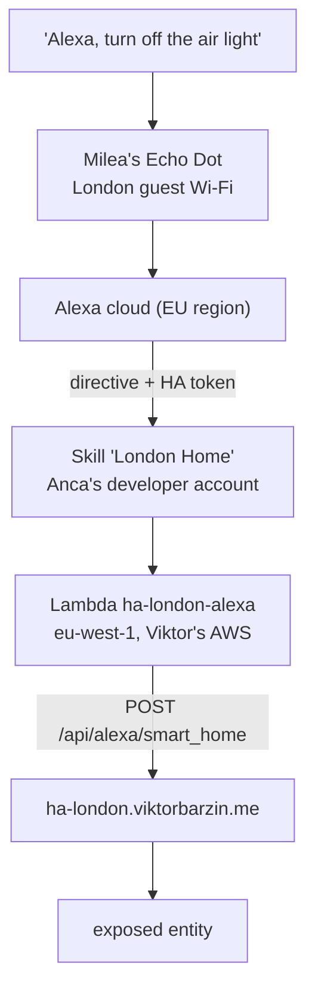

# London Alexa voice control

How ha-london devices are controlled by voice from the Echo in the London flat,
and how to add another one. Built 2026-10-31; design and decisions in
`docs/plans/2026-10-31-london-alexa.md`.

## How it fits together



| piece | where | notes |
|---|---|---|
| Echo | "Milea's Echo Dot", MAC `cc:9e:a2:24:11:e0`, London guest network | Registered to Anca's Amazon account (ancaelena98@yahoo.com, an amazon.com account with UK-English devices). Gheorghe's and Viktor's accounts do not own it |
| Alexa skill | "London Home", `scripts/london-alexa/skill/skill-id`, vendor `MCC26YN3JYHTF` | Private Smart Home skill in development stage, never published. It lives on Anca's developer account because a development skill is visible only to the account that owns it |
| Account linking | `scripts/london-alexa/skill/account-linking.json` | HA's own OAuth: client ID `https://layla.amazon.com/` (the EU value, confirmed by the token HA issued), scope `smart_home`, credentials in the request body. HA does not check the client secret |
| Lambda | `ha-london-alexa`, eu-west-1, account 924337254671 | HA's reference code from gist `matt2005/744b5ef548cc13d88d0569eea65f5e5b`, fetched on every deploy; the gist revision is in the function description. Only the skill may invoke it |
| AWS credentials | IAM user `alexa-ha-london`, policy `scripts/london-alexa/iam-policy.json` | Reaches only this function, its role and its log group, plus two read-only lookups |
| HA side | `alexa:` block at the end of `/config/configuration.yaml` on ha-london | Exposes only the entities listed in its filter |
| Alexa events | `endpoint`, `client_id`, `client_secret` in the `alexa:` block (2026-11-03) | The skill has the `alexa::async_event:write` permission, so HA reports sensor state to Alexa and a sensor can trigger a Routine. Credentials are the skill's messaging credentials (`ask.sh smapi get-skill-credentials`), in `secrets.yaml` and Vault |
| Assistant delivery | `packages/alexa_assistant.yaml` on ha-london | The contact sensor that the alexa-assistant app opens through a webhook when an answer is ready; a Routine on Anca's account then says "open my assistant". See the alexa-assistant repo's plan, section "Delivery" |
| HA login | non-admin HA user `alexa` | Alexa holds this user's refresh token. Changes made by voice show this user in the logbook |
| Cost | $0 | Lambda and CloudWatch stay inside the always-free allowance; the Alexa developer account is free |

Secrets, all in Vault `secret/viktor`:

| key | holds |
|---|---|
| `aws_alexa_access_key_id`, `aws_alexa_secret_access_key` | the `alexa-ha-london` IAM user |
| `ask_cli_refresh_token` | Login with Amazon token for Anca's developer account, used by `ask.sh` |
| `ha_london_alexa_events_client_id`, `ha_london_alexa_events_client_secret` | the skill's messaging credentials for Alexa events |
| `ha_london_alexa_assistant_webhook_id` | the Assistant delivery webhook id (`secret/alexa-assistant` `ha_webhook_url` holds the full URL) |
| `home_assistant_london_alexa_password` | the HA `alexa` user; also in Viktor's Vaultwarden as "ha-london alexa (Alexa skill login)" |

## Add another device

Most future changes are this one. The skill, Lambda and linking stay as they are.

1. Pick the entity. Alexa understands lights, switches, `input_boolean`, scripts,
   scenes, fans, covers, locks, climate and media players, among others; HA's
   Alexa docs list the full mapping.
2. Add it to the `alexa:` block on ha-london (back up first,
   `configuration.yaml.bak.YYYYMMDD`):

   ```yaml
   alexa:
     smart_home:
       filter:
         include_entities:
           - input_boolean.air_sensor_light
           - switch.new_thing            # new
       entity_config:
         switch.new_thing:
           name: "Kettle"                # what people will say
           display_categories: SWITCH    # LIGHT, SWITCH, SMARTPLUG, ...
   ```

3. Check it: `POST /api/config/core/check_config` should answer `valid`.
4. Restart HA. The `alexa:` block has no reload service, so a restart is the
   only way to apply it. Before restarting, turn off the four presence
   automations (`automation.anca_getting_home_safely`, `anca_left_home`,
   `anca_at_the_office`, `anca_left_the_office`), wait after the restart until
   `binary_sensor.anca_home`, `gheorghe_home` and `anca_at_office` are back to
   their earlier values, then turn the automations on again. Skipping this can
   send a false "Anca left/is home" notification.
5. Say "Alexa, discover devices", or use Discover in the Alexa app's Devices tab.
6. Confirm the first voice command in HA's logbook, attributed to the `alexa` user.

To remove a device, delete it from the filter, restart the same way, and delete
it in the Alexa app.

## Other changes

| change | how |
|---|---|
| Refresh the Lambda code or settings | `scripts/london-alexa/deploy.sh` (idempotent) |
| Change the skill manifest | edit `skill/skill.json`, then `scripts/london-alexa/ask.sh smapi update-skill-manifest -s $(cat scripts/london-alexa/skill/skill-id) -g development --manifest file:/work/scripts/london-alexa/skill/skill.json`, run from the infra root |
| Change account linking | edit `skill/account-linking.json`, then `ask.sh smapi update-account-linking-info -s <id> -g development --account-linking-request file:/work/scripts/london-alexa/skill/account-linking.json` |
| Re-link | Alexa app on Anca's phone: More → Skills & Games → Your Skills → Dev → London Home. Log in as `alexa` |
| Revoke Alexa's access | delete the `alexa` user's refresh token in HA (or the user itself), or disable the skill in the Alexa app |
| A second skill (a different type, or for another Echo owner) | the same pattern: a Lambda next to this one (copy `deploy.sh` with a new function name and add it to the IAM policy), a manifest under `skill/`, and the owner's ASK login |

## Gotchas found while building it

- **The Lambda permission principal is `alexa-connectedhome.amazon.com`.** The
  `amazonaws.com` spelling is rejected by Lambda with "The provided principal was
  invalid".
- **Skill ID and Lambda permission depend on each other.** Alexa refuses a Smart
  Home manifest until the Lambda trusts the skill, and the skill ID does not exist
  until the skill is created. A failed first create also leaves the skill without
  a development manifest, so updates return 404. What worked: delete the failed
  skill, add a temporary permission without `--event-source-token`, create the
  skill, run `deploy.sh` to add the skill-scoped permission, then remove the
  temporary one (`alexa-bootstrap`).
- **A development Smart Home skill cannot be enabled through SMAPI** ("You can
  only enable custom or music skills"). Enabling and linking happen together in
  the Alexa app, where dev skills sit under Your Skills → Dev.
- **The Alexa web app is retired** (alexa.amazon.com shows a download page), but
  its JSON API still answers in a logged-in browser. `/api/devices-v2/device` and
  `/api/device-wifi-details` gave each Echo's MAC, which is how the London Echo
  was matched to the Flint's DHCP lease. That API reports UK Echos as offline
  even while they answer.
- **The ASK CLI insists on a named profile** even when credentials come from the
  environment. `ask.sh` writes a throwaway profile inside the container.
- **`--debug` on the ASK CLI prints the refresh token.** Don't use it in a shared
  or recorded session.
- **Changing the `alexa` user's password does not break the link**, because Alexa
  holds a refresh token, not the password.
- **The IAM console's policy description field rejects spaces and slashes.**

## Verify it works

- HA logbook for the entity shows the change with the `alexa` user's ID
  (`06e90013b15a4742a0583ba5aeedbea6`).
- Lambda invocations: `aws logs filter-log-events --log-group-name
  /aws/lambda/ha-london-alexa --filter-pattern '"Processing Alexa request"'`
  with the IAM user's key, region eu-west-1.
- A direct test without the Echo: log in as `alexa` through HA's login flow with
  client ID `https://layla.amazon.com/`, then invoke the Lambda with an
  `Alexa.Discovery` or `Alexa.PowerController` directive carrying that token.
  Revoke the test refresh token afterwards (`POST /auth/revoke`).
