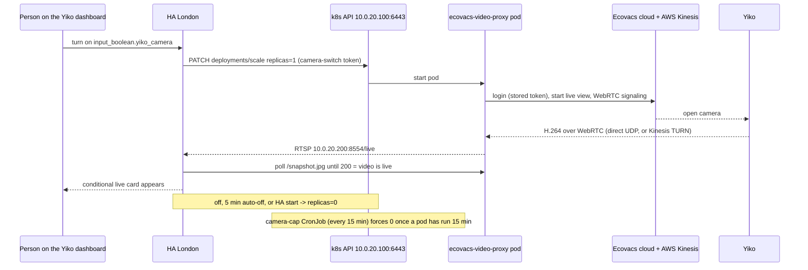

# London robot vacuum "Yiko": camera and Ecovacs access

Yiko is the Ecovacs DEEBOT X8 PRO OMNI in the London flat (class `n0vyif`, on
the London LAN at 192.168.8.175). Home Assistant London controls it through the
core `ecovacs` integration. Its camera is shown on demand through a bridge in
the cluster (`stacks/ecovacs-video-proxy`).

## How the camera works



- The bridge is the unmodified third-party image
  `ghcr.io/c4talyst/ecovacs-deebot-video-proxy`, pinned by digest to release
  1.1.1 (commit `1b08ccb`). Before adoption, every file in the image was compared
  with the audited source, and the bundled MediaMTX binary with the official
  v1.21.2 release. Both matched.
- `ACTIVE_ONLY_VIDEO=false`: the bridge streams for as long as the pod runs. The
  Deployment sits at 0 replicas, so the robot's camera and headlights are off
  unless someone has turned the camera on.
- HA London holds a ServiceAccount token (`camera-switch`) whose Role allows only
  `get`/`patch` on this one Deployment and its scale subresource.

## Pieces and where they live

| Piece | Where |
|---|---|
| Bridge Deployment, LB Service (10.0.20.200:8554 RTSP, :8080 HTTP), RBAC, camera-cap CronJob | `stacks/ecovacs-video-proxy/main.tf` |
| Bridge secrets (env vars, one key per variable) | Vault `secret/ecovacs-video-proxy` |
| Alerts `YikoCameraLeftOn`, `YikoCameraStartFailed` | `stacks/monitoring/modules/monitoring/prometheus_chart_values.tpl`, group "Yiko camera" |
| HA side, YAML (needs an HA restart to change) | `/config/configuration.yaml`: `rest_command.yiko_camera_scale` (PATCH replicas), `command_line` `binary_sensor.yiko_camera_ready` (curl /snapshot.jpg every 5 s, on when 200). Secrets in `/config/secrets.yaml`: `k8s_yiko_camera_bearer`, `yiko_rtsp_password`, `yiko_camera_ready_cmd` |
| HA side, UI-managed | `input_boolean.yiko_camera`; automation `automation.yiko_camera` (id `yiko_camera`: on → replicas 1; off, 5 min on, or HA start → replicas 0); generic camera `camera.yiko` "Yiko camera" (stream `rtsp://10.0.20.200:8554/live` over TCP, still image `/snapshot.jpg`, user `yiko`); Camera card + conditional live `picture-entity` in the first section of the `vacuum-yiko` dashboard |

## Common tasks

### Turn the camera off by hand

```sh
kubectl -n ecovacs-video-proxy scale deploy ecovacs-video-proxy --replicas=0
```

This is a transient step; the Terraform state ignores the replica count, so
nothing reverts it.

### HA London: Ecovacs integration says "Device verification required"

Ecovacs sometimes asks a known client to verify again by email (it happened to
HA on 2026-10-31). HA opens a reauth flow; complete it:

1. WebSocket `config_entries/flow/progress` lists the `ecovacs` reauth flow.
2. `POST /api/config/config_entries/flow/<flow_id>` with `{"password": ...}`
   (Vaultwarden item `ecovacs.com`). Ecovacs emails a 6-digit code to the
   account address.
3. `POST` the same URL with `{"verification_code": "<code>"}`. The answer is
   `reauth_successful`.

### Bridge logs "Device verification required"

The bridge has its own Ecovacs client ID (`ECOVACS_DEVICE_ID` in Vault). If
Ecovacs re-challenges it, verify it again with the bridge's own auth code
(`src/ecovacs_auth.py` from the pinned image): `authenticate()` raises the
error, `request_email_verification_code()` sends the email,
`verify_device_code(code)` then `authenticate()` completes it. Write the new
`ECOVACS_ACCESS_TOKEN` and `ECOVACS_USER_ID` back to Vault; ESO refreshes the
Secret within the hour (or force it with an annotation on the ExternalSecret).

### Updating the bridge image

The digest pin is deliberate. To move to a newer release:

1. Review the upstream diff since `1b08ccb` (look for new network destinations,
   credential handling, and changes to `web_ui.py` auth).
2. Pull the new image by digest and compare `/app` with the reviewed commit and
   `/usr/local/bin/mediamtx` with the official MediaMTX release.
3. Change `local.image` in `stacks/ecovacs-video-proxy/main.tf`.

### Revoking HA's access

Delete the `camera-switch-token` Secret in the `ecovacs-video-proxy` namespace
and re-apply the stack to mint a new one, then update `k8s_yiko_camera_token`
in HA London's `secrets.yaml`.

## Measured behaviour (2026-11-01)

| Step | Time |
|---|---|
| Image pull, first start on a node (400 MB) | 61 s |
| Container start to Ecovacs login | 2-9 s |
| Login to first frame, robot free | 3 s |
| Tap on the card to "Live", image cached and robot free | 19 s |

- **Robot cooldown.** For roughly 3-5 minutes after a video session ends, the
  robot refuses a new one: Ecovacs answers `start_watch` with
  `20303 send cmd to mqserver error`. The bridge retries with a growing delay
  (up to 30 s), so the card stays on "Starting…" until the robot accepts. Ending
  the session cleanly first (`POST /api/robot/sleep`) made no difference. The
  robot answers ordinary commands normally during this time.
- **Image cache.** Nodes delete images unused for 7 days, so the first start
  after a quiet week, or on a different node, pulls the image again (about a
  minute).
- The direct WebRTC path works across the tunnel. The bridge logs a harmless
  `STUN transaction failed (403 - Forbidden IP)` from the Kinesis TURN
  fallback, which it does not need.
- HA plays the stream over WebRTC (`ha-web-rtc-player`, 1280x720) in a browser
  outside the London LAN.

## Known limits

- Start-up takes the pod start, an Ecovacs login and the WebRTC handshake. The
  live card appears only once `/snapshot.jpg` answers 200.
- HA's `rest_command` calls the k8s API with `verify_ssl: false`, over the
  site-to-site WireGuard tunnel, because the API server certificate is signed by
  the cluster CA, which HA London does not trust.
- Known weak points of the unmodified bridge, accepted because it is reachable
  only from the LAN and tunnel, with credentials, for minutes at a time: it runs
  as root, its web UI session key derives from the RTSP credentials, it accepts
  credentials in query strings, and it logs the one-time verification code.
- A camera re-opened within a few minutes of closing waits out the robot
  cooldown described above.
